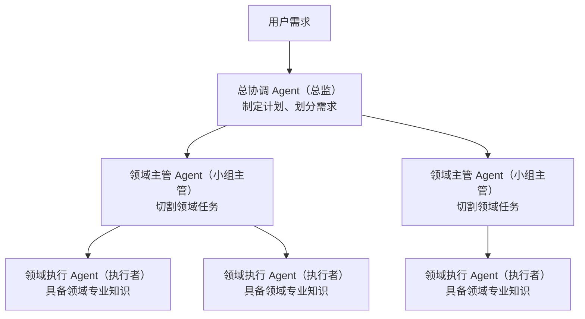

## 【学习目标】

- 理解多 Agent 三层架构（总协调 → 领域主管 → 领域执行者）的分工逻辑及其组织学类比。
- 说清 SubAgent（子代理）被提出的原因：把专业场景从主 Agent 身上拆下来。
- 掌握子代理「独立上下文 + 独立容器」带来的两项工程收益：主上下文不被污染、多子代理可并行。
- 能够区分领域 Agent、SubAgent 与后续登场的 Agent Skills 三者边界。

## 【正文】

### 一、多 Agent 的三层架构

Agent 之所以能成为真正的 Agent，能够高效率地执行复杂需求并且无需用户介入，第一点就在于它是多个 Agent 的协同。多 Agent 协同采用三层架构：

- **第一层：总协调的 Agent**，相当于总监级别。它只负责计划的制定以及需求的划分，然后把某个领域的任务交给具备该领域知识的 Agent 主管，由主管负责该领域。
- **第二层：领域主管 Agent**，同样会把该领域的任务做进一步切割。
- **第三层：领域执行 Agent**，真正执行领域内每个单个任务的执行者，这些单个 Agent 同样具备该领域相关的专业知识。

这套三层架构基本是照着 IT 部门的组织方式设计的。IT 部门里有总监，总监下面有很多小组织：前端小组、后端小组、移动端小组、测试小组。每个小组里的人员都具备本领域的专业知识，前端小组里的人懂前端，后端小组里的人懂后端，不可能在后端组里混进前端人员。每个组都有一个主管，主管负责分配任务并把任务细化，而真正执行这些任务的不是主管，是底下那些同样具备专业知识的成员，就好比实习生、初级程序员、中级程序员才是真正的任务执行者。

该类比不是修辞，而是有明确的功能对应：总监对应「规划」，主管对应「分解」，执行者对应「落地」。任何一层越界都会出问题，总监去写代码，规划就没人做了；执行者去改计划，分解就失去意义。三层各自的职责边界清晰，是多 Agent 协同可控的前提。

三层架构的可行性建立在两个前提上。其一，领域知识可以按边界切分，前端的知识不会溢到后端，旅游场景里路线制定的知识不会溢到费用统筹，切分后每层的知识集合仍然自洽。其二，任务可以按领域路由，总监拿到需求后能判断「这块归路线、那块归行程」，路由依据就是领域边界。课程 5-1 篇把旅行规划拆成路线制定、行程规划、费用统筹三个子任务，正是先划领域边界再做任务路由的实例；5-2 至 5-4 篇逐一落实三个领域执行 Agent，三层架构从类比变成了工程清单。

### 二、每个 Agent 的思维过程都是 ReAct

每个 Agent 在执行任务时的思维过程都是 ReAct：先思考，再执行，执行之后再思考一下结果是否正确，跟预估的目标是否有出入，如果有出入就马上动态调整步骤。这条「推理-行动-验证」环路在 1-7 篇已有完整展开，三层架构中的每一层 Agent 都运行在这条思维链上，区别只是思考的粒度不同：总监思考「需求怎么分」，主管思考「任务怎么切」，执行者思考「这一步怎么走」。

而执行单个任务的 Agent 由于具备领域知识，它知道该用哪些工具、如何组合这些工具、整个流程步骤是什么，因此在执行过程中无需再去询问大语言模型「我应该使用哪些工具」，能够自主地调用这些工具或者说自定义的函数，也就是 Function Calling。

这里的「无需再问」是一个容易被低估的设计。领域知识前置到 Agent 身上之后，工具选择从「每次现问大模型」变成「按领域知识直接定位」，既省了交互轮次，也让执行路径稳定可复现。课程 5-2 至 5-4 篇的路线制定专员、行程规划经理、费用统筹管家，正是按这一原则划分的领域执行者。

三层各自运行 ReAct，但思考粒度不同，这一差异决定了架构的稳定性：总监思考「需求怎么分」，一次 Think 的产出是一组子任务；主管思考「任务怎么切」，一次 Think 的产出是一组执行指令；执行者思考「这一步怎么走」，一次 Think 的产出是一次工具调用。粒度自上而下收窄，任何一层的思考范围都不会溢出本层职责，这是三层架构不会互相踩踏的根本原因。反过来说，如果让总监去思考「这一步怎么走」，规划质量会因为陷入细节而崩塌；让执行者去思考「需求怎么分」，工具调用会由于目标模糊而漂移。粒度分层与职责分层必须严格对齐。

### 三、SubAgent 的提出：把专业场景拆出来

在这套架构里还有一个前面课程提到过的角色：SubAgent，也叫做子代理。之所以说 Cloud Code 具有很好的借鉴和学习作用，是因为它对 Agent 的发展具有前瞻性和引领作用，比如之前所说的 MCP，就带动了很多企业接受并引入 MCP 该标准。Cloud Code 现在又推出了几个很有前瞻性的概念，第一个是 Skills，也就是前面课程讲过的具备专业领域知识的概念；另一个是最近才提出的很新的概念 SubAgent，即子代理。

什么是子代理？既然已经有专业的 Agent 去执行任务了，为什么还要引入子代理？**因为该专业的 Agent 在执行任务过程中会遇到很多个专业场景。** 以数据库为例，查询数据库是否是一个专业场景，需要专门去写 SQL 语句；对于一些 CRUD 的场景，同样是一个独立专业场景。把这些场景分别交给一个专门的 Agent 去负责，让当前执行任务的 Agent 去负责另外一些主要的工作，效率自然更高。

这跟 IT 部门的思路是一样的：部门里会把一些简单的、或者一些 CRUD 的工作，专门交给实习生去负责。所以**子代理是专门负责单个专业场景的**。在 Cloud Code 的实践中，专门处理 SQL 语句的、专门做数据分析的、专门处理 CRUD 的、专门写登录接口的，都可以拆成很多个专业场景，分配给专门处理该场景的 Agent 去处理，而真正执行任务的主 Agent 则去负责更重要的事情。

从主 Agent 的视角看，拆分前后负担的变化是质变的：没有子代理时，主 Agent 的上下文里同时装着全局计划、SQL 试错记录、数据清洗中间产物、登录接口的字段清单，两类工作频繁切换，注意力被反复重置；拆出子代理之后，主线只保留规划类信息与子代理交回的最终结果，主 Agent 的每一轮推理都处在「同一件重要的事」上。所谓效率提升，不只来自并行，更来自主线专注。

### 四、独立上下文：子代理的两项工程收益

子代理最核心的机制在于：**它在独立的上下文中执行任务，并且运行在独立的容器中**。由此带来两项收益：

1. **不污染主上下文**。主 Agent 的上下文窗口是稀缺资源，里面装着全局计划、历史对话、关键中间结果。如果把写 SQL、跑 CRUD 这类过程中的大量试错信息全部灌进主上下文，真正重要的主线信息反而被稀释。子代理在自己的上下文里试错，只把最终结果交回主线，主上下文的信噪比得到保护。
2. **可并行 + 故障隔离**。多个子代理各自拥有独立上下文，因此可以并行地处理任务，这也是我们使用 Cloud Code 时觉得它效率很高的主要原因。同时由于是在独立的容器中执行，哪怕它出错了，也不会影响主线任务，故障被控制在子代理自己的边界内。

对照 Spring AI 的技术栈来看，这正对应多 Agent 系统中「每个子任务一个独立会话记忆」的实践：主线会话与子任务会话分离，`MessageChatMemoryAdvisor` 管理的记忆范围随之收窄，长任务的上下文膨胀问题才有人治。课程 981-demo 工程中，`981-demo/src/main/java/com/travel/agent/agent/TeamMembers.java` 定义的路线制定专员、行程规划经理、费用统筹管家等团队成员，就是「领域执行者」这一层的具体落地；后续 11-7 篇主管 Agent 自主分发任务给远程相应的成员，则演示了任务分发后的并行执行。

课程 12-5 篇「景点推荐SubAgent执行景点推荐任务」则是子代理形态的一次完整演示：景点推荐作为行程规划中的一个专业场景被拆出，由专门的 SubAgent 在独立上下文中执行，执行结果汇入主线。把该篇与本节对照阅读，能看到「独立上下文 + 执行完释放」从概念到落地的完整形态。

并行也要讲清工程边界：独立上下文解决的是「推理状态隔离」，不解决「外部资源争用」。多个子代理同时查询同一个数据库，连接池仍有上限；同时调用同一个付费 API，配额仍然共享。设计并行度时，除了看上下文是否隔离，还要看下游资源的承载能力，后者往往才是真正的瓶颈。

### 五、SubAgent 与相邻概念的边界

| 概念 | 定位 | 生命周期 | 上下文 |
|------|------|----------|--------|
| 领域 Agent（第三层执行者） | 执行某领域内的单个任务 | 随任务存在 | 自身会话 |
| SubAgent（子代理） | 执行单个专业场景（SQL / CRUD / 数据清洗） | **执行完即释放** | 独立上下文 + 独立容器 |
| Agent Skills | 可移植的专业技能包 | **可复用、可移植** | 渐进式加载（见 10-4） |

三者不是替代关系而是分层关系：领域 Agent 是骨架，SubAgent 是应对专业场景的弹性编制，Skills 是沉淀下来的可复用资产。下一篇 10-2 展开 Skills，本节先把 SubAgent 的「临时编制」属性立住，它是流程的工具，不是沉淀的资产。

还有一个时序问题值得说明：SubAgent 是 Cloud Code 在 Skills 之后提出的更新的概念，它要解决的正是「专业 Agent 仍然太重」的问题，领域 Agent 懂一个领域，但一个领域内部还会裂变出多个专业场景，子代理把这最后一层也拆了出来。多 Agent 体系的粒度演进到这里，已经细到「单个专业场景」一级：从部门（领域）到小组（场景）再到一次排班（子代理执行），每一层拆分都在换取更干净的上下文与更高的并行度。

## 【易错点 / 面试题】

1. **面试题：SubAgent 为什么要独立上下文，直接在主 Agent 里调用不行吗？**
   不行，原因有三层。第一，上下文预算：主上下文是稀缺资源，专业场景执行过程中的试错信息量大且与主线无关，混入会稀释关键信息；第二，并行度：独立上下文是多子代理并行的前提，共享上下文则必须串行化以避免写冲突；第三，故障隔离：独立容器保证子代理出错不波及主线任务。答题时把「上下文卫生」作为第一个论点抛出，最容易与面试官形成共识。

2. **易错点：把 SubAgent 当成「小号的普通 Agent」。**
   SubAgent 的定位是单个专业场景的执行者，执行完即释放；它不等同于常驻的领域 Agent，也不等于可移植复用的 Skills。三者在生命周期上的差异是面试高频分辨点。

3. **易错点：认为「并行执行」只是提速手段。**
   并行的前提是上下文隔离，隔离的副产品才是并行。只想要并行却不做上下文切分，多 Agent 之间会互相踩踏会话状态，这类问题在工程上往往表现为「偶发的答案串台」，极难排查。

## 【小结】

本节把多 Agent 三层架构落到最细的一层：领域执行者，并引出 Cloud Code 的前瞻概念 SubAgent，专门负责单个专业场景、独立上下文、执行完即释放。它是主线任务的「牛马小弟」，也是效率与上下文卫生的关键机制。下一篇 10-2 讲 Agent Skills：与 SubAgent 的临时编制不同，Skills 是可移植、可复用的专业技能包。
