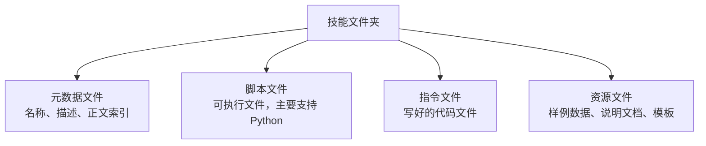

## 【学习目标】

- 掌握元数据索引文件的三段结构：name + description、正文（目标 / 步骤 / 输出格式）、指令结构。
- 掌握 name 与 description 的约束条件：唯一标识、场景匹配、字符上限，以及低效描述与高效描述的判断标准。
- 掌握技能文件夹的文件构成：元数据、脚本文件、指令文件、资源文件。
- 理解 Agent Skills 的可移植性：同一文件夹装载到不同智能体即获得相同能力。
- 能够写出符合 Cloud Code 约束的 name 与 description 字段。

## 【正文】

### 一、元数据先行：文件夹的索引文件

Agent Skills 是一个技能的体系，包括了工作流程、专业领域的知识以及工具调用的一些逻辑，这些知识都是以文件的形式去赋予智能体该专业领域的整个技能系统。整个技能系统就是一个文件夹，所有技能都以文件的形式放到该文件夹里面。

既然它是整个专业领域的一套系统知识，该文件夹是否会很大？所以 Agent Skills 不会一次性把文件夹里面的所有数据都加载进去，它是先加载一个元数据，**该元数据就相当于该文件夹里面的一个索引**，通过该元数据就可以快速地找到文件夹里面所对应的一些具体的文件。先把该元数据加载到智能体里面，智能体拿到该索引，就知道自己应该做什么以及如何去做。这套渐进式加载的整体机制已在 10-4 篇展开，本节落到文件层，讲清楚该索引文件本身长什么样。

前面讲过，该元数据包括了名称、描述以及正文。其实该元数据同样也是一个文件，是一个 markdown 文件，叫做 `skill.markdown`。该文件包含三个部分：第一是该专业的名称，第二是该专业领域技能的描述，第三是正文。

关于文件名需要说明一点：课程原稿中该元数据文件同时出现了两种写法，多处写作 `skill.markdown`，而在引用 Cloud Code 官方文档样例时写作 `SKILL.md`（见下文第六节）。两种写法在原稿中并存，本节正文沿用原稿的 `skill.markdown` 指代课程自己写的元数据文件，用 `SKILL.md` 指代 Cloud Code 官方样例文件，以便与原稿保持一致。

### 二、name 与 description：两个必须字段

**技能的名称很重要，它是该技能的唯一标识**，比如做 PPT 的技能是一个唯一标识，做 Excel 的技能也是一个唯一标识，就是根据技能名称作为标识来区分的。

**技能描述同样很重要，它告诉智能体什么场景会使用到该技能。只要提示词里面跟该技能描述相匹配，智能体就会调用该技能。** 写描述时细节应该丰富一点，像只有一句话的描述就属于很低效的描述，智能体并不知道在什么场景下会调用该技能；而高效的描述能让智能体知道什么场景调用该技能，以及调用该技能具体要做一些什么事情、做什么工作。

Cloud Code 文档用一组对照样例说明了该差距：

```markdown
低效描述示例："该 Skill 可处理 PDF 和文档相关事务。"
高效描述示例："全面的 PDF 处理工具，支持文本/表格提取、创建新 PDF、合并/拆分文档及表单填写。当 Claude Code 需要批量处理或分析 PDF 文档时触发，适用于文档工作流及批量操作场景。不支持简单查看或基础格式转换。"
```

对照两条描述，高效描述的构成要素可以拆出来：**功能范围**（文本/表格提取、创建、合并/拆分、表单填写）、**触发条件**（需要批量处理或分析 PDF 文档时）、**适用场景**（文档工作流及批量操作）、**边界声明**（不支持简单查看或基础格式转换）。四要素齐备，智能体在路由时才能既不错触发、也不滥触发。这解释了为什么 name 与 description 是元数据中唯一被 Cloud Code 列为「必须」的两个字段，它们是技能被发现与被选中的入口，后续一切加载都从这次匹配开始。

### 三、正文：目标、步骤、输出格式

第三部分就是正文，正文包括了目标、步骤、输出格式。前面讲过，该技能系统是包含工作流程的模板的，而该工作流程是一个固定的流程，因此可以把技能里面所包含的工作流程看作是一个固定的模板。该模板包括：我需要完成什么任务，也就是这里的目标；最后以什么形式输出，该就是输出格式，要定义该输出格式、定义该目标；还有就是我要完成该任务需要经过哪几个步骤，这些步骤都是固定式的，就写在这里的正文里面。智能体会根据正文所描述的去执行该固定的流程，所以 `skill.markdown` 该元数据文件的正文部分，是告诉智能体如何去做。

以课程自己写的路线规划技能为例，元数据的正文部分把「用百度地图查询路线」该闭环的步骤固定了下来：首先理解用户的中文问题，然后执行封装了百度 API 调用的 Python 文件，最后把反馈组装成 JSON 格式返回。

```markdown
# 路线制定 Skill
本 Skill 专用于百度地图 API 调用
你必须完成一个完整闭环：
1. **理解用户中文问题**
2. **调用 execute_api.py 执行百度API**
3. **返回Json格式**
```

这段正文的写法值得细看：三步闭环，每步一个可判定的动作，理解问题（输入处理）、执行 `execute_api.py`（工具调用）、返回 JSON（输出格式）。「固定流程」的落地方式就是把流程写成编号步骤，且每步都有明确的完成判据，智能体才可能按模板执行而不跑偏。它与 10-3 篇讲的「目标-步骤-输出」三要素一一对应：闭环本身是目标，三个编号项是步骤，返回 JSON 是输出格式。

### 四、技能文件夹的四类文件

接下来看一下 Agent Skills 文件夹里面的内容。因为 Agent Skills 不只是包含工具的使用，还包含很多东西，可以说它的范围很广，除了专业知识之外，还有工作流程的这些模板。文件夹里面可以包含资源文件、脚本文件、指令文件。

**脚本文件**就是一些可执行的文件，现在主要的是 Python 的可执行文件，以后可能会包含一些 Script 的可执行文件、C++ 的可执行文件、Java 的可执行文件或者 jar 包也可以作为脚本，但是现在来说它只支持 Python 的可执行文件。上文路线制定 Skill 中调用的 `execute_api.py` 就属于脚本文件，百度 API 的调用逻辑封装在里面，智能体按步骤执行它即可。

**指令是一些代码文件**，也就是你可以写好的一些代码文件，智能体会直接去调用你该代码文件。

**资源文件**可以是 markdown 文件，也可以是 txt 的文本节件，比如一些样例的数据、一些说明文档、还有模板，这些都可以作为资源文件。如果你想让 Agent Skills 调用外部的文件，同样的也是把外部文件的一些链接写到一个 markdown 文件里面，然后放到该资源里面就可以了。

加上最外层的元数据文件，技能文件夹的文件构成可以归纳为：

| 文件类型 | 内容 | 加载时机 |
|----------|------|----------|
| 元数据文件 | 名称、描述、正文（索引） | 技能赋予时（第一次加载） |
| 脚本文件 | 可执行文件，当前主要支持 Python | 执行到对应步骤时（第三次加载） |
| 指令文件 | 写好的代码文件，智能体直接调用 | 执行到对应步骤时 |
| 资源文件 | markdown / txt：样例数据、说明文档、模板、外部链接 | 执行到对应步骤时 |

这张表同时解释了 10-4 篇的三次加载为什么成立：文件夹里只有元数据是「进门就加载」的，其余三类全部挂在「执行到那一步」上，上下文压力因此被摊薄到任务全程。



### 五、可移植性：文件夹即交付物

正是由于 Agent Skills 采用了这样一种文件的形式，使得它在确定之后就可以进行移植：想让 A 智能体拥有该 Agent Skills、拥有该专业领域的技能系统，就把该文件夹装载到 A 智能体上面去；想让 B 智能体也像 A 智能体这样拥有同样的专业领域技能系统，只需要把同一个文件夹加载到 B 智能体，B 智能体就同样拥有 A 智能体相同的该专业领域的技能系统。这就是 Agent Skills 的可移植性。

可移植性的工程含义比听上去更深：技能包与智能体彻底解耦，同一份「旅游路线制定」技能，今天挂在路线制定专员身上，明天可以原样挂到另一个智能体上，不需要改一行代码。这也是 10-2 篇 Skills 与 SubAgent 分界的根源：SubAgent 执行完即释放，是流程的工具；Skills 是随拷随用的资产。

### 六、Cloud Code 的 SKILL.md 样例与指令结构

具体来看一下 Cloud Code 给出的该 skills markdown 文件，也就是元数据索引文件的样例。打开 Cloud Code 的文档拉到下面，可以看到它给出了该 `SKILL.md` 的样例。首先必须要求的就是该 skills 的 name 以及该技能的 name 以及 description，这两个是必须的，而且很重要：刚才已经说过，name 是该技能的一个唯一 ID，而 description 是描述，是让智能体知道在什么场景下会调用该技能。文档里还给出了约束：**名称必须是小写字母，长度是 64 个字符；描述最多 1024 个字符。**

这两条约束的工程意图很明显：小写字母 + 64 字符上限保证 name 可以做稳定的程序化标识（路由、检索、去重都依赖这一点）；1024 字符的描述上限则倒逼作者写「高信息密度」的描述，空间有限，废话进不来。

再看一下我们自己写的该 `skills.markdown` 文件。首先这里的 name 就是路线规划该技能，然后描述是这么一个描述，描述的细节应该丰富一点。除了这两个非常重要的字段之外，下面就是该 skills 的正文。正文分为两部分：一个是你自己自定义的该技能的名称，然后就是指令、指令的结果。

技能的名称叫做旅游路线制定的技能，然后这里给出了执行该技能时一个完整的工作流程是怎么样的：首先你要理解我的问题，我该问题是中文的；然后去执行该百度 API，也就是去查询该百度的 API，该百度 API 的调用是写在一个 Python 文件里的，你就去执行该 Python 文件；反馈的是以 JSON 格式，也就是要把百度地图的反馈组成一个 JSON 格式来反馈给我。这就是用百度地图去查询路线的步骤，该步骤给它固定下来了，智能体去执行该技能就要按照该步骤去执行（对应正文第三节的路线制定 Skill 样例）。

第三个部分就是指令的结构。什么叫指令？就是调用该 Python 文件去执行该百度 API 的查询，该就是指令。因为在该步骤里面主要就是调用该 Python 文件去执行百度的 API 查询，就需要约束它一些东西，以及给它一个 JSON 格式、JSON 的模板，反馈的 JSON 格式是怎么样的，要给它一个模板；还要约定如果出错了会怎么样，还有参数入参的一些规范。该就是所谓的指令结构。这里给出了六个指令结构：

```markdown
# 核心指令结构
一、百度地图API文档（必须理解）
二、入参规范（需约束）
三、优先选路「最短行驶距离」
四、execute_sql.py 使用协议（强制）
五、推荐 JOIN 模板（参考）
六、Examples
```

六项各自的用途：第一，你要懂得该百度地图 API 的文档，工具怎么用，先读文档；第二，入参的规范，你是以数字型的参数来去进行入参，还是以 String 类型的参数进行入参，这些都要对它进行规范；第三，它要按照什么查询该路线，是按照通行的时间最短，还是说如果是驾车就按行驶时间最短，还是说搭乘交通花费最少，这都要给它做一个约束，按照入参、按照优先最短的时间或距离、以哪一种方式的最短距离作为优先的选择，都要说给智能体，它才能够知道如何去执行该 Python 脚本去调用 API 查询；然后它返回来的 JSON，也要按照我们所提供的 JSON 结构的模板去组装该 JSON。

需要如实说明的一处原稿痕迹：这份「核心指令结构」样例中的第四、第五项（`execute_sql.py` 使用协议、推荐 JOIN 模板）明显是从 SQL 场景的指令模板复制过来的残留，路线制定场景实际执行的脚本是第三节路线制定 Skill 中的 `execute_api.py`，与 SQL 并无关系。此处按代码守恒原则原样保留该样例内容，仅在此说明其来源痕迹，读者自写技能包时应把这两项替换为自己场景的真实指令。

这里还给出了一个推荐的指令结构，你要描述执行该指令是什么样的、前置的条件是怎么样的、执行的步骤、出现的错误是怎么样的，还要给出一个样例，以及什么场景下去执行该指令：

```markdown
推荐结构：
概述：简要介绍 Skill 的核心功能。
前置条件：使用 Skill 前需要满足的条件。
执行步骤：详细说明每个步骤的输入输出。
示例：提供具体使用场景和操作示例。
错误处理：列出常见错误及解决方法。
局限说明：明确 Skill 无法实现的功能。
```

推荐结构的六项与「指令」的定义严格对应：前置条件约束入口（什么情况下才走该指令），执行步骤规定输入输出（智能体按步执行），示例给智能体一个可模仿的样本，错误处理约定出错时的行为（返回什么、怎么重试），局限说明划出能力边界（什么别找我）。把上文的六项核心指令结构与这六项推荐结构对照着看，就能看出一条指令的完整生命周期：入口条件 → 执行 → 示范 → 异常 → 边界。

### 七、在元数据里引用其他文件

此外，在 `skill.markdown` 该文件里还能够去引用其他的文件，这些其他的文件就是放在该技能的文件夹里面的。文档里同样给出了样例：要引用 `reference.md` 该 markdown 文件，就通过下面这种方式去引用；如果要执行一个脚本，而该脚本是放在技能文件夹里面的，就在 markdown 里这样去执行该脚本文件。该 `sql.md` 元数据索引的文件内容，是在智能体生成的时候，就将该元数据的文件（也就是 `sql.md` 该文件）加载到智能体里面：

```markdown
For advanced usage, see [reference.md](reference.md).
Run the helper script:
```bash
bash scripts/helper.py input.txt
```
python scripts/helper.py input.txt
```

需要如实说明的一处原稿问题：上面这段样例在课程原稿中的代码围栏存在错位，块内嵌套进了一个 bash 语言的代码围栏，导致这一段的反引号围栏无法正常配对解析。按代码守恒原则，此处按原稿原样保留该样例内容，不修改其内部结构；读者实际使用时，应把「引用 reference.md」与「执行脚本」拆成两个各自独立、围栏配对的代码块来写。这段样例同时示范了元数据文件的两类引用方式：用 Markdown 链接语法引用同文件夹内的 `reference.md`（资源文件），用执行语句调用文件夹内的脚本文件（脚本文件），这正是 10-4 篇第三次加载「附加资源」在文件层的落地形式。

### 八、元数据文件结构总览

总体来说，该元数据的索引也就是 `skill.markdown` 该文件结构包括三个部分：第一个部分就是 name 以及 description 这两个字段，这两个字段是必须的；第二部分就是执行的步骤；第三部分就是执行指令的一个结构。什么叫执行指令的结构？比如执行该指令的前置条件是什么、返回的格式是怎么样的、执行的步骤又是怎么样的、出现了错误你如何去进行处理，该就是所谓的指令结构。

| 段落 | 内容 | 是否必须 | 对应能力 |
|------|------|----------|----------|
| 头部字段 | name（唯一标识）+ description（场景匹配） | 必须 | 技能被发现、被路由 |
| 正文 | 目标、步骤、输出格式 | 核心 | 固定流程模板 |
| 指令结构 | 前置条件、执行步骤、示例、错误处理、局限说明等 | 按需 | 单条指令的完整约束 |

三段结构与 10-4 篇的三次加载在逻辑上是咬合的：头部字段是「索引的索引」，决定技能是否被唤起；正文是流程骨架，决定任务怎么推进；指令结构是执行细节，决定每一步怎么落地、出错怎么办。文件标准立住之后，10-7 篇的 Spring AI 1.1.2 装载 Skills 与 12-1 至 12-4 篇的旅游规划技能实战，都有了统一的编写依据。

## 【易错点 / 面试题】

1. **面试题：name 和 description 为什么是元数据中唯一必须的两个字段？**
   因为它们是技能被发现的唯一入口：name 是唯一 ID，解决「该技能是谁」的程序化标识问题；description 决定「什么场景触发」，提示词与描述匹配，智能体才会调用该技能。后续正文与指令结构都是在被选中之后才加载的，选不中，后面全部无从谈起。可补充 Cloud Code 的硬约束：name 必须小写字母、64 字符以内，description 最多 1024 字符。

2. **面试题：怎么判断一条技能描述是低效还是高效？**
   四要素法：是否写明功能范围、是否写明触发条件、是否写明适用场景、是否有边界声明。只有一句话的「该 Skill 可处理 PDF 和文档相关事务」四要素全无，智能体无法判断何时该用它；对照高效示例逐项拆解即可。答题时直接引用本节第二节的对照样例最有说服力。

3. **易错点：混淆脚本文件、指令文件与资源文件。**
   脚本文件是智能体按步骤去执行的可执行文件（当前主要支持 Python）；指令文件是写好的代码文件，智能体直接调用；资源文件是被查阅的 markdown / txt，如样例数据、说明文档、模板与外部链接。判断标准就一条：该文件是被「执行」的，还是被「调用」的，还是被「阅读」的。

## 【小结】

本节把 Agent Skills 落到了文件层：元数据文件三段结构（name + description 必须字段、目标/步骤/输出格式的正文、指令结构），文件夹四类文件（元数据、脚本、指令、资源），以及文件夹整体拷贝带来的可移植性。原稿中的两处痕迹（指令结构样例混入 SQL 场景残留、末段样例围栏错位）已按代码守恒原则原样保留并在正文说明。Skills 概念篇章至此收官，10-6 篇将总结 Agent 从助手到自主协作的进化过程，10-7 篇进入 Spring AI 1.1.2 的工程装载实现，12-1 至 12-4 篇看旅游规划技能的完整实战。
