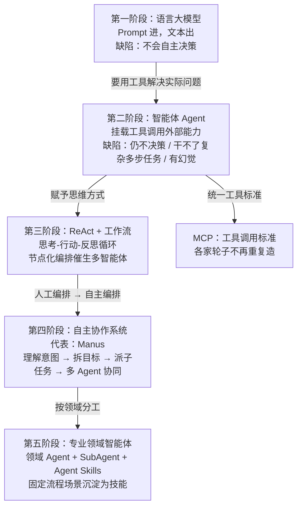

## 【学习目标】

- 能用「五阶段」框架完整复述 Agent 的进化脉络：语言大模型 → 智能体 → ReAct + 工作流 → 自主协作系统 → 专业领域智能体与 Skills。
- 说清每个阶段「解决了上一阶段的什么问题、又暴露了什么新问题」，以及 MCP、Agent Skills、SubAgent 三个概念各自在链条中的位置。
- 理解为什么多 Agent 自主协作系统比单个工作流更能缓解大模型幻觉，能把这一结论讲成面试答案。
- 能将课程后续的旅游规划项目对号入座到五阶段框架的对应层，读架构图时不再迷失。

## 【正文】

### 一、为什么需要一次全景回顾

课程走到这里，已经先后接触了一组新概念：MCP，连接外部工具的标准；Agent Skills，智能体技能系统的标准，是一整套系统而非单个技能；SubAgent，子代理，专门负责单一任务，且在执行该单一任务时运行在一个封闭的上下文里。再往前，还学过语言大模型、智能体（Agent）以及工作流（Workflow）。

概念一个一个学，容易只见树木不见森林。本节把这些概念串成一条线，梳理整条流程：每个概念为什么会出现、它解决了什么问题、又留下了什么新问题，以及未来智能体的整体走向。这条线也是理解后续旅游规划项目的地图，项目里的主管 Agent、团队成员、A2A 协议、Skills 装载，都能在这条线上找到自己的坐标。

### 二、五阶段演进总览

Agent 的进化可以划分为五个阶段，每个阶段都由上一阶段暴露的缺陷所催生：

五个阶段不是替代关系，而是叠加关系：第五阶段的系统里依然跑着第一阶段的语言大模型，也依然靠第二阶段的工具调用干事。新增的每一层，都在修补下一层的缺陷。

### 三、第一阶段：语言大模型：只会应答，不会决策

最开始，用户通过 Prompt 向语言大模型发问，语言大模型反馈文本信息。那段时间人们觉得语言大模型无所不能，像一部百科全书。但慢慢发现，它的行为模式始终是「我问一句，它把答案反馈给我」：先只能反馈文字，后来可以反馈图片甚至视频，这些属于多模态，但交互范式没有变，依然是「问一句、反馈一段内容」。

这一阶段的根本缺陷是**不会自主决策**：用户问 A，它回答 A；它不会自主地把 A 拆成 A、B 两个子问题，再去解决 B。语言大模型在这里只充当一个对话角色，是「助手」，不是「办事员」。

对工程实现的含义：这一阶段对应课程里最基础的 `ChatClient` 调用形态，`chatClient.prompt().user(...).call().content()`，一问一答，无状态、无工具、无规划。后续所有阶段都是在这条调用链上做加法。

### 四、第二阶段：智能体：工具化，以及 MCP 的诞生

为了帮用户解决实际问题，查数据库、生成 PPT，出现了智能体。它出现的意义在于**使用工具**去解决实际问题：能够调用用户电脑上的 PPT 软件生成文档，也能够请求第三方 API 反馈实时数据。智能体之所以能办事，靠的就是工具。

但这一阶段有一个工程乱象：每个大模型厂商都自己写一套函数去调用工具，同一件事各家重复造轮子。后来出现了 MCP 这一标准，所有大模型都基于同一套标准调用同一个工具，轮子不用再重复造。MCP 因此被定义为「连接外部工具的标准」，它规范的不是工具本身，而是「模型如何发现并调用工具」这一接口层。课程里「百度地图 MCP」就是把外部地图能力封装成 MCP Server，再挂到 Agent 上。

智能体虽然是很大的进步，不再只反馈文字，而是真能干活，但它依然没有解决三个问题：

1. **仍然不会自主决策**：工具是有了，但什么时候调哪个工具、按什么顺序调，依然依赖人把流程写死。
2. **干不了复杂多步骤任务**：单靠一个智能体搞不定，而用户的需求往往恰恰是复杂多步骤的。
3. **幻觉无法验证**：它反馈给用户的答案是否正确，没有办法校验。

这三个缺陷分别催生了第三阶段的 ReAct、工作流，以及贯穿后续所有阶段的反思机制。

### 五、第三阶段：ReAct 与工作流：给智能体「思维方式」与「编排形态」

针对第一个缺陷，解决方案是给智能体一种思维方式，即 **ReAct 框架**：先思考，然后行动（执行该步骤）；执行完成后，验证结果是否符合目标与预期，不符合就动态调整该步骤。思考-行动-观察-反思的循环，赋予了智能体自主决策的能力。AgentScope 框架的核心正是 ReActAgent，课程 1-7 篇已专门讲过。

针对第二个缺陷，解决方案是**工作流（Workflow）**：一条工作流有多个节点，每个节点赋予一个智能体，由人预先编排好「先做什么、后做什么、什么条件下走哪条分支」。工作流的出现同时宣告了多智能体时代的来临，节点里跑的不再是同一个大脑，而是多个各司其职的智能体。

但工作流有一个本质局限：**流程是人编排的**。人能覆盖常见路径，覆盖不了长尾；需求一变，流程就得改。该局限直接催生了下一个阶段。

### 六、第四阶段：自主协作系统：从人工编排到自主编排

第四阶段从工作流进化而来：之前流程由人工编排，到这一阶段，从工作流程的安排到每个节点智能体完成任务，都由智能体自主决策，不需要用户介入。代表性框架是 Manus。

这一阶段的系统形态是：理解用户意图 → 拆分目标 → 分配子任务 → 对每个子任务进行多 Agent 协同合作。人只负责提出意图，剩下的拆解、派发、协同、汇总，全部由系统自己完成。对照第三阶段，这是一次「编排权」的转移：编排逻辑从人的设计文档里，搬进了主管智能体的决策循环里。

### 七、第五阶段：专业领域智能体与 Skills：把固定流程沉淀为技能

多智能体协同完成子任务的过程中，每个领域需要分配给专业的智能体，于是进化出**专业领域智能体**。而在这些专业任务里，有一部分场景属于有固定流程的，例如连接数据库查某个数据，步骤是确定的。对于这类有固定流程的场景，方案是分配一个 **SubAgent** 去执行。

问题随之而来：SubAgent 怎么懂得完成这类固定流程任务？答案是赋予它 **Agent Skills**。Skills 包含完成该固定流程场景的一系列步骤以及所使用的工具；SubAgent 被赋予 Skills 之后，就能按照固定步骤、调用既定工具完成任务。10-2 至 10-5 篇讲过，Skills 是一整套技能系统（元数据 + 正文 + 指令结构 + 脚本/资源文件），且采用渐进式加载，这正是为了匹配「专业领域知识体量大、但每次任务只用其中一小部分」的特征。

到这里，三个新概念在链条上的位置可以一句话说清：**MCP 统一工具的接口，SubAgent 承载单一任务的封闭上下文，Skills 把固定流程沉淀成可移植的技能包。** 三者共同支撑起第五阶段。

### 八、幻觉缓解：为什么系统级协作优于单点工作流

原稿最后落在一个结论上：整个自主协作系统里，无论宏观上的计划与任务分配，还是每个子任务的智能体协同，其思维方式与单个智能体相同，都能自我反思、调整步骤。因此智能体自主协作的一整套工程化系统，比起单个工作流更能缓解大模型引起的幻觉：它能自我反思答案是否正确，从而最大限度减少幻觉。

上述结论值得展开一层。单个工作流里，反思的粒度是「节点」，一个节点错了，错误会顺着编排好的边流向下游，如果没有显式的校验节点，错误会被直接吞掉。而在自主协作系统里，反思发生在两个层级：宏观上，主管调整计划与分发策略；微观上，每个子 Agent 在自己的 ReAct 循环里修正步骤。多一层独立的校验视角，就多一次拦住幻觉的机会。这与工程上「多层校验总比单点校验漏检率低」是同一个道理。

五阶段的能力与缺陷可以归纳成一张对照表：

| 阶段 | 核心能力 | 代表概念 | 仍未解决的问题 |
|------|----------|----------|----------------|
| 一、语言大模型 | 一问一答，文本/多模态输出 | Prompt、ChatClient | 不会自主决策 |
| 二、智能体 | 调用工具解决实际问题 | 工具调用、MCP | 不决策、干不了复杂多步任务、幻觉 |
| 三、ReAct + 工作流 | 思考-行动-反思循环、节点编排 | ReActAgent、Workflow | 流程靠人工编排 |
| 四、自主协作系统 | 自主拆解、派发、协同 | Manus、主管 Agent | 领域专业知识如何装载 |
| 五、专业领域智能体 | 领域分工 + 固定流程技能化 | SubAgent、Agent Skills | 技能与工具的标准化仍在演进 |

### 九、把旅游规划项目对号入座

课程后续的旅游规划项目，就是第五阶段形态的一次完整落地：

- **主管 Agent** 对应第四阶段的「自主协作系统」入口：接收用户 Prompt，自主分解需求，制定计划并分发任务，工程实现见 `981-demo/src/main/java/com/travel/agent/agent/SupervisorAgent.java`。
- **团队成员**（路线制定 Agent、行程规划 Agent、景点推荐 SubAgent）对应第五阶段的「专业领域智能体」，各自挂载本领域的工具与技能，见 `981-demo/src/main/java/com/travel/agent/agent/TeamMembers.java`。
- **团队成员之间的发现与调用**走 A2A 协议 + Nacos 注册中心，即 MCP 之后「Agent 之间互相发现」的标准化尝试，见 `981-demo/src/main/java/com/travel/agent/a2a/AgentCard.java` 与 `981-demo/src/main/java/com/travel/agent/a2a/NacosAgentRegistry.java`。

读 11-1 篇的架构回顾时，可随时对照这张五阶段地图：每一个模块，都能回答「它在补哪个阶段的哪个缺陷」。

## 【易错点 / 面试题】

1. **面试题：Agent 进化五个阶段，每个阶段解决了上一阶段的什么问题？**
   答题按「缺陷 → 方案」对答：语言大模型不会决策、只会应答 → 智能体用工具解决实际问题；智能体仍不决策 → ReAct 赋予思考-行动-反思循环；复杂多步任务单 Agent 搞不定 → 工作流节点化编排并催生多智能体；工作流靠人工编排 → 自主协作系统（Manus）把编排权交给主管智能体；领域任务需要专业知识与固定流程 → 专业领域智能体 + SubAgent + Agent Skills。最后补一句 MCP 的位置：它不单独占一个阶段，是第二阶段工具调用乱局的标准化收口。

2. **面试题：为什么多 Agent 自主协作比单个工作流更能缓解幻觉？**
   因为反思从「节点级」升级为「系统级」：微观上每个子 Agent 在自己的 ReAct 循环里验证执行结果是否符合预期、不符合就修正步骤；宏观上主管 Agent 会根据各子任务的反馈调整计划与分发。单个工作流的校验只能靠人预置的校验节点，错误会顺流直下；自主协作系统在每一个子任务边界都多了一次独立反思的机会，幻觉被拦下的概率随之提高。注意答题时强调「最大限度减少」而非「消除」，反思机制降低幻觉概率，不保证根除。

3. **易错点：把 Skills 当成「又一个工具」或「MCP 的竞品」。**
   Skills 与 MCP 不在同一层：MCP 是工具调用的接口标准，回答「模型怎么调用工具」；Skills 是一整套技能系统，内部的工作流程里反而会调用 MCP 工具。Skills 也不同于 SubAgent：SubAgent 是执行单一任务、封闭上下文里跑完即释的执行体；Skills 是随拷随用的流程与知识资产，挂在某个 SubAgent 或智能体身上生效。三者关系一句话，MCP 管接口，SubAgent 管执行体，Skills 管流程知识。

## 【小结】

本节把课程至此的概念串成五阶段主线：语言大模型（只会应答）→ 智能体（工具化，MCP 统一接口）→ ReAct + 工作流（自主决策 + 节点编排）→ 自主协作系统（Manus，编排权移交智能体）→ 专业领域智能体与 Skills（领域分工 + 固定流程技能化），并解释了多层级反思为什么比单点校验更能缓解幻觉。10-7 篇进入工程侧：看 Spring AI Alibaba 1.1.2 如何通过 Hook 把 Skills 装载到 ReActAgent 上；11-1 篇回顾旅游规划项目的四模块架构，届时可对照本节第五阶段逐一落地。
