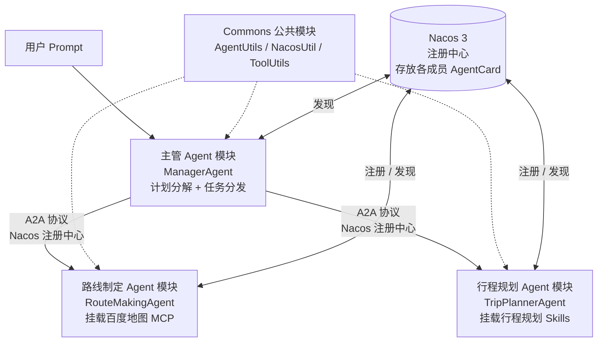

## 【学习目标】

- 复述旅游规划项目的四模块划分（Commons、主管 Agent、路线制定 Agent、行程规划 Agent）与各自职责。
- 讲清主管 Agent 自主决策的核心载体 PlanNotebook，以及 Hook 作为插件扩展点的用法。
- 描述完整的任务流：用户 Prompt → 主管分解 → A2A/Nacos 发现远程成员 → 远程成员挂载 Toolkit 与 Skills 执行。
- 能把课程架构与 981-demo 的模块一一对应，读懂「离线可跑」与「课程原貌」的映射关系。

## 【正文】

### 一、为什么单独用一节课回顾

在继续旅游规划项目的搭建之前，先回顾已经完成的整体架构。之所以单独安排一节课，是因为 AI 领域发展很快，出现了较新的能力，技能，即 Skills，课程也随之增加了对 Skills 的深度讲解，并会把 Skills 领域技能加入旅游规划项目：在完成该项目的过程中，插入了一个专门讲解 Skills 的章节，本章则继续项目的搭建。

这次回顾的价值在于：Skills 章节讲的是「技能如何装载」的通用机制，而项目后续要把这套机制真正落到「行程规划经理」这一具体智能体身上。动手之前，先确认四模块的地基没有松动。

### 二、技术栈与四模块划分

旅游规划项目基于两个框架：**AgentScope**（采用 1.0 版本）与 **SpringBoot**（采用最新的 SpringBoot 4）。由于要用 Docker 搭建多个节点的 Agent，项目按节点做模块划分，共四个模块：

| 模块 | 职责 | 课程篇章 |
|------|------|----------|
| Commons 公共模块 | 存放公共工具类：智能体搭建、Nacos 客户端生成、工具装载 | 11-1 及之前 |
| 主管 Agent 模块 | 整体计划步骤：需求分解、计划制定、任务分发 | 11-3、11-4、11-7、11-8 |
| 路线制定 Agent 模块 | 执行路线规划子任务（挂载百度地图 MCP） | 11-6、13-7 |
| 行程规划 Agent 模块 | 执行景点与行程规划子任务 | 12-1、12-2 |

四模块与课程能力的对应关系：



按节点拆模块不是洁癖：路线制定与行程规划要分别跑在不同 Docker 节点上，主管要能独立部署与扩缩容，编译单元就必须先拆开。Commons 承载三者的公共依赖，避免每个模块各写一份智能体构建代码。

### 三、主管 Agent 的三大已建设能力

回顾主管模块，前面课程主要完成了三件事：

**其一是复杂需求的自主分解。** 主管智能体作为入口接收用户 Prompt 后，把复杂需求分解为简单的执行计划，并将计划分发给路线制定智能体与行程规划智能体执行。这项能力的核心载体是 **PlanNotebook** 对象，它使主管能够将复杂任务分解、生成执行步骤，并对每个步骤的状态进行跟踪，动态调整执行步骤。通过 `planNotebook(...)` 属性方法，主管即拥有自主规划与自主决策的能力。

传入的 PlanNotebook 对象支持自定义，课程通过自定义类完成两处定制：其一，主管生成的执行计划是否需要人工确认；其二，整体计划的存储方式与状态跟踪方式。这两处正是「自主」与「可控」的平衡点，全自动分发适合演示，人工确认关卡适合生产。

**其二是 Hook。** Hook 相当于一个插件，能让智能体搭载外部插件，该插件可以把智能体如何分解步骤、整体执行过程打印出来，即日志类插件的挂载。10-7 篇装载 Skills 同样走 Hook，可见 Hook 是 AgentScope 横切能力的统一入口。

**其三是两个执行智能体的实例搭建。** 路线制定智能体与行程规划智能体都通过 Builder 方式生成，与主管智能体的生成方式相同。

### 四、工具装载：Toolkit 与 @Tool

生成智能体经 Builder 完成。以主管为例，可以通过属性挂载 Hook（插件），另外通过 `Toolkit` 方法挂载工具包，MCP 的工具就放到该工具包里、在该工具包里进行注册。智能体通过 Toolkit 挂载工具包，即可拥有 MCP 工具或其他工具（不限于 MCP）。这就是工具装载。Commons 里把工具的挂载与注册封装为工具类：

```java
// 创建计划对象
TripPlan plan = new TripPlan();

// 创建工具包
ToolUtils toolUtils = new ToolUtils();
Toolkit toolkit = toolUtils.getToolkit(new RemoteAgentTool());

// 创建主管Agent实例
agent = AgentUtils.getReActAgentBuilder(
    name: "ManagerAgent",
    description: "主管Agent"
);
```

需要如实说明的一处原稿痕迹：该代码块是课程为了说明「工具包 → 主管 Agent」装配关系而写的示意片段，其中 `name: "ManagerAgent"`、`description: "主管Agent"` 采用了命名参数写法（Java 中并不存在该语法，属原稿的示意性简写）；`TripPlan plan` 声明后未参与后续使用，`agent` 的赋值也未展示声明。按代码守恒原则，此处按原稿原样保留该代码块、不修改其内部；实际编码时对应 `ReActAgent.builder().name("ManagerAgent").description("主管Agent").toolkit(toolkit).build()` 的形式。

这段示意代码的真正信息量在于装配顺序：先准备计划对象与工具包（工具包里已经装好了「远程智能体工具」），再用统一的 `AgentUtils.getReActAgentBuilder(...)` 产出主管实例。把智能体构建、Nacos 客户端、工具注册全部收拢到 Commons 工具类，是四模块不重复造轮子的前提。

### 五、A2A 协议与 Nacos：远程成员如何被发现

三个智能体处于不同节点，主管如何知道路线制定智能体与行程规划智能体的存在、如何把任务分发给它们？答案是通过 **A2A 协议**实现的。

项目采用 Nacos 注册中心作为 A2A 协议的注册点：路线制定智能体与行程规划智能体把自己的**智能体卡片**（AgentCard，内容包括该智能体拥有哪些技能、擅长做什么）存放到 Nacos 注册中心；主管智能体从 Nacos 就能知道有哪些远程智能体、各自擅长什么，从而把相应任务分发给对应智能体。卡片即能力声明，这是 A2A 与「硬编码 IP 调用」的本质区别：调用方不需要知道对方是谁，只需要按名字解析到一张能力名片。

A2A 协议的搭建非常简洁，引入两个依赖即可：一个是基于 SpringBoot 的 A2A 依赖（`agentscope-a2a-spring-boot-starter`），另一个是 Nacos 依赖（`agentscope-nacos-spring-boot-starter`）。引入后，远程智能体即可将自己的智能体卡片自动注册到 Nacos 注册中心。

### 六、远程智能体作为主管的工具：调用链闭环

主管如何调动远程智能体执行任务？前面课程的实现是：**把获取到的远程智能体作为主管自己的工具**。主管模块里写了一个获取远程智能体的工具，该工具经工具注解修饰（原稿此处写作「A2 注解」，结合 11-3 篇可知智能体工具由 `@Tool` 注解修饰，此处按原稿表述如实说明），因此能被智能体采用。工具内部通过注册中心发现远程智能体，再把远程智能体作为工具去调用，主管由此把任务分发给远程成员。

这里有一个容易含糊的点必须说死：**真正执行任务业务逻辑的是远程智能体，远程智能体是作为工具装载到主管智能体里面的**。主管负责「决定调谁、传什么任务」，远程成员负责「在自己的 ReAct 循环里把任务做完」。

远程成员执行任务时，同样遵循 ReAct 的思考模式：思考、执行，再反思执行目标是否与预定目标一致，不一致就自我修正步骤。执行过程中，还会把最新的 Skills 专业流程嵌入进去，Skills 不是工具，而是一整套专业固定流程，后续项目会把该固定流程嵌入智能体执行任务的过程。12-1 至 12-4 篇的行程规划经理挂载 Skills，就是这一步的落地。

### 七、课程架构与 981-demo 的模块对应

离线工程 981-demo 按同样的四模块思路做了最小可跑复刻，阅读时可逐一对照：

| 课程概念 | 981-demo 模块 |
|----------|----------------|
| 主管 Agent（ManagerAgent） | `981-demo/src/main/java/com/travel/agent/agent/SupervisorAgent.java` |
| 团队成员（路线制定 / 景点推荐） | `981-demo/src/main/java/com/travel/agent/agent/TeamMembers.java` |
| 主管的工具箱（远程成员即工具） | `981-demo/src/main/java/com/travel/agent/agent/SupervisorTools.java` |
| 智能体卡片 AgentCard | `981-demo/src/main/java/com/travel/agent/a2a/AgentCard.java` |
| Nacos 注册 / 发现（prod） | `981-demo/src/main/java/com/travel/agent/a2a/NacosAgentRegistry.java` |
| 进程内注册表（default 离线） | `981-demo/src/main/java/com/travel/agent/a2a/InProcessAgentRegistry.java` |
| 远程 A2A 端点 | `981-demo/src/main/java/com/travel/agent/a2a/A2aEndpointController.java` |
| 模型与离线开关配置 | `981-demo/src/main/java/com/travel/agent/config/AgentProperties.java`、`981-demo/src/main/java/com/travel/agent/model/OfflineChatModel.java` |

demo 与课程原貌的差异仅在两处，均为工程化需要：用 `InProcessAgentRegistry` 在 default profile 下平替 Nacos，保证离线可跑；用 `OfflineChatModel` 规则模型平替真实大模型，保证 `mvn test` 不联网。注册、发现、分发、ReAct 循环的语义与课程完全一致。

## 【易错点 / 面试题】

1. **面试题：主管 Agent 如何发现远程团队成员？A2A 协议和 Nacos 各自承担什么角色？**
   分工是：A2A 协议规定「智能体之间如何互相描述与调用」，每个成员把自己的 AgentCard（技能、擅长领域）注册到注册中心，主管按名字解析卡片并获得调用通道；Nacos 则是该注册中心的具体实现，课程选它作为 A2A 的注册点。答题时点出关键设计：调用双方经卡片解耦，主管不需要预先知道成员的 IP 与实现，只依赖名字与能力描述；成员扩缩容、换节点，主管无感知。11-2 篇会亲手把成员注册进 Nacos 并验证。

2. **面试题：为什么把远程智能体「作为工具」挂载到主管，而不是主管直接发 HTTP 请求调用？**
   因为主管的决策循环是 ReAct：它按思考结果选择调用哪个工具、传什么参数。远程成员被包装成工具后，就进入了主管的工具空间，主管可以像调用本地工具一样在循环里选择它、组合它，工具描述（如「擅长路线规划」）直接参与模型的路由决策。若改成裸 HTTP 调用，「何时调、调哪个」的决策逻辑就要手写在代码里，自主决策退化成硬编码分支，这正是工作流与自主协作系统的分水岭。

3. **易错点：误以为任务在主管侧执行。**
   主管只做分解与分发，真正执行业务逻辑的是远程智能体：远程成员在自己的节点上跑 ReAct 循环、调用自己的 Toolkit 与 Skills。验证时可以看日志归属，任务执行的痕迹出现在远程成员的日志里，主管日志里只有「调用工具 → 获取成员 → 描述信息」这类分发记录。

## 【小结】

本节回顾了旅游规划项目的四模块架构（Commons / 主管 / 路线制定 / 行程规划，AgentScope 1.0 + SpringBoot 4），理清了三条主线：主管经 PlanNotebook 自主分解与跟踪计划；成员经 A2A 协议把 AgentCard 注册进 Nacos、主管按名发现；远程成员作为工具挂入主管，由成员本地的 ReAct 循环 + Toolkit + Skills 完成任务。原稿装配示意代码的命名参数写法等痕迹已按代码守恒原则原样保留并说明。11-2 篇起进入联调：先把团队成员的卡片注册进 Nacos，再验证主管的发现与调度，直到 11-4 篇打通「主管调动远程成员调用百度地图 MCP」的完整链路。
