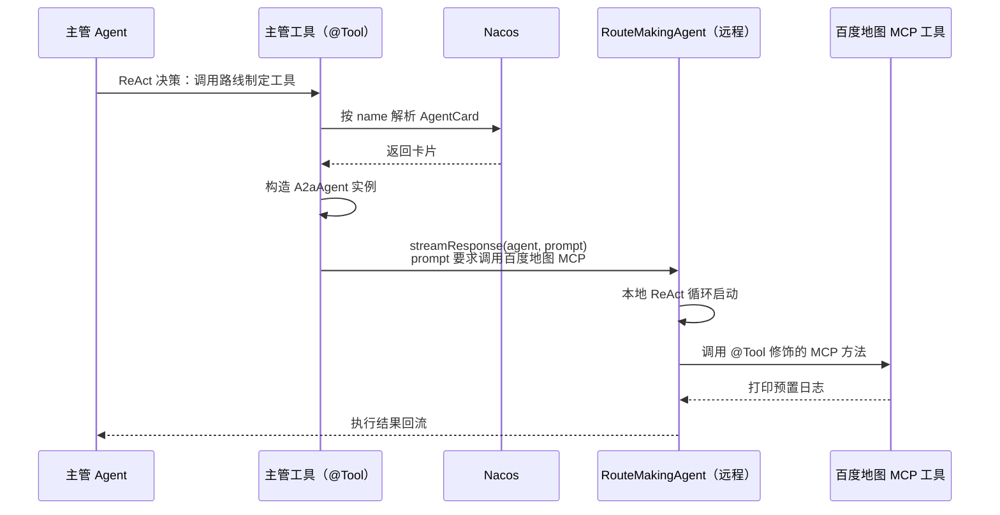

## 【学习目标】

- 在路线制定 Agent 侧挂载百度地图 MCP 工具包（Toolkit），并用打印日志验证工具被调用。
- 改掉主管侧「直接运行远程智能体」的写法，改用公共模块封装的 `streamResponse(agent, prompt)` 运行方法。
- 定位并修复 `ReActAgent` 与 `A2aAgent` 的类型不匹配：把参数类型上提到共同基类 `AgentBase`。
- 从两侧日志确认完整闭环：主管分发任务 → 远程成员调用自己的 MCP 工具执行。

## 【正文】

### 一、从「获取」到「执行」

11-3 篇已验证主管能通过 Nacos 发现并获取远程智能体。本节继续推进：获取到远程智能体之后，如何让远程智能体真正执行任务。

以路线制定智能体为例：获取到该成员后，本节课让它执行主管分发的任务。而路线制定智能体内部的主要动作，就是调用百度地图的 MCP，执行成功的判据，是它自己打印出预置日志。

### 二、成员侧：百度地图 MCP 的挂载与验证打印

在路线制定智能体模块创建 MCP 包，包下创建百度地图的 MCP 类，即百度地图 MCP 服务端，写一个方法。此处先不实现百度地图 MCP 的真实连接，只打印一段日志，目的是以最小成本验证「主管能否让路线制定智能体调用它自己的百度地图 MCP」；若调用成功，日志就会打出来：

```java
@Component
public class RouteMakingAgent {
    @Bean
    public ReActAgent getRouteMakingAgent() {
        //Toolkit toolUtils = new ToolUtils();
        //将百度地图MCP注册到工具包
        Toolkit toolkit = toolUtils.getToolkit(new BaiduMapMCP());
        //... 其他配置
    }
}
```

需要如实说明的一处原稿痕迹：该代码块中 `ToolUtils` 的声明行（`Toolkit toolUtils = new ToolUtils();`）在原稿里处于注释状态，而下一行 `toolUtils.getToolkit(new BaiduMapMCP())` 却直接使用了它，这是原稿为了聚焦「把 MCP 类传进工具包」这一动作而做的示意性裁剪。按代码守恒原则此处按原稿原样保留，实际编码时应把声明行的注释去掉，使 `toolUtils` 先声明再使用。

这段示意代码的机制层面很清楚：先用 `@Tool` 修饰 MCP 服务端里的方法，该方法即被智能体认定为智能体工具；再到路线制定智能体的 Bean 生成处获取工具包，把百度地图 MCP 服务端类传进去。该服务端类中所有经 `@Tool` 修饰的方法，都会让路线制定智能体识别到自己拥有这些工具，这就是路线制定智能体的工具挂载。挂载完成后，这些 MCP 工具就进入该成员自己的 ReAct 循环可调用的工具空间。

### 三、主管侧：改用公共模块的运行方法

回到主管 Agent 模块。上一节是经 Prompt 让主管调用自己的工具方法，从而获取远程路线制定智能体并打印其描述。本节的目标升级为：获取到远程智能体后，让它执行任务，即让它调用自己的百度地图 MCP 工具方法。

做法是先把「远程智能体的直接运行」注释掉，改用公共模块里此前封装的运行工具类。该方法让智能体运行，需要两个参数：其一是要运行的智能体，其二是 Prompt，即该智能体运行所用的 Prompt。此处要运行的智能体，就是从 Nacos 获取到的远程路线制定智能体，把该 Agent 传进去即可。

远程智能体的获取代码：

```java
A2aAgent agent = A2aAgent.builder()
    .name("RouteMakingAgent")
    .agentCardResolver(
        new NacosAgentCardResolver(NacosUtil.getNacosClient())
    )
    .build();
```

需要如实说明的一处原稿痕迹：11-3 篇同一处获取代码中 Nacos 客户端的获取写作 `NacosUtil.getNacos()`，本节写作 `NacosUtil.getNacosClient()`，两处命名不一致，属原稿的方法名笔误痕迹；按代码守恒原则两篇均按原稿原样保留，实际编码时统一为工具类中真实存在的方法名即可。

传给远程成员的 Prompt 目标是明确的：让它去调用自己的 MCP 工具，也就是百度地图 MCP 工具。若它成功运行并调用该工具，就会打出预置日志，「调用了百度地图的 MCP 工具」这句话出现，即证明主管 Agent 成功让远程智能体执行了任务。

### 四、类型不匹配：报错定位到 AgentBase

改动后出现编译报错。点进此前封装的运行方法，原因很清楚：该方法在前面的课程中被设定为接收 `ReActAgent` 对象，而从 Nacos 获取到的远程智能体，其类型是 `A2aAgent`，两者不是同一类型，直接编译不过。

有没有通用的改法？顺着继承链往上找共同祖先：

- `ReActAgent` 继承自某一中间类型，再往上继承 `AgentBase`；
- 远程智能体的类型 `A2aAgent`，同样继承 `AgentBase`。

既然二者同根，把运行方法里的智能体参数类型从 `ReActAgent` 上提为 `AgentBase`，ReActAgent 与 A2aAgent 就都能传入：

```java
public static Flux<Event> streamResponse(
    AgentBase agent,
    String prompt
) {
    return agent.stream(
        Msg.builder()
            .role(MsgRole.USER)
            .content(List.of(
                TextBlock.builder()
                    .text(prompt)
                    .build()
            ))
            .build()
    );
}
```

改完之后报错消失。该修法的分量比表面大：`AgentBase` 是「一切智能体」的抽象，`stream(...)` 在其上定义；参数类型停在抽象层而非具体层，运行方法才能同时服务本地成员（ReActAgent）与远程成员（A2aAgent）。这是「面向接口编程」在 Agent 框架里的一次典型落地，若当初把参数类型写成 ReActAgent，等于把工具类与「本地智能体」这一种实现绑死，多 Agent 场景立刻撞墙。

### 五、联调与结果解读

运行条件与 11-3 相同：路线制定智能体模块与主管智能体模块同时启动。

先看主管 Agent 的输出，它复现了 11-3 的发现链路：调用自己的工具方法（获取远程路线制定智能体）→ 成功获取远程成员并拿到其描述（「路线制定Agent」，该描述由远程智能体返回）。新增的一步在后续：它让远程的路线制定智能体执行交代的任务，调用其自身的百度地图 MCP 工具方法。

再看远程路线制定智能体的日志：预置的那句话被打了出来。这句话是写在百度地图 MCP 工具方法里的，只有该工具被真正调用时才会打印，它的出现，说明远程智能体成功执行了主管分发的任务。

完整调度链路：



### 六、与 981-demo 的对应

981-demo 把这条「主管调度远程成员」链路做成了带生产韧性的最小实现：主管侧入口是 `981-demo/src/main/java/com/travel/agent/agent/SupervisorTools.java` 的 `dispatch(memberName, task)`，先经注册表 `resolve(name)` 拿调用通道，再用 resilience4j 的 `CircuitBreaker.decorateSupplier` 包裹实际调用，成员故障时返回降级文案而非拖垮主管；通道抽象在 `981-demo/src/main/java/com/travel/agent/a2a/AgentTransport.java`，离线走 `InProcessAgentTransport`、生产走 `A2aHttpAgentTransport`（prod profile 由 `NacosAgentRegistry.resolve` 拼出 `/a2a/<name>` 端点）；远程成员的 A2A 接收端在 `981-demo/src/main/java/com/travel/agent/a2a/A2aEndpointController.java`。课程本节修复的 `AgentBase` 参数类型问题，在 demo 中对应 `AgentTransport` 对本地/远程两种成员通道的统一抽象，同一思想：调用侧只依赖抽象，不绑定实现。

## 【易错点 / 面试题】

1. **面试题：封装智能体运行方法时，参数类型为什么从 `ReActAgent` 改成 `AgentBase`？**
   因为运行方法的入参既有本地智能体（`ReActAgent`），也有从 Nacos 获取的远程智能体（`A2aAgent`）；二者是不同类型，但都继承 `AgentBase`，且 `stream(...)` 定义在 `AgentBase` 上。参数类型上提到共同基类后，一套方法同时兼容本地与远程两种智能体。答题时把设计原则点出来：依赖抽象而非具体实现，否则每接入一种新的智能体类型，就要重载一次运行方法。

2. **面试题：如何证明「远程智能体真的执行了任务」，而不是主管自己做的？**
   看日志归属与判据设计：预置打印语句写在远程成员的 MCP 工具方法内部，只有该工具被调用才会输出；该日志出现在远程成员模块的控制台，而非主管模块。两个条件同时满足，才能排除「主管侧伪造结果」的可能。工程上这就是「可观测的验收点」，为关键动作预置带唯一性的日志，比事后读代码推断可靠。

3. **易错点：验证 MCP 挂载时先写真实连接，排障面被放大。**
   课程的做法是先把百度地图 MCP 的连接逻辑搁置，只留打印，用一句日志先把「挂载 → 识别 → 调用」链路走通，再接真实连接。若一上来就对接真实 API，工具没挂上去、网络不通、AK 无效几类故障会绞在一起。分步验证、每步只引入一个变量，是多 Agent 联调的基本纪律。

## 【小结】

本节打通了调度闭环的最后一环：成员侧把百度地图 MCP 经 Toolkit 挂进路线制定智能体（`@Tool` 修饰的方法即成为该成员的工具）；主管侧改用公共模块的 `streamResponse(agent, prompt)` 驱动远程成员，并修复了 `ReActAgent` 与 `A2aAgent` 的类型不匹配，参数类型上提为共同基类 `AgentBase`。联调结果双侧印证：主管日志显示发现并派发，远程成员日志显示百度地图 MCP 工具被调用。原稿两处痕迹（`ToolUtils` 声明行被注释、`getNacosClient` 与 `getNacos` 方法名不一致）已按代码守恒原则原样保留并说明。11-5 至 11-7 篇继续深入：获取百度地图 MCP 服务端的工具列表、路线制定专员正式挂载、主管自主分发任务给远程成员。
