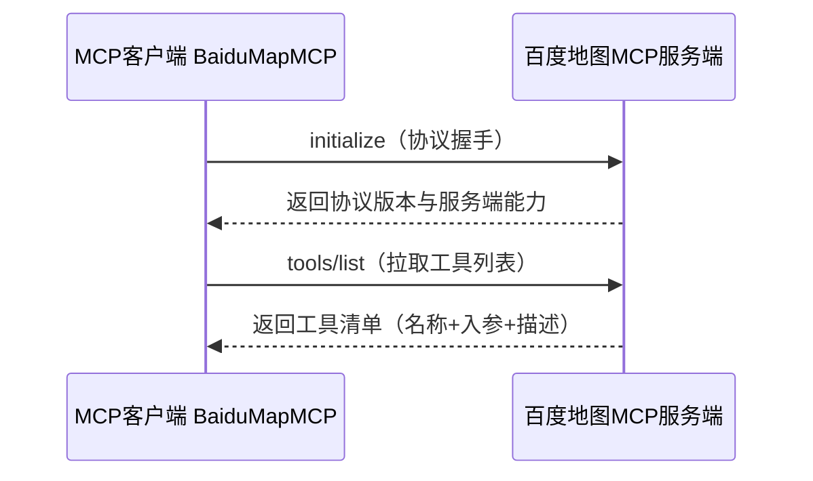

## 【学习目标】

- 讲清 MCP 客户端与 MCP 服务端建立会话的两个必经步骤：协议握手（initialize）与拉取工具列表（tools/list）。
- 独立完成 `BaiduMapMCP` 中「创建客户端」与「初始化客户端」两个方法的编写，理解 SSE 传输、阻塞等待、双重检查锁各自解决的问题。
- 从魔搭社区申请到百度地图 MCP 服务端地址，并用运行日志验证客户端与服务端真正建立了会话。

## 【正文】

### 1. 从「打印日志」到「真实调用」

11-4 中主管 Agent 调度路线制定 Agent 时，对百度地图 MCP 的调用只打印了日志，并未落地业务逻辑。本节把这段链路补全：让路线制定 Agent 真正持有百度地图 MCP 客户端，并从服务端拿到工具列表，为 11-6 的工具挂载做准备。

先回顾 MCP 的通信模型。MCP（Model Context Protocol，Anthropic 提出的工具标准化协议）把外部能力封装成「MCP 服务端」，智能体侧通过「MCP 客户端」接入。客户端要与服务端建立通信会话，必须做两件事：

1. 初始化 MCP 客户端（initialize），与服务端完成协议握手，协商协议版本与双方能力；
2. 从 MCP 服务端拉取工具列表（tools/list），拿到服务端暴露的全部工具名称、入参与描述。

握手与拉清单是后续一切工具调用的前提：拿不到工具列表，智能体就不知道有哪些能力可用，ReAct 循环里的「选工具」一步便无从谈起。相比直接写 HTTP 调用百度地图开放 API，MCP 的价值在于工具的定义、入参 schema、语义描述全部由服务端声明并统一下发，客户端不需要为每家服务商手写一套适配层。



### 2. 创建百度地图 MCP 客户端

创建方式参考百度地图 MCP 官方文档，核心是 `McpClientBuilder` 建造者：

```java
baiduMapMCP = McpClientBuilder.create("BaiduMap-mcp")
    .sseTransport()
    .url("https://mcp.api-inference.modelscope.cn")
    .timeout(Duration.ofSeconds(60))
    .buildAsync()
    .block();
```

逐项说明每个设置的职责与踩坑点：

| 设置项 | 作用 | 注意点 |
|---|---|---|
| `sseTransport()` | 指定传输协议为 SSE | 两侧必须一致：服务端是 SSE，客户端才能是 SSE；服务端是 Streamable，客户端同样只能选 Streamable |
| `url(...)` | MCP 服务端地址 | 从魔搭社区申请得到，下文详述获取流程 |
| `timeout(Duration.ofSeconds(60))` | 请求超时 60 秒 | 地图类工具（路线矩阵、多点规划）计算耗时较长，超时不宜压得太短 |
| `buildAsync()` | 异步构建，返回 `Mono<McpClientWrapper>` | Reactor 响应式类型，不会直接给出实例 |
| `block()` | 阻塞等待构建完成 | 漏写会拿到空引用，后续调用直接 NPE |

`McpClientBuilder` 构建出的客户端类型是 `McpClientWrapper`。由于紧随其后的初始化方法也要使用客户端实例，这里把它定义为成员变量；同时用另一个成员变量记录「是否已初始化」，避免重复初始化。

### 3. 初始化 MCP 客户端

创建只是造出对象，初始化才真正与 MCP 服务端建立会话：

```java
public McpClientWrapper initBaiduMapMCP() {
    Optional<McpClientWrapper> mcpClientWrapper = Optional.ofNullable(mcpClientWrapper);
    if (mcpClientWrapper.isPresent()) {
        log.info("百度MCP客户端已经创建");
        log.info("================================");
    }
    if (!mcpInitialized) {
        synchronized (this) {
            if (!mcpInitialized) {
                baiduMapMCP.initialize().block();
            }
        }
    }
    return baiduMapMCP;
}
```

这段代码做了三件事，每件都对应一个真实的工程问题：

- **`Optional` 判空**：客户端成功创建后成员变量不为空。用 `Optional.ofNullable(...)` 包装后判断 `isPresent()`，为空时跳过日志，不为空时打印「已创建」，确认创建阶段无异常。
- **双重检查锁定**：外层 `if (!mcpInitialized)` 先做一次无锁判断，内层 `synchronized` 块中再做一次判断并执行初始化。多线程同时触发时，只有一个线程能进入临界区完成初始化，其余线程在第二次判断时直接放过；既保证只初始化一次，又避免每次调用都抢锁。
- **`initialize().block()`**：初始化的本质是客户端与服务端握手，握手需要时间，且异步链路不会把失败信号自动抛回主流程。用 `block()` 阻塞线程，等待握手成功后再往下走；握手失败时异常才会如实暴露，而不是把失败吞掉。

按课程叙述，初始化成功后需把初始化状态标志置为 true，最后返回已初始化的客户端实例。上面代码块聚焦初始化主体，该状态赋值行未在块中画出，实际编写时需补上。

### 4. 验证：工具列表就是「会话已建立」的证据

如何判断初始化真的成功？MCP 客户端提供 `isInitialized()` 状态判断，但更可靠的证据是工具列表：客户端能完整打印出服务端暴露的工具，说明会话已通。因此初始化成功后，从服务端拉取工具列表并逐项打印，既是验证手段，也是后续排错的抓手，列表为空或残缺，第一反应就该检查握手是否真正完成。

### 5. 获取百度地图 MCP 服务端地址

MCP 服务端地址在魔搭社区申请，步骤如下：

1. 打开魔搭社区，搜索「百度地图」，务必选择百度官方发布的 MCP 服务，而非个人镜像；
2. 进入服务配置页，先选传输类型：服务端配的是 SSE，客户端就用 SSE；服务端是 Streamable，客户端同样用 Streamable，两侧必须一致；
3. 填入百度地图 API Key（AK，1-4 节申请），提交后平台会分配一段 JSON 格式的配置；
4. 从 JSON 中取出 URL 字段的值，即为百度地图 MCP 服务端地址；
5. 把该地址填回创建代码的 `url(...)` 处。

### 6. 运行验证

在路线制定模块的启动类中做临时验证：

```java
public static void main(String[] args) {
    BaiduMapMCP mcp = new BaiduMapMCP();
    mcp.getBaiduMapMCP();
    mcp.initBaiduMapMCP();
    SpringApplication.run(RouteMakingAgentApplication.class, args);
}
```

这段代码只服务于联调，正式代码中应移除。运行后日志依次出现三类关键输出：客户端已创建、初始化成功、工具列表。工具列表能完整打印，即证明 MCP 客户端与百度地图 MCP 服务端已建立会话，并成功拿到服务端暴露的全部工具。

与生产的差距也值得一提：真实工程中 MCP 客户端应做成单例以复用连接，API Key 走环境变量而非硬编码，对外调用包一层超时与重试。本课聚焦「把链路打通」，这些加固点留到工程化阶段处理。

放到 Spring AI 技术栈中对照，本节的两个方法对应「构建 MCP 客户端并挂载」的同一意图：`McpClientBuilder` 的角色由 Spring AI 的 MCP Client 自动配置承担，服务端工具经 `McpToolCallback` 汇入 `ChatClient` 的工具集，工具循环由 `ToolCallingAdvisor` 驱动。名词不同，链路形态一致，先建会话，再拿工具清单，最后才谈调用。

## 【易错点 / 面试题】

1. **为什么 `initialize()` 之后必须 `block()`？** 初始化是异步的（返回 `Mono`），不阻塞的话主线程会继续往下走，握手尚未完成就发起工具调用，必然失败；阻塞还能让握手异常及时抛出，而不是把失败吞掉。
2. **客户端与服务端传输协议不一致会怎样？** 连接直接建立失败，表现为超时或协议错误。排错时先核对两侧的 `sseTransport()` / Streamable 配置，这是最高频的一类联调问题。
3. **面试延伸：双重检查锁为什么常搭配 `volatile`？** 防止指令重排导致其他线程看到「半初始化」对象。本课聚焦链路打通，成员变量由 Spring 单例托管；真实工程中若初始化状态要跨线程共享，需要一并考虑可见性问题。

## 【小结】

本节完成了百度地图 MCP 客户端从创建、初始化到拉取工具列表的完整链路，路线制定 Agent 从此具备了「看见」百度地图工具的能力。下一节（11-6）把这些工具通过 `Toolkit` 挂载到路线制定 Agent 上，使其真正可以调用。在 `981-demo` 工程中，`com/travel/agent/tool/RouteMakingTools.java` 用本地桩复刻了 `map_geocode`、`map_directions`、`map_weather` 三个百度地图 MCP 工具的返回结构，使「工具挂载 → 工具调用 → 结果回传」的链路形态与生产环境一致，离线环境也能跑通同一套调用逻辑。
