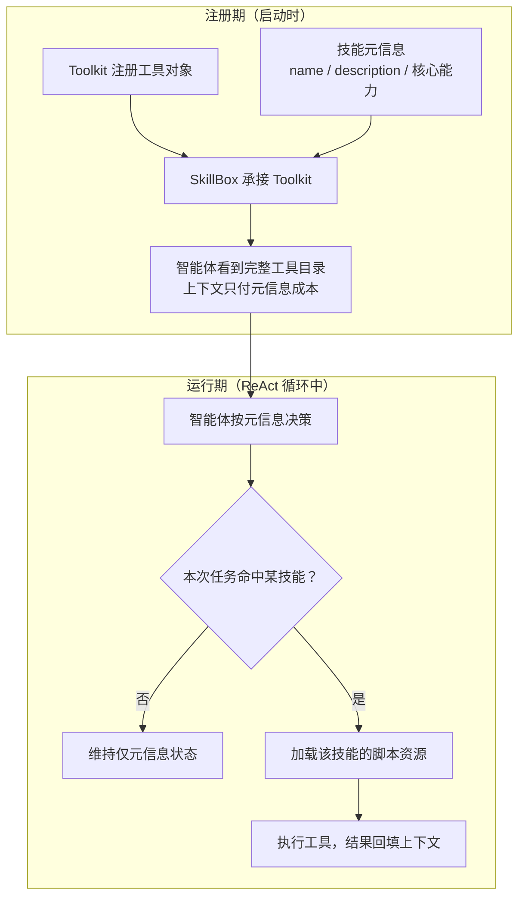

## 【学习目标】

- 讲清渐进式加载要解决的核心矛盾：上下文窗口有限，与工具定义全量注入的贪婪之间的冲突。
- 掌握 Toolkit 与 SkillBox 的接合方式：new SkillBox(toolkit)，以及 skillBox.registration().tool(...) 等注册入口。
- 理解「注册期只带元信息、运行期才加载资源」的两段式机制，以及为什么 ReActAgent 仍然必须挂载 toolkit。

## 【正文】

### 1. 先回顾：渐进式加载到底在省什么

前面课程已经通过 SkillBox 把技能加载进智能体。本节要回答的是一个更根本的问题：Skill 如何让工具实现渐进式加载。

回到 10-4 节讲过的动机。智能体持有的每个工具都由两部分构成：定义（名称、描述、参数结构）与实现（脚本、代码、外部服务）。传统做法是把全部工具的定义一股脑塞进系统提示词；智能体的上下文窗口是有限资源，工具一多，窗口被撑满，注意力被稀释，决策质量随之下降。引入 Agent Skills 的重要目的之一，就是把「拥有」与「加载」分离：不用某项工具时，智能体只需要知道自己有这项能力的名称即可；真正用到时，才把工具内部的脚本资源加载进来。

### 2. 机制：两段式加载



注册期解决「智能体知道自己有什么」，运行期解决「需要时才把资源取出来」。目录必须常驻，资源按需借阅，这是渐进式加载的完整契约。缺了任何一段，机制都不成立：没有注册期，智能体对工具一无所知；没有运行期，全部资源又会一次性压垮上下文。

### 3. Toolkit 与 SkillBox 的接合

回顾此前课程的挂载方式：智能体工具经 Toolkit 对象注册，例如 toolkit.registerTool(对象)。现在技能在 SkillBox 一侧，工具在 Toolkit 一侧，两者结合的方式非常直接：把 Toolkit 作为参数传给 SkillBox 构造，工具与技能即完成结合，之后由 SkillBox 统一管理，加载时实现渐进式。

SkillBox 提供三类注册入口，职责边界清晰：

| 入口 | 注册对象 | 说明 |
|---|---|---|
| skill 系列方法 | 技能（AgentSkill） | 技能注册的主路径 |
| tool 方法 | 单个工具 | 把工具纳入 SkillBox 托管 |
| toolkit 方法 | 整个工具包 | 批量承接 Toolkit 中已注册的工具 |

技能走 skill 系列方法注册；工具既可经 Toolkit 注册后再随 toolkit 整体交给 SkillBox，也可用 tool 方法单独注册。多条路径指向同一个目的：让 SkillBox 成为工具与技能的统一调度者。

需要补充一个版本细节：registration() 这类链式注册 API 的形态与 12-3 节讨论的装载器版本强相关，1.0.8 与 1.0.9 的 SkillBox 接口并不完全相同，课程按锁定的 1.0.8 编写。升级依赖时，注册入口的方法签名应作为第一回归点，而不是编译通过就收工。

### 4. 装配代码

```java
@Bean
public ReActAgent getTripPlannerAgent() throws URISyntaxException {
    Toolkit toolkit = new Toolkit();
    toolkit.registerTool();

    // 构建SkillBox
    SkillBox skillBox = new SkillBox();

    // 以文件形式读取Skill.md
    JarSkillRepositoryAdapter repo = new JarSkillRepositoryAdapter();
    resourcePath: "skills"

    // 景点推荐技能
    AgentSkill SuggestSightsSkill = repo.getSkill(skillName: "SuggestSightsSkill");
    // 表格制作技能
    AgentSkill MakeATableSkill = repo.getSkill(skillName: "Make-A-TableSkill");
    skillBox.registerSkill(SuggestSightsSkill);
    skillBox.registerSkill(MakeATableSkill);

    skillBox.registration();

    // 行程规划智能体配置
    return ReActAgent.builder()
        .prompt("I am a trip planner agent. I can help you plan your trip...")
        .toolkit(toolkit)
        .skillBox(skillBox)
        .build();
}
```

如实说明三处转写痕迹，代码块按原稿保留：其一，JarSkillRepositoryAdapter 构造之后 resourcePath 独立成行，Java 语法里孤立的名值对不是合法语句，实际应为构造参数；其二，getSkill 实参的 skillName: 前缀是 IDE 具名参数提示被一并录进来的结果；其三，registerTool() 未传参、skillBox.registration() 未继续链式调用，属于讲演现场的示意性写法。另需注意，本段代码里两个技能名写作 SuggestSightsSkill 与 Make-A-TableSkill，与 12-3 节的 Suggest-Sights、Make-A-Table 不一致，判断为同一技能在两处讲演中的不同口述，实际工程必须以 skill.markdown 声明的 name 为准。

装配的关键在最后几行：ReActAgent.builder() 同时挂载 toolkit 与 skillBox。

### 5. 为什么 toolkit 仍然必须挂给智能体

这是本节最容易混淆的点。toolkit 与 SkillBox 承担的是两件不同的事：

- toolkit 挂给 Agent：让智能体知道「自己拥有哪些工具」。没有它，智能体决策时看不到工具目录，渐进式加载根本无从谈起；
- SkillBox 接管 Toolkit：决定工具实现的加载时机。只有命中的技能，其脚本资源才会真正进入上下文。

打个比方：toolkit 是书架目录，SkillBox 是图书管理制度。目录必须常在案头，书才可以按需借阅。只挂 SkillBox 不挂 toolkit，等于把管理制度留下了却没收目录，智能体对工具一无所知；只挂 toolkit 不挂 SkillBox，则是把全馆藏书堆上案头，上下文立刻被撑满。

从 token 角度看，两种挂载策略的差异是结构性的：

| 策略 | 启动时上下文占用 | 工具规模增长时 | 适用场景 |
|---|---|---|---|
| 传统全量挂载 | 全部工具定义 | 线性膨胀，挤占窗口、稀释注意力 | 工具数量少 |
| SkillBox 渐进式 | 仅元信息 | 基本恒定，按需加载 | 工具与技能规模化 |

工具只有三五个时，两种策略差别不大；当技能库长到几十项，渐进式加载决定系统是否还可用。

可以把注册期的成本算得更细：每个工具进入上下文的是名称、描述与参数结构，通常几十到上百 token；技能库五十项，注册期固定支出大约几千 token，且不随任务增长。运行期的支出与命中次数成正比，没用到的技能，token 为零。这正是渐进式加载相对全量挂载的结构性优势：用固定的小成本，替换浮动的大成本。

### 6. 计算工具示例与技术前瞻

原稿以一个计算工具为例演示注册：工具就是带 @Tool 注解修饰的方法，直接 new 出来即可注册。注册入口二选一：toolkit.registerTool(对象) 走传统方式，或 skillBox.registration().tool(对象) 纳入 SkillBox 托管，后者在 12-5 节有完整示例。走 SkillBox 托管的工具才享受渐进式加载，这正是本节的落点。

技术前瞻：Spring AI 2.0 把「先索引、按需检索」的思想标准化为 ToolSearchToolCallingAdvisor，会话内先对全部工具建索引，按需检索注入，大工具集可省约五成到七成 token。AgentScope 的 SkillBox 与它思路同源：都是用「元信息目录加按需加载」对抗上下文窗口的有限性。名词不同，机制一致。

## 【易错点 / 面试题】

1. **转写残缺识别**：代码块中 resourcePath 独立成行、skillName: 前缀等均非合法 Java 语句，应能一眼识别为转写痕迹；照原稿保留的同时，心里要还原真实写法。
2. **只挂一边**：只给 Agent 挂 toolkit 不挂 SkillBox，工具全量注入；只挂 SkillBox 不挂 toolkit，智能体看不到工具目录。两者都挂，职责分工。
3. **面试题：「渐进式加载省的是哪种 token？」**，省的是工具定义常驻上下文的输入 token 与注意力占用；工具执行结果的 token 无论如何都要花。再追一层：「它和 RAG 的检索注入有什么思想共通点？」，都是把「全量在上下文」改为「按需检索进上下文」，用检索成本换窗口成本。
4. **面试题：「Toolkit 直接挂 Agent 与经 SkillBox 托管，行为差在哪？」**，直接挂载时，工具实现随定义一起进入上下文，命中与否都占窗口；经 SkillBox 托管后，实现按需加载。前者简单直接，适合工具少、迭代快的原型阶段；后者是规模化的必经之路。

## 【小结】

本节把 Toolkit 与 SkillBox 接合在一起，让智能体持有的工具实现渐进式加载：注册期只加载元信息，运行期命中技能才加载脚本资源；toolkit 与 skillBox 同时挂载，分别负责「知道有什么」与「何时加载」。至此，行程规划智能体既拥有技能，又不会被技能压垮上下文。下一节 12-5 把景点推荐任务下沉为独立 SubAgent，观察子智能体如何作为工具被主智能体调用。工程侧的对应实现见 `981-demo/src/main/java/com/travel/agent/agent/SupervisorTools.java`：ask_route_making_agent 与 ask_attraction_agent 两枚 @Tool 工具，名称加描述即「注册期只带元信息」的最小形态。
