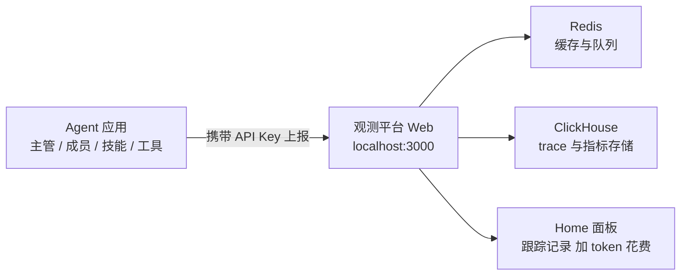

## 【学习目标】

- 用 Docker 与 Docker Compose 搭建课程演示的大模型观测平台，完成注册、建项目、领取 API Key 的初始化。
- 读懂面板的两类核心统计：LLM 与智能体的跟踪记录、大模型 token 花费。
- 建立 Agent 可观测性的分析框架：延迟、成本、工具调用链路分别看什么、怎么降。

## 【正文】

### 1. 为什么 Agent 比传统服务更需要可观测性

智能体在运行过程中同样需要可观测性。一次用户请求的背后，是一串不确定的模型调用加工具调用：主管先规划，成员再生成，工具结果回填，循环几轮不可预知。传统 APM 能看到「接口返回 200、耗时 300 毫秒」，却看不到「这次为什么贵、为什么慢、为什么答错」。

非确定性还把问题放大了一层：同一个请求执行两次，走的可能不是同一条路径，第一次主管直接分发，第二次可能先多问了一轮工具。没有 trace 记录，两次执行的差异无从比对，问题也无法复现。课程强调的四类必看指标：响应时间、token 消费、MCP 的调用、工具调用与上下文信息。对关心成本与性能的团队来说，这是一个相当重要的能力，没有它，多 Agent 系统的运行状态就是黑箱。课程把观测放在 13 章工程化阶段并非偶然：功能没跑通之前，观测对象还不存在；链路稳定之后，每一轮优化的前提都是先量出基线。

### 2. 平台识别与 Docker 部署

课程推荐的是一个开源的大模型数据观测与分析平台，用来监控智能体运行期间的各项实时指标。从特征可以确认其身份：本地 3000 端口提供 Web 界面、依赖 Redis 与 ClickHouse 等组件、按项目维度创建 API Key、Home 面板同时提供跟踪记录与 token 花费统计，这正是 Langfuse 的形态。把它作为观测方案，是因为它覆盖了从 trace 明细到成本聚合的完整链路。

平台本身基于 Docker 启动，使用前需要本机具备 Docker 以及 Docker Compose 环境，这部分属前置技能，此处不做展开。启动命令只有一句，但首次启动会拉取 Redis、ClickHouse 等多个组件镜像；网络不佳时需要做访问特殊处理，下载过程比较费时间，务必预留充足时间。

拉取下来的多个组件各有分工：Web 服务占用 3000 端口提供面板与接入 API，Redis 承担缓存与队列角色，ClickHouse 负责 trace 与指标的持久化存储。理解分工有助于排查，数据看不见时，先判断是上报没到（Web 层），还是存储没落（ClickHouse），或是任务堆积（Redis）。

另有一个容易忽略的细节：执行启动命令前必须先进入平台所在的文件夹，compose 文件与相对路径都基于当前目录解析，目录不对会直接找不到配置。

启动后的健康检查建议纳入日常：面板能打开只说明 Web 层就绪，还要确认一条测试 trace 能落库、能检索，再往应用里接 Key。跳过这一步，等应用接完发现平台侧无数据，就要在「应用没上报」和「平台没存储」之间反复试错。

### 3. 初始化四步

启动完成后，通过 localhost:3000 访问。首次进入需要注册账号，填写邮箱和密码即可，密码要求包含特殊符号并区分大小写。注册完成后登录，先创建自己的项目，然后在项目里创建最关键的 API Key，只有拿到该 Key 才能把观测能力接入到自己的项目中。

步骤可以固化为四步：注册账号、创建项目、创建 API Key、把 Key 配进自己的应用。API Key 与 .env 里的模型密钥同级管理（呼应 13-1 节）：不硬编码进仓库，随环境变量注入。

### 4. 面板怎么读

回到平台的统计面板（点击 Home），可以看到两类核心统计：一类是语言大模型或智能体的跟踪记录，另一类就是大模型的 token 花费。

分析框架按三步走。第一步按 trace 定位「贵的那一次」：一次用户请求内部展开了哪些模型调用与工具调用、各自耗时多少，明细里都有。第二步下钻到单次调用看 token 构成：系统提示词、工具定义、历史消息、模型输出各占多少份额，哪一项异常膨胀，优化目标就锁定了。第三步回到架构视角看分层消耗：主管-成员架构下，token 是分层计费的，主管的规划与汇总、成员的领域生成各记各的账，任何一层的提示词膨胀都会被面板成比例放大。

背景常识有必要补一句：主流模型厂商按输入与输出分别计价，两者单价不同，输出通常更贵。因此「历史消息越滚越长」这类问题，伤的不只是窗口，还有真金白银，每一轮调用都要把全部历史重新作为输入计费一次。

观测数据的使用场景可以归为三类。成本分摊：按项目、按天、按 trace 汇总花费，回答「当月钱花在哪」；性能优化：按耗时排序定位慢调用，区分是模型生成慢还是工具执行慢；质量复盘：回放问题请求的完整执行路径，定位是哪一跳开始跑偏。三类场景对应三种看板姿势，面板数据同一份，看法不同。

补一个读 trace 的基本功：一次请求的完整记录是一棵树，根节点是用户请求，下面挂着若干模型调用与工具调用，每个节点各有起止时间、输入输出与 token 计数。读树先看形状，后看数值：形状异常（某一层突然多出一串重复调用）往往比数值异常更早暴露问题，例如工具描述不清导致模型反复试错，或历史消息失控导致上下文被反复重传。数值异常则按 token 计数排序，计数最大的节点就是第一优化对象。

### 5. 与 13-4 节的衔接：从自建平台到接入项目

本节把平台跑起来，下一步是把它接进旅游规划项目，这正是 13-4 节的内容，此处先留一个锚点：课程的接入方式基于 Spring AI Alibaba 的监控 API（课程使用版本 1.1.2.2），通过 TelemetryTracer 以 Builder 方式生成实例，传入访问地址与认证头两个参数，随后把实例注册到全局的 TracerRegistry，智能体运行期即可自动完成追踪，业务代码无需逐个埋点。读 13-4 时带着该预期：本节创建的 API Key，就是那里的认证头来源。

### 6. 两层观测：平台与工程内指标互补

课程方案回答的是「模型调用层」的问题；应用层指标同样不能缺。`981-demo/src/main/resources/application.yml` 通过 management.endpoints.web.exposure 暴露了 health、info、prometheus、metrics 端点，Micrometer 指标带 application 标签，可接 Prometheus 抓取；`981-demo/docker-compose.yml` 则把 agent-app 与 nacos 容器化编排，健康检查就绪后才启动应用。两者的分工：

| 维度 | 观测平台（本节） | 981-demo 内建（Actuator / Micrometer） |
|---|---|---|
| 粒度 | 单次模型调用、工具调用（trace 级） | 进程级指标（健康、水位、自定义计数） |
| 成本视角 | token 花费按次、按天聚合 | 需自行埋点 |
| 部署形态 | 独立 Docker 组件栈 | 随应用端点暴露 |
| 回答的问题 | 为什么这次贵、慢、错 | 服务活着吗、整体水位如何 |

生产上两层都要：前者定位模型侧问题，后者保障服务侧 SLO。只上平台不看进程指标，服务挂了都不知道；只看进程指标不上平台，token 账单成了糊涂账。

### 7. 日常使用节奏与生产注意

日常节奏可以固化为三个时刻：每日看花费曲线，异常陡增立刻下钻；每次发版前后比对同类请求的耗时与 token，回归劣化要能归因；问题反馈进来，先拉对应 trace 复盘全路径，再动手改。观测的价值不仅是「看见」，更是把优化动作与指标变化对应起来，形成闭环。

团队协作里还要定好观测的分工：成本报表适合按周汇总给负责人，trace 明细留给排障时按需拉取，两者不必混着看。平台的项目维度在这里正好对应课程的模块划分，主管、路线制定、行程规划可以各自建项目，token 花费按项目天然分开，与 13-1 节按模块管理密钥的思路一致。

生产层面的注意事项：

- ClickHouse 存储随 trace 量增长，需提前规划保留周期与备份策略；
- 上报链路要有兜底：观测平台故障不能拖垮主链路，采样与异步上报是常规手段；
- 观测本身也消耗资源，高负载下应评估采样率；
- API Key 按项目隔离，泄露后的处置与模型密钥同级，立即吊销重建，并回溯受影响窗口。

## 【易错点 / 面试题】

1. **启动目录错误**：没进入平台所在文件夹就执行启动命令，compose 相对路径解析失败，报错直指找不到配置文件。
2. **未建 API Key 就接入**：上报没有凭证，平台侧看不到任何数据；Key 只在创建后可见，需妥善保存。
3. **面试题：「Agent 的可观测性和传统 APM 有什么区别？」**，追踪对象从接口与 SQL 变成模型调用与工具调用；核心指标多了 token 与成本；非确定性让同一请求两次执行的路径不同，trace 回放成为刚需。再追一层：「token 花费怎么降？」，提示词瘦身、工具渐进式加载（12-4 节）、历史消息截断、按任务难度选模型，四条路的共同前提是「先看见，再优化」。

## 【小结】

本节用 Docker 搭建了课程演示的大模型观测平台：首次启动拉取 Redis、ClickHouse 等多个组件，注册后在项目内创建 API Key 完成接入，Home 面板同时提供跟踪记录与 token 花费两类核心统计；分析上按 trace 定位、按 token 构成下钻、按架构分层复盘。下一节 13-4 通过 Spring AI Alibaba 监控 API 与 TelemetryTracer 把平台接入旅游规划项目。工程侧的对应配置见 `981-demo/src/main/resources/application.yml` 与 `981-demo/docker-compose.yml`。
