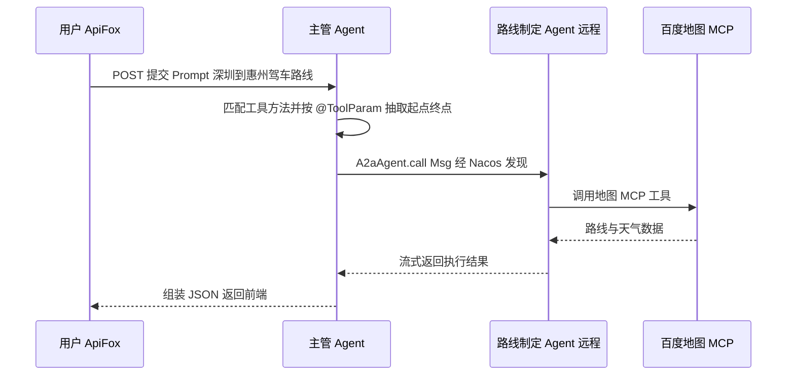

## 【学习目标】

- 理解「手写 Prompt」到「自动生成 Prompt」的演进动机：让用户经接口提交的一句话直接驱动远程 Agent
- 掌握参数抽取的关键手法：用 `@ToolParam` 的 description 向大模型声明「从哪里抽、抽什么」
- 掌握 AgentScope 中字符串 Prompt 到 `Msg` 对象的转换（`PromptUtils`），以及 `A2aAgent.call()` 的阻塞调用语义
- 能看懂双端日志：路线制定专员与主管 Agent 各自在什么时机打印什么

## 【正文】

### 1. 问题背景：远程 Agent 的 Prompt 还在手写

前面的课程里，主管 Agent 通过工具调用远程的路线制定 Agent，由后者请求百度地图 MCP，拿到路线规划与天气数据。路线制定 Agent 启动后，已经能拿到百度地图 MCP 的工具列表，链路是通的。

遗留问题在于 Prompt 的来源：此前传递给远程路线制定 Agent 的 Prompt，是写在工具方法内部的一段固定文本。用户经接口提交的 Prompt 到了主管这一层就断掉了，远程成员收到的仍然是预先写好的那一句。

本节要做的改进：用户提交「制定深圳到惠州最优的驾车路线」这样一句话，主管 Agent 自行从中抽取有效信息、生成传给远程成员的 Prompt，全程无需人工预设。这正是 11-7「主管 Agent 自主分发任务给远程相应的成员」在参数维度上的落地，任务内容不再由开发者在代码里写死，而由模型根据用户输入实时生成。

### 2. 参数抽取：`@ToolParam` 让大模型识别起点和终点

先看工具方法的签名。主管工具箱里「寻找擅长路线制定的远程智能体」这一方法，描述是「擅长制定最优驾车路线的Agent」，用户 Prompt 提到制定驾车路线时，主管依据这段描述自动匹配到该方法。匹配只是第一步，真正要解决的是：匹配之后，用户 Prompt 里的信息怎么传进去。

做法是在方法里加一个参数，并用 `@ToolParam` 注解修饰。该注解有两个要素：`name` 是参数名，`description` 是参数描述。后者的分量常被低估，模型并不读 Java 源码，它看到的只有 `name` 与 `description` 组成的工具说明。把描述写成「驾车的起点和终点」，等于向模型下达了一条抽取指令：从用户 Prompt 中取出起点地址与终点地址。用户说「深圳到惠州」，抽取结果就是起点深圳、终点惠州。

```java
    @Tool description = "擅长制定最优驾车路线的Agent"
    public String gqlRouteMakingAgent(
        @ToolParam name = "prompt", description = "驾车的起点和终点"
        String prompt) throws NacosException {
```

如实说明：该片段按讲稿现场写法照录，`@Tool` 与 `@ToolParam` 未按注解常规加括号，方法体与右花括号亦省略，此处不做修补，仅关注签名结构：方法描述负责「被匹配到」，参数描述负责「被填对」。

运行验证的做法是打印一次。用户经接口提交 Prompt 后，主管 Agent 先依据方法描述匹配到「寻找擅长路线制定的远程智能体」这一工具，再按照 `@ToolParam` 声明的要求，从用户 Prompt 中提取信息。日志里起点深圳、终点惠州被清晰打印出来，证明抽取链路成立：描述写得准确，模型就抽得准确。

### 3. 组装 `Msg` 对象并调用远程 Agent

信息抽取出来之后，下一步是把它送进远程调用。前文课程中，远程智能体的运行由 `call` 方法触发；现在要把抽取到的 Prompt 传进 `call`。

这里横亘着一个类型问题：`call` 接受的参数是 `Msg` 对象，而抽取出来的 Prompt 只是字符串。AgentScope 中的 Prompt 并不是裸字符串，而是携带角色与内容结构的 `Msg` 对象，因此需要一次转换。课程在公共模块的 `utils` 下提供了一个用户 Prompt 构建工具类：传入字符串，产出 `Msg` 对象。转换完成后，把 `Msg` 交给 `call`，远程 Agent 即可运行。

```java
    A2aAgent agent = A2aAgent.builder()
        .name("RouteMakingAgent")
        .agentCardResolver(
            new NacosAgentCardResolver(NacosUtil.getNacosClient())
        )
        .build();

    // 组装Prompt
    PromptUtils promptUtils = new PromptUtils();
    Msg userMsg = promptUtils.getPrompt(prompt);

    // 远程Agent调用
    Msg remoteAgentResponse = agent.call(userMsg).block();
    log.info("remoteAgentResponse.getTextContent()");
```

逐段读这段代码：

- `A2aAgent.builder()` 构建一个远程 Agent 客户端，`agentCardResolver` 传入 `NacosAgentCardResolver`，智能体卡片（AgentCard）的发现走 Nacos 注册中心，与 11-2「团队成员基于 A2A 协议注册到 Nacos」、11-3「主管 Agent 基于 A2A 协议获取团队成员」一脉相承。远程成员的地址不在代码里写死，而是运行时从注册中心解析。
- `promptUtils.getPrompt(prompt)` 完成字符串到 `Msg` 的转换，把抽取结果包装成 AgentScope 认识的消息对象。
- `agent.call(userMsg).block()` 发起调用并阻塞等待。远程任务涉及多轮推理与 MCP 工具调用，耗时以秒计，`block()` 的含义是：当前线程挂起，直到远端完整返回。
- 返回值 `remoteAgentResponse` 保留了远程智能体的运行结果。由于最终要经接口组装成 JSON 返回给前端，该方法必须把结果以流的形式交出，而不是打印了事。

一次调用的完整数据流可以画成下面这张时序图：



### 4. 运行结果：双端日志对读

总体跑一次，重点对读两端的日志，主要任务执行发生在路线制定智能体一侧。

路线制定 Agent 的日志显示：它先确认收到请求，并声明以 SSE 形式返回；随后创建一个新任务，任务内容即「深圳到惠州的最优驾车路线」；任务启动后，转而请求百度地图的 MCP，调用地图工具获取数据。

主管 Agent 的日志则呈现等待姿态：先打印远程智能体已接收到调动、任务已经开始；由于采用 `call` 阻塞调用，它会一直等待远程成员的整体返回；远端执行完毕的那一刻，主管打印任务完成，随后拿到返回内容。阻塞式调用在这段日志里表现得非常直白，主管线程的等待周期与远程任务的执行周期完全重合。

远端返回的内容如下：

```text
    2026 [INFO] ... A2aAgent complete call.
    2026 [INFO] 根据百度地图MCP返回的数据，深圳到惠州的最优驾车路线如下：
    **路线概览**
    - 总距离：约9.21公里
```

可以看到，最终输出是基于百度地图 MCP 返回的数据生成的：先给路线概览，再给总距离约 9.21 公里。主管没有参与路线计算，它只负责抽取参数、分发任务与回传结果，计算发生在工具侧，这正是多 Agent 分工的边界。

### 5. 与 981-demo 的对应关系

`981-demo/src/main/java/com/travel/agent/agent/SupervisorTools.java` 把课程的「Agent 即工具」模式落成了生产代码：`ask_route_making_agent` 与 `ask_attraction_agent` 两枚 `@Tool`，参数均以 `@ToolParam(name = "task", description = "任务描述，如 杭州三天路线")` 声明，description 即抽取指令，与本节「驾车的起点和终点」同一手法；分发走 `AgentTransport`，并包了 resilience4j 熔断，成员不可用时降级提示而非拖垮主管。

`981-demo/src/main/java/com/travel/agent/agent/TeamMembers.java` 定义远程成员：`routeMakingAgent` Bean 以 `RouteMakingAgent` 为名、描述为「路线制定Agent：调用百度地图 MCP 规划路线与通勤方案」，方法描述决定匹配的写法在此固化。`981-demo/src/main/java/com/travel/agent/tool/RouteMakingTools.java` 提供地图能力：`map_geocode`、`map_directions`、`map_weather` 三枚工具对应百度地图 MCP 服务端的工具体系（11-5），离线模式以本地桩返回同构数据。

调用链的出口在 `981-demo/src/main/java/com/travel/agent/a2a/A2aEndpointController.java`：成员以 A2A 端点形式暴露，GET 路径 `/.well-known/agent.json` 做能力发现，POST 以 JSON-RPC `message/send` 提交任务；课程的 Nacos 发现在工程中由 `NacosAgentRegistry` 承接，离线默认走进程内注册表（`InProcessAgentRegistry`），保证无外部依赖也能跑通「发现-调用-回传」全链路。

## 【易错点 / 面试题】

1. **`@ToolParam` 的 description 写敷衍了会怎样？** 模型只依据工具说明填充参数，描述写成「路线相关的信息」这类含糊措辞，抽取结果就会缺起点或缺终点。参数描述要当成提示词来写：说清楚从哪里抽、抽出来放进哪个参数。
2. **为什么不能把字符串直接传给 `call`？** AgentScope 的 Prompt 是 `Msg` 对象而非裸字符串，类型不匹配在编译期就过不去。转换逻辑应收敛到 `PromptUtils` 之类的工具类，避免在每个调用点重复组装消息结构。
3. **面试题：「主管 Agent 怎么把用户的一句话变成远程成员能执行的任务？」** 答两层：匹配层靠工具方法描述，模型据此选择调用哪个成员；参数层靠 `@ToolParam` 描述，模型据此从用户输入中抽取结构化信息。再补一句工程演进：抽取质量不满意时，优先改描述而非改链路，提示词层面的调整成本远低于改代码。

## 【小结】

本节把远程路线制定 Agent 的 Prompt 来源从「手写固定文本」换成了「主管自动生成」：`@ToolParam` 的描述向模型声明抽取要求，`PromptUtils` 完成字符串到 `Msg` 的转换，`A2aAgent.call()` 经 Nacos 发现远程成员并阻塞等待结果。双端日志验证了链路：主管负责匹配与抽取，路线制定专员负责调 MCP 算路线，结果经接口组装成 JSON 返回。

至此，13-2 留下的「执行语义」空白基本填上，用户请求可以真正驱动远程成员完成子任务。生产化落地可对照 `981-demo/src/main/java/com/travel/agent/agent/SupervisorTools.java`、`981-demo/src/main/java/com/travel/agent/agent/TeamMembers.java` 与 `981-demo/src/main/java/com/travel/agent/a2a/A2aEndpointController.java`：同一套「Agent 即工具 + 参数抽取 + A2A 调用」链路，配熔断降级与离线注册表，即可不填 Key 跑通全流程。
