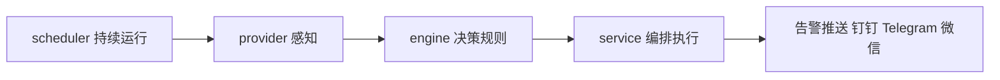

## 【学习目标】

读完本节并完成思考练习后，你应当能够：

1. 用「痛点-需求-能力」的三段式方法，把一句模糊的业务想法（「想早点知道股票消息」）拆解成可落地的功能清单与技术模块。
2. 区分项目的两类核心任务，**技术实战**与**商业盈利**，并理解二者如何互相验证。
3. 建立「及时信息即竞争力」的需求认知，知道为什么「实时可达的提醒」比「事后能查的报表」价值更高。
4. 把需求映射成 `982-demo` 的工程骨架（数据采集、规则判定、告警推送），提前建立需求与代码的对应关系。

> **课程声明（务必牢记）**：股市有风险，投资需谨慎。本课程不提供任何股票推荐或投资建议，所有与股票相关的内容与决策均由读者自行判断和负责。

---

## 【正文】

### 一、项目痛点：为什么需要一个股票异动提醒系统

任何一个值得做的工程项目，都始于一个真实且未被满足的痛点。本课程要做的「股票异动风控机器人」，痛点的根源在于**信息的不对称与滞后**。

股票涨跌本是常态，但真正影响决策的是「异动」，某只股票突然拉出一根大阳线、或某公司突然发布重大合作。这类事件往往伴随密集的新闻推送。现实中许多投资者面临同一个困境：「要是我能早点知道该消息就好了。」这里的「早点」，差的可能不是几小时，而是决定了能否提前布局、能否及时止损的关键窗口。

为什么信息前置如此重要？可以从三个层次理解：

1. **时间价值层**：资本市场对消息的定价是瞬时完成的。一条「某公司宣布与 OpenAI 合作」的利好，在公开后的几分钟内就可能被部分资金消化。普通投资者能越早拿到原始信息，越有可能在价格完全反映之前做出自己的判断（上涨则考虑建仓，利空则设置止损）。
2. **认知负担层**：人工盯盘几乎不可能覆盖全市场数千只股票。人脑的带宽决定了你只能关注持仓的几只，而系统性风险往往来自你没盯的那只。
3. **执行闭环层**：即便看到了消息，从「看到」到「通知到手机」还有一段距离。如果还要手动转发、手动建群通知，信息的时效价值在传递过程中被不断损耗。

因此，项目的核心痛点可以被精炼为一句话：**把分散、滞后的股票新闻，变成实时可达的提醒。**

这里需要特别说明信息源的可及性。以美股为例，部分知名公司的信息相对透明，官网、合规披露渠道会发布自身股票相关的动态与新闻报道；一些聚合类 RSS 源（如本课程使用的 `https://www.stocktitan.net/rss`）会把这类异动新闻集中推送。这意味着「提前获取信息」在工程上是可行的：通过程序主动抓取、清洗、入库、再推送到手机端，就能在用户不盯盘的情况下，把关键消息实时送到眼前。

### 二、从想法到落地：一条可被复用的验证路径

把「痛点」变成「系统」，中间需要经过一次真实的工程验证，而不能停留在脑内推演。本课程项目的演化路径，是一段值得复制的方法论：

1. **提出假设**：既然信息前置有价值，那能否用程序把异动新闻自动抓取、存储、再推送到聊天软件？
2. **外部求证**：先去外部网站查资料，确认 RSS 源稳定可用、聊天机器人 API 开放、翻译与推送链路技术可行。这一步决定项目是不是「能做的」。
3. **最小可用实现**：动手写出第一版采集 + 入库 + 推送的脚本，自己先用起来。
4. **真实场景内测**：把身边朋友拉进来试用，观察真实使用中的摩擦，消息太多怎么切片、时区怎么换算、翻译失败怎么降级。
5. **沉淀为课程**：当自用与内测都验证价值后，再把这套工程化、模块化，以课程形式开放给更多学习者。

这条路径的关键启示是：**任何「可盈利」的项目，都必须先通过「自己愿意用」这一关**。自己都不用的系统，不可能说服别人付费。本课程的机器人是先服务好作者本人与内测群，验证闭环成立，才向外输出。

### 三、需求建模：把「提醒」拆成可执行的子需求

「实时可达的提醒」听起来是一句话，但拆解成工程需求后，至少包含以下可独立实现、可独立测试的模块。建议读者在做任何项目时，都先画一张类似的需求-模块映射表：

| 编号 | 业务需求 | 工程子任务 | 对应 `982-demo` 模块 |
|---|---|---|---|
| R1 | 持续获取异动新闻 | 定时从 RSS / 行情源拉取数据 | `provider/QuoteProvider`、`MockQuoteProvider` |
| R2 | 数据可用、不脏 | 空值校验、时区换算、标题抽取 | `RssServiceImpl`（采集层清洗） |
| R3 | 异动可判定 | 涨跌幅/成交量/波动率阈值规则 | `engine/RuleEngine`、`RiskRule` |
| R4 | 触发后可决策 | 编排「是否告警、告警给谁」 | `service/RiskEvaluationService` |
| R5 | 消息达人到手机 | 钉钉/Telegram/微信多渠道推送 | `controller` + 推送适配层 |
| R6 | 人能用自然语言查 | 把数据封装成 MCP 工具 | `agent/RiskQueryAgent` + `@Tool` |
| R7 | 系统长期稳定 | 定时调度、AOP 日志、去重 | `scheduler/RiskScanScheduler` |

这张表的价值在于：它把「我想做个股票机器人」这种模糊想法，翻译成了**可被任务分解、被排期、被单测**的工程清单。每一项 R 都能对应到 `982-demo` 中的一个真实包，读者在后续章节每写完一块，都能回看这张表确认「需求是否被满足」。

> **为什么用「需求-模块」映射表**：软件工程里最贵的成本不是写代码，而是「写错了方向」。先固化需求与模块的对应关系，能让后续每一章都有明确的验收标准，避免做到一半发现某块能力根本没规划。完整可部署示例见 `982-demo/src/main/java/com/riskbot/provider/QuoteProvider.java`。

### 四、项目核心任务：技术实战与商业盈利的双轮

任何项目的开展，核心任务无非两个方面，二者构成互相反哺的双轮：

#### 4.1 技术实战与项目开发

以技术为核心，通过开发本项目提升自己的工程能力，并完成项目本身的迭代升级。这部分是「练内功」：Spring Boot 4 多模块工程、Spring Schedule 定时采集、MyBatis-Plus 入库、Redis 分布式去重、Spring AI 封装 MCP 工具、Docker 容器化部署，每一项都是生产环境高频出现的能力。项目本身就是简历上最有说服力的作品：它不是一个玩具 CRUD，而是一个具备「感知-决策-执行」闭环的真实系统。

#### 4.2 项目盈利

做项目的目的往往是为了产生收益。一个完全不带收益预期的项目，很难持续投入精力去打磨。本课程项目从设计之初就带有清晰的盈利路径，既可以通过「及时信息差」辅助投资决策（收益或止损），也可以通过「信息不对称」提供会员订阅服务。

需要强调的是，这两类任务**不是先后顺序，而是互相验证**。技术实战打磨出稳定可用的系统，系统可用才能支撑盈利；盈利带来的真实用户与反馈，又倒逼技术做弹性、做可观测、做多租户。一个只谈技术不谈价值、或只谈价值没有工程支撑的项目，都走不远。

### 五、把「需求拆解」沉淀为工程直觉

本节看似在讲业务动机，实则在训练一种可迁移的工程直觉：**拿到任何一句业务诉求，第一反应应是「拆」**，拆成数据从哪来、怎么变干净、用什么规则判定、触发后怎么执行、人如何触达、系统如何长期稳定。这套拆解框架不仅适用于股票机器人，也适用于你未来会遇到的风控、监控、运营自动化等一切「感知-决策-执行」类系统。

在 `982-demo` 里，这条链路被物理地落地为 `provider`（感知）→ `engine`（决策规则）→ `service`（编排执行）→ `scheduler`（持续运行）。当你能把需求讲清楚、又能指给面试官看代码落点在哪，你的项目就脱离了「我跟着视频敲了一遍」的层次，进入了「我理解它为什么这么设计」的层次。

需求落地的工程链路如下：

---

## 【易错点 / 面试题】

1. **面试官问：你该项目是怎么确定要做的？有没有做过需求分析？**
   答：我从「信息滞后导致决策被动」的真实痛点出发，先用外部资料验证了 RSS 源与推送链路的技术可行性，再做出最小可用版自用验证，最后才工程化。需求被拆成了采集、清洗、规则判定、告警推送、MCP 查询、稳定运行 7 个子模块，并能一一映射到代码包。

2. **易错点：把「盈利」当成项目的唯一目标，忽视技术打磨。**
   只有稳定好用的系统才能支撑盈利。本项目先保证 `default` profile 下 Mock 数据即可离线跑通主链路（无需外部 Key），再谈接真实行情与商业化。技术地基不牢，盈利就是空中楼阁。

3. **易错点：需求只停留在口头描述，没有量化。**
   「异动」必须被定义成可计算的阈值（涨跌幅、成交量倍数、单位时间出现次数）。模糊的需求无法落地成规则引擎，这正是 `RuleEngine` 中 `PriceVolatilityRule` 与 `VolumeSpikeRule` 存在的意义，把业务语言翻译成数值判定。完整可部署示例见 `982-demo/src/main/java/com/riskbot/engine/PriceVolatilityRule.java`。

4. **面试题：为什么先自用验证，而不是直接开课？**
   答：自用验证能暴露真实摩擦（消息切片、时区、翻译降级），这些只有在真实使用中才会显现。先服务好自己与内测群，确认闭环成立，再对外输出，是对学习者负责，也是工程严谨性的体现。

---

## 【小结】

本节把「想早点知道股票消息」这一句朴素诉求，拆解成 7 个可执行的工程子需求，并建立了「技术实战 × 商业盈利」的双轮模型。下一节（2-2 项目核心能力与功能说明）会沿着这张需求表，逐项展开系统最终落地的两大功能板块，聊天机器人消息推送与 MCP 股票服务；再下一节（2-3 项目架构全景图）则把模块映射成完整的技术架构图。建议读者在继续之前，先把本节的需求-模块映射表记熟，它是后续所有章节的「目录」。
