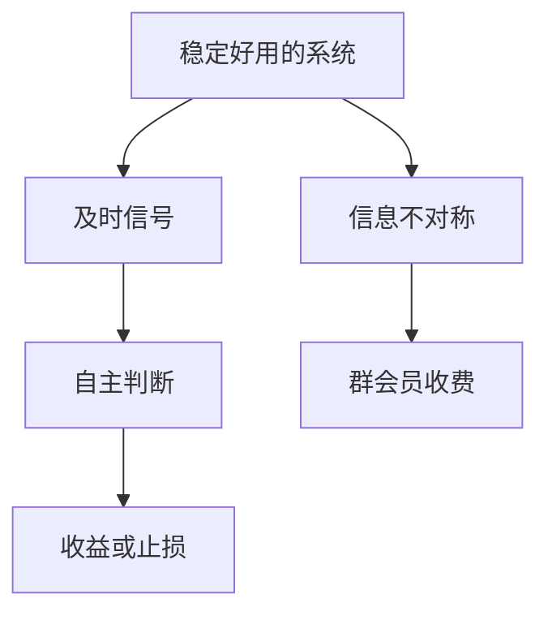

## 【学习目标】

读完本节后，你应当能够：

1. 说清本项目的两类盈利方式，**股票收益或止损**与**群会员收费**，各自的运行逻辑与前提条件。
2. 结合课程中真实观察过的案例（SMX、Oracle、BRJ/新蛋、CJET），理解「及时信息」如何转化为决策优势，以及为什么「止损」和「收益」同等重要。
3. 建立「信息不对称即商业价值」的认知，理解会员订阅模式的可持续性来源。
4. 把「盈利」与工程能力关联：为什么只有稳定可用的系统（`982-demo` 的可部署闭环）才能支撑持续盈利。

> **再次强调**：以下仅为案例讲解与逻辑分析，绝不构成任何投资建议。股市有风险，投资需谨慎，所有决策由读者自行判断和负责。

---

## 【正文】

### 一、盈利的总逻辑：信息差 + 系统稳定性

项目全部做完之后，它会带来盈利。但盈利的前提不是「你比别人聪明」，而是「你比别人早拿到结构化、可行动的信息」，并且**系统能持续、稳定地把信息送到你手上**。如果系统三天两头挂、消息延迟半天，信息差就被磨损殆尽，盈利逻辑也就不成立。

因此盈利方式始终建立在两个支点之上：一是项目帮你更早发现异动消息（技术支点），二是你基于消息做出自己的决策或提供服务（商业支点）。下面分两种方式来说明，并配上实际操作中观察到的真实例子。

### 二、第一种盈利方式：股票收益或止损

当我们通过该消息渠道交流时，会收到一条群发消息。该信息的优势在于「及时」，你能比大多数人更早拿到消息。收到消息之后，你可以自己判断：

- 如果认为这只股票在未来某段时间有上涨空间，可以选择**买入**；
- 如果这条消息是利空，则可以**设置止损点**。

需要特别指出：盈利方式的闭环里，「agent」指的是**智能体**，只要监测到积极利好消息，股价很可能上去；出现利空，价格就可能下跌。结合消息做决策，这就是第一种盈利方式的本质。而系统要做的，正是及时、准确地把「利好/利空」信号送达，让决策窗口尽可能不被浪费。

下面是四个真实观察案例，仅用于说明「信息前置如何改变决策窗口」，不含任何买卖建议。

#### 案例 1：SMX

以 SMX 为例。其实一周前就已经在数据库里监听到了相关消息，11 月 15 日就有很多消息，11 月 28、29 日也是。它的价格走势大致是：数据库里最早记录是 11 月 18 日，当时价格只有 **3 块**；而到 12 月 1 日之后开始大幅拉升，最高涨到了 **490 块**（当时页面大致在 400～450 区间）。

换言之，如果在拿到这些积极消息时判断它会涨，并选择买入，假设用 10 块钱买，涨到 400 多，资金就翻了很多倍；如果买了 1500 股，到达该位置时的资金量会相当可观。当然，具体怎么操作完全取决于个人。

> 注：前面提到的「三毛」是另一只股票，不是 SMX。那只从三毛涨上来的股票，翻倍倍数比 SMX 还要多，只是当时没有完整记录。

#### 案例 2：甲骨文（Oracle）

甲骨文是最早开始监测的对象。当时正好在做本项目，把内容打印到控制台，那天控制台一下子刷出了大量与 Oracle 相关的信息。看日 K 线：9 月份那天，价格从 240 涨到了 340，**涨了 100 块**。记得很清楚，有位朋友正好前两天买了 **100 份期权合约**，当天开盘后就直接卖掉，差不多赚了 **500 万美元**。

不过要提醒：Oracle 当时其实整体呈下降趋势，而且它和 AI 领域相关，而 AI 领域本身存在泡沫，**风险相当高**，可能暴跌，也可能暴涨。看财报能了解经营状况，但最终还是要自己根据消息做决策。

#### 案例 3：BRJ 与新蛋（Newegg）

还有两只股票，BRJ 和新蛋（New Egg）。新蛋最早在 Telegram 里监测到：某天 9 点半左右出消息，10 点多才开始涨，价格从 **6 块涨到 45 块**。BRJ 那边是一次两家公司的共同投资，资产大幅上涨（具体数额记不太清了，大概是几十亿级别，约 300M）。新蛋从最初关注时的 30 多块，一度涨到 90 多，后来又回到 70 多，感兴趣可以自己关注，同样不做任何推荐。

#### 案例 4：CJET（中概股）与止损

止损同样重要。CJET 是一只中概股，之前处于合股状态。一开始就持有它（从 1000 股逐渐加仓到一万股），最初是盈利的。但后来收到一条消息，觉得可能有问题，当天就立刻全部卖掉了，结果合股之后股价立刻暴跌，一直跌到 **9 毛钱** 左右（那天最低跌到约 0.5 元）。

这给我们的启发是：如果持有某只股票，同时又收到了关于它的不利消息，就可以根据情况及时采取措施**止损**，或者做高抛低吸。止损操作能帮你及时挽救处境、保住资金。

#### 案例速查表（仅作逻辑对照，非投资建议）

| 标的 | 关键信号 | 价格轨迹（观察值） | 说明的盈利逻辑 |
|---|---|---|---|
| SMX | 两周内 14 次异动 | 3 块 → 最高 490 块 | 早期异动密集 → 潜在上涨空间 |
| Oracle | 控制台突发大量消息 | 240 → 340（单日 +100） | 信息密集期配合期权放大收益，但 AI 泡沫风险高 |
| 新蛋 Newegg | Telegram 早间消息 | 6 块 → 45 块（盘中启动） | 消息早于涨势，存在决策窗口 |
| CJET | 持仓期间突现利空 | 合股后暴跌至约 0.9 / 最低 0.5 | 利空即时止损，避免更大回撤 |

这张表的目的，是把「信息前置」和「决策窗口」之间的关系讲清楚，而不是推荐任何标的。读者应从中提取的，是**「及时信号 → 自主判断 → 收益或止损」**这一可复用的方法论。

### 三、第二种盈利方式：群会员收费

第二种方式，就是建会员群收费。道理在于**信息不对称**：消息是公开可查的，但并不是每个人都知道怎么写代码、怎么用本项目。如果有人没有该消息渠道、又希望及时拿到消息，你就可以为他提供这样一个群组，让他能及时采取行动。

具体做法：一开始就建一个会员群，把人拉进来一起参与，然后定期收费。例如：

- **按年收费**：每年 99 元，或者 199 元也完全可以；
- **一次性 / 永久会员**：299 元、399 元都可以，收一笔永久费用。

一旦将该群建起来，这种盈利方式也相当可观。你可以在相关平台的留言区先发评论、再做推广分享来运营。具体怎么运营，就靠大家自己发挥了。

会员模式的可持续性来自三点：第一，信息差长期存在（不会所有人都去写采集系统）；第二，系统的边际成本极低（多一个会员只是多推一个群，几乎不增加算力）；第三，用户对「及时性」的付费意愿稳定。但这同样建立在系统稳定可用的基础上，如果推送经常延迟或丢失，会员就会流失。

### 四、盈利与工程的相互验证

两类盈利方式都绕不开一个事实：**没有稳定好用的系统，盈利就是空中楼阁**。

- 第一种方式要求消息足够「及时」，这依赖 `scheduler/RiskScanScheduler` 的可靠周期扫描、依赖 `provider` 的稳定取数、依赖推送通道的不丢消息；
- 第二种方式要求服务足够「稳定」，这依赖 `RuleEngine` 准确判定、依赖 `RiskEvaluationService` 正确编排告警、依赖系统在外部依赖（翻译、机器人 API）故障时降级而非崩溃。

在 `982-demo` 中，这套闭环被做成可部署工程：`default` profile 用 `MockQuoteProvider` 提供样本行情、用 `OfflineChatModel` 验证主链路，无需任何外部 Key 即可离线跑通；切 `prod` profile 再接真实行情与模型。只有先跑通离线主链路，才有资格谈盈利。完整可部署示例见 `982-demo/src/main/java/com/riskbot/service/RiskEvaluationService.java` 与 `982-demo/src/main/java/com/riskbot/engine/RuleEngine.java`。

两类盈利方式与系统支点的关系如下：

---

## 【易错点 / 面试题】

1. **面试官问：你做本项目只是为了赚钱吗？技术上有沉淀吗？**
   答：盈利是项目的目标之一，但技术沉淀才是根本，Spring Boot 4 多模块、Spring Schedule、MyBatis-Plus、Redis 去重、Spring AI 封装 MCP、Docker 部署，每一项都是生产高频能力。盈利逻辑建立在「系统稳定可用」之上，二者互相验证，不是割裂的。

2. **易错点：把案例当投资建议。**
   课程所有案例（SMX、Oracle、新蛋、CJET）都只是「信息前置如何改变决策窗口」的示例，绝不构成买卖建议。真实市场存在泡沫与暴跌风险（如 Oracle 整体下行、AI 泡沫），必须独立判断、自负盈亏。

3. **易错点：忽视止损，只谈收益。**
   CJET 案例恰恰说明止损和收益同等重要，持仓期间突现利空时，及时清仓避免了合股后暴跌至 0.5 元的更大回撤。风控机器人的「风控」二字，重点就在止损信号的及时触达。

4. **面试题：会员模式的可持续性靠什么？**
   答：靠三点，信息差长期存在（非人人会写采集系统）、系统边际成本极低（多一个会员只是多推一个群）、用户对及时性的付费意愿稳定。但前提是系统稳定不丢消息，否则会员必然流失。

---

## 【小结】

本项目的盈利方式就是两种：**通过股票收益或止损获利**，以及**通过群会员收费获利**。前者建立在「及时信息 → 自主决策」的窗口优势上，后者建立在「信息不对称 → 订阅服务」的可持续模型上。二者共同的地基是稳定可用的工程系统，`982-demo` 把「感知-判定-告警-推送」闭环做成可离线验证、可生产部署的工程，正是为了让该地基牢靠。若你有更好的方法，也欢迎在我们的群里交流讨论。从下一章开始，我们就会一步一步、通过写代码将本项目逐步搭建并实现出来。
