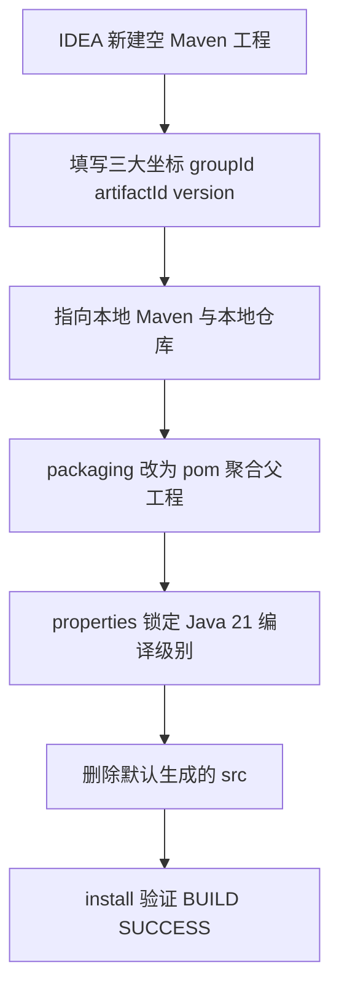

## 【学习目标】

学完这一篇，你应该能够独立做到以下四件事：

1. 在 IntelliJ IDEA 中基于本地已装好的 JDK 21 与 Maven，创建一个空的 Maven 工程并正确填写三大坐标（groupId / artifactId / version）。
2. 把 IDEA 的 Maven 指向本地安装版本与本地仓库，避免 IDE 自带 Maven 带来的版本错配与下载慢问题。
3. 理解 `pom` 聚合工程与 `jar` 普通工程的区别，并把父工程改造为 `packaging=pom` 的分层骨架。
4. 用 `maven.compiler.source/target` 把全项目 Java 字节码版本锁死在 21，再用 `install` 验证骨架可构建。

这一篇是整个课程的「地基」环节：后续所有股票异动风控的代码都会挂靠在一个多模块工程之下，地基不牢，后面每加一个子模块都会反复踩坑。

## 【正文】

### 一、为什么先搭骨架，而不是先写业务

很多初学者习惯「新建一个 Spring Boot 工程直接开写」，这在小 demo 里没问题。但本课程的工程最终要承载行情接入、规则引擎、Agent 查询、定时扫描、REST 接口等一整套能力，它们之间既有公共依赖（Spring AI、Spring Boot、工具库），又有清晰的职责边界。如果一开始就是一个扁平的 `jar` 工程，后期会出现三个典型问题：

- **依赖版本各自为政**：A 模块引了 Spring AI 2.0.1，B 模块不小心引了 1.0.9，编译期看不出问题，运行期 `NoSuchMethodError` 才会爆雷。
- **包结构纠缠**：所有类塞进一个 `src/main/java`，无法用模块边界强制隔离「行情」与「规则」的关注点。
- **构建不可拆分**：想单独给规则引擎跑单元测试都办不到，因为根本没有模块边界。

因此课程选择「先建一个 `pom` 聚合父工程，后续逐个挂载子模块「的路线。父工程本身不写业务代码，它只负责三件事：**统一坐标、统一依赖版本、统一 Java 编译级别**。

### 二、创建空项目并填写坐标

打开 IDEA，点击 **New Project（新建项目）**，选择创建一个空项目（Empty Project）。需要填写以下几项：

- **Name（名称）**：我们的项目叫「美股监控」，对应英文 `us_stock_monitor_dev`；
- **Location（位置）**：项目存放在本地的哪个文件夹，保持默认即可；
- **Language（语言）**：选择 **Java**；
- **JDK**：切换为我们已经装好的 **JDK 21**。

展开下方的 **Advanced Settings（高级设置）**，这里要设置 Maven 的项目坐标：

- **Group Id**：通常代表公司或组织，比如 `com.imook`、`com.abc`，我这里改成 `com.it`（也可以改成你自己的名字，都没问题）；
- **Artifact Id**：就是项目名称 `us_stock_monitor_dev`，与上面的 Name 保持一致即可；
- **Version**：默认 `1.0-SNAPSHOT`。

填好后点击 **Create（创建）**，一个空项目就建好了。

**坐标的语义要讲清楚**：Maven 靠 `groupId + artifactId + version` 三者唯一确定一个构件（artifact）。`groupId` 用反向域名表达归属，`artifactId` 表达项目名，`version` 中的 `SNAPSHOT` 后缀表示「仍在开发中、内容可能随时变化」，Maven 对 SNAPSHOT 构件每次都会去远程仓库检查更新，而正式版本（如 `1.0.0`）则会被本地仓库缓存复用。把 `groupId` 取成 `com.it` 这类短域名没问题，但生产项目里建议用你真实可控的反向域名，避免将来发布到中央仓库时撞名。

### 三、配置 Maven 的 Home 与本地仓库

项目创建成功后，还需要检查一下 Maven 的设置，否则 IDEA 可能用的是自带的 Maven。进入 **Settings → Build, Execution, Deployment → Build Tools → Maven**：

- **Maven home path**：指定我们本地安装的 Maven（我这里选 3.9.0，和 3.9.2 本质相同）；
- **Local repository（本地仓库）**：指向我们本地的仓库目录（如 `~/.m2/repository`）；
- **User settings file**：找到 Maven 的 `settings.xml` 并打开。

配置完点击 **Apply**、**OK**，你会看到下方原来的报错信息消失了，说明 Maven 已经接管成功。

接着确认一下项目的 JDK：打开 **File → Project Structure**，当前 SDK 已经是 **JDK 21**，无需改动；下面的 **Language level（语言等级）** 保持默认或选择 JDK 21 即可。同样点击 Apply、OK 完成设置。

**为什么要特意指向本地 Maven**：IDEA 自带一个捆绑版 Maven，版本往往偏旧，且它的本地仓库路径默认在 IDEA 自己的缓存目录里。如果你之前在命令行用本地 Maven 下载过大量依赖，切到 IDEA 自带版本就意味着要重新下载一遍，既慢又占磁盘。更关键的是，很多团队会在 `settings.xml` 里配置**镜像仓库**（比如把中央仓库指向国内镜像），只有用同一份 `settings.xml`，IDEA 才能享受同样的加速，本课程依赖外网拉取依赖，网络条件普通的同学更该用镜像，否则后面引入 Spring AI 这类大依赖时会非常痛苦。

**JDK 与 Language level 必须一致**：`Language level` 决定编译器允许你使用哪些 Java 语法特性（比如 `switch` 模式匹配、Record 模式是 Java 21 才稳定的）。如果 SDK 是 21 但 Language level 被误设成 17，你写的 Java 21 语法会直接编译报错。所以这里统一选 JDK 21。

### 四、改造 pom.xml：从 jar 父项目改为 pom 聚合工程

此时项目虽然建好了，但还只是个空壳。因为我们后面要做的是**分层结构**的项目（有主项目和多个子项目），所以需要对 `pom.xml` 做改造。

先确认项目的三大坐标，`<groupId>`、`<artifactId>`、`<version>`，它们用来唯一标识一个项目：

```xml
<groupId>com.it</groupId>
<artifactId>us_stock_monitor_dev</artifactId>
<version>1.0-SNAPSHOT</version>
```

默认打开的 `pom.xml` 里，打包类型（`<packaging>`）是 `jar`（普通 Java 应用）。但主项目是用来**统筹构建**的父工程，后面还会挂多个依赖的子项目，所以要把它改成 `pom`：

```xml
<packaging>pom</packaging>
```

同时可以在 `<properties>` 里锁定 Java 编译版本，确保全项目统一用 JDK 21：

```xml
<properties>
    <maven.compiler.source>21</maven.compiler.source>
    <maven.compiler.target>21</maven.compiler.target>
    <project.build.sourceEncoding>UTF-8</project.build.sourceEncoding>
</properties>
```

这里再说明一下 `<packaging>` 的作用：它指定打包类型，`pom` 表示父/聚合工程，`jar` 是普通 Java 应用，`war` 是 Web 应用。父子工程正是靠它区分的。

**`packaging=pom` 到底意味着什么**：Maven 在构建 `pom` 类型工程时，不会去编译 `src` 下的 Java 代码、也不会打出一个可运行的包，它只做一件事，**按 `<modules>` 列表依次构建每个子模块**。这正是「聚合」的含义：你在父工程上执行一次 `mvn install`，Maven 会按依赖顺序把每个子模块都构建一遍。与之配套的是「继承」：子模块通过 `<parent>` 指向父工程，从而自动继承父工程 `dependencyManagement` 里锁定的版本和 `properties` 里统一的编译级别。

**`source` 与 `target` 为什么要一起锁**：`maven.compiler.source` 控制「允许使用的语法版本」，`maven.compiler.target` 控制「生成的字节码能跑在哪个 JVM 上」。两者必须一致，否则会出现「用 21 的语法写、却想跑在 17 的 JVM」这类矛盾。本课程锁在 21，是因为 Spring AI 2.0 的基线就是 Java 21（虚拟线程、Record 模式都是 21 的红利），低于 21 根本跑不起来。

### 五、清理并验证构建

父工程不需要业务源码，所以可以把默认生成的 `src` 源码包直接删掉（选中包，点删除即可）。

删除后，在右侧 Maven 面板里双击 **install**，看到控制台输出 `BUILD SUCCESS`，就说明父工程骨架已经成功构建。后续我们只要在该层级上一步步往下扩展子模块就可以了。

**为什么父工程的 `src` 要删掉**：既然 `packaging=pom` 不参与编译，默认生成的 `src/main/java` 和 `src/test/java` 就成了无主目录，留着只会让阅读者误以为父工程里有代码。删干净，骨架的语义才清晰，「父工程只是个壳，真正的代码在子模块里」。

脚手架搭建的完整步骤如下图：



### 六、骨架与课程配套工程的对照

课程的 `us_stock_monitor_dev` 是一个 `pom` 聚合父工程，后续会挂载多个子模块（行情接入、规则引擎、Agent 查询、定时扫描等）。而本课程配套的**生产级示例工程 `982-demo`** 为了「开箱即跑、便于讲解单个闭环」，做成了**单模块**的 Spring Boot 应用，它的 `pom.xml` 直接以 `spring-boot-starter-parent` 4.1.1 为父，是一个标准的 `jar` 工程。两者并不矛盾：

- 教学主工程用 `pom` 聚合，是为了演示「企业级分层多模块」的拆法；
- `982-demo` 用单模块 `jar`，是为了让你能把「感知→决策→执行」的 Agent 闭环在一个工程里跑通、用 `mvn test` 验证。

你如果将来要把 `982-demo` 的 `provider / engine / service / agent` 拆回教学主工程，只需在主 `pom` 里加 `<modules>` 并把 `982-demo` 的 `<parent>` 指回主工程即可，这正是多模块继承体系的用处。完整的单模块骨架可对照 `982-demo/pom.xml` 阅读，它展示了 Java 21 + Spring Boot 4.1.1 + Spring AI 2.0.1 的真实依赖声明。

## 【易错点 / 面试题】

1. **面试题：Maven 的 `groupId`、`artifactId`、`version` 各自起什么作用？`SNAPSHOT` 版本和正式版本在构建行为上有什么区别？**
   答：`groupId` 表达组织归属（反向域名），`artifactId` 表达项目名，`version` 表达版本；三者唯一确定一个构件。`SNAPSHOT` 表示开发中版本，Maven 每次构建都会去远程检查并更新本地缓存；正式版本（如 `1.0.0`）则被本地仓库稳定缓存、不会自动变。发布到生产或中央仓库的必须是非 SNAPSHOT 版本。

2. **易错点：`packaging` 写成 `jar` 却想当父工程用。** 如果父工程没改成 `pom`，Maven 仍会尝试编译它的 `src`，而且子模块无法正确继承「聚合」语义。新建空工程后第一件事就是确认 `<packaging>pom</packaging>`。

3. **易错点：IDEA 用了自带 Maven，导致依赖重新下载、镜像不生效。** 一定在 Settings 里把 `Maven home path` 指到本地安装目录，并复用同一份 `settings.xml`（里面通常配置了镜像仓库）。

4. **面试题：为什么 `maven.compiler.source` 和 `target` 要设成同一个值？设成 source=21、target=17 会有什么问题？**
   答：source 决定可用语法，target 决定字节码目标 JVM。若 source=21、target=17，编译器会拒绝你使用 21 的语法特性（因为生成的字节码宣称只兼容 17），或者反过来若强行用 21 语法却 target=17 会直接编译失败。统一设成 21 才能保证「用 21 写、跑在 21」。

## 【小结】

这一篇我们打下了整个课程工程的骨架：用 IDEA 建出空 Maven 工程、把构建工具指向本地 Maven 与 JDK 21、把父工程改造为 `packaging=pom` 的聚合壳、并用 `properties` 把全项目锁在 Java 21。这套骨架的下一步，就是逐个挂载子模块，而子模块里第一个要拍板的是「数据存哪里」，这正是下一篇《数据库选型策略》要解决的问题。骨架的 `pom` 写法、坐标语义、编译级别锁定，也都能在配套工程 `982-demo/pom.xml` 里找到真实可对照的单模块版本。
