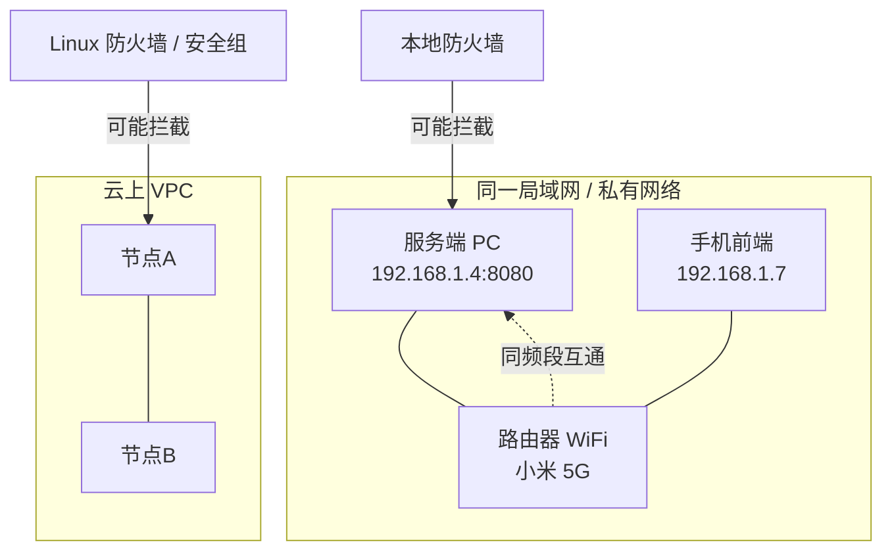

## 【学习目标】

学完这一篇，你应该能够：

1. 说清本地防火墙、Linux 防火墙（安全组）、WiFi 频段、网段四者与「连不上」的对应关系。
2. 用 CIDR（如 `192.168.1.0/24`）判断两台设备是否在同一网段，而不是凭「都连了同一个路由器」下结论。
3. 解释为什么前端（App / 小程序 / 网页）绝对不能把服务端地址写成 `localhost`。
4. 理解云上「私有网络 / 专有网络（VPC）」与本地局域网是同一概念的两种叫法，以及多节点必须同地域同网络。
5. 把这套网络前提和课程配套工程 `982-demo` 的 `8080` 端口暴露、健康检查衔接起来。

正式写业务代码之前，先把「内网互通」这件事讲透。现在普遍是分布式 / 微服务架构，服务之间必须能互访。只要是企业内开发，连不上的低级问题就会反复出现，这一篇帮你一次性排雷。

## 【正文】

### 一、为什么「连不上」是最高频的低级故障

很多同学写代码没问题，一联调就卡在「请求发不出去 / 接收不到」。根因往往不在代码，而在网络前提没理顺。本节讲的几条原则，覆盖了从「你笔记本上的服务」到「手机前端」再到「云服务器」的全部常见场景。先把全局拓扑画出来，后面每条原则都挂在该图上：



只要图中的任一「连通边」被防火墙切断、或被 WiFi 频段错配、或两端不在同一网段，联调就会失败。下面逐层拆。

### 二、关闭本地防火墙

首先要关闭本地的防火墙。因为我们本地跑的是服务端技术，会有其他客户端（比如手机）向本地发请求，防火墙不关的话请求会被挡住。

在 macOS 和 Windows 上都能在系统设置里把防火墙关掉（Windows 自带的 Windows 防火墙也可以关闭，相关的更新提示一并关掉更省心）。如果你不知道怎么关，去搜索引擎搜一下自己系统的关闭方法即可。

**为什么开发期要关本地防火墙**：你在本机起的服务（比如后面 `982-demo` 的 `8080` 端口）默认只监听本机或局域网。手机作为另一台设备向 `192.168.1.4:8080` 发请求，数据包要穿过你 PC 的防火墙才能进到应用层；系统防火墙默认会拦掉「非本机发起的入站连接」，于是手机侧看到的就是超时。开发联调阶段关掉它最直接，但**生产机器绝不能关防火墙**，而是改用「只放行业务端口」的白名单策略。

### 三、关闭 Linux 防火墙（或开放安全组端口）

很多中间件我们是基于 Linux 装的，比如用 **CentOS 7**。在 Linux 上务必把防火墙**永久**关掉，不能只是临时关一下，否则机器一重启防火墙又生效了，请求照样被拒绝。

如果上云了，云服务器本身也有防火墙，只是换了个名字叫**安全组**。这时可以不关防火墙，而是去安全组里把需要的端口打开，比如 80、8080、Redis 的端口、MySQL 的 3306 等。端口开了，本地就能和服务器建立连接。

**`systemctl stop firewalld` 与 `systemctl disable firewalld` 的区别**：前者只是「现在关」，重启后防火墙自动恢复，联调时看似好了、第二天开机又连不上，这就是「临时关」的坑。必须 `disable`（开机不启动）才是永久关。更规范的做法是 `firewall-cmd --permanent --add-port=8080/tcp` 放行具体端口并保持防火墙开启，既安全又不影响联调。

**安全组是「云上的防火墙」**：云厂商的虚拟机默认所有入站端口都是拒绝的，必须在安全组里显式放行。这和本地防火墙逻辑一致，只是配置入口在云控制台。常见要放行的：Web 用 80/443/8080，MySQL 3306，Redis 6379。注意安全组是**有状态的**，入站放行后，对应的出站响应自动允许，不用再配出站规则。

### 四、连接同一个 WiFi 网段

这点很容易被忽略。我们平时连 WiFi，设备必须选**同一个**。比如我的电脑连的是「小米 5G」频段，手机端（前端 UI 调试用）也必须连「小米 5G」。如果电脑在 5G 频段、手机在 2.4G 或其他频段，虽然都来自同一个路由器，但两个频段之间数据无法互通，彼此发不了请求。

**双频路由器的隐形隔离**：现代路由器大多同时广播 2.4G 和 5G 两个频段，它们逻辑上是两张独立的桥。设备连在不同频段时，即使都「连着同一个路由器」，也属于不同的二层域，默认互不转发。联调前让电脑和手机连**完全相同的 SSID（最好是同一频段）**，是最容易被忽略、却最高频的坑。

### 五、保证设备处于同一网段

这和上面是同一个道理。我们看一下 IP：我电脑（也就是服务端）的 IP 是 `192.168.1.4`，子网掩码 `255.255.255.0`，所以它在 `192.168.1.0/24` 网段里。手机连上同一个 WiFi 后，IP 是 `192.168.1.7`，网段相同，才能互相访问。

可以用 `ifconfig`（macOS/Linux）查看本机 IP 来确认。如果电脑开了个叫 「Hello」 的接口（API），手机端要能访问到它，前提就是两者在同一网段、同一 WiFi 频段。很多同学在这里栽跟头，务必注意。

**用 CIDR 判断同网段，而不是凭感觉**：子网掩码 `255.255.255.0` 写成 CIDR 就是 `/24`，表示 IP 前 24 位（前三个十进制段）是网络号。把两台设备的 IP 前三个段做按位与：

```
192.168.1.4   & 255.255.255.0 = 192.168.1.0
192.168.1.7   & 255.255.255.0 = 192.168.1.0   → 同网段 ✅

192.168.1.4   & 255.255.255.0 = 192.168.1.0
192.168.2.7   & 255.255.255.0 = 192.168.2.0   → 不同网段 ❌
```

只要网络号相同就是同网段，能二层直连；不同则要经路由器三层转发，而家用路由默认不开「跨网段互访」或 AP 隔离，结果就是连不上。所以「都连了同一个路由器」不等于「同网段」，路由器可能分配了不同子网，或开了 AP 隔离。

| 设备 | IP | 子网掩码 | 网络号 | 互通？ |
|---|---|---|---|---|
| 服务端 PC | 192.168.1.4 | 255.255.255.0 | 192.168.1.0/24 | - |
| 手机（同频段） | 192.168.1.7 | 255.255.255.0 | 192.168.1.0/24 | ✅ 同网段 |
| 手机（跨子网） | 192.168.2.7 | 255.255.255.0 | 192.168.2.0/24 | ❌ 需路由 |

### 六、前端不要使用 localhost

客户端发请求时，server URL 的 host 部分**绝对不能写 `localhost`**。很多同学习惯填 localhost，但 `localhost` 指的是「本机」，比如你在 iOS 上发请求，localhost 请求的是 iOS 自己，而手机本身并没有提供任何服务，自然访问不到。

正确做法是填电脑的 IP，比如 `192.168.1.4`。这条对 **App / iOS / 安卓 / 鸿蒙 / 小程序** 等所有前端形态都成立，是极易被忽略的配置项。

**`localhost` 的本质是回环地址**：它解析到 `127.0.0.1`，语义是「发往本机协议栈」，永远到不了另一台设备。前端跑在手机上，`localhost` 就指向手机自己，而服务在电脑上，自然 404 / 连接拒绝。记住一条铁律：**凡是「前端和后端不在同一台物理机」的场景，host 必须填后端所在机器的可达 IP 或域名，`localhost` 一律不可用**。微信小程序还有额外约束：开发时要在后台配置「合法域名 / 不校验域名」的白名单，否则连 `http://192.168.1.4:8080` 也会被小程序框架拦截。

### 七、内网的几种称呼

我们说的「内网」，在不同语境下叫法不同：

- **局域网**：最通用的说法；
- **私有网络**：腾讯云等厂商的叫法；
- **专有网络**：阿里云等厂商的叫法（即 VPC）。

如果你买了云服务器做部署和测试，创建多台节点时要确保它们在**同一个地域、同一个私有网络**里，这样它们之间用内网互联，请求能以最快速度到达。如果用公网，带宽通常不高，还可能被其他请求占满，所以云上多台机器一定要走内网。

**VPC 就是「云上的局域网」**：你在云上申请的 VPC 相当于划了一块私有地址空间（如 `10.0.0.0/16`），里面的虚拟机像本地局域网一样二层互通、走内网网卡、免公网带宽费。但 VPC 是**有地域属性的**，北京地域的 VPC 和上海地域的 VPC 物理隔离，跨地域互访只能走公网或专线。所以「同地域 + 同 VPC」是云上多节点低延迟互通的前提，和本地「同 WiFi 同网段」是同一个道理，只是换了个名词。

### 八、与课程配套工程部署的衔接

课程的配套生产级示例 `982-demo` 在 `docker-compose.yml` 里把风控 Bot 暴露为 `8080:8080`，并挂了 `curl http://localhost:8080/actuator/health` 的健康检查。这里的 `localhost` **是写在容器内部、由容器自己 curl 自己**，属于「同机回环」的合法用法；而你在**手机 / 另一台机器**访问该 Bot 时，必须填宿主机的可达 IP（如 `192.168.1.4:8080`），绝不能用 `localhost`。这就是本节原则在真实工程里的映射：回环地址只在「客户端与服务端同一内核/容器」时有效，跨设备一律用真实 IP。

## 【易错点 / 面试题】

1. **面试题：为什么手机访问电脑上的服务填 `localhost` 连不上，填 IP 就行？**
   答：`localhost` 解析到 `127.0.0.1`，语义是「发往本机」，手机上填它就指向手机自己，而服务在电脑上。必须填电脑在局域网内的可达 IP（如 `192.168.1.4`），且两端同 WiFi 同网段、电脑防火墙放行端口，才能连通。

2. **易错点：Linux 防火墙只 `stop` 没 `disable`。** 重启后防火墙自动恢复、联调又失败。开发期要 `disable`，或规范地用 `firewall-cmd --permanent --add-port` 放行端口并保持开启。

3. **易错点：电脑手机连了同一路由器却不同频段 / 不同子网。** 双频路由 2.4G 与 5G 逻辑隔离；或路由器分配了不同子网并开了 AP 隔离。用 CIDR 算网络号确认同网段，并连同一 SSID 同一频段。

4. **易错点：云上多节点跨地域 / 跨 VPC 还想低延迟互通。** VPC 有地域属性，跨地域只能走公网或专线。多节点必须同地域同私有网络。

5. **易错点：把容器内的 `localhost` 健康检查和前端访问的 host 混淆。** 容器内 curl 自己用 `localhost` 合法；跨设备访问必须用宿主机 IP。

## 【小结】

「连不上」的本质是连通边被切断或网段错配：本地防火墙拦入站、Linux 防火墙（云上即安全组）未放行端口、双频 WiFi 频段隔离、两端不在同一 CIDR 网段、前端误用 `localhost` 指向自己，这几条覆盖了绝大多数联调故障。云上的 VPC / 私有网络 / 专有网络只是「局域网」的另一种叫法，同地域同网络才低延迟互通。下一篇进入正式编码，我们将用这套已理顺的网络前提，把 Spring Boot 工程跑起来并对外暴露接口，配套 `982-demo` 的 `8080` 端口与 `/actuator/health` 正是本节原则的真实落点。
