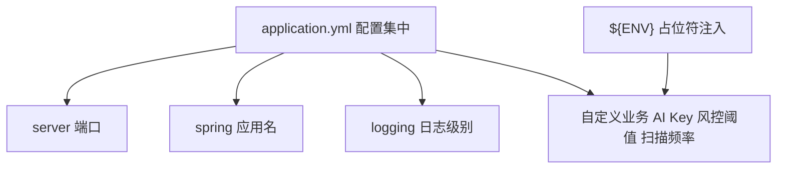

## 【学习目标】

学完本节，你应该能够：

- 说清 YAML 与 `.properties` 的本质区别，理解「冒号 + 空格」与缩进层级为什么是 YAML 的硬性语法。
- 正确修改 `server.port`、`spring.application.name`、`logging.level.root` 三项高频配置并验证生效。
- 建立「配置集中、命名规范、按职责分区」的书写习惯，为下一节多环境解耦打基础。
- 对照 982-demo 的 `application.yml`，理解生产工程如何把端口、应用名、AI Key、风控参数统一收纳。

## 【正文】

在 Spring Boot 项目里，配置文件扮演非常关键的角色，几乎所有运行参数都通过它设置。以当前项目为例，它默认运行在 `8080` 端口，而这个 `8080` 本质上就是 Tomcat 服务器的默认端口号。端口本身也是一项配置，完全可以按需修改。

### 一、创建 application.yml

在 `resources` 资源目录下新建一个配置文件，命名为 `application.yml`。`yml` 是 YAML（YAML Ain't Markup Language）的缩写。相比传统的 `.properties` 文件，YAML 更倾向于面向对象的层级化写法，写起来更直观、也更方便。

新建后，IDEA 会在文件图标上显示一个绿色小叶子，表示这是 Spring Boot 识别的配置文件，配置项都会带自动补全提示。

### 二、YAML 的基本语法

YAML 使用「冒号 + 空格」来分隔键与值，这一点一定要记牢：**冒号后面必须跟一个空格，否则配置无法被正确解析**。

层级关系通过缩进（通常是空格，不推荐 Tab）来体现。例如我们要配置服务器端口，写法如下：

```yaml
server:
  port: 8080 # 修改为 7070
  server.address: # (Network context-path)
  server.compression.enabled: false
  server.compression.excluded-user-agents: # (Comma-separated list of user agents for which responses should not be compressed)
  server.compression.mime-types: text/html, text/plain, text/css, text/javascript, ...
  server.compression.min-size: 2KB
  server.forward-headers-strategy: ForwardedHeadersStrategy
  server.http2.enabled: false
  server.max-http-header-size: 8KB
  server.reactive.session.cookie.http-only: true
```

输入 `server` 后 IDEA 会自动提示出一长串子配置项，上面这串就是常见的 `server` 配置块。当某个配置项被高亮时，说明它正是 Spring Boot 默认帮我们配置好的内容。

**为什么编辑器能把 `server.port` 这种点号形式自动渲染成「冒号 + 缩进」的层级？** 因为 Spring Boot 的配置绑定（relaxed binding）同时接受「点号扁平写法」和「缩进层级写法」，两者语义等价。写代码的人用点号更省行，写配置的人用缩进更直观，IDEA 只是在展示层做了转换，底层绑定的 key 始终是 `server.port`。

### 三、properties 与 yaml 的取舍对照

| 维度 | `.properties` | `.yml / .yaml` |
|---|---|---|
| 层级表达 | 全靠点号 `a.b.c` 扁平堆叠 | 靠缩进天然分层，嵌套深时更可读 |
| 列表/多行 | 需重复前缀或特殊语法 | 原生支持列表、多行文本 |
| 出错风险 | 漏写点号不易发现 | 缩进错位会导致整体解析失败 |
| 自动补全 | 支持 | 支持（Spring Boot 元数据） |
| 适用场景 | 极简单键值 | 微服务多模块、多层嵌套配置 |

结论：配置项一旦超过十几条、且有明显分组（server / spring / logging / 自定义业务），优先用 `yml`；配置极少时两者皆可。

### 四、修改端口号并验证

把 `server.port` 从 `8080` 改成 `7070` 后，重启项目。在控制台向下滚动，会看到 Tomcat 已经启动在 `7070` 端口。此时在浏览器里访问 `http://127.0.0.1:7070/hello/world`，页面内容依旧正常显示，说明配置已经生效。

需要留意的是，配置文件里虽然写的是 `server.port` 这种点号形式，但保存后在编辑器里往往以「冒号 + 缩进」的层级形式呈现，两者是同一个含义。

### 五、为项目命名

除了端口，还可以给当前项目起一个名字，在微服务架构中这一步尤为重要，微服务往往根据应用名称来相互识别和区分。对应配置项是 `spring.application.name`：

```yaml
spring:
  application:
    name: us-stock-monitor-web
logging:
  level:
    root: info # 设置日志级别为 info
```

这里把它命名为 `us-stock-monitor-web`（Web 模块）。后续接入 MCP 等其他模块时，也会各自有不同的应用名。应用名有三个实际用途：① 注册到 Nacos / Eureka 后被其他服务发现；② 作为日志、Metrics 的维度标签；③ 作为配置中心的命名空间隔离依据。

### 六、配置日志级别

最后聊一下日志。通过 `logging.level.root` 可以设置全局日志级别。开发调试时我们常临时切到 `debug` 来看更详细的输出，但 `debug` 日志量非常大，日常开发更推荐统一使用 `info` 级别，既保留关键信息又不至于刷屏。改完重启，控制台输出就恢复清爽了。

**经验法则**：`trace / debug` 只在定位问题时短暂开启，提交代码前务必回落到 `info`；生产环境严禁长期开 `debug`，否则磁盘与 I/O 会被日志打满。

### 七、配置集中化与 982-demo 的落地

随着项目推进，配置项会越来越多：MyBatis-Plus 的数据库配置、MCP 相关配置、百度翻译等第三方服务的密钥配置，所有自定义配置都可以统一放进 `application.yml`。但「放在一个文件」不等于「随意堆放」，应遵循三条纪律：

1. **按前缀分区**：`server / spring / logging / 自定义业务` 各自成块，块内再缩进。
2. **密钥走占位符**：敏感信息用 `${ENV}` 从环境变量注入，不落库、不提交明文。
3. **公共与差异分离**：公共配置留在主文件，环境差异交给子 profile（下一节展开）。

在 982-demo 里，这套纪律被严格执行。其 `application.yml` 用 `spring.application.name: stock-risk-bot` 命名，把端口之外的 AI Key、风控阈值、扫描频率全部收纳，并通过 `${SPRING_AI_OPENAI_API_KEY:dummy}` 这类占位符实现「留空即走 mock」的离线友好设计（完整示例见 `982-demo/src/main/resources/application.yml`）。

配置集中化的结构如下图：



## 【易错点 / 面试题】

1. **问：YAML 里 `key:value`（冒号后无空格）为什么报错？**
   答：YAML 语法规定键值分隔必须是「冒号 + 至少一个空格」。缺空格时解析器会把整串当成一个 key，后续 binding 全部失败，Spring 启动报 `Cannot create binding`。

2. **问：`server.port` 写成 `server: port:` 缩进层级，和写成 `server.port:` 点号，效果一样吗？**
   答：对 Spring Boot 配置绑定而言完全等价。IDEA 在 yml 中展示层级只是可读性优化，绑定的目标 property 名都是 `server.port`。

3. **问：为什么生产上推荐用 `${ENV}` 占位符而不是直接写死 Key？**
   答：直接写死会把密钥提交进代码仓库，存在泄露与合规风险；占位符配合多 profile 与 Secrets 管理，实现配置与代码分离，是 12-Factor App 的基本要求。

4. **问：`logging.level.root=debug` 长期开着有什么隐患？**
   答：debug 级别日志量可能是 info 的数十倍，会迅速占满磁盘、拉高 I/O 与 GC 压力，甚至在高频交易类服务里拖累主流程。仅排查时临时开启。

## 【小结】

到这里，`application.yml` 的基础配置就搭好了：用「冒号 + 空格 + 缩进」表达层级，正确设置 `server.port`、`spring.application.name`、`logging.level.root` 三项高频配置并验证生效，同时建立「按前缀分区、密钥占位符化」的书写习惯。下一节我们会进一步讨论如何把不同环境（dev / prod）的差异配置解耦，避免发布时反复改具体项带来的出错风险。对应工程示例见 `982-demo/src/main/resources/application.yml`。
