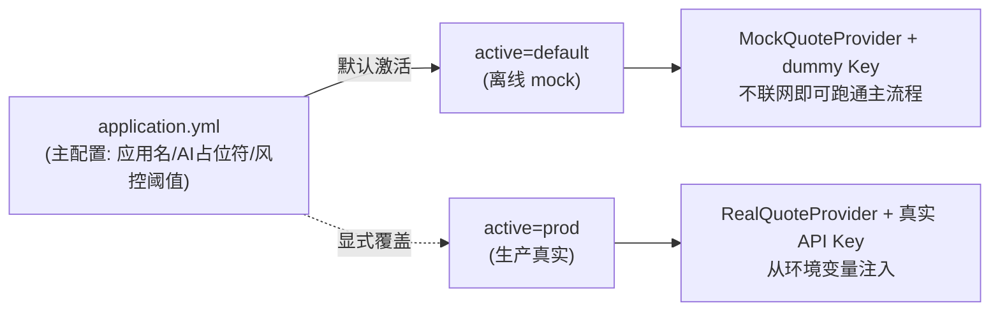

## 【学习目标】

学完本节，你应该能够：

- 说清为什么「多环境共用一份配置」会在发布时埋坑，理解环境差异最终都体现在配置上。
- 用 `application.yml` + `application-{profile}.yml` 的父子继承模式，把 dev / prod 的差异配置彻底解耦。
- 通过 `spring.profiles.active` 切换环境并验证端口、数据源随之变化。
- 对照 982-demo 的 `default / prod` 双 profile，理解「离线 mock 不填 Key 即可跑、生产注入真实 Key」的落地方式。

## 【正文】

### 一、为什么需要多环境配置

在企业里做项目，几乎一定会面对多种环境：日常开发用的是**开发环境**；测试同学验证功能用的是**测试环境**；已经上线对外提供服务的是**线上（生产）环境**；大一些的公司还会有**预发环境**等。不同的团队、不同的阶段，往往各自拥有独立的环境，彼此不能混在一起，否则一定会乱套。

而这些环境之间的差异，最终都会体现在配置上。比如端口号可能不一样，数据库、Redis 等中间件的 IP 地址不一样，连接的用户名和密码也不一样。如果所有环境共用同一份配置文件，那么每发布一次，就得手动改一遍端口、IP、用户名、密码，既繁琐又极易出错。

好在 Spring Boot 提供了一套成熟的多环境配置方案，可以让我们把不同环境的配置彻底解耦。

### 二、Spring Boot 的多环境配置方案

以「开发（dev）」和「生产（prod）」两个环境为例。思路是：先有一份公共的 `application.yml` 作为主配置，再为每种环境各建一份子配置文件。

在 IDEA 的 `resources` 目录下，把 `application.yml` 复制两份，分别命名为 `application-dev.yml` 和 `application-prod.yml`：

- `application-dev.yml` 对应开发环境（Development）；
- `application-prod.yml` 对应生产环境（Production）。

测试、预发等环境同理，都可以照此扩展。

### 三、父子继承：公共配置与差异化配置

这里要理解一个关键关系：`application.yml` 和子配置文件之间是**父子继承**的关系。公共的、所有环境都一样的配置放在 `application.yml` 里；只有某个环境特有的配置，才放进对应的子文件。

以端口号为例。我们把端口号从 `application.yml` 中删掉，只保留在子文件里，开发环境用一个端口，生产环境用另一个端口，互不干扰。后续如果有数据库这类带地址、用户名、密码的配置，也直接写进对应的子文件，而不是堆在主配置里，这样既能避免混淆，发布时也不需要再频繁改动主文件里的具体项（只要一改，就有改错的风险）。

### 四、用 spring.profiles.active 激活环境

有了子配置文件，怎么告诉 Spring Boot「现在用哪个环境」？答案就是在主配置 `application.yml` 里通过 `spring.profiles.active` 指定要激活的 profile。`active` 即「激活」之意，它本身没有默认值，需要我们显式给出。

```yaml
server:
  port: 7070

spring:
  application:
    name: us-stock-monitor-web
  profiles:
    active: dev # 或 prod

logging:
  level:
    root: info
```

上面写的是 `active: dev`，项目启动就会加载 `application-dev.yml`；改成 `prod`，就会加载 `application-prod.yml`。注意文件名里的后缀要和 `active` 的值对应上：写了 `-dev` 子文件，激活时就写 `dev`。

```yaml
# 用于开发环境的特定配置，例如数据库连接、日志级别等
spring:
  datasource:
    url: jdbc:mysql://localhost:3306/dev_db
    username: dev_user
    password: dev_password
```

```yaml
# 用于生产环境的特定配置，例如数据库连接、日志级别等
spring:
  datasource:
    url: jdbc:mysql://prod-server:3306/prod_db
    username: prod_user
    password: prod_password
```

**激活机制的本质**：Spring Boot 在启动时按 `active` 的值拼接文件名 `application-{active}.yml`，并将其与主 `application.yml` 做合并，主文件是「父类」，子文件是「子类」，子类中的同名 key 覆盖父类。这正是上一节讲的「父子继承」在配置维度的延伸。

### 五、验证环境切换

我们把开发环境的端口设为 `6060`，生产环境设为 `9090`，然后切换 `active` 的值来验证。

先把 `active` 设为 `prod` 并重启，控制台会显示应用启动在 `9090` 端口，浏览器访问 `9090` 就能打开页面；若改成 `6060`（开发端口）自然访问不通。再把 `active` 改回 `dev` 重启，应用就回到了 `6060` 的开发端口，页面又能正常显示。整个过程只需要切换 `active` 的值，不必动任何具体配置项。

### 六、多环境策略的通用性

需要强调的是，多环境配置的思路是通用的：不仅 Spring Boot 有 profile，构建工具 Maven 也有 `<profiles>` 机制，同样可以针对生产等环境做差异化管理（例如 `mvn package -Pprod` 激活生产专属的资源过滤与插件）。理解「公共配置 + 环境差异覆盖」这一模式，比记住某个具体文件命名更重要。

### 七、与 982-demo 的对照落地

982-demo 把这套方案直接用到了生产级工程，但它的取值更贴近「离线优先」的演示诉求：



它的主 `application.yml` 用 `spring.profiles.active: ${SPRING_PROFILES_ACTIVE:default}` 约定「默认走 default（离线）」；`application-prod.yml` 只覆盖 AI Key 与扫描开关，并把 Key 写成 `${SPRING_AI_OPENAI_API_KEY}` 强制从环境变量注入，杜绝明文落库。这与本节「公共放主文件、差异放子文件」的原则完全一致，只是把 dev/prod 改成了 default/prod 的命名（完整示例见 `982-demo/src/main/resources/application.yml` 与 `982-demo/src/main/resources/application-prod.yml`）。

## 【易错点 / 面试题】

1. **问：`application.yml` 和 `application-dev.yml` 的加载顺序是怎样的？同名 key 谁生效？**
   答：主文件先加载，子文件后加载并覆盖同名 key。子文件相当于「更具体的环境配置」，优先级更高。未被子文件覆盖的主文件配置继续有效。

2. **问：把 `active: dev` 写成 `active: Dev` 会怎样？**
   答：Spring profile 名称大小写敏感，文件名必须严格匹配 `application-Dev.yml` 才能被找到；写成 `Dev` 但文件是 `application-dev.yml` 会导致子文件不加载，配置缺失启动异常。

3. **问：生产环境的数据库密码写在 `application-prod.yml` 明文里安全吗？**
   答：不安全。正确做法是子文件里也用 `${DB_PASSWORD}` 占位符，由部署平台 / 容器环境变量注入，配置文件中只留占位符，避免密钥进仓库。

4. **问：Maven 的 profile 和 Spring 的 profile 是一回事吗？**
   答：不是。Maven profile 在构建期生效，用于资源过滤、插件开关；Spring profile 在运行期生效，用于决定加载哪份配置。两者可配合使用，但作用阶段不同。

## 【小结】

通过 `spring.profiles.active` + `application-{profile}.yml` 的组合，我们就能在 dev / prod 之间自由切换，把环境差异完全解耦。发布到生产时，只需把 `active` 指定为 `prod` 即可，避免了频繁修改具体配置带来的出错风险。这一「公共 + 差异覆盖」的模式在 Maven、K8s ConfigMap、Nacos 配置中心里反复出现，是工程基本功。下一章进入数据层，我们会用 RSS 接入真实股票资讯源，并把它落到数据库，届时多环境配置将直接服务于「开发连本地库、生产连云库」的切换。对应工程示例见 `982-demo/src/main/resources/application.yml` 与 `application-prod.yml`。
