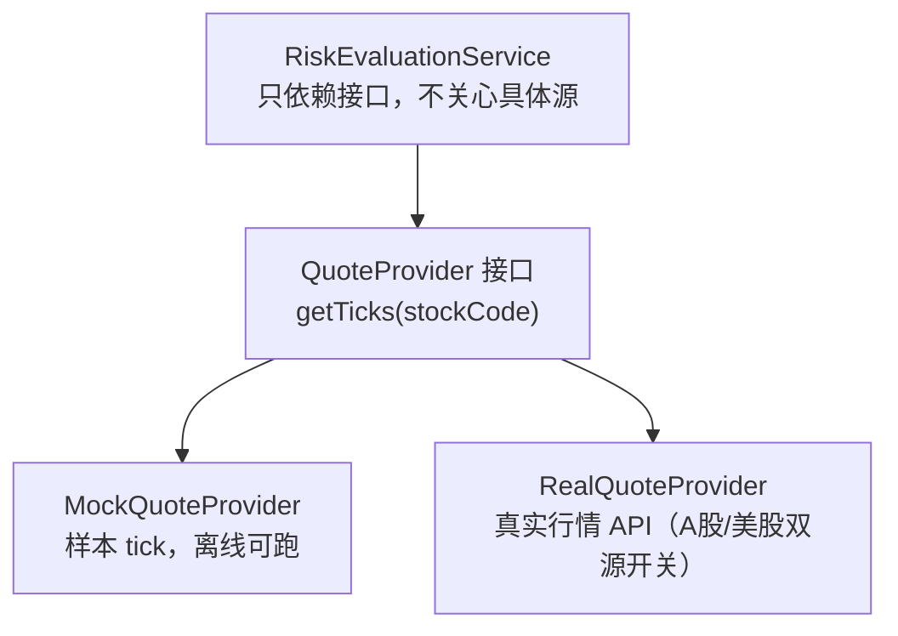

## 【学习目标】

学完本节，你应该能够：

- 说清「股票数据从哪来」这一章要解决的核心问题：把资讯抓取下来并最终落库。
- 列出美股资讯的五大类站点，并理解用 GPT 反向推导信息源、再用搜索引擎核实的工作流。
- 解释为什么最终选定 StockTitan 的 RSS 订阅源作为项目入口，以及一条新闻里真正要落库的核心字段是哪三个。
- 把「数据源可插拔」的思想映射到 982-demo 的 `QuoteProvider` 接口，理解为何要把数据获取与业务规则解耦。

## 【正文】

### 一、本章目标：为股票监控系统找到数据源

上一章我们已经把基础项目搭建起来并成功运行。这一章要解决的问题是：股票数据到底从哪里来？目标是把这些股票相关的资讯抓取到，并最终保存到数据库里，供后续的规则引擎与风控 Agent 消费。

在动手写代码之前，必须先回答「源」的问题。一个风控机器人能不能跑得稳，很大程度上取决于数据源是否稳定、字段是否规整、更新是否及时。选错源，后面所有清洗与解析都要返工。

### 二、数据源从哪来：一份美股资讯站点清单

项目以美股为背景，第一步是把靠谱的美股资讯站点摸清楚。下面按类别列出常见信息源，看行情、看分析、看社区讨论都能用到：

| 类别 | 代表站点 | 说明 |
| --- | --- | --- |
| 财经新闻 | Bloomberg、CNBC、Yahoo Finance、MarketWatch | 综合财经新闻报道 |
| 券商研究与工具 | Morningstar、Zacks、The Motley Fool、Seeking Alpha | 研报、评级、分析工具 |
| 实时行情与数据 | TradingView、Finviz、Benzinga | 行情、筛选、实时数据 |
| 社区讨论 | StockTwits、Reddit（r/stocks、r/wallstreetbets） | 散户观点与社区情绪 |
| 专业报告 | TipRanks、GuruFocus | 分析师追踪、机构持仓 |

像 Reddit 这类社区讨论站点，信息更新很及时。上面这些网站里，既有免费的实时资讯，也有一些提供付费 API 的站点（例如 Benzinga 的 APIs 页面，既有免费也有收费，适合做更深入的量化研究），都可以按需去逛。

### 三、用 GPT 反向推导与验证数据源

这些站点具体怎么找？平时可以通过 Google 这类搜索引擎去搜，也可以借助大模型辅助调研。做法是先给模型设定一个角色，「你是一个在股票咨询领域非常专业的人」，再让它基于该背景去推荐和介绍相关站点。

举例：查 `FFAI` 这只股票（法拉第未来），通过它相关的新闻反向推导信息源，顺藤摸瓜找到了 `investing.com`、`globenewswire.com` 这些站点。模型会把它认为权威的来源和内容反馈回来，我们再把其中具体的网址复制到 Google / 浏览器里核实即可。

这里有个经验：涉及网页浏览、图表分析这类任务时，能力较强的通用模型相对表现得更好；如果你用的是国内的大模型，返回结果的质量未必理想。具体用哪个工具，一定要根据实际可调用的模型能力来调整，别生搬硬套。

**工作流的边界要清楚**：GPT 负责「推荐 + 解释」，不负责「最终确认」。凡是要写进代码的 URL，必须人工在浏览器里打开核实其结构、稳定性与版权许可，不能把模型随口给的链接直接硬编码进生产系统。

### 四、最终选定 StockTitan

综合比较之后，项目最终选用 **StockTitan**（`https://www.stocktitan.net`）作为数据源。它的「Stock News Live Feed」实时新闻流体验很好，每条新闻会展示这些信息：

- 对应企业的 **Logo**；
- 新闻发布的 **时间 / 日期**；
- 当前的 **股票代码**（例如 `FFAI`、`YUMC`）；
- 所属 **市场**（如 `FFAI` 在纳斯达克上市）；
- 具体的 **新闻内容**；
- 一个 **标签（tag）**。

关于标签要单独说一下：它会给股票打上英文标签，比如 `PennyStock`（低价股）、`Low Float`（低流通盘）、`IPO` 等等，数量非常多。这些标签是英文的，在我们自己的项目里，会专门做一层「英文标签 → 中文」的枚举映射（后面章节会讲）。对这节课而言，一条新闻里真正要用的核心字段其实就三个：**时间、新闻内容、股票代码**，其余信息暂时用不到。

另外，有些新闻的标签是「空」的（没有有效标签），这类在我们的系统里就不会做额外展示。

### 五、关键：StockTitan 提供 RSS 订阅源

StockTitan 最大的价值在于它提供了 **RSS 订阅源**。点进任意一条新闻，页面上就能找到一个 RSS 链接，它采用 **XML 格式**，遵循标准的 RSS 规范。

重点是：RSS 源里的内容和网站上展示的数据**完全一致**。无需手动去刷新网页，只要在代码里加入 RSS 集成逻辑，定期去拉取最新的条目（item）即可，每新增一条新闻，RSS 里就多一个 `<item>`，程序就能直接解析到。

这样一来，集成的思路就非常清晰了：把 StockTitan 的 RSS 地址接入项目，定时抓取，解析出时间、新闻内容、股票代码等字段，再落库。从下一节课开始，我们就正式进入编码环节，动手把 RSS 集成跑通。

### 六、为什么 RSS 优于「直接爬网页」

| 维度 | 直接爬取网页 HTML | 订阅 RSS / Atom |
|---|---|---|
| 结构稳定性 | 页面改版即失效，需重写选择器 | 标准 XML 结构，长期稳定 |
| 更新发现 | 需全量比对去重 | 自带 `<item>` 增量，天然可增量拉取 |
| 解析成本 | 要处理 DOM、反爬、渲染 | 直接 XPath / 反序列化即可 |
| 合规风险 | 高频请求易被封、易触版权 | 官方开放订阅，合规友好 |

RSS 的本质是站点主动「喂」给你结构化数据，而不是你去「扒」页面的非结构化内容。风控系统追求稳定可重现，RSS 是第一选择。

### 七、数据源可插拔：从课程思路到 982-demo

课程用 StockTitan 的 RSS 作为唯一数据源，但工程上更成熟的做法是**把「数据从哪来」抽象成接口**，让源可替换。982-demo 正是这么做的：

`982-demo/src/main/java/com/riskbot/provider/QuoteProvider.java` 定义了行情获取的统一契约，其下 `MockQuoteProvider`（离线样本源）与 `RealQuoteProvider`（可接真实 API，由 `application.yml` 的 `risk.market` + `risk.quote-api-url` 双源开关控制）各自实现。业务逻辑 `RiskEvaluationService` 只依赖接口，不关心数据来自 RSS、API 还是 mock，这正是本课程「选定 StockTitan RSS」在更大工程里的推广形态。完整示例见 `982-demo/src/main/java/com/riskbot/provider/MockQuoteProvider.java`。

## 【易错点 / 面试题】

1. **问：为什么风控项目优先用 RSS 而不是爬网页 HTML？**
   答：RSS 是站点主动提供的标准 XML 结构，稳定、可增量、合规友好；爬 HTML 受页面改版、反爬、渲染影响大，维护成本高，不适合追求可重现的风控系统。

2. **问：一条 StockTitan 新闻里，落库只需哪三个字段？为什么其余可丢弃？**
   答：时间、新闻内容、股票代码。风控与推送的核心是基于「哪只票、何时、发生了什么」做判断；Logo、市场、空标签等属于展示增强，暂不入库可减少存储与清洗负担。

3. **问：用大模型帮找数据源时要注意什么边界？**
   答：模型只做「推荐 + 解释」，最终 URL 必须人工在浏览器核实结构、稳定性与许可，不能把模型随口给的链接直接硬编码进生产。

4. **问：数据源接口化（如 QuoteProvider）带来什么好处？**
   答：隔离变化，换源、加 mock、做 A/B 测试都不动业务代码；同时便于离线测试（mock 源）与在线切换（真实源），是生产级工程的基本要求。

## 【小结】

本节明确了「数据从哪来」：以美股为背景，用大模型辅助 + 搜索引擎核实的方式锁定信息源，最终选定 StockTitan 的 RSS 订阅源，只取时间、新闻内容、股票代码三个核心字段落库。RSS 相比爬网页在稳定性、增量与合规上全面占优。下一节正式进入编码，动手把 RSS 集成跑通（定时拉取、解析 `<item>`、入库）。这一「数据源可插拔」的朴素思想，在 982-demo 中被提升为 `QuoteProvider` 接口，为后续规则引擎与风控 Agent 提供稳定、可替换的输入。对应工程示例见 `982-demo/src/main/java/com/riskbot/provider/QuoteProvider.java`。
