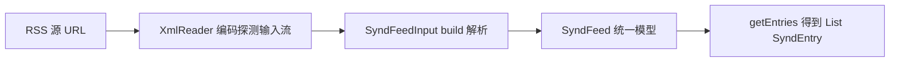

## 【学习目标】

学完本节，你应该能够：

- 说清为什么「RSS 订阅」比「主动爬网页」更适合作为股票异动资讯的自动化入口，并权衡两者的取舍；
- 在 Spring Boot 工程中引入 ROME 系列依赖（`rome` / `rome-utils` / `jdom2`），用十余行代码把一份外部 RSS 源解析成结构化列表；
- 理解 `SyndFeed` / `SyndEntry` 这套与具体 RSS 版本无关的抽象模型，以及 `XmlReader` 在解析链路中的真实作用；
- 绕开 `XmlReader` 最常见的导包陷阱，写出能一次跑通的解析测试；
- 把本节「数据源即接口」的思想，与后续课程中 `QuoteProvider` 的 mock/真实可切抽象对应起来，为整条风控数据链路打底。

---

## 【正文】

### 1. 为什么把 RSS 当作数据入口

股票异动风控的第一步是「感知」，系统得持续、低成本地拿到市场资讯。资讯来源大致分两类：

| 接入方式 | 代表形态 | 优点 | 代价与风险 |
|---|---|---|---|
| 主动爬网页 | HTTP 请求 + HTML 解析（Jsoup 等） | 能拿到 RSS 没有的字段（如标签、详情） | 强依赖页面 DOM 结构，对方一改版即失效；易被限流（429） |
| 被动订阅 RSS | 定时拉取标准 XML 源 | 结构稳定、增量友好、解析成本低 | 字段有限，深层信息仍需二次抓取 |

RSS（Really Simple Syndication）本质是一份**机器可读的 XML 清单**：每一条新闻带标题、链接、发布时间，部分源还带分类。对「异动资讯入口」而言，它的价值在于，你不需要关心对方网站长什么样，只要它按标准吐 XML，你的解析逻辑就几乎不用变。这也是本节先用 RSS 把数据「接进来」，把清洗、落库、推送这些重活留到后面章节的原因。

本课程示例源用的是 StockTitan 的美股异动 RSS：`https://www.stocktitan.net/rss`。它把「某股票异动了、对应新闻标题、发布时间、关联代码」打包成标准条目，正好契合我们「先感知、再决策」的闭环起点。

### 2. 引入 ROME 解析依赖

RSS 是 XML，理论上用 JDK 自带的 `javax.xml` 也能解析，但 RSS 存在 0.9x / 1.0 / 2.0 多个版本，字段命名不统一，自己用 DOM/SAX 硬解析要写大量版本适配代码。ROME 是 Java 生态里最成熟的 RSS/Atom 聚合库，它向上提供一套**与具体版本无关的统一模型**（`SyndFeed` / `SyndEntry`），向下屏蔽各版本差异。下面是课程给出的 `pom.xml` 片段，复制进当前 Web 工程的 `pom.xml` 后执行 Maven 刷新并 `install` 即可：

```xml
<dependency>
    <groupId>com.rometools</groupId>
    <artifactId>rome</artifactId>
    <version>2.1.0</version>
</dependency>

<dependency>
    <groupId>com.rometools</groupId>
    <artifactId>rome-utils</artifactId>
    <version>2.1.0</version>
</dependency>

<dependency>
    <groupId>org.jdom</groupId>
    <artifactId>jdom2</artifactId>
    <version>2.0.6</version>
</dependency>
```

三者的分工：`rome` 是核心聚合 API（提供 `SyndFeedInput`、`SyndFeed` 等）；`rome-utils` 是工具与底层支持；`jdom2` 是 ROME 底层依赖的 XML 对象模型（早期 ROME 绑死 JDOM，2.x 用 jdom2）。版本固定 `2.1.0` / `2.0.6` 是经过课程验证的稳定组合，不要随手升到未测版本，否则可能遇到 XML 工厂或命名空间的兼容问题。

### 3. 先写一个最小可跑通的解析测试

依赖就位后，不要急着往业务里塞，先写一个独立的测试类验证「源能解析、字段能取到」。在 `com.itizixi.test` 包下新建 `RssTest`，目标是：传入一个 RSS 源 URL，把里面的条目列表取出来。URL 直接复用上一节在 StockTitan 上找到的 RSS 地址。

RSS 本质是一份 XML 文档，解析思路是：`java.net.URL` 打开连接 → ROME 的 `SyndFeedInput` + `XmlReader` 把流解析成 `SyndFeed` 对象 → `feed.getEntries()` 取出 `List<SyndEntry>`。

这里有一个高频陷阱：`XmlReader` 的**正确包路径是 `com.rometools.rome.io.XmlReader`**。导入时很容易错导成 `javax.xml.parsers` 下的同名类，后者是抽象类，无法实例化，编译期可能不报错但运行时会抛「抽象类无法实例化」之类的异常。下面这份测试代码特意保留了两种 import，**请注意 `javax.xml.parsers.XmlReader` 这行正是要剔掉的干扰项**，真实可编译版本只保留 rometools 的版本：

```java
package com.itizixi.test;

import java.net.URL;
import javax.xml.parsers.XmlReader;
import com.rometools.rome.feed.synd.SyndFeed;
import com.rometools.rome.feed.synd.SyndFeedInput;
import com.rometools.rome.io.XmlReader;

public class RssTest {
    public static final String RSS_URL = "https://www.stocktitan.net/rss";

    public List<SyndEntry> fetchRssReed(String rssurl) throws Exception {
        URL url = new URL(rssurl);
        SyndFeedInput input = new SyndFeedInput();
        SyndFeed feed = input.build(new XmlReader(url));
        return feed.getEntries();
    }

    @Test
    public void testFetchRssReed() throws Exception {
        this.fetchRssReed(RSS_URL);
    }
}
```

逐行看这段：

- `RSS_URL` 抽成常量，符合「配置与代码分离」的起步习惯，后面接入 `application.yml` 时再进一步外置；
- `URL url = new URL(rssurl)` 直接用一个 `String` 地址构造 `URL`，JDK 会按 `https` 协议打开连接；
- `new SyndFeedInput().build(new XmlReader(url))` 是整段的核心：`XmlReader` 包一层带编码探测的输入流，`build` 负责把 XML 读成统一模型 `SyndFeed`；
- `feed.getEntries()` 返回 `List<SyndEntry>`，每个 `SyndEntry` 就是 RSS 里的一条新闻。

> 工程经验：`fetchRssReed` 的方法名沿用课程原稿的 `Reed` 拼写（与后面 `RssServiceImpl` 保持一致）。真实项目里建议顺手改成 `fetchRssFeed`，避免拼写歧义，但本节为代码守恒保留原样。

RSS 解析链路如下图：



### 4. 运行验证：条目里究竟有什么

在测试方法上加 `@Test`（用 Spring Boot 测试或纯 JUnit 均可），右键运行 `testFetchRssReed`。跑通后控制台会把整个列表打印出来。粗略一看，每条 `SyndEntry` 已经带上了我们关心的关键字段：

- **链接** `getLink()`：这条新闻对应的网页地址；
- **发布时间** `getPublishedDate()`：返回 `Date` 类型（GMT）；
- **标题** `getTitle()`：英文原标题，里面通常藏着股票代码；
- **描述** `getDescription()`：摘要正文。

通过 RSS 集成，这批资讯已经成功被我们「抓」进内存。此时数据还比较杂乱，字段是 RSS 原始结构，没有清洗成我们自己的领域对象，也没有股票代码、北京时间等衍生字段。下一节起我们会把它整合成统一的实体，为入库和推送做准备。

### 5. 从「一次性测试」到「可持续入口」

`RssTest` 只是验证手段。真正要落地成「自动化入口」，得解决两件事：**定时**（不能每次手动跑）和**抽象**（数据源可替换）。前者是 5-3 节 `@Scheduled` 的主题；后者则是一个贯穿本课的设计原则，把「数据从哪来」抽象成接口。

这一点在课程配套的完整工程 `982-demo` 里被贯彻得更彻底：`982-demo/src/main/java/com/riskbot/provider/QuoteProvider.java` 定义了 `List<StockTick> nextTicks()` 与 `String market()` 两个方法，`MockQuoteProvider`（离线样本源）与 `RealQuoteProvider`（真实行情 API）实现同一接口，由 Spring profile 决定注入哪一个。RSS 接入与行情接入是同一类问题，都是「外部数据源的可切抽象」，区别只是 RSS 给的是资讯、QuoteProvider 给的是 tick。理解了本节 RSS 的接入方式，后面读 `982-demo` 的 provider 分层会觉得顺理成章。

---

## 【易错点 / 面试题】

1. **`XmlReader` 导包错误，编译或运行报抽象类无法实例化。**
   答：确认 import 的是 `com.rometools.rome.io.XmlReader`，而不是 `javax.xml.parsers.XmlReader`。前者是 ROME 提供的可实例化实现，后者是 JAXP 里的抽象类型。

2. **面试官问：为什么不直接用 JDK 原生 XML 解析 RSS？**
   答：RSS 跨 0.9x/1.0/2.0 多版本，字段与命名空间不一致。ROME 提供 `SyndFeed`/`SyndEntry` 这套与版本无关的统一模型，把版本差异收敛在库内部；自写 DOM/SAX 要重复造轮子且易碎。代价仅是多引入三个依赖。

3. **`getEntries()` 返回 `null` 还是空列表？**
   答：源正常但无条目时通常返回空列表；网络异常或 XML 损坏会在 `build` 阶段抛异常。所以「判空 + 判 `isEmpty()`」双重防护才是稳妥写法（见 5-4 节）。不要只写 `if (list == null)` 而忽略空集合。

4. **面试延伸：RSS 接入要不要做超时与重试？**
   答：要。外部源不稳定，生产上应给 `URL` 连接设 `connectTimeout`/`readTimeout`，并对瞬时失败做有限重试（如 `resilience4j` 的 `@Retry`）。本课程 RSS 入口是轻量起步，后续 `982-demo` 对外部行情调用也用 `resilience4j` 包裹。

---

## 【小结】

本节用 ROME 把 StockTitan 的 RSS 源接进系统，得到 `List<SyndEntry>`，这是整条「感知层」链路的第一个实体化节点：资讯从外部 XML 变成了内存里的 Java 对象。核心收获有三：一是选 RSS 而非爬网页，换取结构稳定与低维护成本；二是吃透 `SyndFeedInput.build(XmlReader)` 这一行背后的统一模型抽象；三是避开 `XmlReader` 导包陷阱。

但「能抓到」不等于「能用」。下一节（5-3）把抓取挂到 Spring 的 `@Scheduled` 上实现定时拉取，并把逻辑从测试类抽成 `RssService`；再之后（5-4）做字段清洗与实体映射。要注意的是，本节拿到的数据仍带原生结构、含可能重复的条目，清洗与防重（5-4、5-8/5-9）是必须补的环节。

从架构视角看，本节建立的「数据源即接口、可切 mock/真实」思想，正是 `982-demo` 中 `QuoteProvider`（`982-demo/src/main/java/com/riskbot/provider/QuoteProvider.java`）与 `RiskScanScheduler`（`982-demo/src/main/java/com/riskbot/scheduler/RiskScanScheduler.java`）所贯彻的同一套原则，前者解耦数据来源，后者以虚拟线程做周期扫描。读懂本节，就握住了下游风险判定数据底座的第一块砖。
