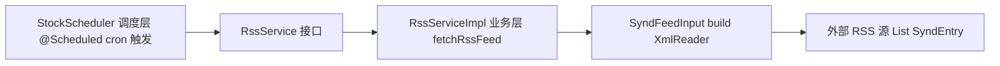

## 【学习目标】

学完本节，你应该能够：

- 用 Spring 的 `@Scheduled` + `@EnableScheduling` 把「一次性抓取」升级为「周期自动抓取」；
- 读懂 Cron 表达式的常见写法，并理解为什么抓取频率不能无脑调快；
- 把抓取逻辑从测试类抽成 `RssService` / `RssServiceImpl`，用依赖注入喂给定时任务，做到职责分离；
- 把「轻量 `@Scheduled`」与课程 `982-demo` 中「虚拟线程周期扫描」的生产级做法对照起来，理解两者的差距与演进方向。

---

## 【正文】

### 1. 为什么需要定时任务

上一节我们跑通了 `RssTest`，但它要「手动右键运行一次」才能抓一批。真实的异动风控系统要 **7×24 不间断**地感知市场，靠人手点运行显然不现实。Spring 自带了调度组件 `spring-context` 里的 `@Scheduled`，零额外依赖、注解即生效，是接 RSS 入口最快的方式。

它的价值不只是「省得手动点」。当抓取变成周期性动作后，系统才真正具备「持续感知」能力，每隔固定间隔拉一次源，新出现的异动资讯就会被陆续纳入清洗、落库、告警链路。这也是「感知→决策→执行」闭环里「感知」能自动运转的前提。

### 2. 第一个定时任务：StockScheduler

在能被 Spring 扫描到的包下新建 `StockScheduler`，加 `@Component` 让它成为容器管理的 Bean，再在类上 `@EnableScheduling` 开启调度支持。然后写一个普通方法，标 `@Scheduled` 并配 Cron 表达式，Spring 就会按该表达式周期性调用它。先用打印 `LocalDateTime.now()` 验证「确实在定时跑」：

```java
@Component
@EnableScheduling
public class StockScheduler {
    @Scheduled(cron = "*/5 * * * * ?")
    public void getStockInfo() throws Exception {
        System.out.println("每隔一段时间运行..." + LocalDateTime.now());
        rssService.displayRss();
    }
}
```

启动应用后等 5 秒，控制台就会按固定间隔打印时间戳，说明调度已生效。`@Scheduled(cron = "*/5 * * * * ?")` 表示「每秒的第 0 秒起、每 5 秒触发一次」。注意这里方法里直接调用了 `rssService.displayRss()`，`rssService` 字段需要靠依赖注入进来（见 2.4 节），原稿片段为聚焦结构省略了字段声明，真实类里要有 `@Autowired`/`@Resource` 或构造器注入。

### 3. Cron 表达式速查与频率红线

`@Scheduled` 的 `cron` 是类 Unix Cron 的六/七段表达式，用来精确控制「每隔多久 / 每天几点」执行。课程给出几个常用写法，整理成对照表便于查阅：

| Cron 表达式 | 含义 | 典型场景 |
|---|---|---|
| `*/5 * * * * ?` | 每 5 秒一次 | 调试验证（生产不推荐） |
| `0 0/5 * * * ?` | 每 5 分钟一次 | 中等频度资讯拉取 |
| `0 0 10,14 * * ?` | 每天 10:00、14:00 各一次 | 盘前/盘中定时任务 |
| `0 0 0 * * ?` | 每天零点 | 日终统计、归档 |

字段顺序为：秒 分 时 日 月 星期（Spring 用六段，第七段「年」可选）。`*` 是「任意」，`/` 是「步长」（如 `0/5` 表示从 0 开始每 5 单位），`,` 是枚举多个值。

> **频率红线（生产经验）**：抓取间隔别设太快。对方站点一般有流量限制，抓太猛会被限流甚至返回 404、拒绝访问。课程实际项目常用 15 秒、30 秒或 1 分钟级别的间隔。本课程的 RSS 源压力小，但后面 5-6 节要爬 StockTitan 网页拿标签，该源对高频访问极敏感，调太快要吞 `429`（限流）苦果。

表达式语法网上资料很多，不必死记；真写不出来时也可以让大模型生成一段再核对，但要理解它表达的意思，不能被「能跑」蒙混过关。

### 4. 把抓取逻辑抽成 RssService

测试类里的代码不能直接被定时任务调用，它混着 `@Test`、字段也都是临时的。正确做法是把抓取逻辑抽成一个 **Service**。建 `RssService` 接口，再写 `RssServiceImpl`（加 `@Service` 让 Spring 扫描加载），把 `RssTest` 的解析逻辑搬过来：

```java
@Service
public class RssServiceImpl implements RssService {
    @Override
    public List<SyndEntry> fetchRssFeed(String rssUrl) throws Exception {
        URL url = new URL(rssUrl);
        SyndFeed feed = input.build(new XmlReader(url));
        return feed.getEntries();
    }
}
```

接口中声明的方法是 `fetchRssFeed(String rssUrl)`，传入 RSS 地址、返回 `List<SyndEntry>`。如果地址经常变动，就把地址抽成配置变量从 `application.yml` 读取，而不是硬编码在代码里，这正是 4-3/4-4 节「配置外部化、多环境解耦」所强调的习惯。

### 5. 在定时任务中注入并调用

回到 `StockScheduler`，因为是 Spring 环境，用 `@Autowired`（或 `@Resource`、构造器注入）把 `RssService` 注进来，在定时方法里调用它。课程在 Service 里额外封装了一个 `displayRss()`（无返回值），内部调用 `fetchRssFeed` 拿列表并打印。这里原稿用了 `System.out.println`，规范做法其实应走日志框架（如 SLF4J + Logback），更高效、可分级、可采集。

```java
@Component
@EnableScheduling
public class StockScheduler {
    @Scheduled(cron = "*/5 * * * * ?")
    public void getStockInfo() throws Exception {
        System.out.println("每隔一段时间运行..." + LocalDateTime.now());
        rssService.displayRss();
    }
}
```

之所以要把业务逻辑放进 Service、而不是全堆在定时任务类里，原因是：后面要处理的事会越来越多（清洗、入库、翻译、推送……）。定时任务只负责「按时触发」这一件事，具体活儿交给 Service 层，职责边界清晰、也更好扩展和单测。这是分层架构里「调度层只管触发、业务层管逻辑」的基本纪律。

调度层与业务层的协作关系如下图：



### 6. 运行验证与下一步

把 Cron 改成每 10 秒测试一次，启动应用后能看到控制台时间戳依次为 10、20、30、40……稳定递增，说明定时抓取闭环已经跑通。到此，「外部源 → 周期拉取 → 内存列表」的链路打通。

下一阶段的工作是把抓回来的杂乱数据**清洗**掉，归纳到自定义实体对象里，为后续入库和推送做准备，也就是 5-4 节的 `USStockRss` 与字段映射。

### 7. 从 `@Scheduled` 到生产级周期扫描

本节用的是 Spring 原生 `@Scheduled`，足够轻量、上手快，但有两个生产短板：一是默认跑在单线程调度池，任务多了会互相阻塞；二是没有优雅关停、没有频率弹性。课程配套的 `982-demo` 把同类需求做得更生产级：`982-demo/src/main/java/com/riskbot/scheduler/RiskScanScheduler.java` 同样用 `@Scheduled` 触发，但内部把扫描任务交给 `Executors.newScheduledThreadPool(2, Thread.ofVirtual().factory())`，**Java 21 虚拟线程**承载，避免传统线程池打满；并用 `@PreDestroy` 在应用关停时 `executor.shutdown()` 优雅退出；还用 `@ConditionalOnProperty(prefix = "risk.scan", name = "enabled")` 支持按 profile 开关扫描。

对照来看，本节的 `StockScheduler` 是「能跑通的最小形态」，理解它之后，读 `RiskScanScheduler` 就能立刻抓住演进要点：**触发机制不变（还是 `@Scheduled`），承载任务的方式从「直接同步执行」升级成「虚拟线程异步承载 + 可关停 + 可配置」**。

---

## 【易错点 / 面试题】

1. **`@Scheduled` 不生效，方法从不触发。**
   答：最常见两个原因，① 忘了在配置类或 `StockScheduler` 上加 `@EnableScheduling`；② `StockScheduler` 没被 Spring 扫描到（包不在 `@ComponentScan` 范围内，或没标 `@Component`）。两者缺一会静默失效。

2. **多个 `@Scheduled` 方法互相「卡住」。**
   答：Spring 默认用单个调度线程串行执行所有 `@Scheduled` 任务。某个任务耗时过长会阻塞后续任务。生产上要么让任务体尽快返回（把重活丢线程池/虚拟线程），要么自定义 `TaskScheduler` 线程池。这正是 `982-demo` 用虚拟线程池承载扫描的原因。

3. **面试官问：Cron 的 `?` 和 `*` 在「日」「星期」字段上有什么区别？**
   答：两者都表示「不限定」，但 Spring Cron 要求「日」和「星期」两个字段**不能同时为 `*`**，必须有一个用 `?` 表达「不指定」以避免语义冲突。例如 `0 0 10 * * ?` 表示每天 10 点，星期位用 `?`。

4. **为什么业务代码不要直接 `System.out.println`？**
   答：标准输出无级别、无上下文、不可采集、且在高并发下可能成为性能瓶颈。生产统一走日志框架，按 `INFO/WARN/ERROR` 分级，可输出到文件或接入 ELK/Prometheus，便于排查与告警。

---

## 【小结】

本节把「手动抓一次」升级为「周期自动抓」：用 `@EnableScheduling` + `@Scheduled(cron=...)` 让 `StockScheduler` 定时触发，并把抓取逻辑下沉到 `RssService` / `RssServiceImpl`，通过依赖注入解耦调度与业务。要点是三句话，Cron 表达式控制频率但要守住限流红线；Service 层承载逻辑、调度层只管触发；`System.out` 仅用于验证，生产要换日志框架。

下一节（5-4）承接本节拿到的 `List<SyndEntry>`，做字段清洗与 `USStockRss` 实体映射，把原生结构转成可落库的领域对象。再往后（5-7）落库、（5-8/5-9）防重，最终汇入 `us_stock_rss` 表，这张表正是下游风险判定的数据底座。把本节的 `StockScheduler` 与 `982-demo` 的 `RiskScanScheduler`（`982-demo/src/main/java/com/riskbot/scheduler/RiskScanScheduler.java`）对照阅读，能看清「教学最小形态」到「生产级虚拟线程周期扫描」的演进路径。
