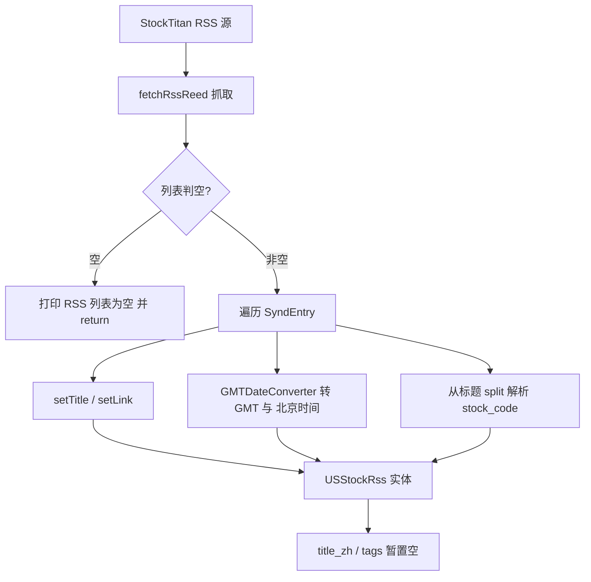

## 【学习目标】

学完本节，你应该能够：

- 说清「为什么清洗」：原始 `SyndEntry` 与数据库表之间隔着一道结构鸿沟，直接落库会埋坑；
- 设计 `USStockRss` 实体，让属性名与 `us_stock_rss` 表字段一一对应（驼峰 ↔ 下划线）；
- 用 `GMTDateConverter` 把 GMT 时间正确转成纽交所时段（纽约）与北京时间，理解 `Instant` + `ZonedDateTime` + `ZoneId` 的时区套路；
- 从标题里按 `|` 分隔解析出股票代码，并规避正则里 `|` 的转义坑；
- 把清洗逻辑落到 `RssServiceImpl.displayRss()`，形成「抓取 → 判空 → 映射」的稳定骨架。

---

## 【正文】

### 1. 为什么要做数据清洗

前两节我们已经能稳定拿到 `List<SyndEntry>`，并用 `@Scheduled` 让它周期跑起来。但拿回来的这份列表，本质上和网页原始 XML 几乎一样杂乱，不能直接用。问题集中在三点：

- **字段结构不是我们的**：`SyndEntry` 是 ROME 的通用模型，字段名、`Date` 类型都不一定贴合我们的库表；
- **缺衍生字段**：股票代码、北京时间在源里根本没有，需要二次计算；
- **可能含脏数据/重复项**：源不稳定时会混入异常条目（防重留到 5-8/5-9）。

这一节的目标，就是把里面真正关键的字段**提取**出来，映射到我们自定义的实体类，构建一份稳定的数据结构。所谓「稳定」，指它向后对接 MyBatis-Plus 落库、对接翻译与标签模块时，上游怎么变，这一层的契约都不变。

### 2. 定义实体类 USStockRss

清洗出来的数据最终要落库，所以先建一个和数据库表一一对应的实体类。在 `entity` 包（也可叫 `bean`）下建类，类名与表名 `us_stock_rss` 对应，去下划线、首字母大写得 `USStockRss`。

字段逐个与表对齐，命名走驼峰（首单词小写、后续单词首字母大写），数据库列用下划线（如 `stock_code`）。对照如下：

| 实体属性（驼峰） | 表列（下划线） | 说明 |
|---|---|---|
| `id` | `id` | 主键，数据库自增，代码不手动设 |
| `stock_code` | `stock_code` | 股票代码（从标题解析） |
| `title` | `title` | 英文原标题 |
| `title_zh` | `title_zh` | 中文标题（当前留空，翻译章节再填） |
| `link` | `link` | 新闻网页地址 |
| `pub_date_gmt` | `pub_date_gmt` | 发布时间（GMT 原始值） |
| `pub_date_bj` | `pub_date_bj` | 发布时间（北京时间） |
| `tags` | `tags` | 标签（当前留空，标签章节再填） |

实体本身用 Lombok 注解简化样板代码（`@Data`、`@ToString`、`@NoArgsConstructor`、`@AllArgsConstructor`，这套注解几乎是每个项目的标配）：

```java
@Data
public class USStockRss {
    private String id;
    private String stock_code;
    private String title;
    private String link;
    private String pub_date_gmt;
    private String pub_date_bj;
    private String tags;
}
```

类的属性名和数据库字段名保持一致，就能形成一一对应的映射关系，后面无论是用 MyBatis-Plus 还是 JPA，都能直接通过该实体去操作数据库。注意这里用的是与列名一致的 `stock_code`、`pub_date_gmt` 等命名，这是为了和 5-7 节 `resultMap` 里的 `column="stock_code"` 直接对齐；5-7 节给出的实体版本改成了纯驼峰 `stockCode`，两处命名风格不同，本质是「库列名」与「Java 属性名」的映射约定差异，靠 `resultMap` 桥接，本节为代码守恒保留各自原貌。

### 3. 遍历列表并判空

拿到 `List<SyndEntry>` 后，先写 `for` 循环遍历。循环之前务必判空：如果列表为 `null` 或 `isEmpty()`，直接打印「RSS 列表为空」并 `return`，后面的清洗逻辑就没有执行必要。这一步是容错底线，外部源异常时 `getEntries()` 可能返回空集合甚至抛异常，未判空会导致后续 `entry.getTitle()` 空指针。

### 4. 逐字段清洗与映射

循环里每次 `new` 一个 `USStockRss` 对象（`stockNews`），把 `entry` 的数据取出来 `set` 进去：

- **标题**：`entry.getTitle()`，直接 `stockNews.setTitle(...)`；
- **链接**：`entry.getLink()`，设置到 `link`；
- **发布时间**：`entry.getPublishedDate()` 返回 `Date` 类型，而我们的属性是 `LocalDateTime`，类型不兼容，不能硬塞，需要靠工具类做一次时区转换。

### 5. GMTDateConverter：时区转换工具类

RSS 里的发布时间是 GMT。我们的对象里既保留 `pub_date_gmt` 原始值，又保留 `pub_date_bj`（北京时间），所以需要把 GMT 转成目标时区。项目提供了一个 `GMTDateConverter`（`util` 包下），核心是 `Instant` + `ZonedDateTime` + `ZoneId` 的套路：先把 `Date` 转成 UTC 的 `Instant`，再按目标时区 `withZoneSameInstant` 过去。

这里特意做了两个方向：纽约时间和北京时间。纽约时间对应纽交所交易时段（冬令 9:30 开盘、夏令 10:30 开盘，换算到我们这边是晚上）；北京与纽约冬季相差 12 小时、夏季 13 小时（夏令时）。工具类如下，可直接复用：

```java
public static String getNewYorkTime(Date externalDate) {
    return convertGmtToNewYork(externalDate);
}

public static LocalDateTime convertGmtToNewYork(Date externalDate) {
    Instant instant = externalDate.toInstant();
    ZonedDateTime gmtTime = instant.atZone(ZoneId.of("GMT"));
    ZonedDateTime newYorkTime = gmtTime.withZoneSameInstant(ZoneId.of("America/New_York"));
    return newYorkTime.toLocalDateTime();
}

public static LocalDateTime convertGmtToBeijing(Date externalDate) {
    Instant instant = externalDate.toInstant();
    ZonedDateTime gmtTime = instant.atZone(ZoneId.of("GMT"));
    ZonedDateTime beijingTime = gmtTime.withZoneSameInstant(ZoneId.of("Asia/Shanghai"));
    return beijingTime.toLocalDateTime();
}
```

> 工程经验：现代 Java 做时区转换，**一律走 `java.time`（Instant/ZonedDateTime/ZoneId），不要再用 `Calendar`/`SimpleDateFormat`**，后者线程不安全、API 反直觉。这里 `Date.toInstant()` 把老 `Date` 桥接到新时间体系，是处理遗留 `Date` 字段的标准写法。

### 6. 从标题里解析股票代码

`stock_code` 在 RSS 原始字段里并不存在，得从**标题**里抠出来。StockTitan 的标题有固定格式：新闻标题和股票代码用竖线 `|` 隔开，代码后面通常跟着 `Stock News` 字样。

解析分两步：

1. 用 `split("\\|")` 按竖线切分（`|` 在正则里是「或」元字符，Java 字符串里要写成 `\\|` 才被当作普通字符，否则永远切不出来）；切完数组第 0 项是标题，后面那项是「股票代码 + Stock News」；
2. 对后半段再按空格 / `Stock News` 切一次，取出代码。为稳健，取切分后数组的**最后一项**作为代码，即使将来格式多加了一道分隔符也能兜住。

标题部分记得 `trim()` 掉首尾空格，才是真正要的内容。这一步是「从非结构化文本里抠结构化字段」的典型手法，和后面 5-6 节从网页 DOM 抠标签是同一思路的两面。

### 7. 整合进 RssServiceImpl

清洗逻辑最终落到 `RssServiceImpl`：先 `fetchRssReed` 抓列表，判空后遍历，把每条 `SyndEntry` 映射成 `USStockRss` 并 `set` 好各字段（标题、链接、GMT/北京时间、股票代码），`title_zh` 和 `tags` 当前先置空，最后打印对象验证：

```java
@Service
public class RssServiceImpl implements RssService {
    public static final String RSS_URL = "https://www.stocktitan.net/rss";

    @Override
    public void displayRss() throws Exception {
        List<SyndEntry> rssList = this.fetchRssReed(RSS_URL);
        System.out.println(rssList);

        if (rssList == null || rssList.isEmpty()) {
            System.out.println("RSS 列表为空");
            return;
        }
    }

    @Override
    public List<SyndEntry> fetchRssReed(String rssUrl) throws Exception {
        URL url = new URL(rssUrl);
        SyndFeedInput input = new SyndFeedInput();
        SyndFeed feed = input.build(new XmlReader(url));
        return feed.getEntries();
    }
}
```

> 实际项目里，遍历后的映射代码（`new` 对象、`setTitle`、`setLink`、时间转换、`getStockCode` 等）就写在 `displayRss` 的判空分支之后；示例为了聚焦结构，只保留了「抓取 + 判空」骨架。

整条清洗链路的流向可以归纳成一张图：



### 8. 运行验证

启动应用后，控制台把清洗好的 `stockNews` 打印出来：没有 `id`（自增）、有股票代码（比如 `FFAI` 贾跃亭那家）、英文标题在、`title_zh` 为空、链接在、`pub_date_gmt` 和 `pub_date_bj` 都正确转换。随手拿一条标题去 StockTitan 页面核对，时间和内容都能对上，说明清洗流程没问题。

需要注意，现在拿到的数据里**可能包含重复条目**，下一节（5-5）先补标签，防重处理留到 5-8（本地库）/5-9（Redis 分布式）。

---

## 【易错点 / 面试题】

1. **`split("|")` 切不出内容，返回长度为 1 的数组。**
   答：`|` 是正则「或」元字符，必须转义成 `split("\\|")`。这是 Java 字符串正则里最常踩的坑之一。面试常考「String.split 的参数是正则还是普通串」，答案是正则。

2. **`entry.getPublishedDate()` 是 `Date`，直接 `set` 进 `LocalDateTime` 字段编译不过。**
   答：类型不兼容，必须经 `Date.toInstant()` → `ZoneId` 转换到 `LocalDateTime`。不要图省事把实体字段类型也改成 `Date`，那会把老时间 API 的坑往下传。统一用 `java.time` 是更优解。

3. **面试官问：`SimpleDateFormat` 为什么线程不安全，怎么替代？**
   答：`SimpleDateFormat` 内部持有共享Calendar状态，多线程并发调用会互相覆盖导致结果错乱。Java 8+ 用 `DateTimeFormatter` + `java.time` 全面替代，后者不可变、线程安全。本节 `GMTDateConverter` 走 `ZonedDateTime.withZoneSameInstant` 正是这条路线。

4. **为什么实体属性名既像列名（`stock_code`）又像驼峰（`stockCode`）？**
   答：取决于团队约定。若属性名直接等于列名，可省掉 resultMap 的逐列映射；若用纯驼峰，则必须在 MyBatis `resultMap` 里把 `stock_code ↔ stockCode` 显式桥接（见 5-7）。两种都合法，关键是全局一致并在映射处对齐。

---

## 【小结】

本节完成了「感知层」最关键的一步转身：把 ROME 的通用 `SyndEntry` 清洗成与库表一一对应的 `USStockRss`。三个要点，用 Lombok 省样板、用时区工具类把 GMT 同时落地为纽约/北京两个标准、用 `split("\\|")` 从标题抠出股票代码，构成了下游所有模块都能依赖的「稳定数据结构」。

但清洗出的数据此刻还在内存里，下一站是落库（5-7 MyBatis-Plus）与防重（5-8/5-9）。从架构看，`USStockRss` 就是 `us_stock_rss` 表的领域映身，而这张表正是 `982-demo` 中 `RiskEvaluationService`（`982-demo/src/main/java/com/riskbot/service/RiskEvaluationService.java`）做「感知→决策」时所依赖的数据底座，区别只是 982-demo 感知的是行情 tick、本课感知的是资讯条目，抽象层级一致。理解本节，等于理解了整条链路「外部杂乱数据 → 稳定结构」的归一化范式。
