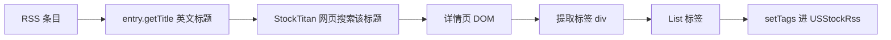

## 【学习目标】

学完本节，你应该能够：

- 说清为什么 RSS 里没有标签、标签为什么要去网页二次抓取，以及「标题是唯一桥梁」这条关键前提；
- 用浏览器开发者工具定位标签所在的 HTML 结构，并把关键片段交给大模型生成爬虫代码；
- 用 Jsoup 连接网页、按动态标题提取一组标签，封装成可复用的 `StockTitanCrawler.getTags(title)`；
- 把爬到的标签接回清洗流程，理解「AI 辅助编码」的正确用法与失效边界。

---

## 【正文】

### 1. 还差两个字段：中文标题与标签

上一节我们把 RSS 数据清洗进了 `USStockRss`，但有两个字段还空着：一个是中文标题 `title_zh`（要靠百度翻译 SDK，留到 7-x 翻译章节），另一个是 `tags`（标签）。这一节专门解决标签的获取。

### 2. 为什么 RSS 里没有标签、要去网页抓

StockTitan 的 RSS 源里其实**没有**标签，标签只存在于它的网页上。这些标签（如 `PennyStock` 低价股、`Low Float` 低流通盘、`IPO` 等）是给用户（尤其是付费版）提供的一种体验，用来快速标记某只股票的特性。普通股票没有这些特性，自然就没有标签。

那标签怎么拿？关键在于：**新闻标题是唯一的桥梁**。RSS 里的标题不会重复，我们可拿该标题去 StockTitan 网页上搜索，定位到对应的新闻详情，再从详情页把标签抠出来。搜不到就说明这条新闻没标签，直接存空也没问题，标签是增益信息，缺失不影响主流程。

这张「源 → 网页」的二次抓取关系如下：



### 3. 用开发者工具定位标签的 HTML 结构

在浏览器打开一条新闻，右键「检查」进入开发者工具，就能看到页面代码。每个新闻条目对应一个大 `div`，里面的标签内容与之呼应；前端通过循环渲染这些 `div`。我们只需要取这一段的 HTML 即可。

更省事的做法：右键「编辑为 HTML」，把整段 HTML 复制下来，待会儿直接丢给 AI 分析。以 `IRBT`（iRobot，前期涨势不错的机器人股）这条为例，它下面「标签」栏里可能只有一个，也可能像「三家公司同时 IPO」那样出现三个，本质都是一组标签。确认了 DOM 结构，爬虫才有稳定锚点。

### 4. 让大模型帮写爬虫代码

这种「按页面结构抠标签」的爬虫，没必要从零手写、很耗时间。我们直接让 AI 生成。

做法是：给大模型设定一个角色（比如「拥有 20 年经验的资深架构师」），再提需求，打开网页、找到我们框出的那段关键 `div`、并且**根据标题动态**地把标签抓出来。特别强调「标签是动态的、不是固定的」，让它生成通用代码。模型给出的方案是用 **Jsoup**（Java 的 HTML 解析库，前面课程也用过）来实现。

连接网页的代码非常标准：

```java
Document doc = Jsoup.connect(URL)
    .userAgent("Mozilla/5.0")
    .timeout(10_000)
    .get();
```

- `userAgent("Mozilla/5.0")` 伪装成浏览器，避免被站点识别为脚本而拒绝；
- `timeout(10_000)` 设 10 秒超时，防止目标响应慢把线程一直挂着；
- `.get()` 发起 GET 请求并解析成 `Document`。

它会根据 `a` 标签定位、按段落读取，最终从目标 `div` 里循环取出标签，以数组形式返回。

> 工程经验：凡是外网抓取，超时必须设。没有超时的 HTTP 调用在网络抖动时会无限等待，拖垮整个调度线程。生产上还会叠加重试与熔断（如 `resilience4j`），不能只依赖单次连接超时。

### 5. extractTagsByTitle：按标题提取标签

核心方法接收整个 `Document` 和我们传入的标题，内部循环把标签收集到列表里返回。无论 0 个、1 个还是多个标签都能处理（空标签返回空列表，单个如 `Low Float` 返回只含一项的列表，多个如三个 IPO 公司则全部返回）：

```java
private static List<String> extractTagsByTitle(Document doc, String title) {
    List<String> result = new ArrayList<>();
    // ... (提取逻辑)
    return result;
}
```

把这段代码放进 `util` 包下的 `StockTitanCrawler` 工具类里。运行测试：两个标签的新闻、空标签的新闻、单个标签的新闻都能正确抓到。注意原稿用 `// ... (提取逻辑)` 占位，真实实现就是前面「开发者工具定位到的 div + 动态标题匹配」那套选择器逻辑，本节为代码守恒保留占位形态。

### 6. 封装成可复用工具方法

直接写在 `main` 里不优雅，把它抽成公开静态方法 `getTags`，让外部能直接调用：

- `URL` 提成 `private static final String` 常量，粘贴进去即可；
- 标题是动态传入的，所以参数用 `String title`；
- 返回值用 `List<String>`（比数组更顺手）；
- 方法声明 `throws` 异常。

这样在测试里右键运行能成功，外部业务代码也能直接 `getTags(title)` 调用。

### 7. 接回清洗流程

回到数据清洗的「标签」那一步：拿到 `entry` 的标题后，先调用 `getTags` 把标签列表取回来，再 `set` 进实体。这里有个细节，从 `SyndEntry` 直接拿到的标题可能带着 `Stock News` 之类的前缀，拿去网页搜会搜不到，所以要先处理成干净的英文标题（把前缀/抬头去掉）再传给 `getTags`。爬回来的标签通过流式处理合并进实体即可。

AI 分析生成的整体封装片段如下，可以看到「标题、链接、时间、股票代码到标签」的完整链路：

```java
// 从 SyndEntry 获取信息
String titleEn = getStockTitle(title);
stockNews.setLink(entry.getLink());
Date gmtDateTemp = entry.getPublishedDate();
LocalDateTime gmtDate = GMTDateConverter.convertGmt(gmtDateTemp);
stockNews.setPubDateGmt(gmtDate);
stockNews.setPubDateJ(gmtDate);
String stockCode = getStockCode(title);
stockNews.setStockCode(stockCode);
// TODO 处理股票标题，翻译为中文
stockNews.setTitleZh("");
```

注意这段里 `setPubDateJ` 与 5-4 节的 `setPubDateBj` 命名不一致（前者是源码原貌），且 `convertGmt` 方法名与 5-4 的 `convertGmtToBeijing` 不同，这是原稿不同章节的命名漂移。本节为代码守恒保留各片段原样；真实工程里应统一为一个时间转换入口，避免一个概念两套命名。

### 8. 运行验证

跑起来后，控制台把抓到的标签打印出来，确认标签确实能拿到并写进实体。到这里，标签字段的获取就闭环了，配合前面清洗好的标题、链接、时间、股票代码，`USStockRss` 的关键字段基本齐全（只剩 `title_zh` 留待翻译章节）。

---

## 【易错点 / 面试题】

1. **为什么不直接在 RSS 里拿标签，而要多爬一次网页？**
   答：RSS 是轻量资讯源，只暴露标题/链接/时间等核心字段，标签是网页端的「增值展示」，不在源里。重复标题作为唯一键去网页二次定位，是成本最低的补充手段；搜不到就存空，不影响主流程。

2. **Jsoup 连接被拒或返回空。**
   答：大概率是缺 `userAgent` 被识别为爬虫而拒绝，或目标结构改版导致选择器失效（见下条）。先补 `userAgent("Mozilla/5.0")`，再用开发者工具重新核对 DOM 锚点。

3. **面试官问：AI 生成的爬虫代码能直接进生产吗？**
   答：不能无脑进生产。AI 代码对「当下页面结构」负责，站点改版即失效，且可能漏掉超时/重试/异常处理。正确用法是把它当「草稿」，生成后人工补全超时、异常兜底、频率控制，并加监控，把失效成本降到可承受。下一节（5-6）会专门讲失效与 429 兜底。

4. **为什么标签缺失不影响主流程？**
   答：标签是增益维度，不是异动判定的主键。即便抓不到，资讯本身（标题、代码、时间、链接）已足够驱动下游。把「非核心字段的异常」隔离在 `try-catch` 里置空，是健壮采集的通用原则。

---

## 【小结】

本节演示了「AI 辅助编码」的正确姿势：用开发者工具定位 DOM 锚点，把关键片段交给大模型生成 Jsoup 爬虫草稿，再由人工补全工程要素（超时、异常、封装），最终沉淀为 `StockTitanCrawler.getTags(title)` 接回清洗链路。核心认知是，标签在网页不在 RSS，标题是唯一桥梁；AI 代码是起点不是终点，失效与兜底（5-6 节）才是生产的真实形态。

至此，`USStockRss` 的关键字段基本齐全，下一节（5-6）处理「英文标签转中文 + emoji 枚举映射 + 429 兜底」，再之后（5-7）落库。把本节的「二次抓取补充字段」与 `982-demo` 的 `QuoteProvider`（`982-demo/src/main/java/com/riskbot/provider/QuoteProvider.java`）对照：两者都是「主源不够、用可切的辅助源补」的思想，RSS 主源补网页标签，行情主源（真实）补 mock 样本，抽象形态一致。读懂本节，就理解了采集链路「主源 + 辅助源」的可扩展范式。
