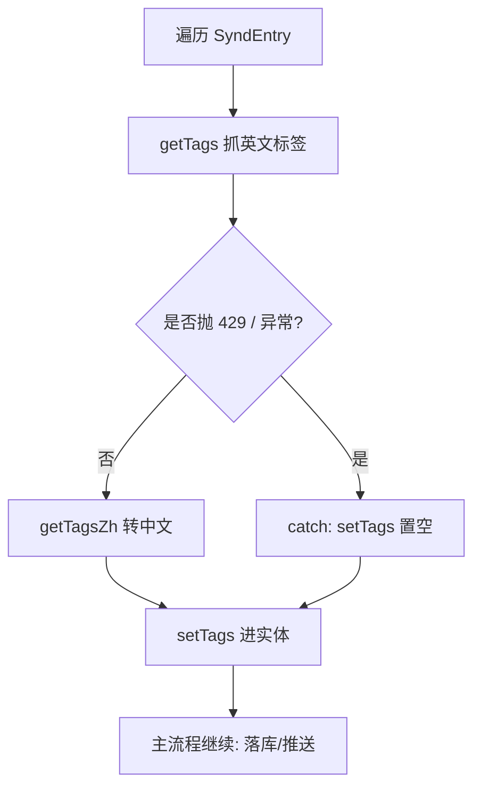

## 【学习目标】

学完本节，你应该能够：

- 论证「英文标签用固定枚举查表转中文」优于「调用翻译 API」，并算清成本账；
- 定义 `StockTag` 枚举，建立「英文标签 → 中文（含 emoji）」的固定映射；
- 用 `getTagsZh` 把英文标签列表拼成逗号分隔的中文字符串，便于落库与展示；
- 用 `try-catch` 把 429 反爬异常隔离、置空标签，保证主抓取流程不被非核心字段打断。

---

## 【正文】

### 1. AI 生成的爬虫代码可能失效

上一节我们借大模型写出的抓取代码其实挺通用，完全可以照着再做一遍。但要提醒一点：StockTitan 是官方站点，不止我们在爬，很多人都用同样的手段抓，所以这段靠 AI 生成的代码**可能几周甚至一两个月后就失效**。讲师这已经是第三次写了，前两次都因为官方改了标签名称或页面结构而失效。如果长远拿不到标签，就用同样的方法重新抓一份即可。

这一点决定了采集层代码的定位：**它是「易耗品」，不是「长期资产」**。生产上要接受「爬虫会过期」，并为此准备快速重建能力与兜底（置空），而不是指望一份代码永远有效。

### 2. 英文标签要转中文：用固定枚举而不是翻译

我们抓回来的标签都是英文的。如果系统面向国际化用户，英文没问题；但服务国内用户，很多人看不懂。那能不能用翻译 API 转中文？没必要，原因有两层：

- **成本**：翻译按字符/次计费，翻一个字符也是钱，高频抓取下这笔开销无谓且持续；
- **稳定性**：标签本质是**固定且有限**的枚举，来来去去就那几种，每次翻都返回相同结果，纯属浪费。

更好的办法：建立一份「英文标签 → 中文（可带 emoji）」的固定映射，以后直接查表。这是典型的「以空间换时间、以一次性配置换持续成本」。

### 3. 定义 StockTag 枚举

讲师提前准备好了这份映射，放在 `stocktag` 包下，做成枚举类 `StockTag`。每个标签配了中英文对应，还顺手加了 emoji，例如 `AI` 对应「人工智能」、`LOW_FLOAT` 对应「低浮动」、`PENNY_STOCK` 对应「便士股 / 低价股」。标签数量现在不多，可按需增减；觉得某个 emoji 不合适就删，觉得有用就保留。

> 说明：下面这段是课程原稿给出的枚举形态（用 `key:` / `description:` 伪字段表达语义），保留原貌以做代码守恒；真实工程里应写成标准 Java 枚举常量 + 字段。理解「每个枚举项绑定一个英文键与一个中文描述」即可。

```java
public enum StockTag {
    AI(key: "AI", description: "人工智能"),
    PRIVATE_PLACEMENT(key: "private placement", description: "私募"),
    ...
    VOLATILITY(key: "volatility", description: "波动性"),
    SENTIMENT(key: "sentiment", description: "市场情绪"),
    IMPACT(key: "impact", description: "影响"),
}
```

枚举里除了映射关系，还提供了 `getTagValue(tag)` 方法：传入英文标签，返回对应的中文描述，方便后面直接查表。查表法的好处，O(1) 命中、零外部调用、结果确定可缓存，对比翻译 API 是质的差距。

### 4. 按标题提取标签 extractTagsByTitle

抓标签的核心还是上一节的思路：用 CSS 选择器定位标题元素，再向上找父级容器，从父级里把标签抠出来。

```java
Elements titleElements = doc.select(cssQuery);
for (Element titleEl : titleElements) {
    Element newsRow = titleEl.closest(cssQuery);
    if (newsRow == null) continue;
    Elements tagElements = newsRow.select("div#inframontal");
}
```

`doc.select(cssQuery)` 用 CSS 选择器批量选中标题元素；`closest(cssQuery)` 向上回溯到最近的匹配容器；`newsRow.select("div#inframontal")` 在容器内锁定标签所在的 `div`。这种「先定位锚点、再收缩到目标子节点」是 Jsoup 爬虫的通用套路。

### 5. getStockCode：从标题解析股票代码

顺带复习股票代码解析：标题用 `|` 分隔，取最后一段，再按 `Stock News` 切一次，取第一项并 `trim`，就是代码。

```java
String[] titleArr = titleStr.split(regex: "\\|");
String[] stockCodeArr = stockStr.split(regex: "Stock News");
return stockCodeArr[0].trim();
```

> 同上，原稿用 `regex:` 伪参数表达语义，保留原貌；真实 Java 应写成 `titleStr.split("\\|")`。`\\|` 的转义坑与 5-4 节一致，`|` 是正则元字符，必须转义。

### 6. getTagsZh：标签列表转中文字符串

拿到英文标签列表后，需要把它转成「逗号分隔的中文字符串」，方便直接存库和展示。逻辑就是遍历列表，用 `StockTag.getTagValue` 查中文，逐个拼到 `tagStr` 里，注意最后一项不加逗号：

```java
String tagStr = "";
for (int i = 0; i < list.size(); i++) {
    String tag = list.get(i);
    tagStr += StockTag.getTagValue(tag);
    if (i < list.size() - 1) {
        tagStr += ",";
    }
}
return tagStr;
```

> 工程经验：字符串拼接在循环里用 `+=` 会产生大量中间对象，标签数量少时无碍；量大时应改用 `StringBuilder` 或 Java 8 的 `String.join` + Stream 映射。这里保留原稿写法，生产优化点是明确的。

### 7. 接入主流程 + 429 异常处理

在 `RssServiceImpl` 里，先 `getTags` 拿到英文标签列表，再 `getTagsZh` 转成中文字符串，最后 `setTags` 进实体：

```java
List<String> tagsList = StockTitanCrawler.getTags(titleEn);
stockNews.setTagsZh(tagsList);
System.out.println(stockNews.toString());
```

这里有个必须处理的坑：**频繁请求会触发反爬虫**。定时任务间隔设成 10 秒还好，如果改成 5 秒、10 秒高频抓，网站会返回 `429` 错误（限流）。一旦抛异常，标签就取不到。

优雅的做法是用 `try-catch` 把取标签的逻辑包起来，捕获到异常时直接 `stockNews.setTags("")` 置空即可。标签本身不重要，置空不会影响主流程，项目照样往下跑。不要因为标签异常就把整个抓取任务打断，这是采集层「非核心字段异常隔离」的核心纪律。



### 8. 运行验证与两点注意

测试时把间隔调到 5 秒频繁抓，控制台能看到：抓不到时标签为空；抓到时则显示「低价股」这类带 emoji 的中文标签，医疗股的「临床试验」相关标签也在其中。多个标签以逗号 + 空格形式拼接，存进数据库后页面直接显示，没问题。

最后强调两点注意事项：

1. **429 反爬虫**：高频访问会被限流，用 `try-catch` 兜底置空即可；
2. **AI 代码可能失效**：官方调整标签或页面结构后，旧的抓取代码会失效，届时重新用同样的方法生成一份即可。

---

## 【易错点 / 面试题】

1. **面试官问：标签翻译为什么不用翻译 API 而用枚举？**
   答：标签是有限固定集合，每次翻译都返回相同结果，纯属浪费且按量计费。枚举查表零外部调用、结果确定、O(1) 命中，成本与稳定性都占优。仅当标签集合开放、不可枚举时才有翻译必要。

2. **429 是什么，怎么处理？**
   答：`429 Too Many Requests` 是 HTTP 限流状态码，表示客户端请求频率超过服务端配额。处理方式有三层，① 降频（调大抓取间隔，这是根本）；② 退避重试（指数退避，不要立即猛重试）；③ 异常隔离（如本节 `try-catch` 置空非核心字段）。绝不能因为 429 让主流程崩溃。

3. **为什么置空而不是抛异常中断？**
   答：标签是增益字段，缺失不影响异动资讯的主键（代码/时间/标题/链接）。把非核心字段的采集异常隔离、降级置空，是「核心链路优先可用」的工程原则。中断整个抓取反而丢掉了本可入库的宝贵资讯。

4. **`split("\\|")` 与 `trim()` 为什么要配合？**
   答：`|` 分隔后各段常带首尾空格，`trim()` 去掉后才能得到干净代码/标签；否则 ` FFAI ` 这类带空格的值会让后续匹配与落库出现幽灵差异。所有文本切分后都应考虑 `trim`。

---

## 【小结】

本节把「英文标签」收口为「可展示的中文 + emoji」，方法不是翻译 API，而是 `StockTag` 固定枚举查表，用一次性配置换掉持续的成本与不确定性。同时立下了采集层的两条铁律：爬虫代码是易耗品（会失效、要可重建），非核心字段的 429 异常必须 `try-catch` 隔离置空、绝不让主流程陪葬。

至此，`USStockRss` 的标签维度补齐，下一节（5-7）用 MyBatis-Plus 把整条清洗链路的结果落库，形成入库闭环。把本节的「异常隔离 + 频率自律」与 `982-demo` 对外部行情调用的处理对照：`982-demo` 用 `resilience4j`（`@Retry`/`@TimeLimiter`/熔断降级）包裹 `RealQuoteProvider` 的真实 HTTP 调用，而本节的 `try-catch` 置空是轻量版降级，两者都是「外部源不稳定 → 降级而非崩溃」的同一工程直觉。完整可部署示例参见 `982-demo/src/main/java/com/riskbot/provider/RealQuoteProvider.java` 与 `982-demo/src/main/java/com/riskbot/service/RiskEvaluationService.java`。
