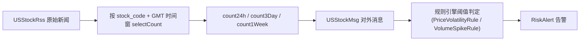

## 【学习目标】

学完本节，你应该能够：

- 设计「对外消息实体」`USStockMsg`，理解它与数据库实体 `USStockRss` 的职责边界（内部存储 vs 用户展示）。
- 用 `BeanUtils.copyProperties` + 时间/标签转换，把原始新闻加工成可推送消息。
- 实现 `getStockUnusualCounts`，用 `QueryWrapper.between` 按 GMT 时间窗口 `selectCount` 统计 24 小时 / 3 天 / 1 周三个维度的异动次数。
- 把「N 小时内异动多次」的计数思想，映射到 982-demo 的 `RuleEngine` 风控判定，理解规则引擎如何消费这类聚合指标。

## 【正文】

### 一、背景：从防重到异动次数统计

前面两节课我们讲了防重方案，主要有两种：一种基于数据库，一种基于 Redis。到这里，股票新闻已经能够成功保存进数据库了。接下来的问题是：如果后续要基于这些数据做推送（比如把消息群发到 Telegram），那么该推送什么？

数据库里的实体（`USStockRss`）是给内部代码用的，一般不直接对外发送。对外推送时，通常会单独声明一个新的实体（一个 message / DTO 对象），只带用户关心的字段。本节就围绕这个「对外消息实体」展开，并重点实现**异动次数统计**这一核心能力。

### 二、设计对外消息实体 USStockMsg

我们基于数据库实体复制出一个新类，命名为 `USStockMsg`（`message` 即「消息」），并对字段做裁剪：

- `id`：数据库自增主键，对用户来说只是一串无意义数字，删掉；
- `stockCode`：股票代码，用户需要看，保留；
- `title` / `titleZh`：英文原标题与中文翻译标题，面向中文用户，保留中文标题即可（英文标题保留也问题不大，这里保持原样）；
- `link`：原文链接，对外不一定需要，删掉；
- `pubDateGmt` / `pubDateBj`：GMT 时间和北京时间。GMT 时间用户看不懂，保留 `pubDateBj`（北京时间，`LocalDateTime` 类型）用于展示；GMT 时间则继续留在库里，用于后面按时间范围查询；
- `tags`：标签，保留并直接展示中文映射后的内容。

最终对外消息实体大致如下：

```java
@Data
@ToString
@NoArgsConstructor
@AllArgsConstructor
public class USStockMsg {
    private String id;
    private String stockCode;
    private String title;
    private String titleZh;
    private String link;
    private LocalDateTime pubDateGmt;
    private LocalDateTime pubDateBj;
    private String tags;
}
```

**为什么用「复制一个新类」而不是复用数据库实体对外？** 这是典型的分层防腐思想：数据库实体随表结构变化（加字段、改类型），若直接对外序列化，会把内部细节（主键、GMT 时间、审计字段）暴露给前端，且任何表结构变更都会破坏接口契约。`USStockMsg` 作为展示层 DTO，只承载用户关心的字段，把「存储模型」与「视图模型」彻底隔离。

### 三、属性拷贝与时间/标签处理

实体定义好之后，在保存新闻的 Service 里用 `BeanUtils.copyProperties` 把原始 `StockNews` 的属性拷过去，再做时间转换和标签处理，最后落库：

```java
// 处理新闻标题和标签
List<String> tagsList = StockTitanCrawler.getTags(titleEn);
stockNews.setTags(getTagsZh(tagsList));

// 设置发布时间
stockMsg.setPubDateBj(GMTDateConverter.getBeijingTime(stockNews.getPubDateGmt()));

// 保存新闻
stockService.saveStockNews(stockMsg);
```

时间转换依赖一个工具类 `GMTDateConverter.getBeijingTime(gmtDate)`，它会把 GMT 时间转成北京时间，后面查询时我们再反过来用 GMT 作为统一标准。

**一个易错点**：`BeanUtils.copyProperties` 是按「同名同类型」属性拷贝的。如果源/目标里存在名字相同但类型不同（如一个是 `Date`、一个是 `LocalDateTime`）的字段，拷贝会静默失败或抛异常。务必保证参与拷贝的字段类型一致，类型不同的（如时间）手动转换后单独 `set`。

### 四、增加异动次数三个字段

光把新闻发出来还不够。我们想告诉用户：这只股票最近「异动」了多少次。所谓异动次数，本质上就是某只股票代码在数据库里、某个时间窗口内保存了多少条记录。

于是在 `USStockMsg` 上额外加了三个整型字段，分别代表三个时间窗口内的出现次数：

- 24 小时内的次数；
- 3 天内的次数；
- 1 周内的次数。

这类「N 小时内异动多次」的指标很有价值：一只股票如果短时间内频繁异动（比如之前讲过的 OKLO 财报，24 小时内反复触发），很可能就要暴涨或暴跌，值得用户重点关注。它也可以作为付费版的增值能力来提供。

### 五、按时间范围统计次数：getStockUnusualCounts

统计的核心就是查数据库。我们写一个方法 `getStockUnusualCounts`，入参是当前 `USStockMsg`（取其股票代码）、再加上起始时间和结束时间：

```java
@Override
public Long getStockUnusualCounts(USStockMsg stockNews, LocalDateTime startDate, LocalDateTime endDate) {
    String stockCode = stockNews.getStockCode();
    QueryWrapper<USStockRss> queryWrapper = new QueryWrapper<>();
    queryWrapper.eq("stock_code", stockCode);
    // 设置时间范围
    queryWrapper.between("pub_date_gmt", startDate, endDate);
    return usStockRssMapper.selectCount(queryWrapper);
}
```

逻辑很直接：用 `QueryWrapper` 限定 `stock_code` 等于当前股票代码，再用 `between` 限定 `pub_date_gmt` 落在 `[startDate, endDate]` 区间内，最后 `selectCount` 返回符合条件的记录数。

为什么用 GMT 而不是北京时间做范围比较？因为 GMT 是标准化时区表示，传入的起止时间也应是 GMT；如果业务要国际化，用 GMT 才不会出错。国内单体项目用北京时间也行，但统一用 GMT 更稳妥。

### 六、时间窗口的计算细节

查询时，起始时间 = 当前时间往前减；结束时间 = 当前时间再加一点缓冲。以 24 小时窗口为例：

- 起始：`now - 24小时`；
- 结束：`now + 1分钟`。

为什么要多加 1 分钟？因为如果只把 `now` 当结束时间，边界上刚好在 `now` 这一刻入库的记录很可能被漏掉；多留 1 分钟（或 5 分钟）的缓冲，能避免这种边界丢失。同理，3 天用 `minus3day`、1 周用 `minus1week` 的工具方法，结束时间同样加 1 分钟。

调用时把三个窗口的次数分别取出来，再 `set` 进消息对象：

```java
// 24 小时
Long count24h = stockService.getStockUnusualCounts(stockNews, now.minusHours(24), now.plusMinutes(1));
// 3 天
Long count3Day = stockService.getStockUnusualCounts(stockNews, now.minusDays(3), now.plusMinutes(1));
// 1 周
Long count1Week = stockService.getStockUnusualCounts(stockNews, now.minusWeeks(1), now.plusMinutes(1));

stockMsg.setCount24h(count24h.intValue());
stockMsg.setCount3Day(count3Day.intValue());
stockMsg.setCount1Week(count1Week.intValue());
```

这里用 `DateTimeFormatter` 把时间格式化成数据库里的 `yyyy-MM-dd HH:mm:ss`。要特别注意：**大写的 `M` 是「月份」，小写的 `m` 是「分钟」**，两个只差大小写但含义完全不同，写错会导致时间解析出错。

**为什么结束时间要加缓冲而不是减？** 加缓冲（now + 1min）是把「刚发生的、可能尚未落库完成」的记录也纳入，宁可多算一条也不漏算；减缓冲则会把边界记录排除。风控场景宁可误报也别漏报，所以选「加」。若你做的是严格去重的对账场景，则应反过来避免重复计入。

### 七、从「计数」到「规则引擎」的衔接

本节的异动次数，本质是「在时间窗口内对某 stock_code 做聚合计数」。在 982-demo 的 `RuleEngine` 里，这类聚合指标正是规则判定的输入：当某票 24 小时异动次数超过阈值，或涨跌幅/成交量突破阈值，规则即触发告警。



`982-demo/src/main/java/com/riskbot/engine/RuleEngine.java` 聚合了 `PriceVolatilityRule`、`VolumeSpikeRule` 等规则，阈值由 `application.yml` 的 `risk.rules.*` 配置（如 `price-change-threshold: 5.0`、`volume-spike-ratio: 2.0`）。本节的计数逻辑是这类规则的事实来源之一。完整示例见 `982-demo/src/main/java/com/riskbot/engine/RuleEngine.java` 与 `982-demo/src/main/java/com/riskbot/engine/RiskRule.java`。

### 八、测试验证

为了验证，我们在定时任务里（调度间隔设了 30 秒）把构建好的 `stockMsg` 打印出来观察。实际输出中：

- `id` 已不存在（被我们去掉了）；
- `title` 存在，中文标题 `titleZh` 暂时为空（还没翻译）；
- 发布时间、标签都在；
- `count24h`、`count3Day`、`count1Week` 都能正确算出。

用 FFAI、SMA、PayPal 等股票去数据库里测试，统计结果和库里记录数一致（例如某股票三天内出现 2 次、一周内也是 2 次，两个字段就都是 2）。数据量小的时候差异不明显，可以自己往库里多造点数据再测。

## 【易错点 / 面试题】

1. **问：为什么对外消息要新建 `USStockMsg` 而不是复用 `USStockRss`？**
   答：数据库实体随表结构变化且含内部字段（主键、GMT 时间），直接对外会暴露实现细节并破坏接口契约；DTO 只承载用户关心的字段，实现存储模型与视图模型隔离。

2. **问：`BeanUtils.copyProperties` 拷贝时出现字段没值，可能是什么原因？**
   答：最常见是源/目标属性名不同或类型不同（如 `Date` vs `LocalDateTime`），同名同类型才会拷贝；类型不一致的字段需手动转换后单独 `set`。

3. **问：为什么统计时间范围用 GMT 而不用北京时间？**
   答：GMT 是标准化时区，统一用它能避免国际化部署下的时区错乱；国内单体项目用北京时间也行，但 GMT 更稳妥、可移植。

4. **问：时间窗口结束时间为什么要 `now.plusMinutes(1)` 而不是 `now`？**
   答：加 1 分钟缓冲，避免边界上刚好入库的记录被漏算；风控场景宁可多算也不漏报。注意大写 `M` 是月份、小写 `m` 是分钟，写错会导致解析错误。

## 【小结】

到这里，「异动次数监测」就跑通了：基于数据库实体复制出对外 `USStockMsg`，用 `BeanUtils` 拷贝属性，借助 `GMTDateConverter` 统一时间，再用 `QueryWrapper.between` 按 GMT 时间窗口 `selectCount` 出 24 小时 / 3 天 / 1 周三个维度的次数。后续把这条消息推到 Telegram 时，用户就能一眼看到「某股票近期异动了几次」，从而快速判断关注度与风险。这一计数结果正是 982-demo `RuleEngine` 做阈值判定的事实输入之一。下一节把课程从美股扩展到 A 股，验证同一套采集-落库思路能无缝覆盖更多市场。对应工程示例见 `982-demo/src/main/java/com/riskbot/engine/RuleEngine.java`。
