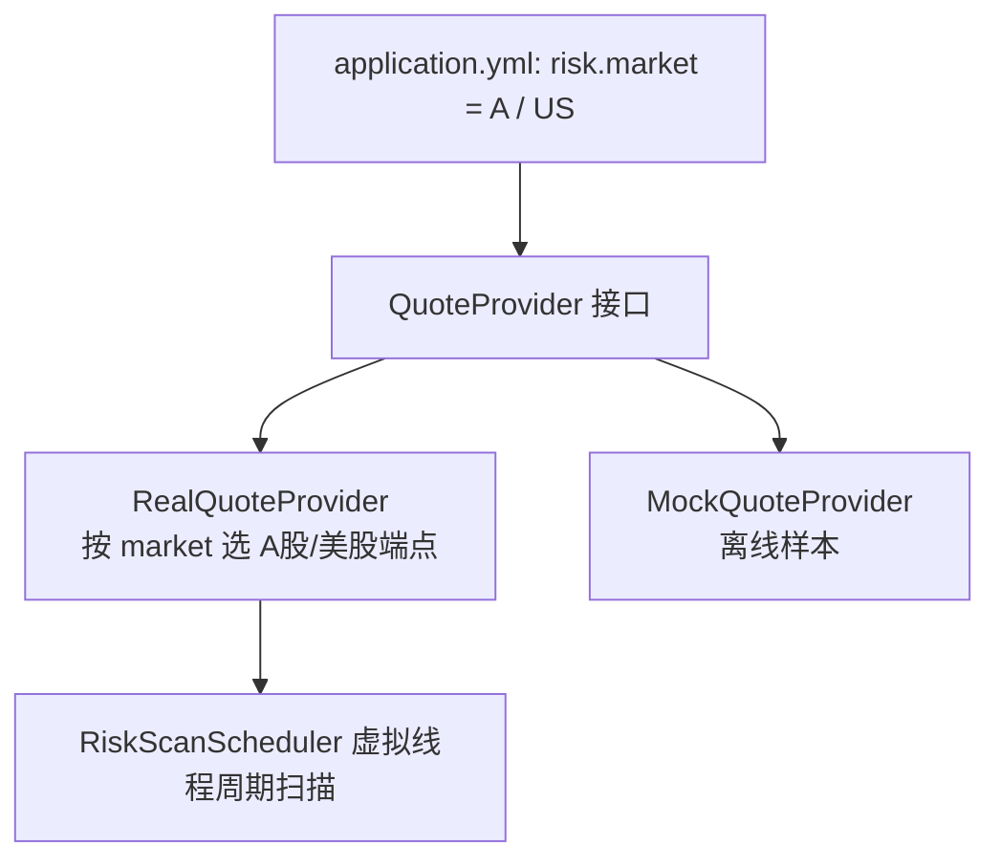

## 【学习目标】

学完本节，你应该能够：

- 把课程从「美股专属」扩展到「A 股也能跑通」，理解公告数据里的股票代码、名称、标题、标签如何对应到已有模型。
- 用 `httpclient5` + `jackson-databind` 调用东方财富公开接口，并用 `ObjectMapper` / `JsonNode` 解析 `data.list` 数组。
- 说清「公告类型即标签」「标题链接可丢给 AI 研判涨跌」的扩展思路，以及如何把 A 股字段封装进既有 entity 落库。
- 对照 982-demo 的 `risk.market` 双源开关与 `RealQuoteProvider`，理解「美股 + A 股」双源在配置层如何一键切换。

## 【正文】

### 一、把课程从美股扩展到 A 股

原本课程内容只涉及美股。这一节做一个简短的扩展：让你看到 A 股数据同样能跑通。A 股的公告页面里包含股票代码、股票名称、公告标题，有些还涉及重大财务报告等内容，自然也可能伴随涨跌。公告类型本身其实就相当于我们之前说的「标签」。把这些内容抓下来之后，一样可以存进数据库。

值得一提的是，公告标题大多是可以点击的，背后带有链接。你完全可以把链接里的正文提取出来，丢给 AI 系统去分析「这只股票更可能涨还是跌」，这条路是走得通的。

### 二、复用大模型辅助写爬虫

抓取代码的实现方式，和之前做美股时用的套路基本一致。同样借助通用大模型来产出初版代码：一共迭代了三次，边跑边调整，等稳定之后这份代码就能直接用了。视频里给出的原接口地址和页面地址，都可以直接打开对照着看。

A 股数据是通过东方财富网（`data.eastmoney.com`）的公开内部接口获取的，底层用 HTTP 客户端去调用，返回的是一份 JSON。

### 三、依赖与请求方式

要调用接口并解析 JSON，需要在 `pom.xml` 里引入这几个依赖：用 `httpclient5` 发起 HTTP 请求，用 `jackson-databind` 解析 JSON，日志用的 `slf4j` 则是可选的，不强制。请求时记得带上 `User-Agent` 等请求头，模拟浏览器访问：

```xml
<!-- HTTP 客户端 -->
<dependency>
    <groupId>org.apache.httpcomponents</groupId>
    <artifactId>httpclient5</artifactId>
    <version>5.3c</version>
</dependency>

<!-- JSON 解析 -->
<dependency>
    <groupId>com.fasterxml.jackson.core</groupId>
    <artifactId>jackson-databind</artifactId>
    <version>2.16.1c</version>
</dependency>

<!-- 日志 (可选) -->
<dependency>
    <groupId>org.slf4j</groupId>
    <artifactId>slf4j-simple</artifactId>
    <version>2.0.9</version>
</dependency>
```

**为什么用 `httpclient5` 而不是 JDK 自带的 `HttpURLConnection`？** `httpclient5` 内置连接池、自动重试、超时与重定向管理，处理真实站点（需带 `User-Agent`、处理 gzip、保持连接）时比裸 `HttpURLConnection` 稳健得多；`jackson-databind` 则是 Java 生态事实标准的 JSON 绑定库，配合 `JsonNode` 做「动态、未必闭合」的接口响应解析非常顺手。

### 四、核心爬取逻辑：AStockFetchUtil

拿到 JSON 后，用 `ObjectMapper` + `JsonNode` 解析，遍历 `data.list` 数组，把每条公告的股票代码、名称、标题、标签、展示时间取出来。核心逻辑如下：

```java
public class AStockFetchUtil {
    // ... 其他注释和变量 ...

    public static void main(String[] args) throws Exception {
        String url = "https://np-notice-stock.eastmoney.com/api/security/ann" +
                     "?sr=1&st=notice_date&page_size=200&page_index=1&ann_type=web";

        CloseableHttpClient httpClient = HttpClients.createDefault();
        HttpGet httpGet = new HttpGet(url);

        // 设置请求头
        httpGet.setHeader(name: "User-Agent", value: "Mozilla/5.0");
        httpGet.setHeader(name: "Accept", value: "application/json");

        String json = httpClient.execute(httpGet, response -> EntityUtils.toString(response.getEntity(), defaultCharset: "UTF-8"));

        ObjectMapper mapper = new ObjectMapper();
        JsonNode root = mapper.readTree(json);

        JsonNode list = root.path("data").path("list");

        for (JsonNode node : list) {
            String stockCode = node.get("codes").get(0).get("stock_code").asText();
            String stockName = node.get("codes").get(0).get("short_name").asText();
            String title = node.get("title").asText();
            String tag = node.get("columns").get(0).get("column_name").asText();
            String displayTime = node.get("display_time").asText();

            System.out.println(
                "A-Stock-Notice: " +
                "stockCode=" + stockCode + ", " +
                "stockName=" + stockName + ", " +
                "title=" + title + ", " +
                "tag=" + tag + ", " +
                "displayTime=" + displayTime + "."
            );
        }
    }
}
```

可以在 `node` 这一层打个断点进去看，里面字段很全。这里字段设计得比较规范、扩展性也好：既有中文标题，也有英文标题（美股场景里英文标题才有意义，A 股这边用英文做了占位填充），还有一个 `cn` 标题。你拿到这段代码后完全可以根据自己的需要改。

**关于 `JsonNode` 的健壮性**：`node.get("codes").get(0)` 这类链式访问在字段缺失或数组为空时会抛 `NullPointerException`。生产代码应改成 `node.path("codes").get(0)`（`path` 对缺失返回 `MissingNode` 不抛异常），或在进入循环前先 `list.isArray() && list.size() > 0` 判空。本节演示代码为求简洁未做防御，落地时要补上。

### 五、封装入库与运行结果

建议把这个工具返回的字段封装成我们自己的 entity 数据格式，再走之前课程里讲过的那套流程做数据库保存，这部分前面美股相关章节已经覆盖，这里就不再重复演示了。

直接运行 `main` 方法（用 Debug 模式右键运行），就能在 Console 看到从 JSON 里提取出来的公告信息，例如：

```
A-Stock-Notice: stockCode=300855, stockName="图南股份", title="图南股份：2026年1月23日投资者关系活动记录表", tag="其他", displayTime="2026-01-24 13:42:32:000".
```

到这里，A 股公告监测就跑通了。课程范围也已经同时覆盖美股和 A 股。

### 六、从「双源采集」到 982-demo 的配置化

课程里美股走 StockTitan RSS、A 股走东方财富接口，是两套独立实现。在 982-demo 中，这种「多市场源」被收敛成一个可配置开关：



`982-demo/src/main/resources/application.yml` 里有一行 `risk.market: A`（A = A 股，US = 美股），配合 `risk.quote-api-url` 一起决定真实行情走哪个端点；留空时由 `MockQuoteProvider` 提供样本。实现类 `RealQuoteProvider`（`982-demo/src/main/java/com/riskbot/provider/RealQuoteProvider.java`）即对应本节「调用东方财富类公开接口取数」的能力，只是把它接口化、配置化了。完整示例见 `982-demo/src/main/java/com/riskbot/provider/QuoteProvider.java`。

### 七、还能继续扩展：港股

课程之外，完全可以再接港股。东方财富的行情中心里就有港股、基金等相关内容，接入方式大同小异。多接几个市场，智能体能力就更全面，能覆盖的用户也更多，自然也会有更大的想象空间。

## 【易错点 / 面试题】

1. **问：为什么 A 股公告的「公告类型」可以直接当标签用？**
   答：东方财富返回的 `columns[0].column_name` 本就是公告分类（如「其他」「年报」），语义上等同于我们对新闻打的英文标签，可直接进入既有标签映射与展示链路，无需额外 NLP 分类。

2. **问：解析第三方 JSON 时，`node.get()` 和 `node.path()` 有什么区别？**
   答：`get()` 在字段缺失时返回 `null`，后续链式调用易 `NPE`；`path()` 在缺失时返回安全的 `MissingNode`，可继续链式调用不抛异常，生产解析更推荐用 `path`。

3. **问：请求公开接口为什么要带 `User-Agent`？**
   答：部分站点会拒绝无 UA 或默认 UA 的请求（防爬/内容协商），带上浏览器 UA 可模拟正常访问，提升成功率；同时要注意目标站点的使用条款与频率限制，避免被封。

4. **问：多市场源（美股 + A 股 + 港股）怎么在工程里优雅支持？**
   答：把取数抽象成 `QuoteProvider` 接口，用配置开关（如 `risk.market`）选择具体实现，业务层只依赖接口；新增市场只需加一个实现类并扩展配置，不动核心逻辑。

## 【小结】

到这里，A 股公告监测就跑通了：用 `httpclient5` 调东方财富公开接口，以 `jackson-databind` 的 `ObjectMapper` / `JsonNode` 解析 `data.list`，提取股票代码、名称、标题、标签、展示时间，再封装进既有 entity 落库。课程范围已同时覆盖美股与 A 股。这一「多市场源」思路在 982-demo 中被配置化为 `risk.market` 双源开关，由 `RealQuoteProvider` 承载真实取数。后续若接港股，接入方式大同小异，市场越多，风控智能体的覆盖面越广。对应工程示例见 `982-demo/src/main/java/com/riskbot/provider/RealQuoteProvider.java`。
