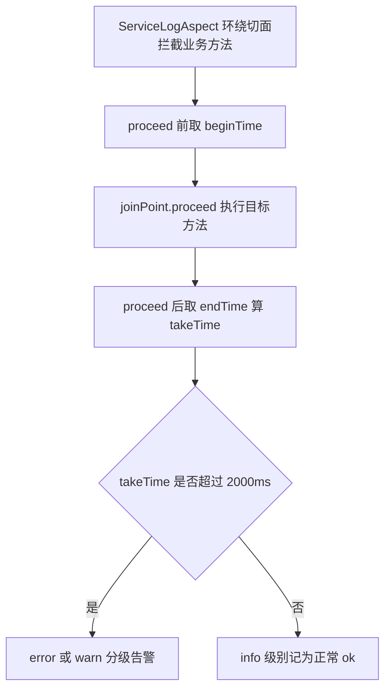

## 【学习目标】

学完本节，你应该能够：

1. 说清为什么「手动在方法前后打点计时」不可维护，以及 AOP 如何用统一切面横切业务层方法。
2. 用 `@Around` 环绕通知 + `ProceedingJoinPoint` 正确实现「方法执行前后取时间、算耗时」的切面，并避开 `proceed()` 漏调用、`return null` 这类典型错误。
3. 逐段拆解切点表达式 `execution(* com.itzixi.service.impl.*.*(..))`，理解每个通配符的含义与「包含子包（`..`）」的必要性。
4. 基于耗时做分级告警（error / warn / info），把监控真正用起来定位慢方法，而非只打印一条时间就完事。

---

## 【正文】

### 一、为什么要在业务层做性能监控

前几节我们已经打通了「抓取 RSS → 清洗 → 去重 → 入库」的主链路。但「能跑通」不等于「跑得快、跑得稳」。真实项目里，业务层（Service 层）是性能问题的集中爆发地：它既要调数据库（MyBatis-Plus Mapper），又可能调外部翻译 API、外部行情接口。某个方法一旦变慢，上游调度就被拖垮，定时任务开始积压。

问题是一个项目里往往有十几到二十个 Service 类，每个类里又有好几个方法。**靠手动在方法前后 `System.currentTimeMillis()` 打点计时，既不优雅也难维护**：

- 要在每个方法里各写两行取时间、一行相减、一行日志，侵入性强；
- 方法一多，散落各处的计时代码无法统一开关、统一格式；
- 想临时关掉监控就得逐个改，极易漏改。

这正是 **AOP（Aspect Oriented Programming，面向切面编程）** 的典型用武之地：它把「横切多个类的同一类关注点（这里是耗时统计）」抽出来，做成一个独立的切面，统一拦截、统一处理。业务代码里一行计时都不用写，监控逻辑与业务逻辑彻底解耦。

### 二、引入 AOP 依赖

AOP 能力来自 `spring-boot-starter-aop`。我们的项目继承自 Spring Boot 的父 POM：

```xml
<parent>
    <groupId>org.springframework.boot</groupId>
    <artifactId>spring-boot-starter-parent</artifactId>
    <version>4.0.0</version>
    <relativePath/>
</parent>
```

父 POM 统一管理了依赖版本。在此基础上，手动补上 `spring-boot-starter-aop` 坐标（部分 Spring Boot 4.0 的里程碑版本里该 starter 不会自动带进来，手写即可）。坐标加好之后记得刷新并安装依赖，**只有当该依赖真正被下载下来，AOP 才会生效**。漏掉这一步，切面类编译不报错，但运行时切面根本不会被织入，排查起来非常迷惑。

> 技术栈对齐：本项目锁定 Spring Boot 4.0 系列（课程录制时的版本）；课程配套的 982-demo 已升级到 **Spring Boot 4.1.1 + Spring AI 2.0.1 + Java 21**（见总提示词 §0）。AOP 的注解与用法在两个版本间完全兼容，`@Aspect` / `@Around` / `ProceedingJoinPoint` 没有变化，所以本节写法可直接平移到新栈。

### 三、被监控的目标：业务层 Service

我们要监控的业务层典型代表是 `RssServiceImpl`，它负责抓取 RSS、清洗并交给 `StockService` 落库：

```java
@Service
public class RssServiceImpl implements RssService {
    @Resource
    private StockService stockService;
    public static final String RSS_URL = "https://www.stocktitan.net/rss";
    @Override
    public void displayRss() throws Exception {
        // ... 省略部分代码 ...
        for (SvndEntrv entrv : rssList) {
            // ... 省略部分代码 ...
            try {
                List<String> tagsList = StockTitanCrawler.getTags(title);
                stockNews.setTagsZh(tagsList);
            } catch (Exception e) {
                throw new RuntimeException(e);
            }
        }
    }
}
```

注意 `displayRss` 内部是一个 for 循环，循环体里既做去重查询（`isStockNewsExist`）、又做标签抓取。这种「一个公开方法内部反复调用多个子操作」的结构，正是耗时容易失控、也最值得被切面统一量化的地方。

### 四、编写环绕切面 ServiceLogAspect

新建一个 Java 类作为切面，两个关键注解：

- `@Component`：让 Spring 把它扫描进容器托管；
- `@Slf4j`：引入标准日志能力。**注意这里不要用 `System.out.println`（sout）打日志**，那是不规范的；生产环境一律用 slf4j。

因为要统计「方法执行了多久」，最合适的是 `@Around`（环绕通知），它能在目标方法执行前和执行后都拿到控制权，像一个刀切在木棍上，切点（Pointcut）就是那把刀切入的位置：

```java
@Component
@Slf4j
public class ServiceLogAspect {
    @Around("execution(* com.itzixi.service.impl.*.*(..))")
    public Object recordTimeLog(ProceedingJoinPoint joinPoint) throws Throwable {
        long beginTime = System.currentTimeMillis();
        Object proceed = joinPoint.proceed();
        String pointCut = joinPoint.getTarget().getClass().getName() + "." + joinPoint.getSignature().getName();
        long endTime = System.currentTimeMillis();
        long takeTime = endTime - beginTime;
        return null;
    }
}
```

`@Around` 里的 `ProceedingJoinPoint` 就是连接点（JoinPoint），通过它我们能拿到目标方法的完整信息。这里有两个**必须牢记的生死线**：

1. **必须调用 `joinPoint.proceed()`**：这一行才是真正执行目标方法。漏掉它，目标方法永远不会跑，业务直接停摆。
2. **必须 `return` 目标方法的返回值**：上面这段初版代码写成了 `return null;`，这是个隐蔽 bug，对于 `void` 方法无所谓，但对于有返回值的方法（比如返回 `List`、返回 `boolean`），调用方会拿到 `null`，轻则空指针、重则业务逻辑全部错位。正确的结尾是 `return proceed;`。

> 这是课程演示阶段留下的「半成品」，本节重点在讲 AOP 机制，但你在生产里集成时一定要改成 `return proceed;`，否则有返回值的方法被切后会全部返回 null。下一篇 `6-2` 会给出修正后的完整切面。

### 五、切点表达式逐段拆解

`@Around` 里的 `execution(* com.itzixi.service.impl.*.*(..))` 是 AOP 的核心，一段一段拆开看：

- 第一个 `*`：匹配**任意返回类型**。方法可以返回对象，也可以是 `void`，该星号都能覆盖；
- `com.itzixi.service.impl`：指定要切的**包名**，即业务层实现类所在包；
- `..`：两个点表示匹配该包**及其所有子包**。考虑到后续可能往 `service.impl` 下再建子包（如 `service.impl.risk`、`service.impl.translate`），写成两个点能让子包里的类也被一并切到，更具通用性；
- 再一个 `*`：匹配该包下的**任意类**；
- `*(..)`：匹配类里的**任意方法名、任意参数**，无论有没有参数、有多少个参数，都能被锁定。

合起来的语义是：**拦截 `com.itzixi.service.impl` 包（含子包）下所有类的所有方法，统计它们的执行时间**。

> 面试题延伸：如果想只对 `save` 开头的方法切面，可写成 `execution(* com.itzixi.service.impl.*.save*(..))`；如果想排除某些类，可配合 `@annotation` 或 `@within` 做更细粒度控制。AOP 表达式的灵活度远超「一刀切」。

### 六、记录耗时并分级告警

在 `recordTimeLog` 里，我们在 `proceed()` 前后各取一次系统毫秒时间戳，相减得到耗时 `takeTime`：

- 先用 `System.currentTimeMillis()` 取 `beginTime`；
- 调用 `joinPoint.proceed()` 让目标方法执行；
- 通过 `joinPoint.getTarget().getClass().getName()` 拿类名、`joinPoint.getSignature().getName()` 拿方法名，拼成 `pointCut`（形如 `com.itzixi.xxxServiceImpl.methodName`）；
- 再取 `endTime`，算出 `takeTime = endTime - beginTime`。

拿到耗时后做分级判断，把「监控」变成「可行动的告警」：

- **`takeTime > 3000ms`**：记一条日志，提示该切点「耗时较慢」，需重点关注；
- **`takeTime > 2000ms`**：用 `warn` 级别告警；
- **`takeTime < 2000ms`**：普通 `info` 级别，记为正常（ok）。

这样运行日志里就能直观看到哪些业务方法偏慢，方便后续排查。分级的价值在于：**不用人盯着每一条时间，告警级别本身就在帮你排序优先级**，error 的那几个方法，就是下一轮优化的靶子。

耗时统计与分级告警的处理流程如下：



### 七、运行验证

代码写完后，记得给切面类补上 `@Aspect` 注解，漏了它切面不会生效（仅 `@Component` 不足以让 Spring 识别这是切面）。加上之后，IDE 里该方法上会多出一个切面徽标，点开能看到所有被 AOP 拦截的 Service 方法。如果表达式写错（比如类名拼错），徽标会变红并提示找不到对应方法，这一点要特别注意。

跑一下程序验证。股票数据在盘前、下午三四点之后量会明显变大；如果数据量一直很少，方法基本是空转状态。运行后查看日志，会看到类似这样的输出：

```
[us-stock-monitor-web] scheduling-1 com.itzixi.ServiceLogAspect
```

这说明切面已经成功拦截了目标方法。比如去重判断 `isStockNewsExist` 被业务层频繁调用，日志里会显示它被切到了；而像 `displayRss` 这类方法，因为内部多次调用去重方案，执行一次可能耗时 **785ms** 左右，日志里就会标记为偏慢，这本身就提示我们：该方法里反复做去重查询，值得优化（优化方向见 `5-9` 的 Redis 去重，把 DB 查重换成内存查重）。

### 八、与 982-demo 的对应：切面同样能罩住风控 Bean

课程配套 982-demo 工程里，被 Spring 托管的业务 Bean 同样适合用 AOP 统一监控：

- `src/main/java/com/riskbot/scheduler/RiskScanScheduler.java`：周期扫描调度器，每次扫描要拉行情、跑规则，是耗时大户；
- `src/main/java/com/riskbot/service/RiskEvaluationService.java`：编排「感知→决策」的核心服务；
- `src/main/java/com/riskbot/agent/RiskQueryAgent.java`：基于 `ChatClient` + `@Tool` 的查询 Agent（见 `9-7`、`10-x` 系列）。

把本节的 `ServiceLogAspect` 的切点表达式从 `com.itzixi.service.impl` 改成 `com.riskbot.service` / `com.riskbot.scheduler`，就能一模一样地给风控链路做耗时画像，例如观察 `RiskScanScheduler` 一个扫描周期花多久、`RiskEvaluationService.evaluate` 在 `RuleEngine` 判定上耗了多少。监控手段与业务栈完全解耦，这正是 AOP 的价值。

---

## 【易错点 / 面试题】

**1. `@Around` 切面里最常见的两个致命错误是什么？**
答：①漏调 `joinPoint.proceed()`，导致目标方法根本不执行；②写成 `return null;` 而非 `return proceed;`，导致有返回值的方法被切后全部返回 null，引发下游空指针。正确写法必须 `proceed()` 并把返回值原样返回。面试官可能追问：`@Before`/`@After` 需不需要 `proceed()`？答：不需要，只有 `@Around` 掌握执行控制权。

**2. 切点表达式 `execution(* com.x.service.impl.*.*(..))` 中 `..` 和 `*(..)` 分别匹配什么？**
答：`..` 表示「当前包及其所有子包」；`*(..)` 的 `*` 匹配任意方法名、`(..)` 匹配任意参数（含无参）。少了 `..` 就只能切到 `impl` 直接类、漏掉 `impl.risk` 这类子包。延伸：想切特定注解的方法可用 `@annotation(com.x.MyMark)`。

**3. 为什么监控日志要用 slf4j 而不是 `System.out.println`？**
答：sout 无法分级、无法按环境开关、无法接入日志框架做聚合与采集；slf4j 的 info/warn/error 分级天然适配告警分级，也便于在生产用 Logback/Log4j2 做滚动与远程收集。性能监控本就是要「可持续观测」，sout 违背了这一目标。

---

## 【小结】

本节用 `@Aspect` + `@Around` + `ProceedingJoinPoint` 实现了业务层耗时的统一横切监控，逐段拆解了切点表达式，并给出 `>3000ms error / >2000ms warn / 其余 info` 的分级告警。重点纠偏了 `proceed()` 漏调用与 `return null` 两个隐蔽 bug，后者会在下一篇 `6-2` 的 `StopWatch` 升级版切面里被彻底修正。AOP 把「监控」从散落各处的打点解放成一处可维护的切面，这套手法同样适用于 982-demo 的 `RiskScanScheduler`/`RiskEvaluationService`。下一篇我们将用 Spring 自带的 `StopWatch` 替换手写 `currentTimeMillis`，支持一段业务内多节点分段计时，把监控粒度进一步做细。
