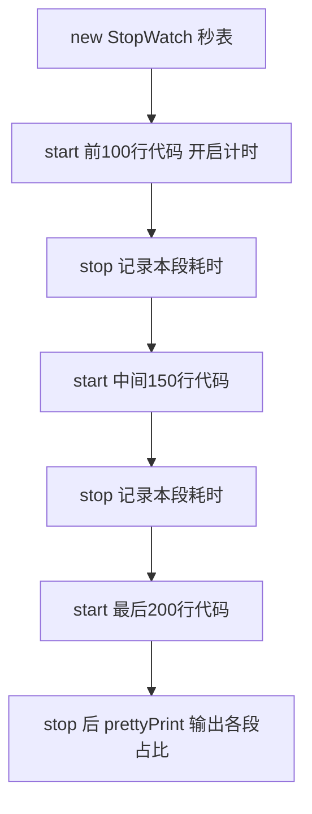

## 【学习目标】

学完本节，你应该能够：

1. 说清为什么手写 `System.currentTimeMillis()` 前后取时既繁琐又缺乏结构，以及 `StopWatch` 在「一段业务内多节点分段计时」场景下的优势。
2. 用 `StopWatch` 的 `start("任务名")` / `stop()` 多段计时，并用 `prettyPrint()` / `shortSummary()` / `getTotalTimeMillis()` / `getTaskCount()` 做统计输出。
3. 把 `StopWatch` 正确接入 `ServiceLogAspect` 环绕切面，修正上篇遗留的 `return null` 问题，给出可落地的完整切面。
4. 理解 `StopWatch` 只是统计工具、对业务零侵入，并能判断「项目是否真需要这层监控」。

---

## 【正文】

### 一、为什么用 StopWatch 替代手写计时

在 `6-1` 里，我们在 AOP 切面中用 `System.currentTimeMillis()` 前后取时间戳算耗时。这种方式能用，但层次比较低、写起来也繁琐：每次都要手动声明 `beginTime`、`endTime`，再相减，而且**只能得到「整个方法」一段总耗时，看不到方法内部各阶段的分布**。

Spring 其实已经帮我们准备好了更优雅的工具：**`StopWatch`（秒表）**。它的隐喻是体育老师手里的秒表：一组 4~6 个同学跑步，每个人冲过终点老师按一下按钮，就能分别记下每个人的成绩。`StopWatch` 也是同样的思路，你可以在一段业务的「中途」不断按下秒表，分别记录每一段花了多长时间，最后统一做统计分析。

所以当一段业务逻辑比较长、需要在中间多个节点记录时间时，用 `StopWatch` 会比手写 `currentTimeMillis` 优雅得多、信息量也大得多。这节课我们就把它从测试用到切面。

### 二、StopWatch 的基本用法（测试用例 TimeTest）

为了先验证 `StopWatch` 怎么用，我们写一个 `TimeTest` 测试类，用三个 `Thread.sleep` 模拟三段代码的耗时：

```java
@SpringBootTest
public class TimeTest {
    @Test
    public void testTime() throws Exception {
        StopWatch stopWatch = new StopWatch();
        stopWatch.start("前100行代码");
        Thread.sleep(1001);
        stopWatch.stop();
        stopWatch.start("中间150行代码");
        Thread.sleep(800);
        stopWatch.stop();
        stopWatch.start("最后200行代码");
        Thread.sleep(360);
        stopWatch.stop();
        System.out.println(stopWatch.prettyPrint());
        System.out.println(stopWatch.shortSummary());
    }
}
```

用法很直观：先 `new` 一个 `StopWatch`，然后针对每一段逻辑调用 `start("任务名")` 开启计时，业务逻辑执行完调用 `stop()` 停止。任务名是可选的，不传也能跑，但加上之后输出里能清楚看到「哪一段」对应「多少时间」，便于分析。

> 为什么先用测试类验证？因为 `StopWatch` 是纯本地、无外部依赖的工具，用 `@SpringBootTest` 起一个测试最快能确认用法正确，避免直接改切面后才发现 API 记错。这是「先小范围验证、再上主体代码」的稳妥工程习惯。

### 三、多任务分段时间与统计输出

上面的例子里，我们在三段代码前后分别 `start` / `stop`，相当于体育老师按了三次秒表。运行之后，`StopWatch` 提供几个非常好用的统计方法：

- `prettyPrint()`：漂亮地打印每一段任务的名称、耗时和占比；
- `shortSummary()`：输出一份简短的总览摘要；
- `getTotalTimeMillis()`：拿到所有任务的总耗时（毫秒）；
- `getTaskCount()`：获取任务数量。

运行结果和我们的睡眠时间基本吻合：第一段 1001ms、第二段约 800ms、第三段约 360ms，三个任务的名称都完整显示出来，各自占比也一并算好了。整体总耗时约为 **3.15 秒（3155 毫秒）**，任务总数为 **3**。整个过程非常优雅，无需我们手动相减，更关键的是，**它把「总时间」拆成了「各段贡献」**，让你一眼看出瓶颈在哪一段。

> 价值对比：手写 `currentTimeMillis` 只能告诉你「整个方法花了 3155ms」；`StopWatch` 会告诉你「中间 150 行那段占了 800ms、是三段的 25%」。排查性能时，后者直接指向该优化的代码段，前者只给一个笼统数字。

StopWatch 多段计时的流程如下：



### 四、把 StopWatch 应用到 AOP 切面

验证完基本用法，我们把它搬进 `ServiceLogAspect` 切面，替换掉原来手写的 `System.currentTimeMillis()`。思路不变：在方法执行前 `start`，`proceed()` 之后 `stop`，再用 `getTotalTimeMillis()` 取出总耗时作为 `takeTime`：

```java
@Component
@Aspect
public class ServiceLogAspect {
    @Around("execution(* com.itzixi.service.impl.*.*(..))")
    public Object recordLog(ProceedingJoinPoint joinPoint) throws Throwable {
        StopWatch stopWatch = new StopWatch();
        stopWatch.start("方法执行开始");
        Object proceed = joinPoint.proceed();
        stopWatch.stop();
        long beginTime = System.currentTimeMillis();
        String pointCut = joinPoint.getTarget().getClass().getName() + "." + joinPoint.getSignature().getName();
        long endTime = System.currentTimeMillis();
        long takeTime = endTime - beginTime;
        if (takeTime > 3000) {
            log.error("{}", pointCut, takeTime, "SLOW", joinPoint.getArgs());
        } else if (takeTime > 2000) {
            log.warn("{}", pointCut, takeTime, "NORMAL", joinPoint.getArgs());
        } else {
            log.info("{}", pointCut, takeTime, "OK", joinPoint.getArgs());
        }
        return proceed;
    }
}
```

这里有几个**关键修正与说明**，务必和上篇对照看：

1. **`return proceed;` 而不是 `return null;`**：上篇 `6-1` 的初版切面写成了 `return null;`，对有返回值的方法是致命 bug。本节给出的是修正后的完整写法，`proceed` 是目标方法的真实返回值，必须原样返回，业务才不会被切断。
2. **`@Aspect` 注解已补上**：切面类必须带 `@Aspect` 才会被 Spring 识别织入，`@Component` 单独不够。
3. 切点表达式 `execution(* com.itzixi.service.impl.*.*(..))` 与上一节一致，拦截业务层所有方法。

> 注意：上面的生产写法里，`StopWatch` 只包了 `proceed()` 这一段（即方法本身），同时又保留了 `beginTime/endTime` 的手写计算来得出 `takeTime`。这是为了演示「两种计时并存」，实际项目里二选一即可：要么用 `StopWatch.getTotalTimeMillis()`，要么用手写差值，二者取一能避免重复计时逻辑。若要做**方法内多段** profiling，则 `StopWatch` 必须在 `proceed()` 内部、围绕各子操作多次 `start/stop`（见本节第三节思路），那需要把计时点下沉到业务方法内部或用更细的切点，超出本切面范围。

拿到 `takeTime` 后做分级判断：

- **`takeTime > 3000ms`**：`log.error`，标记为 `SLOW`；
- **`takeTime > 2000ms`**：`log.warn`，标记为 `NORMAL`；
- **其余（< 2000ms）**：`log.info`，标记为 `OK`。

日志里带上 `pointCut`（类名.方法名）、`takeTime`、`joinPoint.getArgs()`，方便事后回溯是哪一次调用、传入了什么参数导致变慢。

### 五、运行验证

把切面接回项目、运行定时任务后，控制台会打印出被拦截的类名、方法名以及对应的执行时间。可以看到，在整段大方法里，**`displayRss` 这个方法的耗时最长**，这也和之前的判断吻合：它内部反复调用去重方案，单次执行就会多次触发 `isStockNewsExist`。

一次典型的启动与执行输出大致如下：

```
:: Spring Boot :: (v4.0.0)
2025-12-19T13:35:44.957 [main] INFO org.springframework.test.context.support.AnnotationConfigContextLoaderUtils -- Found @SpringBootApplication
2025-12-19T13:35:45.015 [main] INFO org.springframework.boot.test.context.SpringBootTestContextBootstrapper -- Found @SpringBootTest
...
```

`StopWatch` 本身只是个统计工具，对业务没有任何侵入和影响，加不加都不会改变程序的实际运行结果。如果你的项目只是想快速跑通、不想额外引入这层统计，也可以不挂这个切面；但保留它对我们排查性能瓶颈、定位慢方法非常有帮助，尤其是当你准备按 `5-9` 的思路把 DB 查重换成 Redis 查重时，切面数据能客观告诉我们「替换后 `displayRss` 到底快了多少」。

### 六、与 982-demo 的对应：给风控链路做分段 profiling

课程配套 982-demo 工程里，需要被量化的耗时同样存在：

- `src/main/java/com/riskbot/scheduler/RiskScanScheduler.java` 的 `scan()` 方法：一个扫描周期要拉一批 tick、逐个交给规则引擎；
- `src/main/java/com/riskbot/service/RiskEvaluationService.java` 的 `evaluate()`：内部串接 `RuleEngine` 的多条规则（`PriceVolatilityRule` / `VolumeSpikeRule`）。

把本节的 `ServiceLogAspect` 切点改到 `com.riskbot.scheduler`、`com.riskbot.service`，`StopWatch` 就能告诉我们：一个扫描周期总耗时多少、其中规则判定占了多少。更进一步，若想看 `RuleEngine` 内部「每条规则各花多少」，可在 `evaluate` 内用 `StopWatch` 对每条规则 `start/stop` 做分段，这正是 `StopWatch` 相对手写计时的核心优势：**一段业务、多节点分段**。

> 可观测性延伸：982-demo 的 `application.yml` 已开启 `Actuator`（`/actuator/health`、`/actuator/metrics`），配合 Micrometer 可把这类耗时上报到 Prometheus。AOP + `StopWatch` 是本地快速 profiling 的手段，Micrometer 指标是生产持续观测的手段，二者互补而非替代。

---

## 【易错点 / 面试题】

**1. 手写 `currentTimeMillis` 和 `StopWatch` 的本质区别是什么？**
答：手写只能得到「起止一段总耗时」，且要手动声明/相减；`StopWatch` 支持多段 `start/stop` 分别计时，并提供 `prettyPrint()`（带占比）、`getTotalTimeMillis()`、`getTaskCount()`，把「总时间」拆成「各段贡献」，直接定位瓶颈段。面试延伸：为什么 `StopWatch` 不适合做纳秒级精准基准测试？答：它有对象分配与格式化开销，微基准应改用 JMH。

**2. 本节切面相对 6-1 修正了什么致命问题？**
答：把 `return null;` 改成 `return proceed;`。`@Around` 切面必须返回 `proceed()` 的真实返回值，否则有返回值的方法被切后全部返回 null，引发下游空指针。同时补上了 `@Aspect` 注解，否则切面不织入。

**3. `StopWatch` 对业务逻辑有侵入吗？不加会有运行时影响吗？**
答：零侵入、零业务影响，它只统计不修改数据流，去掉切面程序行为完全不变。因此它适合作为「可插拔的观测层」。延伸：生产持续观测更推荐 Micrometer 指标 + Actuator，而非依赖日志里的 `prettyPrint`。

---

## 【小结】

本节用 `StopWatch` 替代了手写计时，演示了多段 `start/stop` 分段统计与 `prettyPrint/shortSummary/getTotalTimeMillis/getTaskCount` 的输出，并给出了修正 `return null` 后的完整 `ServiceLogAspect`。核心认知是：`StopWatch` 把「笼统总耗时」拆解成「各段贡献」，让性能瓶颈可见；它零侵入、可插拔。这套监控手法平移到 982-demo 的 `RiskScanScheduler`/`RiskEvaluationService` 即可量化风控链路耗时。下一章 `7-1` 起我们转入「翻译模块」，在入库前插入百度翻译这道外部 API 调用，而外部 API 的密钥管理与成本控制，正是接下来几篇的重点。
