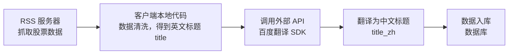

## 【学习目标】

学完本节，你应该能够：

1. 说清为什么股票异动数据需要在入库前做翻译，以及「英文标题直接落库」对中文用户与下游告警可读性的影响。
2. 画出并讲透「RSS 抓取 → 本地清洗 → 调外部翻译 API → 翻译标题 → 入库」这条新增链路，理解它相对「直接入库」多了哪两个环节。
3. 对比多家翻译厂商（百度/阿里/腾讯）的 SDK 共性，理解「调用外部翻译 API」这一能力的本质。
4. 预估百度翻译的成本量级，建立「翻译是按量计费、需控制调用频率」的工程意识。

---

## 【正文】

### 一、为什么需要翻译模块

前面的章节里，我们已经能抓取到股票数据、把它存进数据库，并且写了 AOP 切面做性能监控。从这一章开始，我们专门来解决「翻译」这件事。

抓到的股票异动数据里，标题是英文的（比如来自 StockTitan 的 RSS）。一条典型的英文标题形如 `U.S. Marine Technologies Inc. Announces Pricing of Public Offering`，对中文用户并不友好，毕竟很多人并不精通英文，看到满屏英文标题，既读不懂、也无法快速判断「这条异动重不重要」。

所以在入库之前，最好先调一次翻译，把标题处理成中文，体验更人性化。具体收益有三层：

- **可读性**：用户打开预警列表，看到的是「美国海洋技术公司宣布公开发行定价」而非一串英文，决策效率立刻提升。
- **告警友好**：风控机器人推送到钉钉/Telegram 的消息（见 `8-x` 系列），标题是中文才能被接收者一眼看懂，否则告警失去意义。
- **检索与归档**：中文标题便于后续按关键词检索、做中文摘要，下游分析成本更低。

这里我们使用**百度翻译**来完成翻译。百度翻译开放平台的官方地址是 `https://fanyi-api.baidu.com/`，可以先在浏览器打开、注册账号、浏览开放平台文档与控制台。其实不止百度，阿里、腾讯等各大翻译厂商也都提供了类似的 SDK，供我们集成使用，本质上都是「调用外部翻译 API」，请求一段文本进去、拿回翻译结果出来，差异只在鉴权方式、语种覆盖和资费。

### 二、百度翻译的成本量级

做外部 API 集成，第一件事不是「怎么调」，而是「要花多少钱、会不会失控」。百度翻译开放平台对新用户比较友好：一开始会赠送 **100 万字符/月** 的免费额度，基本等于免费使用。实际跑下来，如果项目持续运行，半个多月就可能把额度用光；用完之后再续费，花几十块钱就能再撑一段时间，整体算下来一个月大约 **50 元**。

把成本摊到每条数据上算一笔账：一条股票标题平均几十个字符，100 万字符大约对应几万条标题，对个人预警项目完全够用。**成本意识的关键结论是：翻译是「按字符计费、调用即烧钱」的操作**，这直接决定了它在采集链路里的位置，必须放在去重之后（见 `5-8`），重复数据绝不该被翻译第二次。

所以也不用 7×24 小时一直开着，如果只是为了学习和演示，工作日打开跑一跑就够了，整体开销并不高。这和 `5-9` 提到的「重复调用翻译会浪费额度」是同一工程逻辑的两面：去重省的是真金白银。

### 三、整体流程解析

我们的本地代码就是「客户端」，百度翻译系统就是「服务端」。客户端主动调用服务端的接口完成翻译。完整的处理链路如下：

对应到具体步骤：

0. **抓取股票**：从远端 RSS 服务器获取原始股票数据；
1. **数据清洗**：在客户端本地代码里做清洗，提取出英文标题 `title`；
2. **调用外部 API**：通过百度翻译提供的 SDK 向服务端发起请求；
3. **翻译为中文标题**：拿到响应，解析出中文标题 `title_zh`；
4. **数据入库**：把翻译后的结果写进数据库。

对比一下就能看出变化：之前我们在拿到英文标题之后就直接入库了；现在多了「调用 API」和「拿到 `title_zh`」这两个步骤，相当于在原来的链路里插了一段翻译处理。

这里要强调链路顺序的**正确性约束**：

- 翻译放在「数据清洗拿到 `title`」之后，没清洗出标题就没东西可翻；
- 翻译放在「去重判定」之后，重复数据直接 `continue`，根本走不到翻译这一步（`5-8` 已经把该闸门卡在最前）；
- 翻译放在「入库」之前，`title_zh` 是要和原数据一起落库的字段，必须先拿到再存。

这条顺序链与 `5-8`/`5-9` 的去重闸门、`6-1`/`6-2` 的监控切面是兼容的：去重在前挡住重复，翻译在中处理文本，监控在旁路量化每一步耗时，入库在最后沉淀数据。四章拼起来就是一条「干净、可读、可观测」的采集闭环。

### 四、外部 API 调用的工程本质

把百度翻译 SDK 抽象一层看，它和我们在 982-demo 里调用的「外部行情 API」「外部 LLM」是同一类东西，**都是通过 HTTP 请求一个远端服务、拿到结构化响应**。这类集成的共性工程问题有：

- **鉴权**：百度翻译用 `appid` + `secret` 签名（见 `7-2`）；982-demo 的 LLM 用 API Key（见 `ChatModelConfig`）；行情 API 也各有各的 Key。本质都是「凭证入参、请求签名、响应校验」。
- **限流**：翻译有 QPS 上限（个人 10、企业 100，见 `7-2`），超限返回错误；行情、LLM 同样有速率限制。所以采集频率、批量大小都要和尊重限流（呼应 `5-8` 的 429 话题）。
- **失败处理**：翻译偶尔失败（网络抖动、密钥过期），应降级而非阻断，就像 `5-9` 里「标签解析失败就置空」的思路：`title_zh` 翻译失败时保留英文原文 + 标记待补译，绝不因翻译问题卡住整条入库。
- **密钥外部化**：`appid`/`secret` 绝不能硬编码进源码，应通过配置中心/环境变量注入。这点在 `7-6` 用 `.env` 专门讲，982-demo 的 `application.yml` + `application-prod.yml` 也是同一原则（Key 走 `${ENV}`，不落库）。

理解了该本质，你会发现「接一个翻译 SDK」和「接一个行情 SDK」「接一个大模型」在架构上是同构的，学通一个就能举一反三。

### 五、与 982-demo 的对应：翻译在风控链路里的位置

课程配套 982-demo 工程（`D:\ai\video2text\output\全部课程交付\06-mksz982-股票异动风控机器人\982-demo`）的「感知→决策→执行」闭环里，翻译不属于核心风控逻辑，但它可以挂在**感知层的预处理**上：

- `src/main/java/com/riskbot/scheduler/RiskScanScheduler.java` 周期扫描拿到行情 tick；若在告警前想把「异动原因/标签」做本地化，可在此处挂一个翻译步骤（调用百度翻译 SDK，或在 prod 下改用 LLM 翻译）。
- `src/main/java/com/riskbot/config/ChatModelConfig.java` 与 `src/main/java/com/riskbot/config/OfflineChatModel.java` 展示了「外部服务凭证外部化 + `default` profile 离线 mock」的统一模式，百度翻译的 `appid`/`secret` 也应照此办理：本地/演示用 mock 翻译、prod 填真实 Key（呼应 `application-prod.yml`）。

也就是说，本节讲的「调用外部翻译 API」是 982-demo 里所有外部依赖集成的一个缩影：鉴权、限流、失败降级、密钥外部化，这四件事在每一次「客户端调远端」时都要被认真对待。

---

## 【易错点 / 面试题】

**1. 翻译步骤在采集链路里应该放在什么位置？为什么必须在去重之后？**
答：顺序应为 抓取 → 清洗出 title → 去重判定 → 翻译 → 入库。翻译必须放在去重之后，因为百度翻译按字符计费、调用即烧钱；重复数据若先翻译再查重，会白白消耗额度。去重闸门（`5-8`）挡在最前，翻译才不会被浪费。延伸：翻译失败时应保留原文并降级，而非阻断入库。

**2. 接百度翻译 SDK 和接一个 LLM/行情 API 在工程上有什么共性？**
答：本质都是「客户端 HTTP 调远端服务」：都需要凭证鉴权（appid+secret / API Key）、都受 QPS 限流、都需失败降级、都应将密钥外部化不硬编码。学通一种外部集成，其余同构可迁移。982-demo 的 `ChatModelConfig` 与 `application-prod.yml` 是同一套原则。

**3. 为什么翻译失败不应阻断整条入库链路？**
答：翻译只是「可读性增强」，不是「数据正确性必需」。翻译抖动/额度耗尽时，应保留英文原文并标记待补译，让主流程继续。这与 `5-9` 中「标签解析异常就置空」是同一降级哲学：非核心字段异常可降级，核心链路不能断。

---

## 【小结】

本节把「英文标题入库前翻译为中文」这件事工程化：讲清了动机（可读性/告警友好/可检索）、成本量级（100 万字符免费、月均约 50 元）、以及「抓取→清洗→调外部 API→翻译→入库」的新增链路。核心认知是，翻译是按量计费、必须置于去重之后，且失败要降级；它与行情/LLM 调用在工程本质（鉴权、限流、降级、密钥外部化）上完全同构。下一节 `7-2` 我们进入百度翻译开放平台，具体讲清申请流程、`appid`/`secret` 获取、计费档位与额度提醒，为 `7-3` 真正把 SDK 接入项目做好准备。
