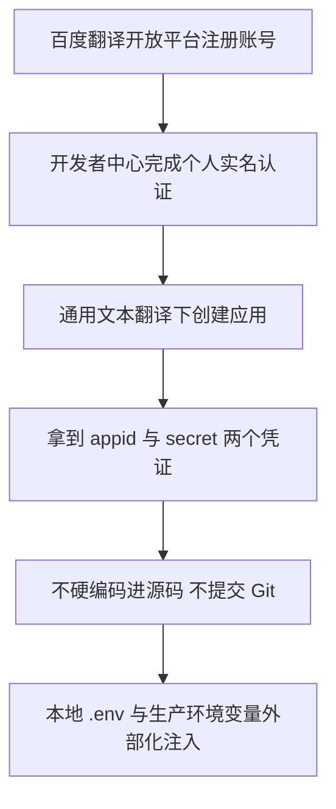

## 【学习目标】

学完本节，你应该能够：

1. 在百度翻译开放平台完成注册、认证、创建应用，拿到集成所需的 `appid` 与 `secret` 两个凭证。
2. 理清通用文本翻译的计费档位（免费额度、超量单价、QPS、单次长度上限、语种数），判断个人版是否满足项目需求。
3. 建立密钥安全意识：明白 `appid`/`secret` 泄露的后果，并知道如何用额度提醒、术语库等平台能力降低运营风险。
4. 把「外部 API 凭证外部化」的意识落到配置实践（对接 `7-6` 的 `.env` 与 982-demo 的 `application.yml`）。

---

## 【正文】

### 一、百度翻译开放平台提供了哪些能力

先到百度翻译开放平台注册一个账号，注册之后就能看到它提供的几类翻译服务。对于我们的股票异动翻译场景，先建立「平台能力全景」，才知道该选哪一档：

- **通用文本翻译**：最基础、最常用的翻译能力，我们这个项目用的就是它，完全够用；
- **领域文本翻译**：针对特定专业领域做了优化，比如生物医药、信息技术、学术论文等，翻译更专业；
- **大模型文本翻译**：基于百度自研大模型完成，在部分场景下表达更精准、更地道；
- **多模态翻译**：支持图片、音频、视频等形式的翻译，属于多模态范畴；
- **私有化部署**：可以把翻译服务部署到你自己的内网环境里。

另外平台还提供了精选案例（游戏、在线教育、新能源汽车、英伟达等）和术语库能力。对我们这个「股票异动翻译」的小项目来说，**通用文本翻译（高级版）**就足够了，没必要去折腾领域版或私有化部署，直接集成官方 SDK 即可，不用重复造轮子。

> 选型判断：股票标题是通用新闻语体，不涉及深奥专业术语，通用版翻译质量足够；若做生物医药/半导体细分赛道舆情，才需要考虑领域版。盲目上高级档位只会增加认证与合规成本。

### 二、计费模式与额度

进入管理控制台后，可以看到余额、用量等数据。重点看通用文本翻译的计费，把关键数字列成一张表，方便和评估成本：

| 计费项 | 个人认证（高级版） | 企业版 | 本项目是否够用 |
|---|---|---|---|
| 每月免费额度 | 100 万字符 | 200 万字符 | 个人版足够 |
| 超量单价 | 49 元 / 百万字符 | （企业定价） | 月均约 49 元 |
| QPS（并发） | 10 | 100 | 本地调用 10 够用 |
| 单次请求长度上限 | 6000 字符 | 6000 字符 | 标题很短，足够 |
| 支持语种 | 28 种 | 200+ 种 | 中英互译，足够 |

几个要点展开说明：

- **免费额度**：完成**个人认证（高级版）**后，每月有 **100 万字符**的免费额度；企业版则是 **200 万字符**。对我们的项目来说 200 万字符绝对够用，但个人版 100 万也绰绰有余。
- **超出部分计费**：按 **49 元 / 百万字符** 收费。实际跑下来，每月费用基本就是 49 元左右。
- **QPS（每秒请求数，即并发能力）**：个人认证是 **10**，企业版是 **100**。我们项目是本地调用，10 完全够用，这也反向约束了采集频率（`5-8` 提到的 429 限流与这里 QPS 是一体两面：别把请求速率顶到上限）。
- **单次请求长度上限**：个人和企业都是 **6000 字符**。股票标题本身很短，肯定够。
- **支持语种**：个人版支持 **28 种**常见语种，企业版超过 200 种，个人版也绝对够用。

如果你的待翻译文本特别长（比如几万个字符的长文），就需要先把它**切分成多段**，分批次翻译，最后再拼接起来。对于股票标题这种短文本，单次请求即可，无需分段。

> 成本护栏：把「100 万字符免费 + 49 元/百万超量」代入项目算，若每天抓 1 万条标题、每条 50 字符，月用量约 1.5 亿字符，远超免费额度，月费约 700+ 元。所以**控制调用量（去重 + 只在必要时翻译）是省钱的根本手段**，这又把话题拉回 `5-8`/`5-9` 的去重闸门。

### 三、申请流程与密钥获取

在平台里进入**开发者中心**，这里有几件事一定要留意：

1. **先做认证**：建议认证为个人开发者，最好完成实名认证，否则不太方便使用。
2. **创建应用**：在通用文本翻译下创建一个应用，起个名字（比如「国际新闻翻译」），应用名称随时可以改。
3. **拿到两个关键凭证**：应用 ID（`appid`）和密钥（`secret`）。这两个值一定要保存好，后续集成到项目里会使用。

> ⚠️ **安全提醒**：`appid` 和密钥千万不要泄露。一旦泄露，被别人拿去刷量，你可能会欠下不少费用。

这里把「凭证获取」与「密钥管理」分开强调，是因为它们是不同性质的动作：

- **获取**是一次性的平台操作，拿到 `appid`/`secret` 字符串；
- **保管**是持续的安全实践，决定了这两个字符串能不能进代码、能不能进版本库。

正确的保管方式是：**绝不硬编码进 `.java` 源码，绝不提交到 Git**。它们应当走配置外部化，本地开发用 `.env`（见 `7-6`），生产用环境变量或配置中心注入。这条原则在 982-demo 里被严格贯彻：`src/main/java/com/riskbot/config/ChatModelConfig.java` 从 `application.yml` 读取 LLM 的 Key，`src/main/resources/application-prod.yml` 里 Key 以 `${ENV}` 占位、由部署环境注入，绝不落库。百度翻译的 `appid`/`secret` 应照此办理，二者是同一套「凭证外部化」纪律。

从注册到凭证外部化的流程如下：

### 四、其他实用功能

平台还提供几个能降低运营风险的能力，按需选用：

- **额度提醒**：平台提供额度使用提醒功能。你可以设置当额度快用完时，向你的邮箱发邮件、或向手机发短信提醒，方便及时充值；必要时也可以更换 API key。
- **术语库**：支持创建或导入术语库，适合有固定专业词汇的场景（比如把某些网络流行语按特定方式翻译）。我们项目只是直接用标题做翻译，暂时用不到术语库，按需选用即可。
- **财务中心**：涉及开票等财务事项，这里不展开。

> 运营建议：把「额度提醒」打开是低成本高回报的动作，它能在你忘记续费、翻译悄悄失效（标题退回英文）之前报警，避免「系统还在跑、翻译早已停」的静默故障。

### 五、与 982-demo 的对应：凭证外部化是统一纪律

课程配套 982-demo 工程把「外部依赖凭证外部化」作为生产级硬约束：

- `src/main/java/com/riskbot/config/ChatModelConfig.java`：构造 `ChatClient` 所需的模型端点与 Key 从配置读取，不在代码里写死；
- `src/main/resources/application.yml`：定义 `default`（离线 mock，`OfflineChatModel`）配置，本地免 Key 即可跑；
- `src/main/resources/application-prod.yml`：真实模型端点/Key 以 `${ENV}` 占位，部署时由环境变量注入。

百度翻译的 `appid`/`secret` 集成进项目时（`7-3`），应当沿用完全相同的方式：本地 `.env` 或 `application.yml` 放占位、prod 走环境变量。这么做的收益与本节「密钥泄露会欠费」的警告直接呼应，**凭证不进代码、不进仓库，泄露面就只剩运行环境，可控得多**。

---

## 【易错点 / 面试题】

**1. 百度翻译个人版的关键计费数字是什么？项目如何避免超额欠费？**
答：个人高级版每月 100 万字符免费、超量 49 元/百万字符、QPS 10、单次上限 6000 字符、支持 28 语种。避免欠费的根本手段是「减少无效调用」：用 `5-8`/`5-9` 的去重闸门挡住重复数据、只在必要时翻译，并打开平台「额度提醒」。延伸：长文本需切分分批翻译再拼接。

**2. `appid`/`secret` 泄露有什么后果？正确保管方式是什么？**
答：泄露后他人可拿去刷量，产生不属于你的费用，甚至欠费。正确方式：绝不硬编码进源码、绝不提交 Git；走配置外部化，本地 `.env`（`7-6`）、生产环境变量/配置中心注入（982-demo 的 `application-prod.yml` 用 `${ENV}`）。这是与 LLM Key 相同的凭证纪律。

**3. 为什么股票项目选「通用文本翻译（高级版）」而非领域版/私有化部署？**
答：股票标题是通用新闻语体，通用版质量足够；领域版针对生物医药等深专业场景、私有化部署针对内网合规，对短标题翻译属过度配置，只会增加认证与运维成本。选型要匹配实际语料，不盲目上高档位。

---

## 【小结】

本节走完了百度翻译开放平台的「选型 → 计费 → 申请 → 凭证保管 → 运营提醒」全流程，给出了个人/企业版的计费对照表，并强调了 `appid`/`secret` 外部化这一安全底线。核心认知：翻译是按需计费、靠「去重 + 额度提醒」控成本，靠「凭证不进代码」控风险。这套外部 API 集成纪律与 982-demo 的 `ChatModelConfig`/`application-prod.yml` 完全同构。下一节 `7-3` 我们就正式把百度翻译 SDK 集成进项目代码，把本节拿到的 `appid`/`secret` 注入配置，跑通「标题英译中」这一步。
