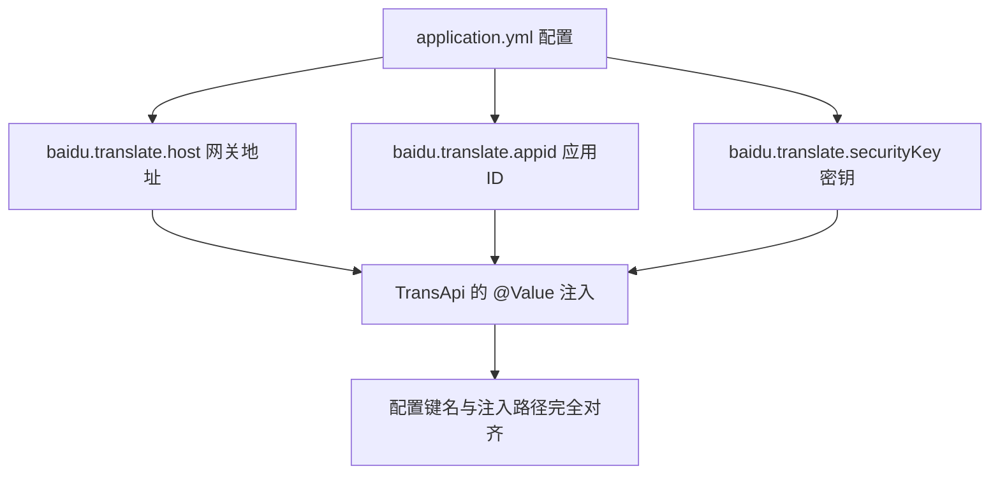

## 【学习目标】

- 在 `application.yml` 中建立独立的 `baidu.translate` 配置块，承载翻译网关地址与敏感密钥。
- 理解「密钥前置、调用后置」的工程节奏：先把接入信息落进配置，再在业务代码里发起 HTTP 调用。
- 识别「配置键名」与下游 `@Value` 注入字段必须逐字对应这一隐性约束，避免注入为空。
- 为后续（7-6）用 `.env` + 环境变量把密钥外部化、移出版本库打好基础。

## 【正文】

### 一、在业务代码里定位翻译入口

前两节已经完成了百度翻译开放平台的账号与 SDK 申请，本节正式把翻译能力集成到项目里。在课程的主链路 `RssServiceImpl` 中，原先留了一处待补全的 `TODO`：在写入中文标题之前，需要先做一次翻译调用。

```java
// TODO 处理股票标题，翻译为中文
stockNews.setTitleZh("");
```

我们补一段注释，明确此处要用百度翻译 SDK 把英文标题翻成中文：

```java
// 使用百度翻译SDK调用其API对英文标题进行翻译（翻译为中文）
// ...
```

为什么翻译要放在「存中文标题」这一步？因为 RSS 抓取到的股票异动信息（如 StockTitan 来源）标题是英文，而最终落库、推送给用户的 `title_zh` 必须是中文。翻译是「抓取 → 清洗 → 入库」链路里的一个纯函数式变换：输入英文标题，输出中文标题，不依赖上下文，因此最适合作为一处独立调用点插入。

如果后续要翻译多语种，只要调整 `from` / `to` 两个参数即可，翻译入口本身不必改动，这也是把翻译抽成独立 `TransApi` 组件、而不是散落在业务代码里的好处。

### 二、查阅官方文档，拿到 API 地址

去百度翻译开放平台的文档中心，通用文本翻译提供了 Java 版本的调用示例（其他语言版本也能下载）。文档里最关键的是它给出的 **HTTPS 调用地址**，这是一个 API 网关地址，后续所有翻译请求都打到这里：

```
https://fanyi-api.baidu.com/api/trans/vip/translate
```

工程上要区分两个概念：

- **网关地址（host）**：固定不变，由平台分配，所有请求共用同一个 endpoint。
- **请求参数（含签名）**：每次请求动态拼装，包含 `q`（原文）、`from`、`to`、`appid`、`salt`、`sign` 等。

我们后续配置就依赖该 host 地址。把它当成「服务契约」的一部分来对待，它不和任何密钥绑定，可以放心写进配置文件，甚至提交到版本库（前提是不要把它和密钥混在一起）。

### 三、在 application.yml 中配置密钥信息

回到 IDEA，打开 `application.yml`，新增一个 `baidu` 配置块，把翻译相关的参数放进去：

```yaml
baidu:
  translate:
    host: https://fanyi-api.baidu.com/api/trans/vip/translate
    appid: [密钥]
    secr: [密钥]
```

配置字段含义如下：

| 字段 | 来源 | 是否敏感 | 说明 |
|---|---|---|---|
| `host` | 官方文档 API 网关地址 | 否 | 从文档复制，不含任何账号信息 |
| `appid` | 开发者中心「我的应用」 | 是 | 应用 ID，标识你的翻译应用 |
| `secr` | 开发者中心「我的应用」 | 是 | 应用密钥（secret），用于签名 |

写入时的操作细节：

- 在 `baidu:` 下回车缩进，新建 `translate:` 子节点。子节点名 `translate` 是自定义的，写成 `translator` 或别的名字都可以，只要和下游 `@Value` 的取值路径保持一致即可。
- `host` 填上面从文档复制的网关地址。
- `appid` 和 `secr` 分别填开发者中心复制来的「应用 ID」和「密钥 ID」。

> 注意：`appid` 和 `secr` 属于敏感信息，不要硬编码提交到代码仓库。后续（7-6）会用更优雅的方式（环境变量 / `.env`）管理，本节先以明文占位，下一节再展开。

到这里，`host` 与密钥的配置就全部完成了。下一节我们在代码里真正发起翻译调用。

### 四、配置键名与下游注入的隐性约束（提前避坑）

本节定义的是 `baidu.translate.secr`，但到了 7-4，`TransApi` 里通过 `@Value` 注入的字段名是 `baidu.translate.securityKey`。**这两个名字对不上**，如果直接照抄两节的代码，Spring 会在启动时因为找不到 `securityKey` 配置键而注入失败（或注入为 `null`，到真正调接口时才报 401 签名错误）。

该陷阱之所以隐蔽，是因为：

1. 配置块和注入点分布在两个文件、两节课里，视觉上割裂；
2. 百度官方文档示例里用的就是 `securityKey` 该名字，而本节手写 yml 时随手写成了 `secr`；
3. 配置缺失不一定在启动期暴露，可能要等到第一次真实翻译请求才炸。

**正确做法**：把 yml 里的键名统一改成 `securityKey`，让 `baidu.translate.host` / `baidu.translate.appid` / `baidu.translate.securityKey` 三键与 `@Value` 路径完全对齐。这正是生产环境里「配置即契约」的体现，任何一处改名都要同步改全。

配置块与下游注入的对应关系如下：



## 【易错点 / 面试题】

1. **配置键名与 `@Value` 路径不一致怎么办？**
   表现为 `securityKey` 注入为 `null`，调用百度接口返回 401 / 签名错误。排查顺序：先确认 yml 实际键名，再确认 `@Value("${...}")` 路径，最后确认 profile 是否激活了正确的 yml。可打开 yml 用 `Ctrl/Cmd + 点击` 跳转验证绑定关系。

2. **为什么 `host` 可以提交版本库、`appid`/`secr` 不行？**
   `host` 是平台公开的网关地址，与账号无关；`appid`/`secr` 是你的账号凭证，一旦进版本库（尤其公共仓库）就等于泄露，别人可冒用你的翻译额度。敏感凭证必须外部化（见 7-6）。

3. **面试官：Spring Boot 读取自定义配置有哪几种方式？**
   至少能答出 `@Value("${key}")` 直接注入、`@ConfigurationProperties` 绑定到 POJO、以及配合 `@PropertySource` / `Environment` 动态读取。本课程用的是最轻量的 `@Value`，适合字段少、结构浅的场景；字段多了建议升级为 `@ConfigurationProperties` 统一管理。

## 【小结】

本节完成了翻译能力的「接入信息前置」：在 `application.yml` 中建立 `baidu.translate` 配置块，并强调了「配置键名必须与下游注入路径对齐」这一契约式约束，为 7-4 真正发起调用扫清了配置障碍。

这节讲的「外部 API 网关地址 + 敏感密钥 + 配置外部化」模式，在 `982-demo` 里以更生产化的形态复现：`provider/RealQuoteProvider.java` 通过 `@Value("${risk.quote-api-url:}")` 读取真实行情端点，而 `src/main/resources/application.yml` 中的密钥全部走 `${ENV}` 占位与环境变量注入，并区分 `default`（mock）/ `prod`（真实）双 profile，思路与本节完全一致，只是把「手动明文」升级成了「多环境 + 外部化」。下一节（7-4）我们编写 `TransApi`，把配置真正用起来。
