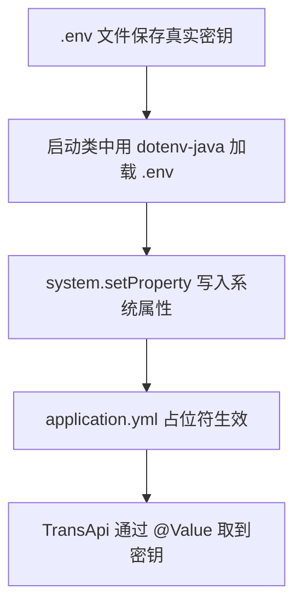

## 【学习目标】

- 认清「密钥硬编码进 yml」的泄露风险，理解配置外部化的必要性。
- 把 `appid` / `securityKey` 等敏感项迁移到 `.env` 文件，yml 改为 `${ENV}` 占位符引用。
- 借助 `dotenv-java` 在启动时把 `.env` 写入系统属性，使 `@Value` 与 yml 占位符生效。
- 形成「不同机器 / 不同环境切换密钥不碰代码」的本地安全习惯。

## 【正文】

### 一、为什么要把密钥移出 YAML

前面几节课我们已经把百度翻译集成进项目，翻译结果也成功落库了。但目前的做法是，把 `appid`、`securityKey` 这些敏感配置**直接硬编码在 `application.yml` 里**：

```yaml
baidu:
  translate:
    host: https://fanyi-api.baidu.com/api/trans/vip/translate
    appid: 202512345678900000
    securityKey: xyzqpw...rytYM
```

这其实不太合适。除了百度翻译的密钥，后面我们还会接类似**通义千问**、**DeepSeek** 这类大模型，它们也都有各自的密钥。把所有密钥明文写在配置文件里，既容易在提交代码时泄露，也不利于在不同环境间切换。

更优雅的做法是：把敏感配置放到一个**外部的环境变量文件**里，项目通过读取环境变量来加载它们。这种方式在 Java、Python 等各类项目里都很常见。

为什么明文 yml 风险高？因为 yml 通常被纳入版本库（`git commit`），一旦仓库被推到 GitHub 公共仓库、或在内部分享时忘记脱敏，密钥就外泄了。而 `.env` 文件习惯上被列入 `.gitignore`，永远不会进版本库。两者差别本质是「配置随代码走」与「配置随环境走」。

### 二、创建 .env 文件

在 `resources` 目录下新建一个 `.env` 文件。它在很多操作系统上会以**隐藏文件**的形式存在（文件名以点开头）。

文件里就是一组键值对，把我们之前写在 `application.yml` 里的三个百度翻译参数搬过来，并用**全大写**的形式命名，更规范：

```env
BAIDU_TRANSLATE_HOST=https://fanyi-api.baidu.com/api/trans/vip/translate
BAIDU_TRANSLATE_APPID=202512345678900000
BAIDU_TRANSLATE_SECURITYKEY=xyzqpw...rytYM
```

把 `host`、`appid`、`securityKey` 的值分别复制过来，这样三个环境参数就配置好了。

命名规范上，环境变量惯例全大写 + 下划线（`BAIDU_TRANSLATE_APPID`），与 yml 里的小写驼峰/短横线（`baidu.translate.appid`）形成区分，避免「同一份值两个名字记混」。注意：`.env` 里的值不要加引号（除非值含空格），否则引号会被当成值的一部分。

### 三、在 application.yml 中用占位符引用

回到 `application.yml`，把原来写死的值改成 `${变量名}` 的占位符写法。Spring 中用 `${...}` 表达式来引用环境变量：

```yaml
baidu:
  translate:
    host: ${BAIDU_TRANSLATE_HOST}
    appid: ${BAIDU_TRANSLATE_APPID}
    securityKey: ${BAIDU_TRANSLATE_SECURITYKEY}
```

这样真实的值就不再出现在 yml 里，而是从环境变量注入。

占位符还可以带默认值，写成 `${BAIDU_TRANSLATE_APPID:default}`。生产建议：敏感字段**不要**给默认值（缺失即报错，比悄悄用默认值更安全）；非敏感、有合理兜底的项可以给默认，例如 `982-demo` 的 `risk.quote.api-url: ${RISK_QUOTE_API_URL:}`，留空时仅用 mock 源，不崩。

### 四、让 Spring Boot 加载 .env 文件

光写 `.env` 还不够，Spring Boot 默认并不会自动去加载它，我们需要借助一个读取 `.env` 的库（如 `dotenv-java`）：

1. 在课程资料里有一份 `env.md` 说明，把其中给出的依赖配置复制粘贴到自己的 `pom.xml` 里，然后刷新 Maven 完成引入（`dotenv-java` 该依赖就加载进来了）；
2. 到 Spring Boot 的**启动类**里，在启动时加载 `.env` 文件。先加一行注释「加载 .env 文件」，然后读取 `.env`。这里有个 `ignore` 选项，如果某个变量缺失就忽略它；如果你能确保所有变量都不缺失，也可以不加该忽略逻辑；
3. 加载完成后，遍历 `.env` 里的 entries（`.env.entries`），在循环里通过 `system.setProperty(key, value)` 把每个变量设置到系统属性中。

一旦 `system.setProperty` 执行完，这些变量就进入了系统环境，`application.yml` 里的 `${...}` 表达式就能生效，代码里通过 `@Value` 也能正常取到值了。

在 `TransApi.java` 中，三个参数就是靠 `@Value` 从环境变量注入的：

```java
@Value("${BAIDU_TRANSLATE_HOST}")
private String host;

@Value("${BAIDU_TRANSLATE_APPID}")
private String appid;

@Value("${BAIDU_TRANSLATE_SECURITYKEY}")
private String securityKey;
```

这里有个工程权衡值得点明：把 `.env` 写进 `system.setProperty`，本质是「启动时把 env 提升到 JVM 系统属性」。好处是 yml 的 `${...}` 与 `@Value` 统一从系统属性解析，无需改任何业务代码；代价是 `.env` 必须在应用启动最早期就加载（放在启动类 `main` 方法里、Spring 容器刷新之前），否则占位符解析时变量还没注入。这也是为什么加载逻辑要放在启动类而非某个 `@Configuration` 里，晚了就来不及了。

> 延伸：生产环境通常不依赖 `.env` 文件，而是由容器 / 编排平台（Docker、K8s）在运行时注入真实环境变量，`application.yml` 的 `${...}` 占位符无需改动即可跨环境复用。`.env` 是「本地开发阶段」最顺手的载体，与「生产用平台注入」并不冲突，而是同一套占位符机制的两端。

.env 参数的加载链路如下：



### 五、验证

配置完成后，写一个简单的测试方法验证一下：调用 `getTransResult` 相关的取值逻辑，把 `host`、`appid`、`securityKey` 取出来打印，确认能正确读到 `.env` 里的值即可：

```
host: https://fanyi-api.baidu.com/api/trans/vip/translate
appid: 202512345678900000
securityKey: xyzqpw...rytYM
```

值能正确打印出来，说明环境变量这条链路已经打通。再跑一次真实的翻译流程，控制台可以看到股票公告标题被翻译成中文后的结果：

```
USStockMsg(stockCode=BNR, title=Burning Rock Announces Results of 2025 Annual General Meeting, titleZh=, pubdateBj=2025-12-23 12:04, ...)
```

通过这种方式，敏感密钥被隔离在 `.env` 中、不再进版本库，既安全又方便在不同机器/环境间切换，这就是我们推荐的配置方式。

## 【易错点 / 面试题】

1. **`.env` 写好了但 `@Value` 取到的还是 `null` / 占位符原样？**
   检查三点：① 启动类是否在容器刷新前就执行了 `system.setProperty`；② `.env` 路径是否被 `dotenv-java` 正确定位（默认读 classpath 根或工作目录）；③ 变量名大小写是否与 yml 占位符完全一致。任何一处对不上，占位符就解析不到。

2. **`.env` 要不要进版本库？**
   绝对不要。`.env` 存的是真实密钥，必须加入 `.gitignore`。版本库里只保留 `.env.example`（含占位键名、不含值）作为模板，团队成员各自本地复制成 `.env` 填自己的密钥。`982-demo` 落的是同一目标的工程化版本：不引入 dotenv-java，`application.yml` 只写 `${ENV}` 占位，真实值由运行环境（compose/systemd 的 env 注入）提供；`.env` 文件方式适合本地开发期使用，两者机制不同、思路一致。

3. **面试官：Spring Boot 配置外部化有哪些手段？**
   能答出优先级链：命令行参数 > 环境变量 > `.env`/外部 `application.yml` > 打包内 `application.yml`。并说明「敏感信息走环境变量、不进代码库」是基本安全基线；配合多 profile（`default`/`dev`/`prod`）可实现一套代码多环境部署。

## 【小结】

本节把翻译模块的密钥从「明文 yml」升级为「`.env` + 环境变量占位符」，消除了版本库泄露风险，也让密钥随环境切换而不碰代码。核心三步：`.env` 存真实值 → yml 改 `${...}` 占位 → 启动类用 `dotenv-java` 把 env 提升为系统属性。

这套「配置外部化 + 多 profile」机制在 `982-demo` 里是工程级标配：`src/main/resources/application.yml` 中所有密钥（`SPRING_AI_OPENAI_API_KEY`、`RISK_QUOTE_API_URL` 等）全部走 `${ENV}` 占位，`default` profile 用 mock / 离线、`prod` profile 才填真实端点与模型 Key，且 `.env`/密钥从不入库。它与本节的 `.env` 思路一脉相承，只是从「本地开发」扩展到了「可生产部署」。接下来进入第 8 章，把处理好的异动数据通过聊天机器人主动推送给用户。
