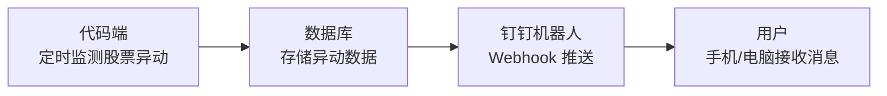

## 【学习目标】

- 看清「定时监测 → 入库 → 钉钉 Webhook 推送 → 用户接收」的完整消息分发链路。
- 理解同步推送与异步推送的取舍，知道何时该把「发送」这条线解耦出去。
- 独立完成钉钉账号、群、自定义机器人（加签）的创建，拿到 Webhook 地址与 secret。
- 建立「secret 即凭证、泄露即重置」的安全意识。

## 【正文】

### 一、业务消息分发模型

前面章节我们已经实现了对股票价格变动的**定时监测**，抓取到的数据也成功存进了数据库。接下来要做的，就是把这些数据「发送」出去，推送到聊天工具里，课程里选的是**钉钉**。

整个分发模型的链路是这样的：

- 代码端定时跑，把抓取并处理好的数据写入数据库；
- 发送环节从数据库取出数据，交给钉钉机器人；
- 钉钉机器人通过 Webhook 把消息推到群里，用户在手机或电脑端收到推送通知。

该过程默认是**同步**的，如果你希望解耦，也可以把它改成**异步**（把「发送」这条线单独拎出来），两种方式都没问题。核心思路就是：代码端 → 数据库 → 钉钉机器人 → 用户。

关于同步 / 异步再展开一层：同步模型下，「扫描异动 → 落库 → 推钉钉」在同一线程顺序完成，逻辑最简单、调试最直观，适合课程演示规模。但生产环境里，钉钉 Webhook 是外部网络调用，可能因网络抖动、限流（钉钉对每个机器人有每分钟消息条数上限）而慢或失败，会拖住上游扫描线程。这时应把「推送」丢进独立线程池 / 消息队列（如 RabbitMQ、Redis Stream），让扫描与推送解耦，扫描只负责落库并投递一条「待推送」事件，推送消费者异步发送。这正是 8-1 选型时强调「主动推送」之后，工程上必须补的弹性设计。

### 二、准备钉钉账号与群

先到钉钉官网注册。这里**建议专门注册一个新账号**来学习，不要直接用自己的、跟公司业务绑定的钉钉，毕竟课程里要建群、加机器人，用独立的小号更干净，也不影响正常工作。

注册并下载安装钉钉（电脑端、手机端都行）之后：

1. 在界面右上角点「+」号**创建一个群**；
2. 选择一个**普通群**即可（不必是班级群、培训群之类），把群命名为 `stock bot group` 这类股票相关的名字；
3. 群里要拉人需要对方同意，按提示把另一端账号拉进来、确认加入即可。

为什么建议小号？因为机器人加签 secret、Webhook 都和该账号绑定，用小号可以把「学习实验」和「工作生产」完全隔离，即便 secret 不小心泄露，重置小号机器人也不会影响任何业务群。这是账号隔离的基本安全习惯。

### 三、在群里添加自定义机器人

群建好之后，往下滑找到**机器人**入口，点进去：

- 钉钉官方自带一些机器人，留着不影响，我们重点是「添加机器人」；
- 机器人种类很多，但本质上**都基于 Webhook 工作**，也就是通过 Webhook 地址来实现消息推送。Webhook 技术在很多项目里都会用到，值得了解；
- 我们选择**「自定义」**类型的机器人（自定义开发机器人），它同样通过 Webhook 接入我们自己的服务；
- 添加时填写**机器人名称**（比如「股票机器人助手」），然后有一个**「加签」**选项，**一定要勾选**，加签对应的是你的密钥，必须打勾确认并同意相关条款，才能完成；
- 密钥千万不要泄露，万一泄露可以到设置里点「重置」。

完成后，机器人就出现在群里了，它会自动发一条打招呼消息（如 `hello world`），说明配置成功。此时页面上会给出两样关键东西：

- 一个 **Webhook 地址**，形如 `https://oapi.dingtalk.com/robot/send?access_token=...`；
- 一段**密钥（secret）**，用于后续的加签校验。

> 课后建议：注册新钉钉账号 → 建群 → 调好机器人设置，把这些凭据记下来。下一节课我们就将该机器人真正集成进项目代码里。

关于「加签」补一句工程原理：钉钉的加签是在发送消息时，用 `secret` 对 `timestamp + "\n" + secret` 做 HmacSHA256 再 Base64，把签名与时间戳一起拼到 Webhook URL 上。服务端用同样的 `secret` 复算比对，确认请求来自持有 `secret` 的合法调用方、且未被重放。所以 `secret` 的保密等级等同于 `appid`/`securityKey`（参见 7-6），必须外部化、绝不进版本库。`access_token` 同样敏感，泄露等于别人能冒用你的机器人发消息。

### 四、Webhook 本质与对接位置

Webhook 是「反向 API」：普通 API 是你主动调用对方拿到数据，Webhook 是对方（钉钉）给你一个固定入口地址，你往该地址 POST 一段约定格式的消息体，钉钉就替你把消息推到群里。它在很多项目里都会用到（如 CI 完成通知、监控告警、支付回调），值得理解透。

在本课程架构里，钉钉 Webhook 处于分发链路的「执行末端」：

| 链路环节 | 课程实现 | 982-demo 对应 |
|---|---|---|
| 感知（定时监测） | 5 章 RSS 定时抓取 | `scheduler/RiskScanScheduler.java` 周期扫描 |
| 决策（判定异动） | 入库前的清洗/去重 | `engine/RuleEngine.java` + `RiskEvaluationService.java` |
| 执行（推送通知） | 本节钉钉 Webhook | `domain/RiskAlert.java`（告警载荷）+ 待接 Webhook |

换言之，钉钉机器人是「感知 → 决策 → 执行」闭环中「执行」这一环的聊天端落点。当 `RiskScanScheduler` 扫出命中规则的异动后，把 `RiskAlert` 的内容通过钉钉 Webhook 推到群，整个风控 Bot 的闭环才真正闭合。

## 【易错点 / 面试题】

1. **钉钉机器人「加签」忘勾选会怎样？**
   不勾加签，机器人只能用最基础的「关键词 / IP 白名单」校验，安全等级最低；且一旦后续想启用加签，已生成的 Webhook 要重建。课程与生产的统一建议是：创建时直接勾选加签，把 `secret` 当作密钥外部化管理。

2. **为什么推送建议异步而不是同步？**
   钉钉 Webhook 是外部网络调用，存在延迟与限流（单机器人每分钟消息数上限）。同步推送会让扫描线程被外部调用拖住，甚至因超时影响异动监测的及时性。把发送放进独立线程池 / 消息队列解耦，是生产必备的弹性设计。

3. **面试官：Webhook 和 REST API 有什么区别？**
   能答出「Webhook 是接收方提供回调地址、事件发生时由数据源主动 POST 通知；REST API 是调用方主动请求拉取」即可。延展：钉钉机器人就是典型的 Webhook 消费端，我们持有它的 POST 入口，异动时主动推，而不是轮询钉钉有没有新消息。

## 【小结】

本节搭建了消息分发链路的「执行末端」：代码端定时监测 → 落库 → 钉钉自定义机器人（加签）通过 Webhook 主动推送 → 用户接收。同时明确了账号隔离、secret 外部化、推送异步化三个生产要点。

钉钉 Webhook 在本课程架构里对应 `982-demo` 中「感知 → 决策 → 执行」闭环的执行环节：`scheduler/RiskScanScheduler.java` 周期触发扫描、`engine/RuleEngine.java` 判定异动、`domain/RiskAlert.java` 承载告警载荷，后续接入钉钉 Webhook 即可把 `RiskAlert` 主动推群，闭合整个风控 Bot。下一节我们就把本节拿到的 Webhook 与 secret 真正集成进项目代码，实现自动发消息。
