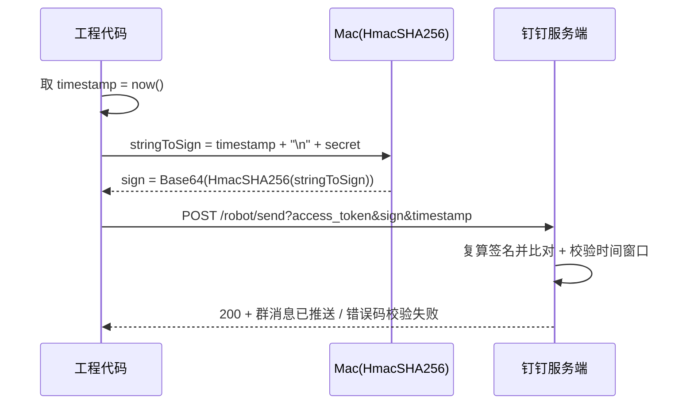

## 【学习目标】

学完本节，你应当能够：

- 在 Spring Boot 工程里引入钉钉官方 SDK 与编解码依赖，把自定义机器人跑通；
- 理解钉钉「加签」机制（HMAC-SHA256 + Base64）为何是调用方必须携带的安全凭证，以及时间戳窗口的作用；
- 基于官方示例补齐 `access_token`、`secret`、`userId` 三类凭据，构建一条文本消息并成功推送到群；
- 列举钉钉自定义机器人的消息类型与常见错误码，把钉钉推送定位为「感知→决策→执行」风控闭环里的执行通道。

## 【正文】

### 一、前置条件与环境基线

前两节已经完成了钉钉自定义机器人的创建，并拿到了 Webhook 地址。进入代码集成阶段前，先确认三项前提：

1. 自定义机器人已在目标群内创建完成；
2. Webhook 中的 `access_token` 已记录；
3. 机器人安全设置选择了「加签」模式（钉钉同时支持「关键词」「IP 白名单」「加签」三种，本节以加签为准）。

开发环境层面，钉钉官方 SDK 对运行时的要求宽松：官方「快速体验」Java 示例以 **JDK 1.8 为最低基线**即可运行，课程工程当前所用的 JDK 版本远高于此，无需额外升级。构建工具使用 Maven，文档给出的示例是一个带 `main` 方法的完整程序，脱离 Web 容器也能直接执行，正好适合先做一条端到端的最小可用链路验证。

钉钉机器人按形态可分三类，理解差异有助于选型：

- **自定义机器人（Webhook）**：挂在群设置里的 outgoing 机器人，拿到 Webhook 即可发消息，本节使用此类；
- **企业内部机器人**：需企业应用资质，可双向收发、支持交互卡片；
- **智能对话机器人（ChatBot）**：面向用户的对话入口，能力更全但接入更重。

风控推送场景只需「单向广播告警」，自定义机器人最轻量，无需企业资质即可落地。

### 二、引入依赖

钉钉开发者平台「自定义机器人 → 群发消息」章节给出的 Java 示例，需要在 `pom.xml` 中补两类依赖：

- 阿里巴巴官方钉钉服务 SDK：`com.aliyun:alibaba-dingtalk-service`；
- 通用编解码工具：`commons-codec`（HMAC 签名后做 Base64 编码时会用到）。

把这两段坐标加入工程 `pom.xml`，刷新 Maven 仓库触发下载即可。整条链路只需要这两个外部依赖，引入成本很低。若走「裸 HTTP」路线（自己拼 `OkHttp` 调 Webhook），则可不引 SDK，但需自行处理 JSON 序列化与响应解析，SDK 的价值正是把这些样板代码封装掉。

### 三、拷贝示例与凭据注入

官方示例是一个自包含的 `main` 程序，迁移进工程的步骤有三步：

1. 从示例的 `class` 声明开始，整体复制到工程目录，连结尾大括号一并带过来；
2. 粘贴时**不要开启 IDEA 的自动导包**：示例里部分包名（如 `java.util.Base64` 与 `org.apache.commons.codec.binary.Base64`）会和工程现有导入冲突，自动导入反而引发编译错误，手动把 `import` 一并复制最稳妥；
3. 运行所需的凭据有三样，均从机器人设置页复制：
   - Webhook 中的 `access_token`（机器人令牌），填入 `CUSTOM_ROBOT_TOKEN`；
   - `userId`：可选字段，内部群可填，外部群走 OpenAPI 时无法 `@` 人，留空也不影响发送；
   - `secret`：加签密钥，把设置页那串密钥原样复制过来。

一个常见误区：把 `secret` 写死在代码里方便跑通后忘了抽离。生产环境必须把 `secret` / `access_token` 移进 `application.yml` 并借 `.env` 注入（下一节改造即做此事），否则密钥入库即泄露。

### 四、加签机制：HMAC-SHA256 的本质

钉钉强制要求每次调用都带签名，其原理与前面百度翻译的签名同源，都属于「调用方持有密钥，服务端按相同算法校验」的必要安全握手。

签名计算过程是：取当前毫秒时间戳 `timestamp`，与 `secret` 用换行符拼成待签串 `stringToSign`，通过 `java.security.Mac` 走 **HMAC-SHA256**，再做 **Base64** 编码得到 `sign`。最终请求**必须同时携带 `sign` 与 `timestamp`** 两个参数，钉钉服务端用同样算法复算并比对；「一把钥匙开一把锁」，校验通过才放行。

这里有两个工程细节必须清楚：

- **时间戳窗口**：钉钉服务端会校验 `timestamp` 与当前时间的差值，超出约定窗口（约 1 小时）的请求直接拒绝。因此 `timestamp` 必须是调用时刻的实时毫秒值，不能用固定常量，否则过段时间签名集体失效。
- **待签串格式**：钉钉约定的拼接是 `timestamp + "\n" + secret`，换行符不可省略、不可替换成空格，否则本地算出的签名与服务端复算不一致。

### 五、构建请求并发送

客户端就绪后，再组装一条机器人消息：

- 用 `request.setMsgtype("text")` 指定消息类型为文本；
- 设置文本内容（联调用「钉钉，让进步发生」即可）；
- `at` 对象用于 `@` 群成员，是**可选**字段，不填直接删掉不影响发送；
- 最后通过 `client.execute(request, sign)` 发出，用 `response.getBody()` 取回结果。

钉钉自定义机器人支持的消息类型不止文本，概览如下，便于后续按需升级：

| 类型 | 适用场景 | 备注 |
|---|---|---|
| text | 纯文本告警（本节用） | 最简单，支持 `@` |
| link | 带跳转链接的卡片 | 标题 + 文本 + 图片 + URL |
| markdown | 富文本（标题/列表/加粗） | 群机器人支持，比 text 美观 |
| actionCard | 可交互卡片（按钮） | 需企业内部机器人 |
| feedCard | 多图文列表 | 资讯聚合场景 |

风控告警用 `text` 即可满足，若想让异动统计更醒目，后续可改 `markdown` 类型（思路同 8-5 的格式化）。

下面是钉钉官方示例的核心代码（含签名与发送），后续的服务化改造即以它为基础：

```java
// 1. 导入必要的包
import com.dingtalk.api.DefaultDingTalkClient;
import com.dingtalk.api.DingTalkClient;
import com.dingtalk.api.request.OapiRobotSendRequest;
import com.dingtalk.api.response.OapiRobotSendResponse;
import org.apache.commons.codec.binary.Base64;
import java.security.Mac;
import java.security.NoSuchAlgorithmException;
import java.util.Arrays;
import java.util.Base64;
import java.util.Date;
import java.util.HashMap;
import java.util.Map;
import java.util.Random;
import java.util.UUID;
import java.util.concurrent.TimeUnit;
import java.util.concurrent.atomic.AtomicLong;
import java.util.concurrent.atomic.AtomicReference;
import java.util.concurrent.locks.ReentrantLock;
import java.util.function.Consumer;
import java.util.function.Function;
import java.util.function.Predicate;
import java.util.function.Supplier;
import java.util.stream.Stream;

// 2. 定义常量
public static final String CUSTOM_ROBOT_TOKEN = "<your custom robot token>";

// 3. 主方法
public static void main(String[] args) {
    Long timestamp = System.currentTimeMillis();
    System.out.println(timestamp);
    String secret = "SECRET"; // 这里应替换为实际的 Secret
    String stringToSign = timestamp + "\n" + secret;
    Mac mac = Mac.getInstance("HmacSHA256");
    SecretKeySpec secretKeySpec = new SecretKeySpec(secret.getBytes("UTF-8"), "HmacSHA256");
    mac.init(secretKeySpec);
    byte[] signData = mac.doFinal(stringToSign.getBytes("UTF-8"));
    String sign = Base64.encodeBase64String(signData);
    System.out.println(sign);

    // 4. 创建客户端并发送请求
    DefaultDingTalkClient client = new DefaultDingTalkClient("https://oapi.dingtalk.com/robot/send?access_token=" + CUSTOM_ROBOT_TOKEN);
    OapiRobotSendRequest request = new OapiRobotSendRequest();
    request.setMsgtype("text");
    request.getText().setContent("钉钉，让进步发生");
    OapiRobotSendResponse response = client.execute(request, sign);
    System.out.println(response.getBody());
}
```

上述代码里 `import java.util.Base64` 与 `import org.apache.commons.codec.binary.Base64` 并存，属于官方示例原貌，前者用于 `java.util.Base64` 的便捷解码，后者提供 `encodeBase64String` 工具方法。复制时保持原样，不要因「重复导入」而删改，避免破坏签名逻辑。

整个发送链路的时序可以归纳成下图：



### 六、常见错误码与排查

调用失败时钉钉返回 JSON 中的 `errcode` 是排查入口，高频几类：

| errcode | 含义 | 排查方向 |
|---|---|---|
| 310000 | 签名校验失败 | `secret` 错、待签串换行符错、Base64 编码方式不一致 |
| 130101 | `access_token` 无效或过期 | Webhook 被重置、token 复制不全 |
| 45009 | 接口调用超限（被限流） | 单机器人每分钟 > 20 条，需批量发送（见 8-4） |

拿到错误码先看签名三要素（secret / timestamp / 待签串），这是 90% 失败的根因。

### 七、运行验证

直接右键运行该 `main` 方法。控制台会先打印出生成的 `timestamp` 与 `sign`，随后输出 HTTP 响应体；与此同时钉钉客户端会收到提示音，打开对应群聊即可看到机器人发出的测试消息。这一步说明钉钉集成的最小链路已经跑通。

当前代码仍是「可直接运行的示例方法」，写在 `main` 里、凭据写死、无法被定时任务复用。后续两节会把它改造成规范的 `DingTalkApi` 服务类，并接入项目的周期扫描。动手前建议先把官方示例完整下载、跑通这条测试消息作为基线。

### 八、三种安全策略与 Webhook 结构

钉钉自定义机器人提供三种安全设置，接入前必须选定，直接影响签名代码怎么写：

| 策略 | 服务端校验方式 | 代码侧必须做 |
|---|---|---|
| 加签 | 复算 HMAC-SHA256 比对 `sign` | 本节省略不了的签名逻辑 |
| 自定义关键词 | 消息正文含约定关键词才放行 | 发送内容里拼入关键词 |
| IP 白名单 | 调用方出口 IP 在白名单内 | 部署机 IP 需报备 |

加签安全性最高、不依赖内容约定，课程采用此类。Webhook 的完整结构是 `https://oapi.dingtalk.com/robot/send?access_token=xxx`，其中 `access_token` 即机器人唯一标识，它本身就是敏感凭证，任何人拿到即可向群发消息，务必走配置注入、禁止硬编码或提交进版本库。

### 九、生产化：异步发送与重试

在风控闭环里，推送处于定时任务末端。若同步 `client.execute` 阻塞，单次网络抖动就会拖慢整轮扫描，甚至让下一批告警迟到。稳妥做法是把发送放进独立线程（Java 21 虚拟线程最佳），失败则有限重试。可借 `resilience4j` 的 `@Retry` / `@CircuitBreaker` 包裹发送，连续失败（如机器人被限流）时快速熔断、避免无意义重试放大限流。982-demo 的 `RiskScanScheduler`（`982-demo/src/main/java/com/riskbot/scheduler/RiskScanScheduler.java`）已用虚拟线程承载扫描，推送渠道同理不应阻塞扫描主链路，感知与决策在调度器里完成，执行（推送）异步化，三层解耦更稳。

## 【易错点 / 面试题】

1. **问：钉钉加签为什么必须同时传 `timestamp` 和 `sign`，只传 `sign` 行不行？**
   答：不行。`timestamp` 参与待签串 `timestamp + "\n" + secret`，服务端用收到的 `timestamp` 复算签名；若只传 `sign` 服务端无法还原同一待签串，校验必然失败。此外 `timestamp` 还用于防重放（校验时间窗口），缺失会被直接拒绝。

2. **问：`java.util.Base64` 与 `commons-codec` 的 `Base64` 同时导入会不会冲突？**
   答：不会冲突，二者是不同全限定名的类。但 IDEA 自动导包可能只保留其中一个，导致 `encodeBase64String` 找不到而编译失败。正确做法是手动保留示例原有的全部 `import`，关闭自动导包再编译。

3. **问：机器人返回 `310000` 类错误码，优先排查什么？**
   答：优先排查签名三要素，`secret` 是否与机器人设置页一致、`timestamp` 是否为调用时刻毫秒值、待签串拼接是否为 `timestamp + "\n" + secret`（换行符不可省略）。其次是 `access_token` 是否过期或被重置。

4. **问：风控推送为什么选「自定义机器人」而非「企业内部机器人」？**
   答：风控告警是单向广播，不需要双向交互；自定义机器人只需 Webhook 即可发消息、无需企业资质，接入成本最低。若后续要支持「群里问一句返回风险详情」的双向交互，才需升级企业内部 / ChatBot 形态。

## 【小结】

本节打通了钉钉机器人的最小发送链路，核心是「时间戳 + 密钥经 HMAC-SHA256 + Base64 出签名，随请求带上即可推送」。它在本课程的定位，是「感知→决策→执行」风控闭环里的**执行通道**：上游由 `MockQuoteProvider` 提供行情、由 `RuleEngine` 判定异动、由 `RiskEvaluationService` 编排出告警，再由周期调度 `RiskScanScheduler`（`982-demo/src/main/java/com/riskbot/scheduler/RiskScanScheduler.java`）触发；钉钉/Telegram 这类推送渠道，正是把 `RiskEvaluationService`（`982-demo/src/main/java/com/riskbot/service/RiskEvaluationService.java`）产出的告警投递到人的最后一公里。下一节会把本节这段示例 `main` 改造成可注入、可复用的 `DingTalkApi` 服务，真正接入业务定时任务。
