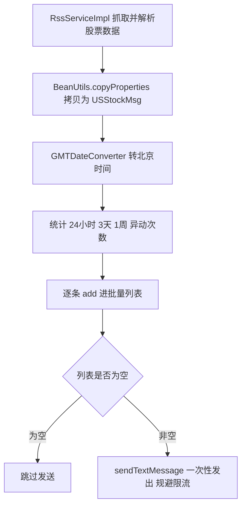

## 【学习目标】

学完本节，你应当能够：

- 在「静态工具类 / Service 服务类 / API 封装类」三种集成方式中，用对照表说清各自取舍并选定适合第三方对接的方案；
- 把上节的示例 `main` 重构成注入式的 `DingTalkApi` 服务：签名逻辑保留、配置外置、补上无参/带参构造；
- 用 `@Value` 把 `application.yml` 中的钉钉配置注入 Bean，并理解 `.env` → `application.yml` → 字段 的映射链；
- 在 `RssServiceImpl` 中注入 `DingTalkApi` 完成「抓取→统计→推送」，并用批量列表规避钉钉每分钟 20 条限流。

## 【正文】

### 一、三种集成方式怎么选

面对「把发消息能力接入工程」这件事，课程给出三条常见路径：

1. **工具类（Utils）**：把发送逻辑剪进 `DingTalkGroupMessageUtils`，方法设为 `static`，本地直接调用即可，甚至能顺手拿去发邮件测试，跑通没问题。
2. **Service 服务类**：把对接逻辑做成真正的 Spring Bean，由容器管理生命周期与配置注入。
3. **API 封装类**：仿照此前对接百度翻译 `TransApi` 的思路，把钉钉机器人也封装成一个对外 API 服务类。

三类方案的本质差异在「耦合度、可测性、配置灵活性」三件事上，对照如下：

| 维度 | Utils 静态类 | Service Bean | API 封装类（本节选） |
|---|---|---|---|
| 配置来源 | 硬编码 / 静态常量 | `@Value` 注入 | `@Value` 注入 |
| 可替换性 | 差（调用方直接依赖实现） | 好（接口可换实现） | 好 |
| 单测友好 | 差（static 难 mock） | 好 | 好 |
| 与 Spring 集成 | 弱 | 强 | 强 |
| 适用场景 | 纯本地小工具 | 通用业务服务 | 第三方对接 / 对外能力 |

课程明确推荐第三种。理由在于：纯本地小工具（时间转换、字符串处理）用 `static` 工具类无可厚非，但一旦涉及第三方服务，静态工具类会带来两类隐患，配置硬编码导致环境切换困难，以及调用方与具体实现强耦合、难以做单测与替换。把钉钉封装成 `@Service` 的 `DingTalkApi`，既贴合企业规范，又能无缝融入 Spring 的依赖注入体系，后续换真实行情推送也只需替换实现。

### 二、构建 DingTalkApi 服务类

新建 `DingTalkApi`，把原工具类里最核心的签名计算整体搬过来，用当前时间戳拼接 `secret`，经 `Mac` 走 HMAC-SHA256，再做 Base64 + URL 编码：

```java
Long timestamp = System.currentTimeMillis();
String stringToSign = timestamp + "\n" + secret;
Mac mac = Mac.getInstance("HmacSHA256");
mac.init(new SecretKeySpec(secret.getBytes("UTF-8"), "HmacSHA256"));
String sign = URLEncoder.encode(new String(Base64.encodeBase64(mac.doFinal(stringToSign.getBytes("UTF-8")))), "UTF-8");
```

此处相比上节示例多了一层 `URLEncoder.encode(...)`：因为签名要作为 URL 查询参数回传，空格与 `+` 等字符必须按 `application/x-www-form-urlencoded` 规则编码，否则服务端解码出的签名会与本地不一致而校验失败。签名本身仍是 HMAC-SHA256 的产出，编码只是「安全上线路」的一步。

### 三、配置外置：从 yml 注入

下一步把写死在代码里的凭据改为配置文件注入。先在 `application.yml` 增加钉钉机器人配置块（同时保留百度翻译配置作为对照）：

```yaml
# 钉钉机器人配置
dingtalk:
  customRobotToken: ${dingding_token}
  secret: ${dingding_secret}
  userId: ${dingding_user_id}
# 百度翻译配置
baidu:
  translate:
    host: ${BAIDU_TRANSLATE_HOST}
    appid: ${BAIDU_TRANSLATE_APPID}
    securityKey: ${BAIDU_TRANSLATE_SECURITYKEY}
```

这些变量与 `.env` 文件一一对应：在 `.env` 中配置 `dingding_token`、`dingding_secret`、`dingding_user_id`，`application.yml` 用 `${dingding_token}` 占位语法把它们映射进来，最终由 Spring 注入到 `DingTalkApi`。一条约定必须遵守：**占位变量名在 `.env` 中必须大写**，否则 Spring 的 `PropertySourcesPlaceholderConfigurer` 取不到值，注入结果为 `null`。

随后用 `@Value` 把三项值注入成员变量。注意原工具类的 `static final` 常量要去掉 `static final`，改为普通实例变量（`private String customRobotToken`、`private String secret`、`private String userId`），因为 Spring 通过反射注入实例字段，静态常量无法被容器赋值。

由于去掉了静态初始化，还需补两样东西保证 Bean 可被实例化：

1. 一个**无参构造函数**（容器默认实例化路径）；
2. 一个**带参构造函数**，三个参数依次为 `String custom_robot_token`、`String secret`、`String user_id`：

```java
public DingTalkApi(String custom_robot_token, String secret, String user_id) {
    this.custom_robot_token = custom_robot_token;
    this.secret = secret;
    this.user_id = user_id;
}
```

变量命名统一改驼峰（如 `userId`），`secret` 本身无需变动。最后给类加 `@Service`（或 `@Component`），它才能被其他类注入。结合 Spring 构造器注入的推荐写法，带参构造函数上加 `@Autowired` 即可让容器完成装配，无参构造则保留以兼容手动 `new` 的场景。工程实践中更推荐「只用带参构造 + 类上加 `@RequiredArgsConstructor`（Lombok）」的单构造模式，避免无参/带参两套构造带来的歧义。

### 四、在业务逻辑中注入并调用

回到核心业务服务 `RssServiceImpl`，注入 `DingTalkApi` 后，在「抓取并解析完股票数据」之后调用 `dingTalkApi.sendTextMessage()` 推送。组装逻辑是：把新闻对象拷贝成 `USStockMsg`、转换发布时间为北京时间、分别统计 24 小时 / 3 天 / 1 周三个时间窗口的异动次数，最后发送：

```java
USStockMsg stockMsg = new USStockMsg();
BeanUtils.copyProperties(stockNews, stockMsg);
stockMsg.setPubDateBj(GMTDateConverter.getBeijingTime(gmtDateTemp));
Long counts24Hour = stockService.getStockUnusualCounts(stockNews, GMTDateConverter.minus24Hour(gmtDate), GMTDateConverter.plusMinute(gmtDate));
Long counts3Day = stockService.getStockUnusualCounts(stockNews, GMTDateConverter.minus3Day(gmtDate), GMTDateConverter.plusMinute(gmtDate));
Long counts1Week = stockService.getStockUnusualCounts(stockNews, GMTDateConverter.minus1Week(gmtDate), GMTDateConverter.plusMinute(gmtDate));
stockMsg.setCounts24Hour(counts24Hour.intValue());
stockMsg.setCounts3Day(counts3Day.intValue());
stockMsg.setCounts1Week(counts1Week.intValue());
System.out.println(stockMsg.toString());
dingTalkApi.sendTextMessage();
```

`BeanUtils.copyProperties` 完成同名属性拷贝，`GMTDateConverter` 负责把 UTC 时间换算成北京时区，三个 `getStockUnusualCounts` 基于不同起止窗口统计异动命中数，最终汇总进 `USStockMsg` 供推送渲染。这里把「数据组装」与「发送」分离，符合单一职责，`RssServiceImpl` 只负责产出 `USStockMsg`，发送细节全在 `DingTalkApi` 内。

### 五、规避限流：用列表批量发送

这里有一处高概率踩坑，必须提前规避。钉钉官方对每个机器人有硬性限制：**每分钟最多向群组发送 20 条消息，超出即被限流 10 分钟**。若在 `for` 循环里「每处理一条数据发一条」，一旦当天异动数据达到百条量级，瞬间突破上限，整轮推送被掐断。

正确做法：循环内部只把每条 `USStockMsg` `add` 进一个列表，循环结束后用 `dingTalkApi.sendTextMessage()` 把整份列表一次性发出。对外只发一个「列表消息」，既满足推送需求又不会触发限流。再补一个非空判断，列表为空（当前无最新数据）时跳过发送，避免无意义调用与潜在异常。

若单批数据仍可能超过 20 条（例如一次扫描命中 50 只异动），还需在列表层面做「20 条分桶」：每满 20 条发一批、间隔稍候再发下一批，配合 `resilience4j` 的限流器更稳。这是生产环境从「能发」到「发得稳」的关键一步。

抓取到推送的处理链路如下：



### 六、运行验证

改造后启动服务验证：首次测试群里收到的是空列表消息，说明数据库当时没有最新数据、列表为空未真正发内容。手动往库里补几条股票异动记录、按时间倒序排列后重启，定时任务再次触发，「Stock Bot Group」群即收到封装好的异常数据（24 小时 / 3 天 / 1 周内的异常交易次数）。此时消息仍是裸对象数组、字段间仅用分隔符与逗号隔开，排版尚未优化，这部分留到下一节处理。

### 七、构造器注入与多 profile 配置

工程落地还有两个细节值得展开。其一是注入方式：`DingTalkApi` 用带参构造接收 `custom_robot_token` / `secret` / `user_id`，配合类上 `@RequiredArgsConstructor`（Lombok）可省去手写构造；相比字段 `@Value` 注入，构造器注入在单测里能直接 `new DingTalkApi("t","s","u")` 传测试值，无需启动 Spring 容器，测试更快更纯。其二是多环境：演练 / 生产不应共用同一机器人。把钉钉凭据放进 `application.yml` 的 `default`（演练用测试群 token）、`prod`（真实告警群 token）两个 profile，靠 `spring.profiles.active` 切换，避免把生产群当测试场发脏数据，这正是 982-demo 多 profile 设计（default=mock、prod=real）的同一种思路，配置外部化、密钥走环境变量不落库。

### 八、批量分桶与可观测

上一节的「列表一次性发」是单批 ≤ 20 条的兜底。若单轮扫描命中 50 只异动，还需在列表层面做分桶：每满 20 条切一批发出、批次间留极小间隔，既贴着限流上限跑满吞吐，又不触发 10 分钟封禁。分桶逻辑建议独立于 `DingTalkApi`、放在调用方（如 `RssServiceImpl` 或调度器），保持发送方法职责单一。此外应给发送加计数埋点：成功数 / 失败数 / 被限流数，经 Micrometer 暴露成指标，告警通道自身异常时能及时被发现，推送通道挂了却无人知晓，比不推送更危险。

## 【易错点 / 面试题】

1. **问：对接第三方服务为什么课程不推荐 `static` 工具类？**
   答：`static` 工具类把配置与实现写死，无法按环境注入不同凭据，调用方与具体实现强耦合、难以 mock 单测。封装成 `@Service` 后，凭据走 `@Value` 注入、实现可替换、`MockQuoteProvider` 等测试替身可直接装配，符合 Spring 工程规范。

2. **问：`URLEncoder.encode` 在签名环节有什么用？**
   答：签名要作为 URL 查询参数回传，`+`、空格、中文等字符需按 `application/x-www-form-urlencoded` 编码，否则服务端解码出的签名与本地复算不一致，校验直接失败。

3. **问：钉钉每分钟 20 条限流怎么在工程层面兜底？**
   答：不在循环内逐条发送，而先收集进 `List<USStockMsg>`，循环结束后批量发一条列表消息；列表为空则跳过。若单批数量仍可能超 20 条，需进一步按 20 条分桶或接入 `resilience4j` 限流器。

4. **问：为什么 `.env` 里的占位变量必须大写？**
   答：Spring 的 `${dingding_token}` 占位解析区分大小写，`.env` 中大写的 `DINGDING_TOKEN` 与 yml 里小写占位无法自动匹配（取决于具体加载器配置）。课程约定 `.env` 全大写、yml 用同名小写占位，确保 `PropertySourcesPlaceholderConfigurer` 正确取值。

## 【小结】

本节把示例级发送逻辑升级为可注入、可复用的 `DingTalkApi` 服务，并完成与 `RssServiceImpl` 抓取统计链路的拼接，用「批量列表 + 非空判断」规避了钉钉限流。它在风控闭环中的角色是**执行通道的接入层**：警报的产出由 `RiskEvaluationService`（`982-demo/src/main/java/com/riskbot/service/RiskEvaluationService.java`）完成，周期触发由 `RiskScanScheduler`（`982-demo/src/main/java/com/riskbot/scheduler/RiskScanScheduler.java`）负责，而 `RiskController`（`982-demo/src/main/java/com/riskbot/controller/RiskController.java`）暴露的 `POST /api/risk/evaluate` 则可作为手动触发推送的入口。下一节专门优化 `USStockMsg` 的排版，让推送从裸 JSON 变成可读消息。
