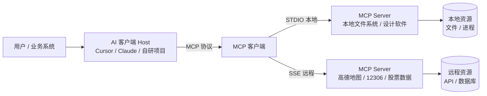

## 【学习目标】

学完本节，你应该能够：

- 用一句话说清 MCP 在「大模型 → 外部能力」链路里的位置，而不是停留在「连个工具」这种模糊说法。
- 区分 MCP 在编程辅助、数据分析、企业知识库、自动化工作流、创意设计五类场景里的典型落地形态。
- 结合本门课程的风控机器人，判断哪些能力适合封装成 MCP 工具，哪些更适合直接写代码。

## 【正文】

### 一、先定位：MCP 是「能力总线」，不是某个具体功能

理解使用场景之前，先要理解 MCP（Model Context Protocol）解决的是哪一类问题。大模型本身只负责「推理」，它不知道你的本地文件长什么样、数据库里有多少条记录、今天的天气如何。过去每接一个外部系统，就要给每个客户端单独写一套对接代码，无法复用。MCP 把这件事标准化了：它定义了一套统一协议，让任意支持 MCP 的客户端（Cursor、Claude、VS Code 插件，以及我们自己写的项目）都能用同一套方式去调用「服务器」提供的工具与数据。

用一张图把链路画清楚：

图里最关键的认知是：MCP 本身不生产能力，它只是「能力的插头标准」。能做什么，完全取决于你或第三方提供了哪些 Server。下面五类场景，本质上就是五类「已经有人把某种能力做成了 Server」的组合。

### 二、MCP 与 Function Calling 不是一回事

很多初学者会把 MCP 和模型的 Function Calling 混为一谈，这里必须分清楚，否则后面选型和排错都会乱：

- **Function Calling** 是「模型侧能力」：指大模型能按约定格式输出一段「我要调某个函数、参数是这些」的结构化指令。它解决的是「模型愿不愿意、会不会发起工具调用」。
- **MCP** 是「协议侧标准」：规定工具怎么被描述、怎么被发现（`tools/list`）、怎么被调用（`tools/call`）、结果怎么回传。它解决的是「客户端和 Server 之间用什么语言对话、工具跨客户端如何复用」。

一句话：**Function Calling 决定模型「想调」，MCP 决定工具「怎么被调、在哪调」**。模型没有 MCP 也能 Function Calling（直接调你硬编码的函数）；但有了 MCP，同一个 Server 能被 Cursor、Claude、自研 Java 服务共用，不用每家重写。本课程后面用 Spring AI 写的 `@Tool`，在协议层就是被 MCP/Function Calling 机制统一消费的，理解这层关系，9-7 动手时才不会困惑「为什么加个注解就够了」。

### 三、五类典型场景对照

| 场景 | 解决的痛点 | 典型 MCP Server | 课程 / 项目呼应 |
|---|---|---|---|
| 编程辅助 | 大模型改不了本地文件、跑不了命令 | filesystem、各类 IDE 插件 | 9-5/9-6 用 Cursor 调 filesystem 直接写 HTML |
| 数据分析 | 自然语言查库 + 自动出图 | 数据库查询、BI 工具 | 课程 RSS 入库后，可封装「查异动」工具 |
| 企业知识库 | 文档 / 邮件 / Office 统一纳入检索 | 文档协作、邮件 MCP | 9-10/9-11 邮件 MCP 即此类 |
| 自动化工作流 | 多系统节点协调编排 | 工作流套件 | 课程 Dify 工作流（11-5/11-6） |
| 创意设计 | 自然语言驱动建模 / 制图 | 3D、PS 类 MCP | 与风控无直接关系，了解即可 |

#### 1. 编程类智能体

这是当前最成熟的一类。Cursor、Claude、VS Code 系列插件都能完整实现 AI 编程：生成代码、修漏洞、做 API 集成，乃至驱动 CI/CD。它们底层都要操作你本地的文件，新建、修改、运行检查，这类「本地动作」正是 MCP 的 STDIO 模式最擅长的（具体机制见 9-3）。黑盒（Blackbox AI）这类工具在代码编写上更强，但本质都归到「智能编程智能体 + MCP 本地能力」这一范式。

**为什么值得关注**：编程类场景把「模型输出文本」和「真实改变文件系统」打通了，是验证 MCP 价值最直观的入口。你在本课程后面用 Cursor 接 filesystem，就是在亲手验证这一点。

#### 2. 数据分析类

过去大屏报表靠手写代码。引入大模型 + MCP 后，先用 MCP 查数据库，再用一句自然语言让模型生成柱状图、饼图、折线图。一句话表达意图，模型完成「查询 → 可视化」整条链路。本门课程把股票异动数据落库之后，完全可以封装一个「按代码查近 N 日异动」的 MCP 工具，让任意客户端一句话拿到图表数据，不必每次重写查询 SQL。

#### 3. 企业知识库管理

企业级知识库比自己手搓的检索强得多：Word、PPT、Excel 等办公文档都能纳入统一检索，还能收发邮件（邮件类工具我们在 9-10/9-11 亲自实现）。由于涉及内部档案，安全与隐私是这类场景的硬指标，选 Server 时务必确认它的权限边界，别把整个文件树暴露出去。

#### 4. 自动化工作流

工作流本质是多节点、多系统的协调。MCP 可以把多个节点看作一条链路做自动编排，跨系统协同非常强，但相对前几类更复杂：你需要自己定义节点间的数据契约（输入 / 输出 schema）。课程的 Dify 工作流章节（11-5/11-6）就是「工作流 + 自研 MCP 工具」的落地。

#### 5. 创意设计类

3D 建模、建筑设计、飞机汽车建模，以及 PS 里的自然语言制图，都能通过 MCP 接入。这类与风控项目关联弱，作为能力边界认知即可，它说明 MCP 的适用面远超「查数据」，任何「软件能力可被程序调用」的地方都能被它标准化。

### 四、与 AI 机器人结合的未来

MCP 问世前，很多 AI 机器人基于厂商内部私有规范，能力难以互通。一旦你能自己定制、扩展 MCP 功能，机器人就能「按需插拔」任意工具，只要提供对应的 MCP Server，它就办得成那件事。这和我们整门课的目标一致：把「感知行情 → 决策风险 → 执行告警」做成可插拔的能力闭环，而不是把逻辑焊死在一个脚本里。

### 五、选型的小结：什么时候自己封装工具

判断标准其实很朴素：能力要被多个 AI 客户端复用、且要碰本地 / 远程资源（文件、库、API）→ 封装成 MCP 工具最划算；一次性脚本、只在自己项目里跑一次 → 直接写代码更省事。MCP 的价值随「复用方数量」放大，单人单次任务上它的协议开销反而是负担。

## 【易错点 / 面试题】

1. **面试题：MCP 和直接调 API 有什么区别？**
   答：直接调 API 是点对点、每客户端重写对接；MCP 是协议标准化，同一 Server 可被任意 MCP 客户端复用，且工具的发现、调用、参数 schema 都由协议统一描述，客户端无需关心实现细节，换模型、换客户端都不用改写工具侧。

2. **面试题：MCP 和 Function Calling 是什么关系？**
   答：Function Calling 是模型发起工具调用的能力，MCP 是工具如何被描述、发现、调用的协议标准；前者解决「模型想调」，后者解决「工具怎么跨客户端复用」。两者互补，不是替代。

3. **易错点**：以为「接了 MCP 就自动变强」。MCP 只是插头标准，能力上限等于你提供的 Server 质量；选第三方 Server 必须看点赞率、下载量、是否官方出品，避免低质或重复实现把脏数据带进链路。

4. **面试题：什么时候适合自己封装 MCP 工具？**
   答：当某个能力会被多个 AI 客户端复用、且涉及本地 / 远程资源访问时（如课程「查某票风险」），封装成 `@Tool` 风格的工具最划算；一次性脚本则直接写代码更省事，不必为了「上 MCP」而引入协议开销。

## 【小结】

本节把 MCP 定位为「能力总线」，厘清了它与 Function Calling 的边界，并给出五类场景的对照表。下一节（9-3）深入通信机制，解释上面反复提到的 STDIO 与 SSE 到底怎么选、各自的并发与部署代价。落地到本门课程，你封装的「查股票风险」工具，在 `982-demo` 里已由 `src/main/java/com/riskbot/agent/RiskQueryAgent.java` 用 Spring AI 2.0.1 的 `ChatClient` + `@Tool` 实现（`builder.defaultTools(this)` 把本类的 `@Tool` 方法挂成可被模型调用的工具），而课程第 10 章的「股票 MCP 工具」正是在同一范式下把行情查询做成对外 MCP Server。先理解场景，再理解机制，最后动手编码，三层递进。
