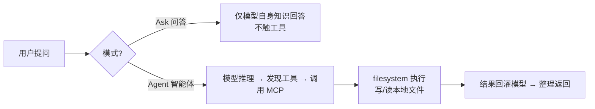

## 【学习目标】

学完本节，你应该能够：

- 在 Cursor 里把一个 STDIO 类型的本地 MCP Server（filesystem）配置并启用。
- 说清为什么「要调 MCP 工具就必须切到 Agent 模式」，以及普通问答模式为什么不触发工具。
- 通过「让 Agent 写 Hello World HTML」这条链路，验证工具被真正调用（而不只是模型在嘴上说说），并掌握调用失败的排查路径。

## 【正文】

### 一、为什么选 Cursor：一个支持 MCP 的 AI 代码编辑器

支持 MCP 的 AI 编程工具不止 Cursor 一个，Claude、VS Code（配合插件）都能用。选 Cursor，是因为它安装时有个贴心设计：安装过程会询问是否「帮助支持 VS Code」，点确定后，Cursor 内部就能直接使用你本地的 VS Code 插件生态，相当于一个本地 VS Code 增强版。它支持 macOS、Windows、Linux，装完是个独立图标，界面和本地 VS Code 非常相似，你本地的插件也都能在里面提供支撑。

### 二、安装与初始配置：模型选择与 Agent 模式

装好后点侧边栏进入交互界面。默认会选 Claude 4 模型，演示里选了 **Claude 3.5（Sonnet）**，因为选 4 价格相对高，初期先用 3.5 足够。

Cursor 有两种模式：**对话问答模式（Ask）** 和 **Agent 智能体模式**。这里有个关键点：**要操作 MCP 服务、调用 MCP 工具，必须切到 Agent 模式**。普通问答模式不会去调用 MCP 工具，它只基于模型自身知识回答，不会触发「调用外部能力」这条分支。

**Agent 模式内部发生了什么**：切到 Agent 后，Cursor 走的是 ReAct（推理 + 行动）循环，模型先推理「用户要写文件，我没有直接改磁盘的能力」，于是从已注册工具清单里匹配 `write_file`，生成调用请求，等待工具执行结果回填，再组织自然语言回复。工具调用不在模型脑子里发生，而在循环里真正发起系统调用。这正是 9-2 讲的「Function Calling 决定模型想调、MCP 决定工具怎么被调」的落地。



先用一个基本验证：开聊天问「你是谁、哪个大模型」，它会回答自己是 Claude 3.5。这一步只是确认聊天功能正常，接下来才进入正题。

### 三、配置本地 filesystem MCP：编写 mcp.json

点右上角**设置按钮** → **「工具」** → **「添加自定义 MCP」**，会打开 Cursor 的 `mcp.json` 配置文件。编辑时先切英文输入法敲一个 `A` 进入编辑模式。

我们去**魔搭社区（ModelScope）**找一个本地（stdio）的 `filesystem` 文件系统工具，它提供 NPX 运行方式。把官方配置复制下来，粘贴到 `mcp.json` 即可：

```json
{
  "mcpServers": {
    "filesystem": {
      "command": "npx",
      "args": [
        "@modelcontextprotocol/server-fileystem",
        "-p",
        "/Volumes/lee/docker"
      ]
    }
  }
}
```

粘贴后有一处必须改：挂载的本地路径。配置里默认有两行路径（比如一个是桌面，一个是某个任意路径），可配多个、也可删掉其中一个。演示里删掉桌面该，换成自己当前用的一个 Docker 文件夹路径，直接复制路径、粘贴进去（按 Ctrl+B 粘贴），然后保存。

**配置含义解读**：`command` 用 `npx`，跑的是基于 Node.js / TypeScript 的包 `@modelcontextprotocol/server-fileystem`；`args` 里 `-p` 后面跟的是你允许 MCP 访问的本地目录（演示里是 `/Volumes/lee/docker`）。保存后回到「工具」页面刷新（先关闭再开启，稍等片刻），当小圆点变**绿色**，说明服务可用。点进去能看到工具列表，filesystem 一共提供 **11 个工具**。

**工程经验**：`-p` 的目录就是权限边界。只挂 Agent 真正要用的目录，别把整个用户目录交出去，否则一个越权的写工具可能覆盖重要文件。这是 STDIO 本地 Server 的安全基线。

### 四、验证：让 Agent 创建 Hello World HTML

配置好，关掉侧边栏再重新打开，新建对话、开启 Agent 模式，就可以正式使用。给 Agent 一条指令：

```
创建html文件并写入内容
```

也就是在刚才配置的目录下创建一个 HTML 文件，内容是 「Hello World」。点击发送后，Agent 会先「思考」，然后去调用 filesystem 提供的 `write_file` 工具（把数据写入文件），并提示你点「运行工具」来确认执行。

执行之后，Agent 会返回执行结果：

```
我已经完成了以下操作：
1. 在 /Volumes/lee/docker 目录下创建了一个名为 index.html 的文件
2. 写入了一个完整的HTML结构，包含了必要的HTML5标签
3. 设置了中文语言和UTF-8字符编码
4. 在页面中显示了“helloworld”文本
5. 验证了文件已经成功创建并包含了正确的内容
```

为确认，它还会再调用一次读取文件的工具去读回内容验证。最终指定目录下确实生成了 `index.html`，双击打开能看到该 HTML 版 「Hello World」 已成功创建，说明任务真的完成了。

**为什么这是「真调用」而非「嘴上说说」**：如果只是 Ask 模式，模型可能直接编一段 HTML 文本回给你，但文件系统里不会多任何文件；而 Agent 模式触发了 `write_file`，磁盘上确实落了文件，且模型还主动读回校验，这就证明 MCP 工具链路是闭合的：模型决策 → 工具执行 → 结果回灌。

### 五、工具调用失败的排查路径

实际动手时常见几类失败，按下面顺序排查：

1. **小圆点不是绿色**：服务没起来。STDIO 类先看 `npx` 能否拉到包（`@modelcontextprotocol/server-fileystem` 该包名易拼错，注意是 `server-fileystem` 而非 `server-filesystem`），再看 `-p` 目录是否存在、有无读写权限。
2. **绿色但工具列表为空**：Server 起来了但没暴露工具，多半是 Server 版本与客户端不兼容，换一个被 `awesome` 收录的版本。
3. **调工具被拒绝**：权限边界问题，`-p` 目录没覆盖目标路径，扩目录或改指令里的路径。
4. **Ask 模式不触发**：确认切到了 Agent 模式，否则模型只在脑子里「编」，不会发起系统调用。

### 六、本地 STDIO 的边界

到这步，通过 Cursor 该外部软件，本地 MCP 服务真正用起来了。整个过程很方便。但记住 9-3 的结论：STDIO 是单进程、本地、并发弱。它适合你个人开发机自测；要给别人或团队共用，得换成 SSE（下一节）。

## 【易错点 / 面试题】

1. **易错点**：在 Ask 模式下问「帮我写个文件」，发现模型没动文件。原因就是 Ask 不触发 MCP 工具，必须切 Agent 模式；面试里常被问「为什么 Agent 能改文件而我直接问不行」，答：工具调用只在 Agent（ReAct）循环里发生。

2. **面试题：Cursor 看到的 11 个 filesystem 工具，模型怎么知道调哪个？**
   答：每个工具注册时都带 `description`，模型根据用户意图在工具清单里做语义匹配，选出 `write_file` 之类的工具，再把参数（路径、内容）填进 schema 发起调用。

3. **易错点**：`npx` 首次运行要现拉包，可能卡在下载。生产环境应预构建镜像或锁版本，避免运行时网络抖动导致工具不可用。

4. **面试题：如何证明 Agent 真的调用了工具而不是在编？**
   答：看副作用，文件系统里是否真多了文件、是否有工具调用日志；而非看模型回复文本。有副作用 + 模型读回校验，才是闭合的工具链路。

## 【小结】

本节用 Cursor + STDIO 把本地 filesystem 真正跑通，验证了「模型决策 → 工具执行 → 结果回灌」的闭环，并给出失败排查路径。下一节（9-6）把通道换成 SSE，接一个远程的高德地图 MCP，体会并发与远程部署的差异。落地到本门课程，这种「让模型通过工具改本地文件」的能力，在 `982-demo` 里换了一种更工程化的写法：`src/main/java/com/riskbot/agent/RiskQueryAgent.java` 用 Spring AI 2.0.1 的 `ChatClient` + `@Tool` 把「查某票风险」挂成可被模型调用的工具，工具循环由 2.0 的 `ToolCallingAdvisor` 在 Advisor 链统一驱动，和 Cursor 调 `write_file` 是同一套「模型触发工具」范式，只是从「外部客户端」搬到了「自研 Java 服务内部」。
