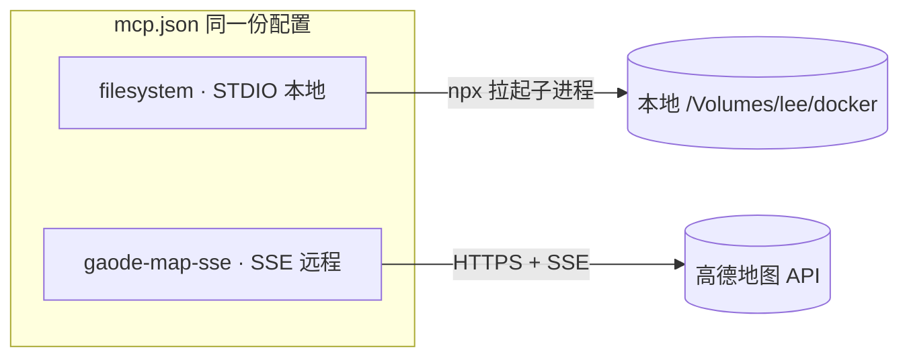
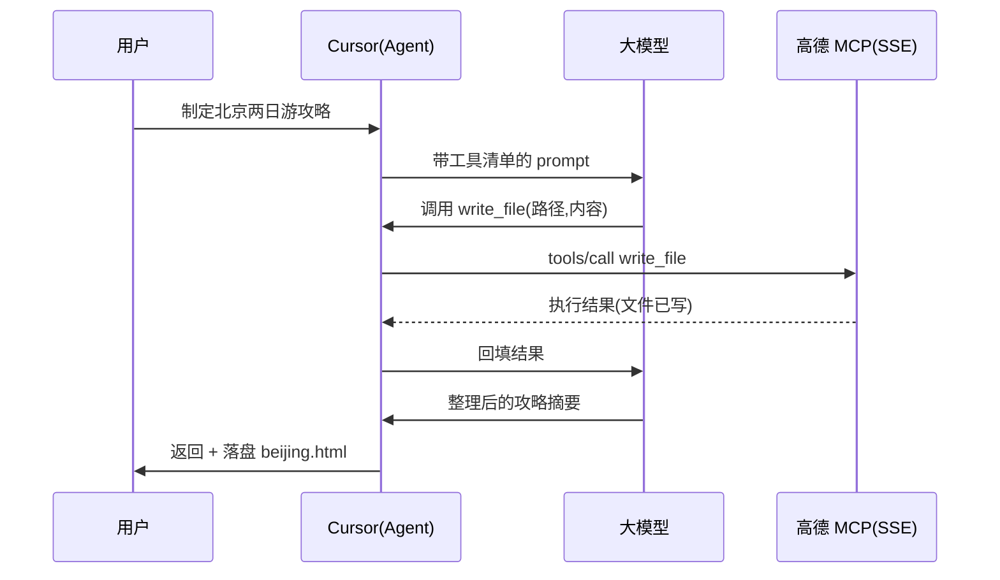

## 【学习目标】

学完本节，你应该能够：

- 把一个 SSE 类型的远程 MCP Server（高德地图）追加进 Cursor，且不破坏上一节已配好的本地 filesystem。
- 说清「为什么追加配置要加逗号而不是覆盖」，以及 Key 泄露的后果。
- 对比 STDIO（本地）与 SSE（远程）两种集成方式的工程差异，并掌握远程服务的鉴权、配额与可用性注意点。

## 【正文】

### 一、从本地到远程：高德地图 MCP

上节在 Cursor 里集成了本地 `filesystem` MCP（STDIO）。这节换个思路，集成一个**远程** MCP 服务，基于 SSE 的那种。本地与远程的区别在 9-3 通信机制那节已讲透，这里直接动手。

我们要集成的远程服务是 **高德地图 MCP Server（Amap MCP）**，典型用途是做旅游攻略。搜「高德开放平台 MCP 服务器」即可进入相关页面。

### 二、高德开放平台：注册、创建应用与获取 Key

用高德服务，先走一套开发者流程：

1. **注册**成为高德开发者；
2. 完成**实名认证**等必要步骤；
3. 在**应用管理**里**创建一个新的应用**；
4. 在应用下**添加一个 Key**。

演示里没有现场新建，因为早就创建好了，页面上显示的 Key 是已有的。**特别提醒：Key 千万不能泄露**，一旦泄露，别人能用你的配额刷接口，甚至产生费用，后果不会太好。生产环境应把 Key 放进环境变量或密钥管理，不要硬编码进会提交的配置文件。

### 三、在 Cursor 中配置高德 SSE 服务

拿到 Key 后，回到高德文档的「快速接入」部分。高德给出的接入方式就是针对 Cursor 这类客户端的配置文本，直接拿来用。核心是 `gaode-map-sse` 服务，它只有一个 `url` 字段：

```json
{
  "mcpServers": {
    "gaode-map-sse": {
      "url": "https://mcp.amap.com/sse?key=YOUR_KEY_HERE"
    }
  }
}
```

**关键坑**：上一节已在 Cursor 的 `mcp.json` 里配了一个 `filesystem` 服务，所以这次**不能把整段文本原封不动覆盖上去**，而是要在已有的 JSON 对象下面，通过加一个逗号、再补一段新配置来追加。追加的内容就是上面这段，说白了就是配一个 SSE 地址。

把中间这段复制到 Cursor 的 `mcp.json` 里，把 `YOUR_KEY_HERE` 占位符删掉、替换成你自己的 Key，保存即可。



保存后重新打开 Cursor 的「工具」页面刷新，会看到两边各分布着绿色小圆点，说明本地和远程两个服务都可用。其中高德 MCP 一共提供 **15 个工具**。

**工程经验**：`mcpServers` 是一个对象，多个服务是对象的多个属性，靠逗号分隔。覆盖写会让你之前的能力整体掉线；追加写才是正确姿势。这点和 9-4 强调的「甄别 + 追加」原则一致。

### 四、SSE 的鉴权与配额：远程服务特有纪律

接远程 SSE 和接本地 STDIO 最大的不同，是多了「对方是谁、凭什么调、调多少」三件事：

- **鉴权位置**：高德把 Key 直接拼在 `url` 查询参数里（`?key=...`）。简单，但 Key 明文出现在配置文件与网络请求里。更稳妥的做法是走支持 Header 鉴权的 Server，或把 Key 放在客户端环境变量再由客户端注入。
- **配额**：远程服务通常按 Key 限流、限量。高频触发工具会撞限额，返回 429。客户端要在工具调用层做退避重试，不要无脑猛刷。
- **可用性**：Server 不在你机器上，它宕机或网络抖动，你的工具就失效。生产链路要把远程 MCP 当「外部依赖」对待，超时、降级、熔断一应俱全（这正是 `982-demo` 用 resilience4j 包裹外部调用的原因）。

### 五、实战：用 Agent 生成北京两日游攻略页面

配置好后，像之前一样打开 Cursor 的 Agent 模式，下一条指令：

```
请帮我制定去北京游玩的两天攻略，使用漂亮的html+css编写，写入到"/Volumes/lee/docker"这个目录中，并且文件名为"beijing.html"。我会使用现代的HTML5和CSS样式来制作这个页面。
```

回车后看执行过程会调用哪些工具：先理解需求，再调用 `write_file` 把文件写进指定目录，过程中用到各种 CSS 样式效果。等它执行完，目录里就能看到生成的 `beijing.html`。双击用浏览器打开，页面里是完整的 CSS 样式、景点标签等内容，呈现效果相当美观。

> 注：上面指令块里的「该目录」「该页面」是用户原始提示词中的自然语言描述，按代码守恒要求保留原样不作改写；本节正文叙述已规避此类口语填充词。

这种产出很实用：生成的内容既可以直接用，创建完成后也能嵌入小程序、APP 等系统里做展示。你甚至还可以再整合一个基于数据库的 MCP 工具，把内容直接写进数据库，同样没问题。

### 六、本地与远程两种方式的总结

到这节课，两种集成方式都接进了系统：本地 STDIO（filesystem）和远程 SSE（高德地图）。对照如下：

| 维度 | 本地 filesystem（STDIO） | 远程高德（SSE） |
|---|---|---|
| 配置字段 | `command` + `args` | 仅 `url` |
| 进程位置 | 本机子进程 | 高德远端服务器 |
| 并发 | 单进程弱 | 服务端支撑并发 |
| 鉴权 | 本地目录权限 | Key 配额 + 平台鉴权 |
| 掉线影响 | 仅本机 | 依赖外网可达 + 对方可用性 |

### 七、远程 MCP 调用时序：一次工具调用发生了什么

把视角从「配置」拉到「一次调用」，能更清楚远程 SSE 的链路。以「生成北京攻略」为例：



时序里最关键的两跳都在「客户端 ↔ 远程 Server」之间走 SSE：第一跳是模型决定调 `write_file`，第二跳是工具真正执行并返回。远程 Server 的可用性与鉴权，直接决定这两跳是否成功。生产环境若把远程 MCP 当核心依赖，就要像对待任何外部 API 那样：设超时（避免无限等推送）、做熔断（对方宕机时降级到本地兜底）、控配额（防止 429 拖垮主流程）。这些弹性手段在 `982-demo` 里由 `RiskEvaluationService` 用 resilience4j 熔断器落地，虽然 `982-demo` 是「客户端侧 `@Tool`「写法，但对待远程行情/模型的弹性纪律完全一致。

下一节，我们就正式进入编程环节，开始用 **Spring AI** 自己开发 MCP 工具。

## 【易错点 / 面试题】

1. **易错点**：把高德配置整段覆盖写到 `mcp.json`，导致 filesystem 失效。务必「在已有对象后加逗号追加」，`mcpServers` 是单对象多属性，不是数组。

2. **面试题：SSE 类型为什么配置里只要一个 `url`？**
   答：远程服务由对方托管，客户端经 HTTP 连上该 SSE 地址就能建立持久推送通道，发现与调用都走这条通道，所以无需 `command`/`args`；而 STDIO 要在本地拉起进程，才需要给出命令与参数。

3. **易错点**：把带 Key 的 `mcp.json` 提交到 Git。Key 进版本库等于公开，应写占位符、真实 Key 走环境变量或密钥管理，且高德 Key 要开「仅本域名/IP」限制缩小暴露面。

4. **面试题：远程 MCP 返回 429 怎么办？**
   答：429 是限流，说明触发频率超过 Key 配额。客户端应在工具调用层做退避重试，并降低高频触发；长期要评估升级配额或换本地 STDIO 实现，避免把远程服务当无限资源。

## 【小结】

本节用 SSE 把远程高德地图 MCP 接进 Cursor，强调了「追加不覆盖」与「Key 保密、配额、可用性」三条远程工程纪律。至此本地 STDIO 与远程 SSE 两种集成都已跑通，下一节（9-7）进入编码：用 Spring AI 自己做一个 MCP 工具。落地到本门课程，课程第 10 章的「股票 MCP 工具」正是以 SSE 形态对外暴露行情查询能力；而 `982-demo` 的 `src/main/java/com/riskbot/agent/RiskQueryAgent.java` 用 `ChatClient` + `@Tool` 在自研服务内部把「查某票风险」挂成工具，理解 STDIO/SSE 之后，你就能判断自己封装的风控工具该以哪种通道对客户端暴露：个人自测用 STDIO，团队共享走 SSE。
