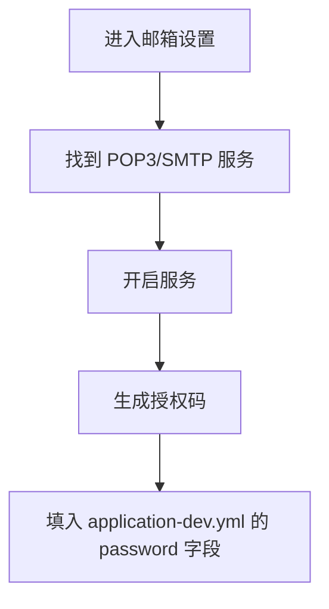

## 【学习目标】

学完本节，你应该能够：

- 在 `stock-mcp` 工程中引入 JavaMail 相关依赖，理解 MCP 服务器 starter 的作用；
- 读懂 `application.yml` 中邮件 SMTP 配置各项含义，并正确填入自有邮箱参数；
- 区分「登录密码」与「授权码」，知道如何在邮箱后台获取授权码；
- 建立敏感配置外部化的工程意识，对比生产级工程的多 profile 做法。

## 【正文】

### 一、为什么需要电子邮件 MCP 工具

前两节我们开发了两个和时间相关的 MCP 工具。接下来花两三节课，写一个非常实用的工具，**电子邮件工具**。

原因很现实：不管生成的是文字、文件还是图片，日常工作里经常需要「发邮件」。过去用代码发邮件可以自己实现，但现在如果希望大模型在交互过程中，仅靠一句自然语言「把这封邮件发出去」，就把内容投递到邮箱，同样可以做到。邮件能力在办公自动化、AI 应用落地里几乎是标配。本节先把邮箱**配置**好，下一篇再补发送代码。

### 二、回顾两个时间工具的实现

先回顾前面那两个工具，它们都写在 `DataTool.java` 里，靠 `@Tool` 注解暴露给大模型。第一个 `getCurrentTimeByZoneId` 接收城市名和时区 ID，通过 `ZoneId.of(zoneId)` 创建时区对象，再用 `ZonedDateTime.now(zone)` 取该时区的当前时间：

```java
@Tool(description = "根据城市所在的时区ID来获得当前时间")
public String getCurrentTimeByZoneId(String cityName, String zoneId) {
    log.info("调用MCP工具: getCurrentTimeByZoneId()");
    log.info(String.format("城市名称: %s, 时区ID: %s", cityName, zoneId));
    ZoneId zone = ZoneId.of(zoneId);
    ZonedDateTime zonedDateTime = ZonedDateTime.now(zone);
    String result = String.format("%s 的当前时间是: %s", cityName, zonedDateTime.format(DateTimeFormatter.ofPattern("yyyy-MM-dd HH:mm:ss")));
    return result;
}
```

第二个 `getCurrentTime` 则直接取本地当前时间并格式化：

```java
@Tool(description = "获取当前时间")
public String getCurrentTime() {
    log.info("调用MCP工具: getCurrentTime()");
    String currentTime = LocalDateTime.now().format(DateTimeFormatter.ofPattern("yyyy-MM-dd HH:mm:ss"));
    String result = String.format("当前时间是: %s", currentTime);
    return result;
}
```

邮件工具与它们同属 `@Tool` 暴露的能力，只是工具内部从「取时间」变成了「调 JavaMail 发信」。

### 三、引入依赖：pom.xml

邮件能力通过 **JavaMail** 集成。早年间自己集成 JavaMail 比较繁琐，现在 Spring Boot 已把整块内容封装好，只需把邮件相关坐标加进来即可。

把依赖复制到当前 `stock-mcp` 项目的 `pom.xml` 里，然后在 Maven 本地仓库（Maven Central）刷新，让它加载进来。注意该依赖的版本与 Spring Boot 版本保持一致（课程里用的是 4.0 最新版）。

```xml
<dependency>
    <groupId>org.springframework.ai</groupId>
    <artifactId>spring-ai-starter-mcp-server-webflux</artifactId>
    <version>1.0.0</version>
</dependency>
```

这里引入的 `spring-ai-starter-mcp-server-webflux` 是 MCP 服务器的 WebFlux 启动器，负责把工程里的 `@Tool` 方法暴露成可被 Cursor 等客户端发现的 MCP 工具端点；邮件发送本身仍走 JavaMail，二者各司其职。

### 四、配置 application.yml 的邮件参数

依赖加好之后，还有一段邮件相关配置。工程本就有一个 `spring` 节点，把这段配置粘贴到 `spring` 节点下面即可：

```yaml
mail:
  host: smtp.163.com
  port: 465
  username: yourmail@163.com
  password: <your password>
  protocol: smtp
  default-encoding: UTF-8
  properties:
    mail:
      smtp:
        socketFactory:
          port: 465
          class: javax.net.ssl.SSLSocketFactory
        ssl:
          enable: true
```

逐项拆解如下：

| 配置项 | 含义 | 注意点 |
|---|---|---|
| `host` | 邮箱服务器域名 | 依邮箱而定：QQ 为 `smtp.qq.com`，163 为 `smtp.163.com`，每家不同需自查 |
| `port` | 固定端口 | 本节用 **465**（SSL 加密端口） |
| `username` | 你的邮箱地址 | 发件人账号 |
| `password` | 授权码（非登录密码） | 见下一节，授权码与登录密码是两回事 |
| `protocol` | 邮件协议 | 用 `smtp` |
| `default-encoding` | 默认编码 | 设 `UTF-8`，避免中文乱码 |
| `properties.mail.smtp.socketFactory` | SSL 套接字工厂 | 端口 465，`class` 为 `javax.net.ssl.SSLSocketFactory` |
| `properties.mail.smtp.ssl.enable` | 开启 SSL | 必须 `true`，否则 465 端口连接失败 |

只要这些值与你的邮箱一致，邮件相关配置就完全没问题了。

### 五、获取邮箱授权码（以 163 为例）

`password` 字段需要重点说明：它不是你登录 163 邮箱时的账号密码。需要进邮箱「设置」，找到 **POP3/SMTP/IMAP** 这类服务并开启（默认关闭）。开启后系统会让你设置一个**授权密码（授权码）**，有效期通常 **180 天**，它就是配置里要填的 `password`。

具体操作：在邮箱设置页找到 POP3/SMTP 服务，点「开启」，按提示点「继续」，生成授权码后复制下来（演示里生成的是 `LGDk3A1KCF6VcnDq` 这样一串字符），回到 `application-dev.yml` 把它填进 `password` 字段即可。POP3 与 SMTP 都是邮件传输协议，此处开启 SMTP 即可。

无论新浪、QQ 还是 163，流程一致：进设置 → 找到 POP3/SMTP 类服务 → 开启 → 设授权码填配置。各家 `host` 不同，但步骤统一。



### 六、工程视角：敏感配置外部化

本节把授权码直接写进了 `application-dev.yml`，这属于开发期便利写法。进入生产，硬编码密码有两个硬伤：一是密钥落库、随代码泄露；二是换环境就得改文件、无法热切换。

982-demo 采用更规范的做法：`982-demo/src/main/resources/application.yml` 只放 `default`/`dev` 的 mock 配置，真实密钥全部走环境变量，由 `982-demo/src/main/resources/application-prod.yml` 以 `${MAIL_PASSWORD}` 这类占位符注入。这样同一份构建产物在 dev 与 prod 之间只靠环境变量切换，密钥不进版本库。MCP 邮件工具若要做成可部署服务，也应沿用这一外部化思路，而不是把授权码明文提交。

## 【易错点 / 面试题】

1. **`password` 填了登录密码会怎样？** 绝大多数邮箱厂商要求 SMTP 鉴权用授权码而非登录密码，填错会直接报 `535 Authentication failed`。先确认已开启 SMTP 服务并拿到授权码。
2. **`host`/`port` 不匹配有何后果？** `host` 写错会连不到目标服务器；`port` 与 SSL 开关不一致（如端口用 465 却没开 `ssl.enable`）会握手失败。465 配 SSL、25/587 配 STARTTLS 是常见组合，必须成对。
3. **为什么 `ssl.enable` 必须为 `true`？** 465 是隐式 SSL 端口，连接一开始就走加密通道；不开启 SSL 工厂，客户端会以明文协议对接加密端口，连接被拒。
4. **授权码过期怎么办？** 163 授权码有效期通常 180 天，过期后发信失败，需回邮箱后台重新生成并同步到配置。这也是把密钥外部化、集中管理的理由。
5. **面试延伸：为什么用 starter 而不是裸 JavaMail？** `spring-ai-starter-mcp-server-webflux` 负责把 `@Tool` 自动暴露为 MCP 端点，省去手动注册工具描述的样板；JavaMail 仍由 Spring Boot 的 `MailSender` 自动装配。starter 解决「工具如何被客户端发现」，JavaMail 解决「如何真正发信」，分工清晰。

## 【小结】

本节完成邮件工具的**配置**部分：依赖引入、SMTP 参数配好、授权码拿到。收盘前可以先照自己的邮箱把配置跑通。下一篇我们在代码里把这把 MCP 邮件工具写完，真正实现「通过大模型用自然语言发邮件」。

配置外部化的意识，正是 982-demo 中 `application.yml` 与 `application-prod.yml` 多 profile 分离所践行的原则，开发便捷与生产安全并不冲突，关键是把密钥关在环境变量里。技术前瞻：Spring AI 2.0 起工具循环由 `ToolCallingAdvisor` 统一驱动，未来 2.1 的渐进式工具披露（`ToolSearchToolCallingAdvisor`）可让工具集进一步规模化而不爆 token。
