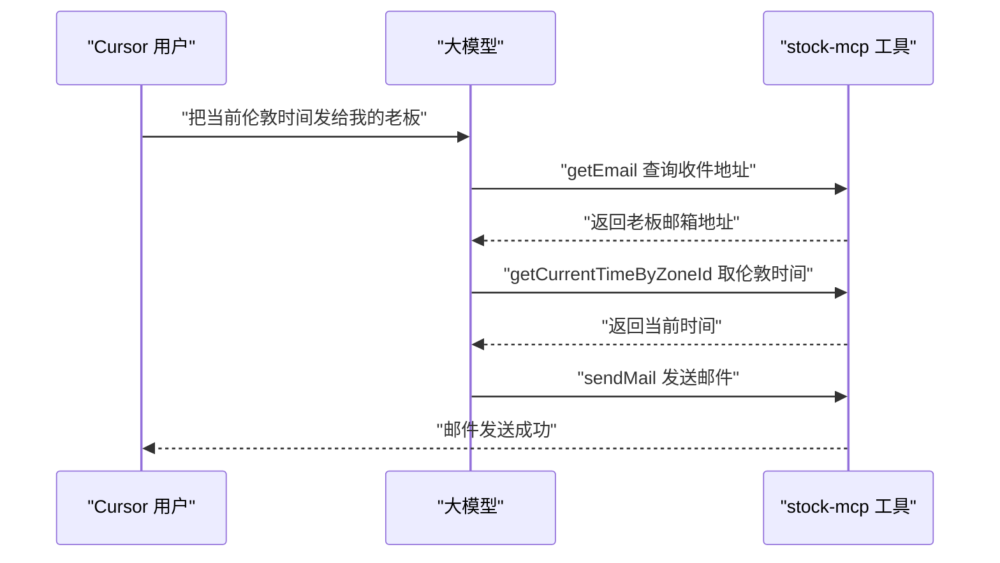

## 【学习目标】

学完本节，你应当能够：

- 在 `stock-mcp` 模块新建 `EmailTool` 并以 `@Component` 交容器管理、注册进 `ToolCallbackProvider`；
- 用 `@ToolParam` 为 `EmailInfo` 三要素（email / subject / content）写精确描述，提升大模型参数匹配准确率；
- 讲清 Jakarta Mail（JavaMail）的 `JavaMailSender` + `MimeMessageHelper` 发送链路，以及 SMTP 认证与端口（465 / 587）的差异；
- 在 Cursor 中端到端验证：大模型自动编排 `getCurrentTimeByZoneId` 与 `sendMail` 完成「查时间 → 发邮件」。

## 【正文】

### 一、新建 EmailTool 与注册

和此前工具一致，在 `stock-mcp` 模块新建 `EmailTool`（电子邮件工具），用 `@Component` 交 Spring 容器管理，并注册进 `ToolCallbackProvider`。此前工具数组是「竖排」写法，直接在末尾加逗号、把 `emailTool` 追加进去即可。

工具内保留一个取当前时间的小方法，便于端到端演示：

```java
public String getCurrentTime() {
    String currentTime = LocalDateTime.now().format(DateTimeFormatter.ofPattern("yyyy-MM-dd HH:mm:ss"));
    String result = String.format("当前的时间是：%s", currentTime);
    return result;
}
```

`@Tool` 方法的返回值可以是 `void` 或一句「发送成功」提示；参数清晰、描述准确，是大模型正确编排的前提。把「取时间」与「发邮件」拆成两个工具，正是为了演示大模型的多步编排能力。

### 二、设计邮件三要素：email / subject / content

发送方法命名为 `sendMail`，描述写明「将邮件信息发送到指定的邮箱地址」。它需要三个参数，即邮件发送**三要素**，缺一不可（缺任一即为空）：

- `email`：收件人地址；
- `subject`：邮件标题 / 主题；
- `content`：邮件正文内容。

三要素缺一不可的本质，是 SMTP 协议对一封合法邮件的最低要求：`RCPT TO` 需要收件人、`DATA` 命令的信封需要主题与正文。工具把这三要素显式建模，等于在大模型侧强制补全 SMTP 必需字段。

### 三、用 EmailInfo 对象封装参数与 @ToolParam

进阶写法：把三个参数封装成一个对象一起传。新建 `public static class EmailInfo` 内部类，放 `email` / `subject` / `content` 三字段，每个加 `@ToolParam` 并写描述。描述越详细，大模型匹配自然语言参数越精准，例如「发给老板」时它能从对象里取对字段：

```java
public static class EmailInfo {
    @ToolParam(description = "收件人地址")
    private String email;
    @ToolParam(description = "发送邮件的标题/主题")
    private String subject;
    @ToolParam(description = "发送邮件的消息/正文内容")
    private String content;
}
```

`@ToolParam` 的 `description` 会进入工具 schema 的 `properties`，大模型据此把用户口语（「标题写当前时间」）映射到 `subject`。这是 MCP 工具「自然语言 → 结构化参数」的关键一环，也是 Spring AI 2.0.1 中 `@Tool` 工具与 MCP 工具共用的参数描述机制，`RiskQueryAgent`（`982-demo/src/main/java/com/riskbot/agent/RiskQueryAgent.java`）的 `queryRisk` 同样用 `@ToolParam(description = "股票代码，如 600519 或 AAPL")` 约束入参。

### 四、配套工具：getEmail 查询收件地址

为让「发给我老板」这类说法跑通，补一个小工具 `getEmail`：用于查询邮件地址（如「我老板的邮箱」）。真实项目可能从数据库按用户名查，此处做模拟，直接返回写死的 163 邮箱地址。这样大模型编排时可先调 `getEmail` 拿老板地址，再填进 `sendMail` 的收件人。多步工具串联正是 ReAct（推理 + 行动）范式的体现：Think（我要发邮件给老板）→ Act（先 `getEmail` 取地址）→ Observe（拿到地址）→ Act（再 `sendMail`）→ 完成。

### 五、发送逻辑：注入 JavaMailSender 与 MimeMessageHelper

邮箱服务端参数配置在 `application.yml` 的 `mail` 节点下：

```yaml
mail:
  host: smtp.163.com
  port: 465
  username: fatherfilm@163.com
  password: LgDK3AtKCF6VcnQ
  protocol: smtp
  default-encoding: UTF-8
  properties:
    mail:
      smtp:
        socketFactory:
          port: 465
          class: javax.net.ssl.SSLSocketFactory
        ssl:
          enable: true
```

此处几个工程要点必须讲清：

- **端口 465 vs 587**：465 是「隐式 SSL（SMTPS）」，连接建立即走 TLS；587 是「显式 STARTTLS」，先明文握手再升级加密。本配置用 465 + `SSLSocketFactory`，属于隐式 SSL 路线，与 `ssl.enable=true` 配合。
- **认证**：`username` / `password` 即 SMTP 登录凭据，Spring 的 `JavaMailSender` 默认开启 `mail.smtp.auth`；密码是邮箱「客户端授权码」而非登录密码（163 邮箱需单独开启 SMTP 并生成授权码）。
- **`socketFactory.class`**：指定 `javax.net.ssl.SSLSocketFactory` 让 465 端口的 SSL 握手由该工厂完成，是隐式 SSL 的标准写法。

核心发送代码注入 `JavaMailSender`，用 `@Autowired private final JavaMailSender mailSender`；发件人 `from` 来自上节配置 `spring.mail.username`，以 `@Value("${spring.mail.username}")` 注入。工具方法标注 `@Tool`：

```java
@Tool(description = "给指定的邮箱发送邮件信息, email 为收件人地址, subject 为邮件标题, content 为邮件的内容")
public void sendMail(EmailInfo emailInfo) {
    log.info("调用MCP工具: sendMail");
    MimeMessage mimeMessage = mailSender.createMimeMessage();
    MimeMessageHelper helper = new MimeMessageHelper(mimeMessage);
    // ... (后续代码未完全展示)
}
```

发送过程分六步：① `mailSender.createMimeMessage()` 建 `MimeMessage`；② `MimeMessageHelper` 包装；③ `helper.setFrom(from)` 设发件人；④ `helper.setTo(emailInfo.getEmail())` 设收件人；⑤ `helper.setSubject(...)` 设主题、`helper.setText(...)` 设正文（均取自 `emailInfo`）；⑥ `mailSender.send(mimeMessage)` 真正发出。建议用 try-catch 包住发送，失败打 `log.info("邮件发送失败")` 比直接抛异常稳妥。

此处工具注册机制与 Spring AI 2.0.1 的 Agent 工具完全一致：`RiskQueryAgent` 同样用 `@Tool` + `@ToolParam` 把 `queryRisk` 挂进 `ChatClient`，并由 `ToolCallingAdvisor` 在 Advisor 链统一驱动循环，MCP 工具数组在 2.0 中也是 `ToolCallbackProvider` 的同源实现，只是对外暴露为 MCP 协议端点。`MimeMessageHelper` 是 Jakarta Mail 提供的便捷封装，自动处理 `MimeMultipart` 与字符集，避免手写 MIME 头。

### 六、在 Cursor 中端到端验证

代码写完后先对整个工程 `install` 再运行（新增配置项，建议先装再跑）。启动 MCP 服务、打开 Cursor 刷新，可见工具数增至 **4 个**。

新开对话验证：① 先问「我老板的邮箱地址」，`getEmail` 返回老板地址；② 再说「伦敦时间是多少？请把这条信息发送给我的老板」。大模型做**自动编排**：先 `getCurrentTimeByZoneId`（经 `ZoneId` 取伦敦时间）获当前时间，再调 `sendMail`，把 `subject` 设为「当前的时间」、`content` 设为「你好，这是当前时间：……」、`email` 填成老板地址。最终参数大致如下：

```json
{
  "email": "fatherfilm@163.com",
  "subject": "当前的时间",
  "content": "你好，这是当前时间：2026-01-08 07:49:47"
}
```

点击运行后邮件成功发送，打开邮箱确收标题「当前的时间」、内容「你好……」的邮件。邮件功能至此跑通。

大模型端到端编排的时序如下：



常见失败点对照：

| 现象 | 可能原因 |
|---|---|
| 认证失败 535 | 密码用了登录密码而非授权码 |
| 连接超时 | 端口 / SSL 工厂配置与邮箱服务不匹配 |
| 收件人为空 | `getEmail` 未正确返回，大模型未填 `email` |

### 七、MIME 结构：为什么一封邮件能同时带 text 与 html

邮件正文并非只能一种格式。Jakarta Mail 支持 `MimeMultipart` 的 `alternative` 子类型：同一封邮件同时放 `text/plain`（给纯文本客户端）与 `text/html`（给现代客户端），客户端按能力择优显示。`MimeMessageHelper` 的 `setText(text, html)` 双参重载就能构造这种「alternative」结构，第一节的纯 `setText(content)` 是单 part，进阶场景用双 part 兼容性最好。附件则是另一类 `mixed` 子类型，经 `helper.addAttachment(...)` 追加，与正文并列。理解 MIME 层级，才能说清「为什么邮件有时既显示文字又显示富文本」。

### 八、工具 schema 生成与 MCP 传输

`@Tool` + `@ToolParam` 在 Spring AI 启动时会被反射扫描，自动生成 JSON Schema（名称 / 描述 / 参数类型），正是前文 `getEmail` / `sendMail` 能被大模型识别的依据。在 `stock-mcp` 里，这些工具经 `ToolCallbackProvider` 注册后，由 MCP Server 以 `tools/list` 暴露给客户端（Cursor）；客户端拿到 schema、代表模型发起 `tools/call`，参数 JSON 经 MCP 传输（本机多为 stdio）送达服务端执行。整条链路：注解 → schema → MCP 协议 → 调用，与 982-demo `RiskQueryAgent` 的 `defaultTools(this)` + `ToolCallingAdvisor` 同源，区别仅是传输层由 Advisor 链变为 MCP 协议。

### 九、SMTP 层的重试与降级

发邮件也会失败（网络抖动、授权码过期、服务商限流）。生产环境应在 `sendMail` 外包一层重试：用 `resilience4j` 的 `@Retry` 限定次数与退避，连续失败则降级（如记日志 + 落库待补发），避免单次发送异常中断大模型编排。SMTP 连接本身建议走连接池 / 复用，而非每条邮件新建连接，`JavaMailSender` 默认会话可复用，高频发送时这点差异明显。

## 【易错点 / 面试题】

1. **问：`@ToolParam` 的 description 写不写、写多写少有何影响？**
   答：description 进入工具 schema，是大模型选参、填参的唯一依据。描述越具体（如「收件人地址」而非「email」），大模型越能把口语映射正确；缺失或含糊会导致参数填错（如把主题填进正文）。这是 MCP 工具可用性的关键。

2. **问：`EmailInfo` 为何要封装成对象而非三个独立 `@Tool` 参数？**
   答：封装对象让 schema 结构清晰、参数成组，大模型一次填充三字段不易错配；也为后续扩展 `contentType` 等字段留口（见 9-11），无需改动方法签名。独立参数在字段增多时 schema 会膨胀、易错。

3. **问：MCP 工具注册与 Spring AI Agent 的 `@Tool` 是两套机制吗？**
   答：同源。课程 `stock-mcp` 用 `@Component` + `@Tool` + `ToolCallbackProvider` 数组注册；Spring AI 2.0.1 中 MCP 服务端进一步提供注解式 `@McpTool`，客户端以 `McpToolCallback` 挂载，底层都由 `ToolCallingAdvisor` 驱动循环，本质一致。

4. **问：SMTP 端口 465 与 587 怎么选？**
   答：465 隐式 SSL，连接即加密，配 `SSLSocketFactory`；587 显式 STARTTLS，先明文后升级。两者都安全，取决于邮箱服务商支持；本配置走 465 隐式 SSL 路线。

## 【小结】

本节落地了 MCP 邮件发送工具：以 `@Tool` + `@ToolParam` 封装 `EmailInfo` 三要素，用 `JavaMailSender` 完成发送，并在 Cursor 中验证「查时间 → 发邮件」的自动编排。工具注册范式与 982-demo 风控问答 Agent 的 `RiskQueryAgent`（`982-demo/src/main/java/com/riskbot/agent/RiskQueryAgent.java`）完全同源，印证了「MCP 工具 = 大模型可调用的标准能力」这一核心认知。下一节在该工具上扩展 HTML / Markdown 内容的正确渲染，避免把源码甩给收件人。
