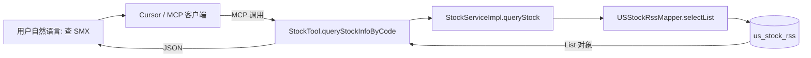

## 【学习目标】

读完本节，你应该能够：

1. 在已有 MCP 工程里接入 MyBatis Plus 持久层（Mapper / 实体 / YAML 配置），把「工具」和「数据库」打通。
2. 用 `@Tool` 注解把「根据股票代码查询信息」的方法暴露成可被大模型调用的工具，并理解 `@Tool` 的 `description` 如何影响模型的工具选择。
3. 通过 `mcp.json` 把自建 MCP Server 加载进 Cursor，并用自然语言驱动一次真实查询。
4. 对照 `982-demo` 的 `RiskQueryAgent`，理解 `@Tool` 在「挂给 ChatClient」与「暴露为 MCP 工具」两种场景下是同一套契约。

## 【正文】

### 一、把 MCP 工具和股票业务结合

前几节逐个写出了最基础的 MCP 工具，从这节开始把 MCP 真正落到股票业务上，落地此前定下的四个目标。第一个目标是**根据股票代码查询某只股票的信息数据**。这类操作本质就是查询，从增删改角度看没有特殊之处；既然 MCP 已经能跑起来，就能用自然语言描述需求，让大模型理解意图，再通过工具调用驱动后端系统返回结果。

### 二、在 MCP 工程里接入数据库

做股票查询，第一步是把持久层接进来，即在当前 MCP 工程中集成 MyBatis Plus。这部分在前面章节已经做过一遍，可直接把已有工程里的 Mapper 复制过来。复制时注意包名容易丢失，两边保持一致即可，操作的本是同一个数据库；对应的实现方法同样复制过来，Mapper 依赖必不可少。

处理 YAML：打开 `application-dev.yml`，把 MyBatis 相关配置复制过来，放在数据源配置上方。数据源本身配置在 DEV 环境里，整块复制即可；MCP 的 DEV 环境里注释是否保留都不影响运行，因为两边配置一致。

依赖方面准备 MyBatis 相关坐标（MyBatis Plus 与 MyBatis-Spring），复制后在 MCP 工程对应位置粘贴；若 Maven 仓库没自动刷新，手动刷新让依赖生效。

实体类同样迁移过来。若复制时默认包名丢失，就新建包再把实体拖进去；没有实体则重新创建，保证工程能正常识别。

Mapper 本身非常轻量，只需继承 `BaseMapper` 即可获得完整单表 CRUD 能力：

```java
public interface USStockRssMapper extends BaseMapper<USStockRss> {
}
```

到这里，MyBatis 的依赖与基础代码全部就位，持久层相当于整体牵引、复制过来。

> 工程视角：MyBatis Plus 的 `BaseMapper` 提供了 `selectList` / `selectOne` / `insert` 等现成方法，省去手写基础 SQL 的成本。但注意 `BaseMapper` 的参数多为 `Wrapper`，复杂分组统计（如后面 10-3 的 GROUP BY + HAVING）仍需自定义 XML，这点会在第 10-3 节展开。

### 三、工具方法设计：用 `@Tool` 暴露能力

依赖就绪后写工具。新建工具类 `stocktool`，先用自然语言把职责描述清楚：「根据股票代码查询相关的股票信息数据」。再改参数：按股票代码查询，入参改为专门的 `stockcode`；方法名体现 `query` 语义，「通过代码查询股票信息」。方法名与参数描述填进工具定义，用不到的工具方法删掉。

最终工具要做的事很明确：从数据库查出对应数据并返回。按股票代码查询得到对象列表，交给 MyBatis Plus 实现即可。

```java
@Component
public class StockTool {
    @Resource
    private StockService stockService;

    @Tool(description = "根据股票代码查询股票信息数据")
    public List<USStockRss> queryStockInfoByCode(String stockCode) {
        log.info("调用MCP工具：queryStockInfoByCode({})", stockCode);
        log.info(String.format("| stockCode: %s", stockCode));
        return stockService.queryStock(stockCode);
    }
}
```

**为什么这样写**：`@Tool(description = "...")` 的 `description` 不是给程序员看的注释，而是写给大模型的「能力说明书」。模型在 ReAct 循环里靠这段描述决定要不要调该工具、传什么参数。描述越贴合用户可能的自然语言问法（「查一下 SMX 的信息」），命中率越高。`@Resource` 注入了业务服务，工具方法本身只做「参数透传 + 日志」，真正的查询逻辑下沉到 `StockService`，符合分层职责。

课程其他 MCP 工具是同一套写法：用 `@Tool` 把方法暴露成工具，方法内部按业务参数做分支。例如 `EmailTool` 依据 `contentType` 决定正文是 HTML 还是纯文本：

```java
MimeMessage mimeMessage = mailSender.createMimeMessage();
MimeMessageHelper helper = new MimeMessageHelper(mimeMessage);
helper.setFrom(from);
helper.setTo(fromEmail);
helper.setSubject(emailInfo.getSubject());
if (contentType == 1) {
    helper.setText(ConvertToHtml(emailInfo.getContent()), html: true);
} else if (contentType == 2) {
    helper.setText(emailInfo.getContent(), html: true);
} else {
    helper.setText(emailInfo.getContent());
}
mailSender.send(mimeMessage);
```

> 工程对照：`982-demo` 的 `RiskQueryAgent.queryRisk` 也是 `@Tool(description = "查询指定股票代码当前的风险评估结果...")`，构造函数里用 `builder.defaultTools(this).build()` 把本类的 `@Tool` 注册给 `ChatClient`。同一条 `@Tool` 方法，挂给 `ChatClient` 就能让模型在对话中触发，封装成 MCP Server 就能让 Cursor / Cherry Studio 调用，**工具契约只有一份，运行载体有两个**。这正是 Spring AI 2.0 把「工具调用循环」统一为 `ToolCallingAdvisor` 在 Advisor 链驱动的好处：无论对话内还是 MCP 调用，递归工具循环逻辑共用。

### 四、服务层与查询逻辑

工具层需要服务层支撑。此前创建过 `StockService`，直接复制过来；包名缺失就重新建包或复制新文件再建包。方法名定为「查询股票信息」，入参即股票代码，业务层和接口代码务必加注释，便于协作。

新建 `impl` 子包，放实现类并加 `@Service`：

```java
@Service
public class StockServiceImpl implements StockService {
    @Override
    public void queryStock(String stockCode) {
        // 业务逻辑
    }
}
```

实现里要做查询，需结合 MyBatis Plus，用 `@Resource` 注入 Mapper。同一股票代码在库里可能对应多条记录，直接用 `selectList`：`new QueryWrapper<>()`，在 `stockcode` 字段上 `eq` 指定要查的代码，传进 `selectList` 拿到对象列表返回。接口层返回类型要跟着改：原 `void` 改成 `List<USStockRss>`，回到实现类不再报错；愿意的话加类型参数让代码更规范。最后在工具类直接 `return`，中间无需额外代码。

### 五、注册工具并启动测试

工具写完后务必注册：在应用里把股票工具加进去。参数多时让配置换行，这里把 `stock tool` 注册进来。改动配置后先全局安装、停服务再重启。启动报错多半是 MyBatis Plus 新版兼容性配置遗漏，把对应配置项贴上即可。更规范的做法是把这类公共能力抽一个 `common` 子工程，把拦截器、MCP 工具、MyBatis 提取到公共范畴，此前 Java 高级体系课程讲过。

补上配置后重启，问题解决。在 Cursor 侧，MCP 服务通过 `mcp.json` 管理，把服务开关打开工具才会加载：

```json
{
  "Tools": {
    "stock-mcp-server": {
      "enabled": true
    }
  }
}
```

### 六、用自然语言驱动一次真实查询（SMX）

关掉 Cursor 再重开，工具列表里应出现「根据代码查询股票信息」。新建对话做查询：股票代码 `SMX`。找到对应工具，点确定运行，返回结果是一个 JSON 列表，包含大量数据，说明 `SMX` 代码存在且记录很多。

向下看，库里已掌握的信息：共收录 **38 条新闻**，相关融资信息包括获得 **1.1 亿美元** 融资资金，以及 **1.165 亿美元** 用于融资的美元资本。这正是此前说过的那支股票：价格从 3 元涨到 400 多元，只用了一周；关键在于融资是非稀释性的，稀释性融资会削弱股东权益、稀释资金，股价可能下跌，非稀释性融资更可能呈现上涨趋势，所以它在 12 月中下旬表现相当强劲。

这就是用自然语言查询数据库达到的效果。后续工作参照此前定的三个目标逐个实现。



## 【易错点 / 面试题】

1. **面试题：MCP 工具的 `@Tool` 注解和 Spring AI 里挂给 ChatClient 的 `@Tool`，是一回事吗？**
   答：是同一套注解契约。`@Tool` 描述方法的能力与参数 schema；挂给 `ChatClient`（经 `defaultTools(this)`）时由 `ToolCallingAdvisor` 在对话循环里触发，封装成 MCP Server 时由 MCP 协议暴露给外部客户端。方法体只写一次。

2. **易错点：复制 Mapper / 实体时包名丢失。**
   MyBatis 按全限定名定位 Mapper 与实体，包名不一致会导致 `Invalid bound statement` 或实体映射失败。复制后先确认包声明与目录结构一致。

3. **易错点：`StockService` 接口返回类型仍是 `void`。**
   工具类 `return stockService.queryStock(...)` 要求接口返回 `List<USStockRss>`，忘改返回类型会编译报错。接口改泛型后实现类同步改，类型对齐即解决。

4. **面试题：为什么模型能「选对」 `queryStockInfoByCode` 而非其他工具？**
   答：靠 `@Tool` 的 `description` 做语义匹配；描述越贴近用户真实问法，命中越准。模糊描述会让模型误选工具或多次重试。

## 【小结】

本节打通了「MCP 工具 → 服务层 → MyBatis Plus → 数据库」的第一条查询链路，核心是把 `@Tool` 当成「给模型看的能力说明书」。下一节（10-2）给同一工具加时间区间维度，10-3 进一步引入 GROUP BY + HAVING 的自定义 SQL，10-4 做关键字检索，四节合起来构成完整的股票查询工具集。需要把「工具契约」意识固化下来的同学，建议对照 `982-demo/src/main/java/com/riskbot/agent/RiskQueryAgent.java`，看同一条 `@Tool` 如何在 `ChatClient` 侧驱动风控问答。
