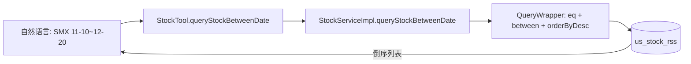

## 【学习目标】

读完本节，你应该能够：

1. 在「按代码查询」的基础上扩展出「按代码 + 时间区间查询」的第二个 MCP 工具，理解 `between` 条件与倒序排序的拼法。
2. 对比「带时间参数」与「不带时间参数」两种方法的取舍，并能用参数判断把它们合并为单一入口。
3. 在 Cursor 里用自然语言驱动一次真实时间段查询，并理解「带年份」对避免跨年歧义的意义。
4. 对照 `982-demo` 的 `MockQuoteProvider`，理解生产里「时间区间」维度对异动分析为什么不可或缺。

## 【正文】

### 一、为什么要加时间区间

上一节实现了第一个工具：按股票代码查询信息。这节课实现第二个工具：**根据股票代码，查询某一个时间段内的股票数据**。只按代码查，会把历年积累的数据全部统计出来，口径太粗；加上时间区间限定后，更贴合实际分析需求，也能得到更具参考价值的细分数据。

### 二、工具方法设计

把上一节的 `queryStock` 方法复制一份，改名为 `queryStockBetweenDate`，新增两个参数：`startDate`（开始日期）与 `endDate`（结束日期）。两个参数都由大模型传入，类型先定为 `String`（若想用 `Date` 等其他类型，也可让模型传入前完成转换，均可）。

接口方法注释写清楚：在指定时间段内查询相关的股票信息。

```java
public interface StockService {
    // 根据股票代码查询股票信息数据
    public List<USStockRss> queryStock(String stockCode);
}
```

### 三、Service 实现：拼出 `between` 与倒序

实现层同样复制上面的逻辑，仍用 `QueryWrapper` 拼条件，只是多了两个时间参数。关键差异：先用 `eq("stock_code", stockCode)` 限定股票代码；再用 `between("pub_date_bj", startDate, endDate)` 限定北京时间区间；最后加 `orderByDesc("pub_date_bj")` 按北京时间倒序，把最新数据排在最上面。列名 `pub_date_bj` 若记不清，直接去库表结构复制字段，别凭记忆硬写。

```java
@Override
public List<USStockRss> queryStock(String stockCode) {
    QueryWrapper<USStockRss> queryWrapper = new QueryWrapper<>();
    queryWrapper.eq("stock_code", stockCode);
    return usStockRssMapper.selectList(queryWrapper);
}

@Override
public List<USStockRss> queryStockBetweenDate(String stockCode, String startDate, String endDate) {
    QueryWrapper<USStockRss> queryWrapper = new QueryWrapper<>();
    queryWrapper.eq("stock_code", stockCode);
    queryWrapper.between("pub_date_bj", startDate, endDate);
    queryWrapper.orderByDesc("pub_date_bj");
    return usStockRssMapper.selectList(queryWrapper);
}
```

**为什么用 `String` 而非 `Date`**：模型传参天然是字符串，落库字段 `pub_date_bj` 多为 `datetime` / `varchar` 文本格式（课程库里是北京时间字符串）。用 `String` 接收可免去模型做类型转换的出错概率，由 `between` 在数据库侧做范围比较；前提是字符串格式与库字段排序规则一致（如 `yyyy-MM-dd HH:mm:ss`）。若要强类型，可在 Service 内部用 `LocalDateTime.parse` 转换，职责更清晰但需处理解析异常。

**为什么倒序**：异动分析通常只关心最近发生了什么，倒序让最新资讯排在最前，模型整理结论时优先看到有效信息，减少长列表噪声。

### 四、两个方法能不能合并

带时间区间与不带时间区间，其实完全可以合二为一：按参数判断，有 `startDate` / `endDate` 就追加 `between`，没有就不加。分开写也行，合并写也完全可行，按偏好来。下面用对照表给出两种写法的取舍：

| 维度 | 拆成两个方法 | 合并为单一入口 |
|---|---|---|
| 工具描述 | 两个 `@Tool`，模型选择更明确 | 一个 `@Tool`，描述需覆盖两种语义 |
| 参数校验 | 各自简单 | 需判断空参决定是否追加 `between` |
| 可维护性 | 重复代码 | 逻辑集中 |
| 适用场景 | 语义差异大、需单独暴露 | 语义一致、仅范围可选 |

生产里倾向合并，因为「查某票」和「查某票某时段」本质是同一查询的不同投影；拆分只会让模型在工具清单里多一个选择、增加误选概率。但合并后要保证空参时的 `between` 不被拼出来，否则 `between null` 会返回空结果。

### 五、用 MCP 工具验证

启动服务后，在 Cursor 里调用刚开发的 MCP 工具（课程环境简称 SMX）做验证：

- 查询股票 **NVT**，时间段 **2025-12-10 至 2025-12-20**，成功返回该时段新闻数据（标题、发布日期、链接等）。记得带上年份，避免跨年歧义。
- 再调用 `queryCurrentTime` 获取当前时间戳，作为后续分析的时效性依据。
- 查询股票 **SMX** 在 **11 月 10 日至 12 月 20 日** 之间的数据，让模型基于这些数据做趋势分析（会复用已开发好的工具）。结果上当前价格已在下跌，前期涨幅过大（出现过超过万分之级别的上涨），回调是必然的。



到这里，「在……日期之间」查询的工具实现并跑通。课后可把合并版也试一下。接下来两个工具稍复杂，在后面两节实现。

> 工程对照：`982-demo` 的 `MockQuoteProvider.nextTicks()` 返回的样本 tick 都带 `Instant` 时间戳，时间戳字段留给消费方使用；当前两条规则（涨跌幅、放量）只看数值不看时间，生产里接 `RealQuoteProvider` 后，`between` 这类时间区间查询才是异动回溯分析的基础。`982-demo` 的 `risk.scan.fixed-delay-ms` 配置（默认 30s）控制扫描节奏，与本节「时间区间」维度互为补充：前者是实时增量，后者是历史回溯。

## 【易错点 / 面试题】

1. **易错点：时间参数漏写年份导致跨年歧义。**
   模型若只传 `12-10` 而非 `2025-12-10`，`between` 可能落到错误年份。工具描述里应显式要求「带年份的完整日期」，或在 Service 内对短格式做归一化。

2. **面试题：MyBatis Plus 的 `between` 是闭区间还是开区间？**
   答：`between` 等价于 `>= AND <=`，两侧都包含。若业务要「大于开始、小于结束」的开区间，需改用 `gt` + `lt` 或 `ge` + `le` 组合。

3. **易错点：合并写法里空参数仍拼出 `between`。**
   未判断 `startDate` / `endDate` 为空就拼 `between(null, null)`，结果恒为空。合并入口必须 `if (startDate != null && endDate != null)` 才追加条件。

4. **面试题：为什么查异动要倒序？**
   答：最新资讯对趋势判断权重最高，倒序让模型优先消费有效数据，降低长列表噪声；同时分页时第一页即最近窗口，契合风控「看最近」的诉求。

## 【小结】

本节在「按代码查询」之上叠加了时间区间维度，核心是 `QueryWrapper` 的 `between` + `orderByDesc` 拼法，以及「拆 vs 合并」的接口设计取舍。下一节（10-3）会跳出单表 `selectList`，用自定义 SQL 做 GROUP BY + HAVING 的分组统计，这是 MyBatis Plus API 不够用、必须手写 XML 的典型场景。时间维度意识可对照 `982-demo` 的 `MockQuoteProvider`（每条 tick 带时间戳）与 `risk.scan` 配置，理解实时扫描与历史回溯如何互补。
