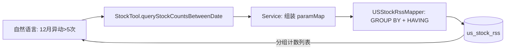

## 【学习目标】

读完本节，你应该能够：

1. 识别「单表查询」与「分组统计」的边界：当查询涉及 GROUP BY + HAVING 时，MyBatis Plus 的 `selectList` 已经不够用，必须写自定义 XML SQL。
2. 手写一条带 `resultMap` 与 `GROUP BY ... HAVING` 的 Mapper XML，并用 `@Param` 把多参数正确传入 SQL。
3. 通过 MCP 工具用自然语言驱动一次「某时段异动次数超阈值」的真实查询。
4. 对照 `982-demo` 的 `RuleEngine` / `PriceVolatilityRule`，理解「次数阈值」与「涨跌幅阈值」背后是同一类规则判定思想。

## 【正文】

### 一、为什么要用自定义 SQL

这节课实现一个稍复杂的工具：**查询在某个时间段内，哪些股票的出现次数超过了指定的目标次数**。前一个工具都较基础，真正有意思的是这类「分析类」查询，比如在钉钉系统里 24 小时不间断记录股票异动次数、一周七天从不间断；想看一个月的异动情况，数据量会非常大。用自然语言直接问「这段时间内哪些股票出现多次、超过规定目标次数」，把筛选交给工具自动完成，比在钉钉里手动翻方便得多。

具体说：需指定一个时间段（开始日期、结束日期）和一个目标次数。例如「某只股票这段时间异动发生 10 次」，工具就把满足条件的股票查出来。

此查询不再是简单单表 `select`，而是涉及**分组（GROUP BY）、过滤（HAVING）和多条件**，MyBatis-Plus 自带 API 已经不够用。所以打开 `USStockRssMapper.xml`，手写一条自定义 SQL，效率也更高。

### 二、第一步：定义结果实体 StockCounts

新建实体类 `StockCounts`，承载「股票代码 + 出现次数」这一对结果。注意它不是数据库表，无需加表映射注解，字段如下：

- `stockCode`：`String`，表示哪只股票；
- `occurCounts`：`int`，表示统计出的出现次数。

（次数也可定义为 `Integer`，均可。）

### 三、第二步：编写 Mapper XML

Mapper 文件里写好 `resultMap` 与对应 `select`。关键点：入参用 `parameterType="map"`，通过 `paramMap` 把 `targetCounts`、`startDate`、`endDate` 传人；`WHERE` 用 `pub_date_bj`（北京时间）在起止时间间做范围过滤；`GROUP BY stock_code` 按股票分组统计；`HAVING occurCounts >= #{paramMap.targetCounts}` 只保留次数达目标值的股票；`ORDER BY occurCounts DESC` 按次数倒序。

```xml
<resultMap id="BaseResultMap" type="com.itzixi.entity.StockCounts">
    <id column="id" property="id" />
    <result column="stock_code" property="stockCode" />
    <result column="title" property="title" />
    <result column="link" property="link" />
    <result column="pub_date_gmt" property="pubDateGmt" />
    <result column="pub_date_bj" property="pubDateBj" />
    <result column="tags" property="tags" />
</resultMap>

<select id="queryStockCountsBetweenDate" parameterType="map" resultMap="com.itzixi.entity.StockCounts">
    SELECT
        stock_code AS stockCode,
        COUNT(*) AS occurCounts
    FROM
        us_stock_rss
    WHERE
        pub_date_bj <= #{paramMap.endDate} AND pub_date_bj >= #{paramMap.startDate}
    GROUP BY
        stock_code
    HAVING
        occurCounts >= #{paramMap.targetCounts}
    ORDER BY
        occurCounts
    DESC
</select>
```

**为什么用 `parameterType="map"` 而非多个 `@Param`**：多参数 + 自定义 SQL 时，XML 里用 `#{paramMap.xxx}` 引用 map 中的键。好处是 SQL 与 Java 侧通过一张 map 解耦，新增筛选条件只改 map 的 key 与 SQL，不动方法签名。代价是编译期不校验 key 拼写，写错会运行时报 `Parameter 'xxx' not found`。也可用 `@Param` 逐个声明（见下一步接口），获得编译期检查。

> 工程提示：`SELECT` 只返回 `stock_code` 与 `COUNT(*)`，但 `resultMap` 映射了 `title` / `link` / `pub_date_gmt` 等列，这些列在结果集中不存在，MyBatis 会把它们填为 `null`。生产里 `resultMap` 应只映射实际返回的列，避免过度映射带来误导；此处保留原写法以对应课程工程。

**为什么 `HAVING` 而非 `WHERE` 过滤次数**：`WHERE` 在分组前过滤行，`HAVING` 在 `GROUP BY` 之后过滤分组结果。`occurCounts` 是 `COUNT(*)` 的别名，属于聚合后的产物，只能出现在 `HAVING` 中。这是 SQL 语义硬约束，写错位置会直接报语法错。

### 四、第三步：Mapper 接口方法

写好 XML 后，对应接口方法必须与 `id` 同名，并用 `@Param` 显式标注参数名，XML 里的 `#{paramMap.xxx}` 才能正确取值。

```java
public interface USStockRssMapper extends BaseMapper<USStockRss> {
    List<StockCounts> queryStockCountsBetweenDate(@Param("targetCounts") Integer targetCounts,
                                                  @Param("startDate") String startDate,
                                                  @Param("endDate") String endDate);
}
```

> 小提示：接口方法名和 XML 的 `id` 不一致，或 `@Param` 名字和 SQL 的 `#{}` 对不上，IDEA 会报红（如「result type 无法匹配」），方法名旁也不会出现可跳转的绿色箭头。保证两边命名一致，红波浪线消失即映射成功。

### 五、第四步：Service 实现

Service 层构造一个 `Map`（即 `paramMap`），把 `targetCounts`、`startDate`、`endDate` 三个参数放进去，再调用 Mapper。**特别注意**：Map 里的 key 必须和 SQL 中 `#{}` 引用的名字完全一致（即 `targetCounts`、`startDate`、`endDate`），否则查不出来或报错。

```java
@Override
public List<StockCounts> queryStockCountsBetweenDate(Integer targetCounts, String startDate, String endDate) {
    log.info("查询某日期段内的哪些股票出现的次数超过指定的目标次数");
    log.info("targetCounts: {}", targetCounts);
    log.info("startDate: {}", startDate);
    log.info("endDate: {}", endDate);
    return stockService.queryStockCountsBetweenDate(targetCounts, startDate, endDate);
}
```

> 工程对照（分层职责）：若该方法处在 `ServiceImpl` 中，真正应调用的是注入的 `usStockRssMapper.queryStockCountsBetweenDate(...)`，而非再调一层 `stockService`（否则形成自调用，Spring 的事务 / 缓存注解会因代理失效而不生效）。原片段里「再调 stockService」是分层描述的笔误，落地时改成本类持有的 Mapper 引用即可。

### 六、第五步：用 MCP 工具实测

重启服务后，在 Cursor 里调用该工具验证。查询 **2025 年 12 月 1 日到月底、异动次数超过 5 次** 的股票。

- 首次调用若遇「model 的 provider 功能无法实现」之类报错，多半是大模型侧问题（课程用的免费版模型），重新发起查询即可；
- 优化自然语言描述，如「查询在 2025 年 12 月 1 日至 12 月 26 日期间，出现次数超过 5 次的股票」，即可正常返回；
- 返回共 3 只股票，全部超过 5 次：两只各 5 次，一只 13 次（正是前面提到的 SMX 那批数据）。

拿到 JSON 结果后，模型会先做一轮优化整理再输出。偶尔结果有小瑕疵，多半是免费模型波动，数据本身已查出、可用。建议换付费大模型试试。



> 工程对照：`982-demo` 的 `RuleEngine` 聚合 `PriceVolatilityRule` / `VolumeSpikeRule` 等多个 `RiskRule`，对每个 tick 求并集告警，与本节「按阈值筛选」是同一思想：阈值（这里 `targetCounts`，demo 里 `risk.rules.price-change-threshold`）把连续数据切成「命中 / 未命中」两类。`982-demo/src/main/java/com/riskbot/engine/RuleEngine.java` 用 `List<RiskRule>` 注入所有规则，可插拔扩展，正是分组统计在生产里的「规则化」形态。

## 【易错点 / 面试题】

1. **面试题：WHERE 和 HAVING 的区别？**
   答：`WHERE` 过滤分组前的行，`HAVING` 过滤 `GROUP BY` 后的分组；聚合函数（如 `COUNT(*)`）只能出现在 `HAVING`。把 `occurCounts >= ?` 写进 `WHERE` 会直接语法报错。

2. **易错点：`@Param` 名字与 `#{paramMap.xxx}` 不一致。**
   XML 用 `#{paramMap.targetCounts}` 引用 map 键，接口用 `@Param("targetCounts")`，两边字符串必须一致；否则运行期 `ParameterNotFoundException`。IDEA 的绿色箭头消失就是映射未对齐的信号。

3. **易错点：Service 实现里自调用 `stockService`。**
   `ServiceImpl` 中再调 `stockService` 会绕过代理，事务 / 缓存注解失效。正确做法是调用本类注入的 `usStockRssMapper`。

4. **面试题：为什么这类统计不用 MyBatis Plus 的 `selectList` + Java 端计数？**
   答：先把全表数据拉到应用层再计数，既有传输开销又丢索引优势；数据库侧 `GROUP BY` + `HAVING` 借助索引一次完成，返回结果集极小，是正确做法。

## 【小结】

本节跨过了「单表查询」的边界，用自定义 XML 实现了 GROUP BY + HAVING 的分组统计，核心是 map 传参与 `@Param` 命名对齐。它和 `982-demo` 的 `RuleEngine`（阈值把连续数据切成命中 / 未命中）共享「阈值筛选」思想。下一节（10-4）实现最后一个查询工具，关键字检索，会引入 `List<String>` 入参与动态 `OR` 拼接，把「精确匹配」升级为「模糊语义检索」。
