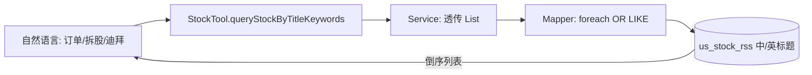

## 【学习目标】

读完本节，你应该能够：

1. 实现第四个也是最后一个查询工具：按标题关键字（支持单个或多个）检索股票信息，理解 `List<String>` 入参与动态 `OR` 拼接。
2. 处理中英文标题双源：同一组关键字在中文版、英文版标题上都要匹配。
3. 区分「真实要写的关键字查询」与「对照用的已有 XML 片段」，避免把片段误当成品。
4. 对照 `982-demo` 的 `@Tool` 工具集，理解四个查询工具构成「自然语言驱动分析」的工具箱。

## 【正文】

### 一、为什么要做关键字检索

这节课实现第四个、也是最后一个查询工具：**根据标题中的关键字来查询股票信息数据**。库里存了大量股票标题，既有中文也有英文（默认没开中文显示，可自己去试，会有不少收获）。若关心「订单（order）」这类消息，一条条翻历史记录太费精力，直接用关键字工具一查效率高得多。

关键字与行情走势强相关：比如「订单」「投资」「迪拜」这类词，分析到位相关股票可能涨一波；而「合股」「反向拆股」往往对应下跌趋势。故此该工具对分析很有帮助。

### 二、工具方法设计

复制上一个工具的方法，改名为 `queryStockByTitleKeywords`，入参是一个或多个关键字，用 `List<String>` 接收（可单可组）。返回 `USStockRss` 列表，而非 `StockCounts`。

`StockTool.java` 里这一组查询工具的方法签名如下：

```java
public List<USStockRss> queryStocksBetweenDate(String stockCode, String startDate, String endDate);
public List<StockCounts> queryStockCountsBetweenDate(Integer targetCounts, String startDate, String endDate);
public List<USStockRss> queryStockByTitleKeywords(List<String> titleKeywords);
```

`queryStockByTitleKeywords` 内部直接调 `stockService.queryStockByTitleKeywords(...)`，并通过 MCP 工具对外暴露。

**为什么用 `List<String>` 而非 `String`**：用户一句「查订单、拆股、迪拜」往往包含多个语义意图，模型天然会把它们整理成数组传参。`List<String>` 让一次调用覆盖多关键字，避免为每组关键字发一次工具调用。`@Tool` 的 `description` 应写明「关键字列表」，引导模型用数组而非拼接字符串传入。

### 三、Mapper：中英文标题都要查

标题有中文版也有英文版，两个条件都要拼上。实现思路：

- 用 `List<String>` 接收传进来的 `keywords`；
- Mapper 里用 `for-each` 循环遍历关键字，拼出 `OR` 连接的条件（满足其一即可）；
- 通过 `Map`（key 为 `titleKeywords`）传参；
- 结果按北京时间（`pub_date_bj`）倒序，最新在前。

Service 层无额外参数，直接 `return` 调 Mapper、把 `keywords` 传进去，比上一个工具还简单。

下面是 `USStockRssMapper.xml` 中相关的查询片段示例（**注意这是一段已有的对照片段，真实关键字查询要用 `for-each` 动态 `OR` 拼接，不要直接照搬**）：

```xml
<select id="queryStockCountsBetweenDate" parameterType="map" resultType="com.itzixi.entity.USStockRss">
    SELECT stock_code AS stockCode, COUNT(*) AS occurCounts
    FROM us_stock_rss
    WHERE pub_date_b >= #{paramMap.startDate} AND pub_date_b <= #{paramMap.endDate}
    GROUP BY stock_code
</select>
```

> 提示：上面给出的是 Mapper 文件中一段已有的查询片段，供对照 XML 写法。真正的 `queryStockByTitleKeywords` 应是 `SELECT ... FROM us_stock_rss WHERE (title LIKE ... OR title_en LIKE ...) ORDER BY pub_date_bj DESC` 形态，用 `<foreach>` 把 `keywords` 拼成多个 `LIKE '%kw%' OR` 条件。片段里的 `pub_date_b` 列名、分组语义都和「关键字检索」无关，仅用于演示 XML 结构。

**为什么要动态 `OR` 而非固定几条**：关键字数量由用户决定，写死 3 个 `OR` 会限制灵活性且多传少传都错位。`<foreach collection="titleKeywords" item="kw" open="(" close=")" separator=" OR ">` 动态生成 `(title LIKE %kw1% OR title LIKE %kw2% ...)`，既贴合任意长度，又避免 SQL 注入（参数走 `#{}`）。

### 四、用 MCP 工具实测

启动服务后，在 Cursor 里调用刚开发的 MCP 工具验证。

- 首次查「订单 / 拆股 / 合股经营 / 迪拜」几组关键字：模型分别发起 4 次查询，但没找到直接相关股票数据，说明当前这批数据量本身不多。直接去库里搜「订单」，确实能搜到（约七八到十二条），证明工具本身没问题，只是库里这类数据少。
- 演示中文例子：搜「基础设施」「生物仿制」，查到 2 条相关股票数据。

需留意：这是**美股**数据，正文绝大多数是英文，中文数据在另一个库，中文深入分析做不深。若分析 A 股或港股，可换国内模型效果更好；美股则可用 xgbt、gm、gbt 这类模型，让模型基于查到的数据再做一遍走势分析，对判断有用。地区不同，适用模型不同。



### 五、扩展：增删改同理

四个查询工具都做好了，都是「查询」类。若想练手，增删改逻辑也一样：

- **新增 / 修改**：用对象封装数据作入参；
- **删除**：按 `ID` 或股票代码操作；
- 工具描述改一改，同样能通过 MCP 工具调用。

增删改可当练习。

> 工程对照：`982-demo` 的 `RiskQueryAgent.queryRisk` 用 `@Tool(description="查询指定股票代码当前的风险评估结果...")` 把「查某票风险」暴露给 `ChatClient`；课程这 4 个 MCP 工具 + `queryRisk` 共同构成「自然语言驱动股票分析」的工具箱，前者查原始资讯，后者给风控结论。`982-demo/src/main/java/com/riskbot/agent/RiskQueryAgent.java` 与本节 `StockTool` 同享 `@Tool` 契约，差异只在运行载体（对话内 vs MCP）。

## 【易错点 / 面试题】

1. **易错点：把对照片段直接当成品 SQL 用。**
   片段是 `GROUP BY` + `pub_date_b` 的统计查询，和「关键字 `LIKE`「语义无关。真实实现必须用 `<foreach>` 拼 `OR LIKE` 条件。落地前先确认 `id` 与自己的方法名一致。

2. **面错点（应为易错点）：`<foreach>` 拼 `OR` 时忘记 `open/close` 括号。**
   多条件 `OR` 不加外层括号，若和其他 `AND` 组合会因优先级出错。正确写法是 `<foreach open="(" close=")" separator=" OR ">`。

3. **面试题：为什么关键字匹配用 `LIKE '%kw%'` 而非等值 `=`？**
   答：标题是长文本，用户关键字是子串，只能模糊匹配；等值匹配要求整列等于关键字，几乎查不到。生产若量大，应上全文索引（`MATCH ... AGAINST`）替代 `LIKE` 提升性能。

4. **易错点：中英文标题只查一个。**
   美股库中文标题少、英文标题多，只查中文会漏掉主体数据。两个语言列都要 `OR` 上，否则召回率极低，像本节首次实测「找不到相关股票」很可能就是只命中了稀疏的中文列。

## 【小结】

本节完成第四个也是最后一个查询工具：关键字检索，核心是 `List<String>` 入参 + `<foreach>` 动态 `OR LIKE`，并强调「对照片段 ≠ 成品 SQL」的落地纪律。至此 10-1 ~ 10-4 四节构成完整的股票查询工具集（按代码 / 按时间 / 按次数阈值 / 按关键字），它们都通过 `@Tool` 暴露，与 `982-demo` 的 `RiskQueryAgent` 共享工具契约。下一节（11-1）离开工具编写，转向用 Cherry Studio 这类客户端把这些 MCP 工具真正接起来调用。
