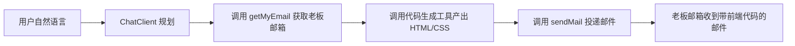

## 【学习目标】

读完本节，应当能够独立完成以下四件事：

1. 在 ChatBox 中完成大模型配置，并验证其代码生成能力（Java / HTML）。
2. 将自研的 MCP 服务（基于 SSE / HTTP 流式传输，本地端点 `http://localhost:7070/v1`）接入 ChatBox 并拉取到工具列表。
3. 走通一条「自然语言指令 → 多工具分步调用 → 邮件推送」的完整链路，理解 Agent 如何把一句话拆成取数、生成、投递三步。
4. 说清聊天模型与编码模型在 MCP 调用上的差异，以及在邮件内容过长时为何优先切到编码模型。

---

## 【正文】

### 1. ChatBox 与 Cherry Studio 的定位差异

ChatBox（Chatbox AI）是一类桌面端 AI 对话客户端，与上一节讲过的 Cherry Studio 属于同一类产品：都扮演「大模型的前端外壳」，负责把用户的自然语言、配置好的 API Key、以及接入的工具，统一封装成一个可对话的界面。

两者在工程上的取舍不同。Cherry Studio 的功能迭代更早、面板更全，内置的角色市场与多模型切换做得更细；ChatBox 则走轻量路线，安装后默认就是一个聊天框，但同样预置了若干常用助手（小红书文案生成器、旅游助手等），相当于开箱即带几个现成角色。选型上并无绝对优劣，关键是看哪一款的 MCP 接入流程更顺手、与本地工作流契合度更高。

> 工程视角：这类客户端本质上是 MCP 的「宿主（Host）」。它们负责实现 MCP 协议中的客户端一侧，发现工具、把工具描述拼进系统提示词、在模型决定调用时发起实际请求、再把返回结果喂回模型。理解这一点后，无论换成 Cherry Studio、ChatBox 还是下文要部署的 Dify，接入逻辑都是同一套。

### 2. 安装与初始界面

从官网下载安装包，启动后桌面会出现一个聊天框图标（Chatbox AI）。首次打开界面为空，但「设置 → 助手」里已经预置了若干角色模板，可直接新建对话复用，也可以完全自建。

### 3. 配置大模型（以 DeepSeek 为例）

先进入设置界面，把底层模型配好。这里以 DeepSeek 为例，它实际对外暴露三个模型：

| 模型 | 用途 | 是否与 MCP 兼容 |
|---|---|---|
| 聊天模型（Chat） | 通用对话、文本生成 | 兼容，但生成长代码易触发下游长度限制 |
| 编码模型（DeepSeek-Coder） | 代码生成、工程任务 | 原生友好，长代码场景更稳 |
| 深度思考模型（Reasoner） | 展示完整推理链 | 兼容，思考过程耗时较长 |

先验证聊天模型：发一句「你是谁」测试连通性，确认请求正常、工具调用通道可用。需要注意一个事实，ChatBox 这里的模型**不支持图片 / 音频输入**，因为它不是多模态客户端，这不影响文本与代码任务，属于可接受的范围。

配置完成后，可切到本地跑着的 Ollama 模型对比一下响应质量；在线 DeepSeek 聊天模型返回更完整，生产环境直接用在线模型即可。

### 4. 顺手验证代码生成能力

在正式接入 MCP 之前，先用两个小例子确认 ChatBox 的代码生成没问题。这两个例子仅用于验证客户端能力，与后面的 MCP 任务无关，但保留下来作为基线对照。

99 乘法表（Java）：

```java
public class MultiplicationTable {
    public static void main(String[] args) {
        for (int i = 1; i <= 9; i++) {
            for (int j = 1; j <= i; j++) {
                System.out.print(i + " * " + j + " = " + i * j + " ");
            }
            System.out.println();
        }
    }
}
```

一个 HTML 页面骨架：

```html
<!DOCTYPE html>
<html lang="zh-CN">
<head>
    <meta charset="UTF-8">
    <meta name="viewport" content="width=device-width, initial-scale=1.0">
    <title>日落主题</title>
</head>
<body>
    <!-- 页面内容 -->
</body>
</html>
```

### 5. 配置 MCP 服务器

回到「设置」，找到 MCP 配置入口，选择「自定义 / 自建服务器」。这里只出现两种拓扑：**远程（Remote）**与**本地（Local）**，本质对应 MCP 的两类传输方式：

- **stdio**：以子进程方式拉起本地服务，宿主机内通信，适合本机工具。
- **SSE / Streamable HTTP**：通过 HTTP 长连接流式推送，适合「服务单独跑在一个端口、客户端远程连」的部署。

本项目把自研 MCP 服务跑在本地 7070 端口，因此类型选 **text**（即 HTTP 流式传输，对应 SSE 那一套），URL 填之前在 Cherry Studio 用过的地址，例如 `http://localhost:7070/v1`，可直接从 Cherry Studio 复制过来。

操作流程：先点「测试」，确认工具列表能被拉取；再点「保存」，服务器正式接入。回到聊天框，把对应 MCP 的开关打开，工具即可在对话中被调用。

> 为什么类型选 text 而不是别的？MCP 在 2024–2025 年的主流实现里，远程传输就是 SSE（Server-Sent Events）或其后继的 Streamable HTTP。ChatBox 用「text」来概括这一类基于文本的流式 HTTP 传输，与本地 stdio 子进程相对。理解传输层，才能在后面换端口、换协议时不慌。

### 6. 用 MCP 跑一个完整任务

发出一句自然语言，例如：

> 「生成一份一日游攻略（用前端 HTML/CSS 实现），并发送给我老板的邮箱」

或：

> 「现在几点了，发给我老板」

模型会沿下面这条链路分步调用 MCP 工具（可用 mermaid 表示）：



实际执行的步骤是：

1. 先用 MCP 获取老板的电子邮件地址；
2. 再生成包含 HTML/CSS 的前端代码；
3. 最后把这段代码通过邮件工具发出去。

第一次尝试时，由于生成的代码量过大，触发了邮件服务对**文字 / 字符数量**的限制，调用报错。把内容精简，或改用 **DeepSeek-Coder** 这类编码模型（它基本原生支持 MCP，无需特意切回聊天模式），即可顺利跑通。最终老板邮箱里确实收到了那封带前端代码的邮件。

> 工程深化：上面这套「自然语言 → 工具编排」的机制，在 Spring AI 侧就是 `ChatClient` 配合 `ToolCallingAdvisor` 在 Advisor 链上驱动工具循环。自研 MCP 工具在 Java 端用 `@Tool` 注解暴露方法能力，ChatBox 作为 Host 把它们注册成可被模型调用的工具；模型每轮输出一个 `tool_call`，Host 执行后把结果回填，循环直到模型认为任务完成。本课程生产工程 `982-demo` 中的 `RiskQueryAgent`（`src/main/java/com/riskbot/agent/RiskQueryAgent.java`）正是同一套 `ChatClient` + `@Tool` 模式，只不过它暴露的是「查某票风险」而非发邮件，本质一致：模型决定调哪些工具、按什么顺序调，Host / Advisor 负责执行与回填。

### 7. 关键差异：聊天模型 vs 编码模型

这一节反复提到「切到编码模型更稳」，原因在于两类模型的训练分布不同：

- 聊天模型为了通用性，输出长代码时更容易在格式、长度、转义上出错，且在下游（邮件正文、IDE）有字符上限时被截断的风险更高。
- 编码模型在代码语料上训练更充分，对长代码块、特殊字符的处理更鲁棒，对接 MCP 这类「产出要被二次消费」的场景更可靠。

因此经验法则：**凡是 MCP 调用的产物还要被邮件 / 文件 / 另一段程序消费，优先用编码模型**。

---

## 【易错点 / 面试题】

1. **问：ChatBox 接入 MCP 时，为什么「类型」选 text？**
   答：本项目 MCP 服务以远程 HTTP 流式方式暴露（SSE / Streamable HTTP），「text」即对应这种基于文本的流式传输，与本地 stdio 子进程相对。选错类型会导致 Host 用错误的协议握手，拉不到工具列表。

2. **问：邮件推送时报「字符数量超限」，根因是什么？怎么解？**
   答：邮件服务对单封邮件正文字符数有上限，模型一次生成的完整 HTML/CSS 超过该上限即报错。解法有二：精简生成内容，或改用编码模型降低格式损耗；生产里更彻底的做法是分片发送（参见 12-1 Telegram 群发的分段思路，逻辑相通）。

3. **问：MCP 工具的「调用」在 Spring AI 里由谁驱动？**
   答：2.0 起由 Advisor 链上的 `ToolCallingAdvisor` 统一驱动工具循环，模型产出 `tool_call`，Advisor 执行 `@Tool` 方法并回填结果，循环至模型结束。宿主客户端（ChatBox / Dify / 自研 Agent）只是把这套循环跑在自己的会话里。

4. **问：为什么同一套 MCP 工具既能接 ChatBox，又能接 Dify？**
   答：MCP 是协议层标准，工具的服务端实现与客户端 Host 解耦。只要 Host 实现了 MCP 客户端（发现、调用、回填），同一份服务端可以被任意 Host 接入。

---

## 【小结】

本节把自研 MCP 服务从 Cherry Studio 延伸到了 ChatBox，并走通了「自然语言 → 取邮箱 → 生成代码 → 邮件投递」的自动化链路。核心收获有两点：一是理解 MCP 的传输层（stdio / SSE / Streamable HTTP）决定了 Host 侧的接入类型；二是建立「编码模型更适合被二次消费的工具产物」这一工程直觉。

往上下游看，ChatBox / Cherry Studio 这类桌面客户端还只是「个人级 Host」。下一节开始进入**私有化部署 Dify**，把 MCP 工具接进可编排、可多人协作的工作流平台，工程化更进一步。而无论 Host 怎么换，真正落地的异动判定与告警闭环，在本课程生产工程 `982-demo` 中由 `engine/RuleEngine`（`PriceVolatilityRule` / `VolumeSpikeRule`）与 `service/RiskEvaluationService` 承载，`provider/MockQuoteProvider` 提供离线样本行情，MCP 工具与 `982-demo` 共用同一份行情语义，只是前者对外暴露、后者对内决策。
