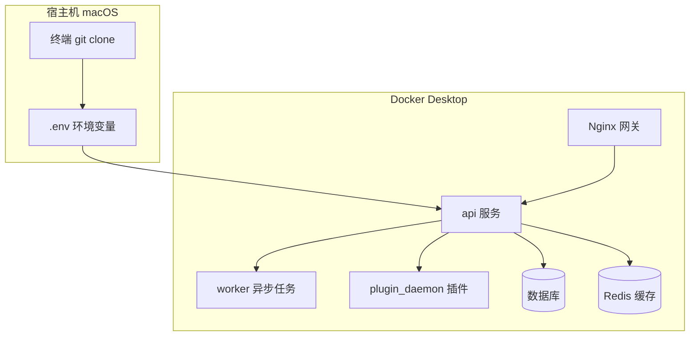

## 【学习目标】

读完本节，应当能够独立完成以下事项：

1. 说清 Dify 的核心能力构成，以及它为何适合作为 MCP 工作流的编排宿主。
2. 在 macOS 上准备好网络、Docker、Git 三项前置依赖，并解释每项为何不可或缺。
3. 通过 Git Clone 源码 + `docker compose up -d` 的完整路径，把 Dify 在本地跑起来。
4. 完成首次管理员账户初始化，进入空白工作台，并为后续接入模型供应商做好准备。

---

## 【正文】

### 1. Dify 是什么

Dify 是一个开源的生成式 AI 应用开发框架（GitHub 上已积累 8 万余 star，版本迭代频繁）。它把构建 AI 应用所需的若干能力收敛到同一个控制台里，官方列出的核心模块包括：

| 能力 | 解决什么问题 | 与本项目的关系 |
|---|---|---|
| RAG 知识库 | 把私有数据安全地接入模型，本质是带检索的知识底座 | 后续可挂股票术语库 |
| Prompt IDE | 可视化配置、生成、优化提示词 | 工作流节点里的提示词在此编排 |
| 企业级 LLMOps | 开发者可观察模型完整推理链路，逐环节留日志 | 排障时看每一步输入输出 |
| Backend-as-API | 把应用封装成后端 API 对外服务 | 可被风控服务或其他系统调用 |
| LLM Agent | 高可靠、可定制的智能体，自主调用工具完成复杂任务 | 与 MCP 工具直接对接的形态 |
| Workflow（工作流） | 编排 AI 流程，让输出更可控、更稳定 | 接自研 MCP 工具的主战场 |

剥开封装，Dify 真正的核心只有两块：**大模型智能体**与**工作流**，两者都支持高度定制。它走的是低代码路线，不写代码能搭，写少量代码也完全可行，所以既能让非工程同学快速出原型，也能让开发同学深入改节点逻辑。

> 工程视角：Dify 在本课程里的角色是「外部编排引擎」。我们自研的 MCP 服务（行情查询、邮件推送等）对 Dify 而言就是一组可被工作流 / Agent 消费的工具；Dify 负责把「用户输入 → 调工具 → 加工 → 回复」这条链路可视化、可复用。这与我们在 `982-demo` 里用 `ChatClient` + `@Tool` 自建 Agent 是同一目标的两套实现：一套用 Java 代码编排，一套用 Dify 的低代码画布编排。

### 2. 三个安装前提

部署 Dify 之前，有三项依赖必须就位，缺一项都会卡在后面某一步：

**① 网络必须通畅。** 做 AI 相关工程，网络是第一步要解决的。拉取镜像、下载组件都依赖外网访问能力，确保代理（TUN / 全局代理）处于可用状态，能顺畅访问 GitHub 与容器镜像源。

**② 安装 Docker。** Dify 是基于 Docker 构建的，官方提供的就是 Docker Compose 方案。无论 macOS 还是 Windows，去 Docker 官网下载 Docker Desktop 装上即可。它是容器管理的基础运行时。

**③ 安装 Git。** Git 负责把 Dify 源码同步到本地（`git clone`）。Dify 是开源项目，可本地部署，也可部署到服务器，Git 是获取源码的唯一入口。

### 3. 为什么倾向本地部署

Dify 既能本地部署，也能上服务器。更推荐本地，原因有三：

- 本地本身就能为企业提供完整解决方案，开发调试闭环最短；
- 外网环境引入额外的安全与合规负担，私有数据不出内网更稳妥；
- 本地部署灵活度最高，未来让智能体直接操作本机、调用内网服务时，本地优势凸显。

### 4. 安装步骤

官方文档提供「快速入门指南」与「Deploy with Docker Compose」两条路径，本教程以文档为准。

**硬件要求**：双核 CPU + 4GB 内存。当前主流电脑基本都满足。

**系统要求**：

| 系统 | 要求 |
|---|---|
| macOS | 10.14 或更高版本，加 Docker Desktop |
| Windows | Docker Desktop，并开启 WSL 2（个别环境装时可能报错，查对应异常基本可解） |
| Linux | 本节不展开 |

**第一步：Git Clone 源码**

复制官方 clone 命令，在终端执行。强烈建议把代码放在**纯英文、无空格、无中文**的路径下（例如 `~/AI/dify`），避免后续出现各种字符编码类诡异问题。

```bash
git clone https://github.com/langgenius/dify.git
```

若报「无法连接」之类的网络错误，多半是代理未就绪，确认 TUN / 全局代理已开启再重试。下载完成后，该目录即全部源代码。

**第二步：进入 docker 目录，准备环境文件**

Dify 的部署配置都集中在 `docker` 目录。进入后，把 `.env.example` 复制一份并重命名为 `.env`：

```bash
cd docker
cp .env.example .env
```

`.env` 是隐藏文件，内部是环境变量参数（端口、密钥、数据库配置等）。复制完成后，即可用 Docker Compose 加载它。

**第三步：启动服务**

执行下面命令拉起所有服务（注意这是 Compose v2 语法；老版本命令是 `docker-compose`，写法略有不同）：

```bash
docker compose up -d
```

这一步同样要求网络通畅，Docker 要从外网拉取多个组件镜像。包含的服务有：api、worker、plugin_daemon、数据库、Nginx、Redis 缓存等，单个镜像往往几百 MB 起，流量消耗不小。耐心等待容器陆续被创建、启动，即说明成功。

启动后，可用 `docker compose ps` 命令，或在 Docker Desktop 里直接查看容器状态，确认都正常运行。这些偏底层组件，若不熟悉编程可先不深究，知道它们是 Dify 的内部依赖即可。



### 5. 访问与初始配置

服务启动后，会在内网暴露访问地址。可用本机内网 IP（macOS 上 `ifconfig` 查，形如 `10.x.x.x`）访问，也可直接访问 `localhost`，两者等价。

浏览器打开 Dify 默认地址（例如 `http://localhost:3000`），首次会要求设置**管理员账户**：填好邮箱、用户名、密码，点「设置」即完成。进入后是空白工作台，说明本地 Dify 引擎已成功搭建。

之后若要接模型，在「设置 → 模型供应商」里配置即可（模型供应商本质是插件，后续章节专门讲）。

### 6. 下节课预告

下一节改用 **Windows 11** 完整走一遍部署。macOS 上装的是最新版；Windows 一侧会用**老版本分支**的方式操作，该版本自带部分大模型插件，可直接用。若想指定版本，clone 时通过分支符号选旧分支安装亦完全可行。

---

## 【易错点 / 面试题】

1. **问：为什么 Dify 必须用 Docker 部署，而不是直接跑二进制？**
   答：Dify 由多个独立服务（api / worker / plugin_daemon / db / redis / nginx）组成，彼此有依赖与端口约定。Docker Compose 把这些依赖、环境变量、网络拓扑一次性声明式拉起，避免手动配环境的不可逆错误，也保证团队成员环境一致。

2. **问：clone 时为什么强调纯英文、无空格路径？**
   答：Docker 与部分脚本对含中文 / 空格的路径处理存在编码与转义隐患（例如 shell 变量展开、挂载路径解析），容易在 `docker compose` 阶段报找不到文件。纯英文路径是成本最低的规避手段。

3. **问：Dify 的 api 与 worker 分别负责什么？**
   答：api 处理同步请求（对话、工作流触发、管理台调用）；worker 处理异步任务（文档索引、长耗时批处理）。两者解耦，worker 可独立扩容，这也是 LLMOps 平台的标准拆分。

4. **问：本地部署相比云端，数据安全上有什么实质差异？**
   答：本地部署时私有数据（知识库、提示词、用户对话）不出内网，密钥与数据库都在自有环境；云端则需把数据托管给服务商，需额外评估合规。这也是本课程把 Dify 与 `982-demo` 都倾向本地 / 容器化部署的原因。

---

## 【小结】

本节完成了 Dify 在 macOS 的本地私有化部署：前置三项依赖（网络 / Docker / Git）→ clone 源码 → 复制 `.env` → `docker compose up -d` → 初始化管理员账户。要点是理解 Dify 的多服务架构与「低代码编排宿主」定位，它将成为自研 MCP 工具的外部工作流平台。

下一节用 Windows 11 复现同一流程，并重点处理一个跨平台共通的坑：Docker 容器内访问宿主机服务时的地址问题。而无论 Dify 怎么编排，真正落地的风控服务在本课程生产工程 `982-demo` 中以 `Dockerfile` + `docker-compose.yml` 同样提供一键容器化与 `Actuator` 健康检查，可与 Dify 部署在同一主机，形成「Dify 编排 MCP → 调用 982-demo 的 `RiskEvaluationService` 决策」的闭环。
