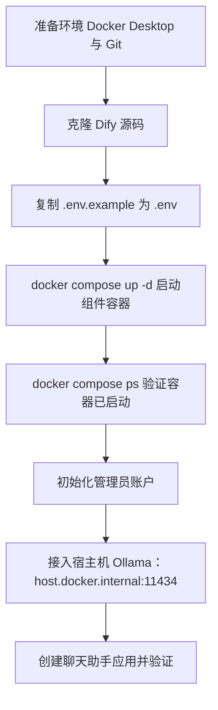

## 【学习目标】

读完本节，应当能够独立完成以下事项：

1. 在 Windows 11 上准备好 Docker Desktop 与 Git 两项必备环境，并验证其就绪。
2. 走完 clone 源码 → 复制 `.env` → `docker compose up -d` 的部署全流程。
3. 用 `docker compose ps` 验证所有容器已启动，并完成管理员账户初始化。
4. 解决一个 Windows / 容器场景的共性坑：Dify 容器内如何正确访问宿主机上运行的模型服务（如本地 Ollama）。

---

## 【正文】

### 1. 与 macOS 部署的一致性

本节用 **Windows 11** 在本地部署 Dify，整体思路与 macOS 完全一致，只是操作入口与个别命令略有差异。Dify 本身跨平台，差异只来自宿主机系统而非 Dify 自身。

### 2. 第一步：准备环境

部署前需要两个必备环境：

1. **Docker**：去官网下载 **Docker Desktop**，它是可视化的容器管理 UI。装好之后，建议先把本地之前跑着的其他容器先停掉、甚至删掉，避免和 Dify 的容器互相干扰（端口占用、网络冲突是常见来源）。
2. **Git**：同样去官网下载安装（Windows 上也可以用 `winget install --id Git.Git --source winget`）。装完后打开命令行，输入 `git -v`，能显示版本号就说明环境就绪。

无论 Windows 还是 macOS，这两个工具都支持。

### 3. 第二步：按官方文档部署

官方文档里的「Deploy with Docker Compose」即本节所用方法。它对电脑的基本要求：

- **CPU ≥ 2 核，内存 ≥ 4GB**；
- 系统层面：macOS 10.14+，Windows 需要 Docker Desktop（以及前文提过的 WSL 2）。

### 4. 第三步：克隆源码并准备配置

在本地新建一个文件夹（例如 `AI`），进入后直接在地址栏输入 `cmd` 打开命令行，执行克隆：

```bash
git clone https://github.com/langgenius/dify.git
```

看到 `done` 提示说明克隆成功。进入 `dify` 目录，再进 `docker` 子目录，里面是官方提供的示例文件 `.env.example`：

- 在 macOS 上它是隐藏文件，需开启「显示隐藏文件」才能看到；
- 在 Windows 上直接 `Ctrl+C` / `Ctrl+V` 复制一份，重命名为 `.env` 即可。

接下来用 Docker Compose 启动（注意使用 **v2** 版本，老版本命令是 `docker-compose`）：

```bash
docker compose up -d
```

这条命令会从远端拉取一堆组件容器：Nginx（Web 服务器）、Redis（缓存）、Sandbox（沙盒）、数据库等等。第一次会比较慢，耐心等全部拉取、安装完成。

### 5. 第四步：验证部署

按官方文档，用 `docker compose ps` 查看容器状态，看到一堆容器都已是「已启动」即没问题；也可直接在 Docker Desktop 的容器列表里刷新查看，里面包含 Dify 相关的数据库、Redis 等所有依赖容器。

### 6. 第五步：初始化与基础设置

浏览器访问 `localhost`（具体端口以你的配置为准，示例 compose 中映射的是 `7860`），第一次会让你设置管理员账户，填好邮箱、用户名、密码，登录后即进入 Dify 工作台。这里有聊天助手、Agent、工作流等模块，先不管，做基础设置：

- 在设置里把语言切换成**简体中文**；
- 在「模型供应商」里接入要用的大模型。

### 7. 第六步：接入本地 Ollama + DeepSeek（关键坑）

本地已部署 **Ollama**，其中跑了 **DeepSeek**。在 Dify 的模型供应商里添加 Ollama 模型（例如选 `deepseek-r1` 的 32B 版本），模型类型选默认的 LLM 即可。

这里有个**非常关键的点**：Dify 本身跑在 Docker 容器里，容器内部的 `localhost` 指的是「容器自己」，而非你的宿主机。所以基础 URL **不能**直接写 `localhost`，必须写成：

```
http://host.docker.internal:11434
```

`host.docker.internal` 代表 Docker 内部的宿主机地址，端口 `11434` 是 Ollama 的默认端口。填好后其余保持默认，点保存，即可看到本地 DeepSeek 模型配置成功。

> 工程深化：该坑的本质是**网络命名空间隔离**。Docker 容器有独立的回环地址（127.0.0.1 / localhost），与宿主机不是同一个。所有「容器想访问宿主机上服务」的场景都要用 `host.docker.internal`（macOS / Windows Docker Desktop 支持）或宿主机的真实内网 IP（Linux 常用）。下一节把自研 MCP 服务接入 Dify 工作流时，会遇到完全同构的问题，MCP 服务跑在宿主机 7070 端口，Dify 容器里必须填宿主机内网 IP 而非 localhost。记住这条规律，能省下大量排障时间。

整体部署链路如下：



### 8. 第七步：创建第一个应用并验证

在「聊天助手」里创建一个空白应用，选刚配好的 DeepSeek 模型，点创建。发布 / 运行后，可直接在调试预览窗口里和机器人聊天，例如问「你是谁」「如何做糖醋排骨才能美味可口」，能看到它**整个推理思考的过程**被展示出来，这正是推理大模型的妙用。

至此，Dify 已在本地成功部署，首个最简单的聊天机器人也构建完成。它既能内网访问，也能低成本部署到云服务器对外提供服务。

> 附：文档里给出的示例 `docker-compose.yml` 片段（含 dify / db / redis / ollama 服务及端口映射），供对照参考：

```yaml
version: '3.8'
services:
  dify:
    image: ghcr.io/difyai/dify:latest
    ports:
      - "7860:7860"
    environment:
      - DATABASE_URL=postgresql://dify:password@db:5432/dify
      - REDIS_URL=redis://redis:6379/0
      - OLLAMA_HOST=http://ollama:11434
    depends_on:
      - db
      - redis
    restart: unless-stopped
  db:
    image: postgres:15
    environment:
      - POSTGRES_DB=dify
      - POSTGRES_USER=dify
      - POSTGRES_PASSWORD=password
    volumes:
      - db_data:/var/lib/postgresql/data
    restart: unless-stopped
  redis:
    image: redis:7
    restart: unless-stopped
  ollama:
    image: ollama/ollama:latest
    ports:
      - "11434:11434"
    restart: unless-stopped
volumes:
  db_data:
```

---

## 【易错点 / 面试题】

1. **问：Dify 容器里填 `localhost:11434` 连不上 Ollama，根因是什么？**
   答：Docker 容器有独立网络命名空间，其 `localhost` 指向容器自身而非宿主机。Ollama 跑在宿主机，必须用 `host.docker.internal:11434`（Win / Mac）或宿主机内网 IP 访问。这是容器网络隔离的直接后果。

2. **问：`host.docker.internal` 与宿主机真实 IP 有何区别？**
   答：`host.docker.internal` 是 Docker Desktop 注入的 DNS 别名，自动解析到宿主机网关，迁移机器无需改配置；真实内网 IP（如 `10.x.x.x`）则硬编码，IP 变化即失效。Linux 下默认没有该别名，需用 `--add-host` 或真实 IP。

3. **问：Windows 部署为何强调开启 WSL 2？**
   答：Docker Desktop 在 Windows 上依赖 WSL 2 作为后端运行 Linux 容器，未开启则无法启动容器引擎。它是 Windows 跑 Docker 的底层前提。

4. **问：示例 compose 里 `ollama:11434` 与 `host.docker.internal:11434` 为何写法不同？**
   答：前者是 compose 网络内「另一容器」的服务名寻址（容器间用服务名互通）；后者是「容器访问宿主机」的特殊别名。两者属于不同网络平面，不能混用。

---

## 【小结】

本节在 Windows 11 上完整复现了 Dify 私有化部署，并重点拆解了跨平台共通的容器网络坑，`localhost` 在容器内指向自己而非宿主机，必须用 `host.docker.internal` 或内网 IP。这套认知直接迁移到下一节：把宿主机上的自研 MCP 服务（7070 端口）接进 Dify 时，同样要避开 `localhost` 陷阱。

部署形态上，Dify 用 `docker-compose.yml` 一键拉起多服务；本课程生产工程 `982-demo` 同样以 `Dockerfile`（eclipse-temurin:21-jre 分层 jar）+ `docker-compose.yml` 提供容器化与 `Actuator` 健康检查，二者可并存在同一主机，构成「Dify 编排 MCP 工具 → 调用 `982-demo` 的 `RiskEvaluationService` 完成异动决策」的本地闭环。
