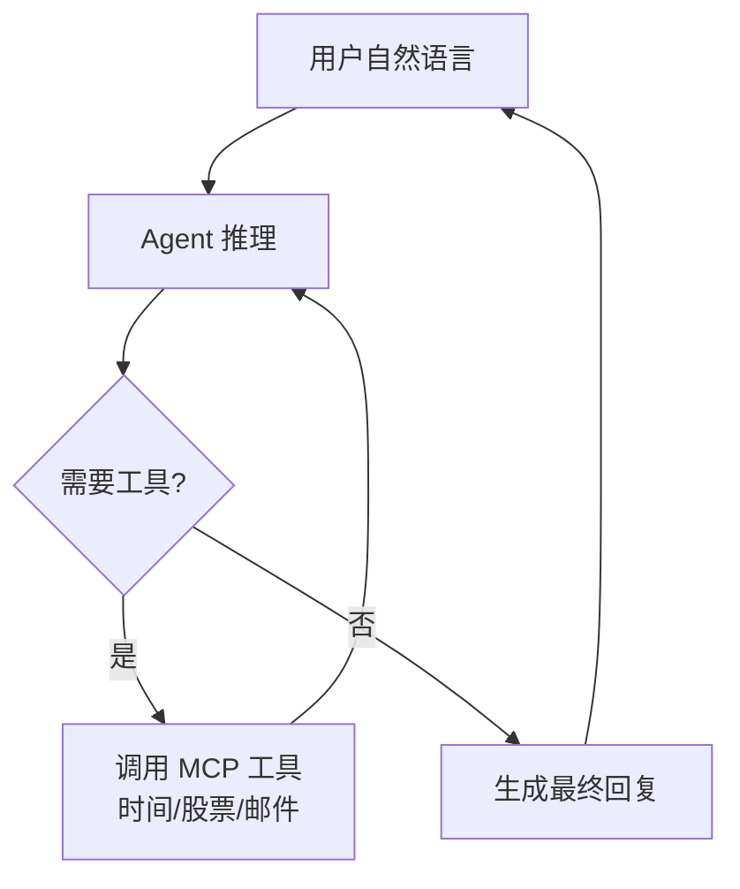

## 【学习目标】

读完本节，应当能够独立完成以下事项：

1. 在 Dify 中创建一个 Agent 应用，并配置系统提示词与 MCP 工具。
2. 走通「时间查询 / 股票查询汇总 / 查询并邮件推送」三类 Agent 自动调用链。
3. 说清 Agent 与 Chatflow（工作流）的本质区别，以及二者在企业里的分工。
4. 看懂自研发邮件 MCP 工具背后的 `@Tool` 暴露机制，并知道如何导出 DSL 复用。

---

## 【正文】

### 1. 另一种更「自动」的形态：Agent

上一节是在 Chatflow（对话流）里接 MCP 工具，需要人把节点一个个连起来。这一节看另一种更「自动」的形态：**智能体（Agent）**。MCP 工具不仅能放进对话流，也能直接装进 Agent 里，由模型自己决定何时调用。

### 2. 创建 Agent 应用

点「Agent」，创建一个空白应用，名称可起成「MCP 代理 / 股票机器人」，挑个头像，创建即可。进入应用后界面分左右两块：

- **右侧**：交互区，直接与机器人对话；
- **左侧**：设置区。

### 3. 配置 Agent

左侧设置主要有三块：

1. **系统提示词**：写一段系统 Prompt，例如「你是一个非常智能的 AI 助手，根据所提供的 MCP 工具进行合理的调用」。这与之前在大模型里写的提示词是同一类东西。
2. **变量**：可加可不加，本场景用不到，先不添。
3. **知识库**：同样不需要，留空即可。

接下来是重点，**工具**。点「添加」，把之前接入的所有 MCP 工具服务都加进来，直接点「添加全部」即可。这样 Agent 在对话过程中就能按需调用它们。

> 工程视角：Agent 之所以「自动」，是因为它底层仍是 ReAct（推理 + 行动）范式，模型每轮先思考「现在该调哪个工具」，输出 `tool_call`，Host 执行后把结果回填，模型再思考下一步，直到认为任务完成。这一循环在 Spring AI 里由 `ToolCallingAdvisor` 在 Advisor 链上统一驱动；工具本身用 `@Tool` 暴露。Dify 只是在自己的运行时里实现了同一套循环，并把 `@Tool` 换成它从 MCP 拉到的工具清单。

### 4. 测试：时间工具

先把模型换成一个规模较大的（例如 DeepSeek，之前报错的模型先换掉），然后问一句「现在几点了？」。Agent 会**自动调用**时间 MCP 工具，把当前时间显示出来（中间遇到时区相关的小问题，重新编排、再试一次即正常）。这说明工具确实已被接进来。

### 5. 测试：股票查询与汇总

再问「查询 SMX 股票的数据」，Agent 会通过标题关键词、股票代码等方式找到数据，并帮做一份汇总。可以看到，工具一旦添加进来，Agent 就会自动调用、自动执行，非常方便。

这里要理解 Agent 与工作流的本质区别：

- **工作流（Workflow）**按人为设定的编排意图运行，一步一步沿既定流向执行，这正是企业里真正实用、被广泛采用的方式；
- **Agent** 更像一个聊天助手，你给它工具和提示词，它自己决定调什么、按什么顺序调。

所以企业里常见做法是：把工作流封装成一个独立系统，再把工具放进 Agent，供最终用户（例如财务会计人员）直接使用。**Agent 面向用户，Chatflow 更偏开发者**，可以这样区分。



### 6. 测试：查询并邮件推送

再测一条完整链路：让 Agent「查询 smx 股票信息，整理完毕后再发送给我的老板」。Agent 会调用相应工具，整理出一份报告，再调用发邮件的工具把报告发出去。去邮箱一看，确实收到了「SMX股票信息分析报告」，全程自动完成。

被 Agent 调用到的发邮件工具，本质就是自己写的 MCP 工具：用 `@Tool` 注解暴露方法能力，内部按 `contentType` 决定正文格式：

```java
@Tool(description = "发送邮件的消息/正文内容")
private String content;
@Tool(description = "查询老板的邮件/邮箱地址")
public String getMyEmail() { return "fatherfilm@163.com"; }
public void sendMail(EmailInfo emailInfo) {
    Log.info("调用MCP工具: sendMail");
    Integer contentType = emailInfo.getContentType();
    MimeMessage mimeMessage = mailSender.createMimeMessage();
    MimeMessageHelper helper = new MimeMessageHelper(mimeMessage);
    helper.setFrom(from);
    helper.setTo(emailInfo.getTo());
    helper.setSubject(emailInfo.getSubject());
    if (contentType == 1) {
        helper.setText(ConvertToHtml(emailInfo.getContent()), true);
    } else if (contentType == 2) {
        helper.setText(emailInfo.getContent());
    }
}
```

`queryStockInfoByCode` 负责取数、`sendMail` 负责投递，Agent 自己决定调用顺序，这就构成了一条从查询到推送的自动化链路。

> 工程深化：这段 `@Tool` 代码正是 MCP 工具的 Java 侧实现，方法上的 `@Tool(description=...)` 会被框架扫描成工具元数据（名称、描述、参数 schema），供 Host（Dify / ChatBox / 自研 Agent）发现与调用。`contentType == 1` 走 HTML 富文本、`== 2` 走纯文本，是工具内部对「输出格式」的自主决策。在 `982-demo` 中，`agent/RiskQueryAgent` 用完全一致的 `ChatClient` + `@Tool` 模式暴露「查某票风险」能力，区别只在于 `982-demo` 不依赖外部 Host，而是用 `ToolCallingAdvisor` 在本地跑工具循环；工具「被谁驱动」不同，但「`@Tool` 暴露能力」这一层完全同源。

### 7. 保存与导出

配置满意后保存。Dify 支持把整个应用**导出为 DSL（一份 YAML 配置文件）**，将配置文件直接拖拽进来就能复用，非常方便。

---

## 【易错点 / 面试题】

1. **问：Agent 与 Chatflow 的本质区别？**
   答：Chatflow（工作流）的调用顺序由节点连线人为编排，确定、可复现，偏生产流水线；Agent 由模型在对话中自主决定调哪些工具、按什么顺序，偏开放助手。企业里常把工作流封装成系统、把工具放进 Agent 供终端用户使用。

2. **问：`@Tool` 注解的作用是什么？**
   答：它把普通 Java 方法标记成可被模型调用的工具，框架据此生成工具名称、描述与参数 schema，供 MCP Host 或 `ToolCallingAdvisor` 发现、调用与回填结果。描述是模型判断「何时调该工具」的关键依据。

3. **问：为什么时间工具首次调用会遇到时区问题？**
   答：MCP 时间工具返回的是带时区语义的时间，模型 / 工具默认时区若与用户预期不一致，就会显示偏差。重新编排（在提示词里明确时区要求）或校准工具时区配置即可。

4. **问：DSL 导出解决了什么工程问题？**
   答：把应用（提示词、节点、工具绑定）固化为可版本化、可迁移的 YAML，避免「配置在控制台里、换环境就丢」；可纳入 Git 管理，实现 Dify 应用的 IaC（基础设施即代码）。

---

## 【小结】

本节讲了 Dify 的第二种主流形态，**Agent**，它与 Chatflow 都能接 MCP 工具，但 Agent 把「调哪个工具、按什么顺序调」交给了模型自主决策。核心代码仍是自研的 `@Tool` 发邮件工具：`queryStockInfoByCode` 取数、`sendMail` 投递，Agent 串联成「查询 → 推送」自动化链路。

聊天助手、文本生成本质上也属于工作流的一种，思路相通。学好 Dify 对提升办公与自动化效率很有帮助。落到本课程生产工程，`982-demo` 的 `RiskQueryAgent`（`src/main/java/com/riskbot/agent/RiskQueryAgent.java`）用同一套 `ChatClient` + `@Tool` 暴露风控查询能力，而 `engine/RuleEngine`（`PriceVolatilityRule` / `VolumeSpikeRule`）与 `service/RiskEvaluationService` 负责真正的异动判定与告警，Dify Agent 是「面向用户的入口」，`982-demo` 是「背后的决策引擎」，二者通过 MCP 工具语义衔接。
