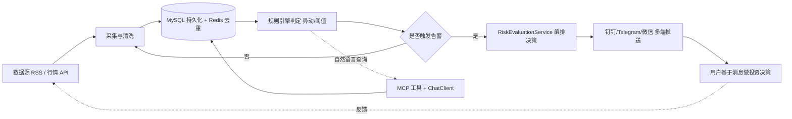

## 【学习目标】

学完本门课程并完成全部章节后，你应当能够独立做到以下四件事：

1. 用 Spring Boot 4 多 Maven 模块工程，从零搭出一个可持续运行的股票异动监测后端（数据采集 → 清洗 → 入库 → 推送）。
2. 用 Spring AI 把业务数据封装成可被自然语言调用的 MCP 工具，让任意兼容 MCP 的 AI 客户端（Cherry Studio、Dify、Cursor 等）直接查询数据。
3. 基于规则引擎与告警阈值，把「感知-决策-执行」的 Agent 闭环落地成生产可用的风控机器人。
4. 把这套「数据系统 + MCP 工具 + AI 决策 + 多终端输出」的架构，迁移到舆情监控、数据预警、企业内部助手等任意领域，并能在面试中讲清其中的取舍。

---

## 【正文】

### 一、我们到底交付了什么

从表面看，本课程似乎只是做了一个「股票机器人」，实时监测股票走势、再把消息推送到聊天群。但本质上，我们完成的是一件更重要的事：**构建了一套让人工智能直接参与业务执行过程的系统架构**。

这套系统由四个相互咬合的齿轮组成：

- **真实且持续的数据来源**：不是一次性爬虫脚本，而是一套能 7×24 小时持续运行、持续采集数据的服务；
- **数据清洗流程 + 业务规则 + 特殊算法**：原始 RSS 噪声很大，必须经过空值校验、时区换算、标签枚举映射、异动次数统计等处理才能变成可用数据；
- **可被 AI 调用的 MCP 工具**：把已结构化的业务数据，暴露成 AI 能用自然语言调用的能力；
- **真实用户与多终端触达**：钉钉、Telegram、微信（拓展）等渠道，让消息真正到达人，并感知推送结果。

因此它早已超出「演示版」范畴，是一个可用于练习工程能力、且具备可商用潜力的项目级结构。

以数据采集为例，真正支撑「持续运行、持续采集」的就是服务层这段代码。它从 RSS 源拉取数据、做空值校验，再逐条转换成可入库的对象，这是整条数据链路的起点：

```java
@Override
public void displayRss() throws Exception {
    List<USStockMsg> stockMsgList = new ArrayList<>();
    List<SynEntry> rssList = this.fetchRssReed(RSS_URL);
    // System.out.println(rssList);

    if (rssList == null || rssList.isEmpty()) {
        System.out.println("RSS 列表为空");
        return;
    }

    for (SynEntry entry : rssList) {
        USStockRss stockNews = new USStockRss();
        // 获得股票异动信息的标题
        String title = entry.getTitle();
        String titleEn = getStockTitle(title);
        stockNews.setTitle(titleEn);

        // 获得股票异动信息的链接地址
        // stockNews.setLink(entry.getLink());
    }
}
```

其中 `RssServiceImpl` 由 `@Service` 标识为 Spring 服务类，`@Resource` 负责注入 `DingTalkApi`、`TransApi` 等依赖，RSS 数据源则由常量 `public static final String RSS_URL = "https://www.stocktitan.net/rss";` 定义。这段代码之所以值得反复体会，是因为它浓缩了一整条数据链路的工程哲学：

- **空值检查保证了健壮性**：外部 RSS 源随时可能返回空列表、缺失字段、编码异常，任何一处不做防御就会让整条定时任务崩溃；
- **循环内的数据转换承载了业务逻辑**：`getStockTitle(title)` 这一步把原始英文标题抽取成标准结构，是后续清洗、翻译、统计能够成立的前提；
- **它只是起点而非终点**：`USStockRss` 对象还要经过入库、去重、翻译、统计、推送等多道工序。在工程化视角里，单点代码的意义永远在于它在整条流水线中的位置。

> **为什么这么写**：`@Service` + `@Resource` 是 Spring 最基础也最稳定的声明式注入方式。采集服务被 Spring 容器托管后，才能被 Spring Schedule 定时调度、被 AOP 统一织入日志与耗时统计。把「取数据」和「存数据」拆成不同层，是为了让采集逻辑可单测、可替换数据源（比如从 RSS 换成行情 API），而不影响下游。

### 二、一条企业级的 AI 落地路径

整门课的设计并非随意堆砌技术，而是严格参照真实公司会采用的方法论：

| 能力维度 | 本课程采用的方案 | 解决的工程问题 |
|---|---|---|
| 工程脚手架 | Spring Boot 4 + 多 Maven 模块 | 代码分层清晰、依赖隔离、可独立构建与测试 |
| 存储与检索 | MySQL 主存储 + Redis 辅助 | MySQL 负责持久化与复杂查询，Redis 负责分布式去重与热点缓存 |
| 定时任务 | Spring Schedule | 周期性自动抓取，无需人工触发 |
| 横切治理 | AOP 日志 + 耗时统计 | 系统级可观测，长期稳定运行可定位瓶颈 |
| 环境隔离 | Docker + 多环境配置 | 开发、测试、生产环境一致，避免「我本地能跑」 |
| 配置管理 | yml 多 profile 解耦 | 密钥与参数外部化，不同环境切换零代码改动 |

这些选择的本质，是帮你把 AI 项目真正落地。真正的工程能力体现在：当数据源抖动、当推送渠道限流、当数据库慢查询拖垮采集时，系统能否自愈或优雅降级。缺少工程能力，人工智能就只能停留在做 PPT、在对话框里聊天的层面。

把这套能力浓缩成一个可部署的工程，正是 `982-demo` 的价值。它通过 `RiskEvaluationService`（感知→决策编排）、`RuleEngine`（规则判定）、`MockQuoteProvider`（离线样本行情）把「监测-判定-告警」闭环跑通，`default` profile 下用 Mock 即可离线验证主链路，无需任何外部 Key。完整可部署示例见 `982-demo/src/main/java/com/riskbot/service/RiskEvaluationService.java`。

### 三、理解 Spring AI 与 AI + MCP 的价值

本课程反复强调的核心认知是：**Spring AI 与 AI + MCP 并非割裂的两块，也不是什么全新结构**。所谓 AI + MCP，就是让 AI 和 MCP 成为连接现实世界与虚拟世界的一座桥梁。

从 Spring AI 2.0.1 的视角看，这套桥梁由几个一等公民构成：

- **`ChatClient`** 作为统一对话抽象，屏蔽了 OpenAI、通义、DeepSeek 等后端差异；
- **`@Tool`** 把任意 Java 方法暴露成模型可调用的工具，模型通过结构化 JSON 参数触发你的业务代码；
- **`ToolCallingAdvisor`** 在 Advisor 链里统一驱动「思考-调工具-观察结果」的递归循环，不再由各个 ChatModel 各自实现；
- **MCP（`@McpTool` / `McpToolCallback`）** 把工具标准化为跨进程协议，让 AI 客户端能像插拔硬件一样接入你的能力。

MCP 工具本质上是人工智能可操控的「脚手架」：你用自然语言描述需求，模型解析意图、调用对应的 MCP 工具、再结合底层数据库，业务系统就能收到结果作为反馈。这样一来，我们就真正完成了整个流程，用自然语言查询股票数据、用 AI 推动数据分析、用 AI 触发业务逻辑的执行。

这意味着一件非常重要的事：**我们具备了「让 AI 调用你的系统」的能力**，而不只是简单地「使用人工智能技术」而已。这是从「人去适应工具」到「工具主动服务于业务」的范式转变。

### 四、一套可迁移的通用智能体模板

你掌握的并不是一套只能用于股票的代码，而是一套**可迁移的通用智能体模板**。虽然业务入口是股票异动，但在你手里，它的边界远不止于此。这套架构可以直接迁移到：

- **舆情监控 / 行业资讯聚合**：把 RSS 换成新闻源、社交媒体流，逻辑完全一致；
- **数据预警系统**：把「异动阈值」换成「库存阈值」「接口错误率阈值」「资金异动阈值」；
- **企业内部智能助手**：把股票数据换成 CRM、工单、财务数据，用 MCP 暴露给内部 AI 聊天系统；
- **自动化运营环节**：把群推送换成工单流转、审批通知、值班排班；
- **各类分析相关系统**：接入 Dify、N8N、Coze 等低代码工作流，做二次编排。

你真正掌握的，是「数据系统 + MCP 工具 + AI 决策 + 多终端输出」这套通用方法。这是一种长期具备价值的能力，无论底层模型如何迭代，把现实世界数据接入 AI、再让 AI 反驱业务的架构思想不会过时。

### 五、感知-决策-执行闭环（核心心智模型）

整门课程可以压缩成一个工程闭环，建议把下面这张图刻进认知里：



这张图里最容易被忽视、却最关键的一环是 **`RuleEngine` 与 `RiskEvaluationService` 的分工**：规则引擎只负责「判定」（给定输入，输出是否异动、异动等级），而编排服务负责「决策与执行」（要不要推、推给哪些群、是否并行扫描）。这种职责分离在 `982-demo` 里体现为 `engine/` 与 `service/` 两个独立包，单测也能各自覆盖，`RuleEngineTest` 验证规则判定，`RiskQueryAgentMockTest` 验证 Agent 链路。完整可部署示例见 `982-demo/src/main/java/com/riskbot/engine/RuleEngine.java` 与 `982-demo/src/main/java/com/riskbot/service/RiskEvaluationService.java`。

---

## 【易错点 / 面试题】

1. **面试官问：你的项目里 AI 到底做了什么？是不是只是调了个 API？**
   答：AI 不是「调个 API 生成文本」，而是作为决策与查询的入口。我们通过 Spring AI 的 `@Tool` 把业务数据封装成 MCP 工具，模型在 Advisor 链（`ToolCallingAdvisor`）驱动下自主决定调哪个工具、传什么参数，再基于返回结果组织回答或触发推送。AI 处于闭环的「决策/查询」节点，而非「生成文案」节点。

2. **易错点：把「采集代码」和「业务规则」写在一起。**
   很多初学者会把 RSS 解析、入库、异动判定全塞进一个方法。正确做法是参考 `982-demo` 的分层：`provider` 只管取数，`engine` 只管判定，`service` 只管编排。职责不清会让定时任务一旦失败就难以定位，也让规则无法独立单测。

3. **易错点：以为 MCP 只服务于「聊天问答」。**
   MCP 的真正价值是标准化工具、实现跨进程/跨服务复用。同一组 MCP 工具既能接 Cherry Studio 做问答，也能接 Dify 工作流做自动化，还能嵌进企业内部 AI 系统，这正是架构可迁移性的来源。

4. **面试题：为什么选 Spring AI 而不是自己写 HTTP 调模型？**
   答：Spring AI 提供了 `ChatClient` 统一抽象、结构化输出（`call().entity()`）、Advisor 横切链（日志/重试/记忆）、MCP 注解等能力，避免重复造轮子；同时保持与 Spring Boot 4 的生态无缝集成（Actuator、resilience4j、虚拟线程），生产化成本低得多。

---

## 【小结】

本课程不是终点是起点。你交付的既不是一段脚本，也不是一个 Demo，而是一套「数据系统 + MCP 工具 + AI 决策 + 多终端输出」的可迁移智能体模板。下一阶段如果你愿意深入，可以在以下方向继续放大价值：

- **工程侧**：把 `982-demo` 的 `MockQuoteProvider` 换成 `RealQuoteProvider`，接真实行情端点；用 `resilience4j` 包裹对外调用做重试/熔断；用虚拟线程（Java 21）提升并行扫描吞吐；用 Docker + Actuator 实现容器化与可观测。
- **架构侧**：体验 Spring AI 2.1 的 Message Parts 与渐进披露（`ToolSearchToolCallingAdvisor`），把大工具集的 token 成本再压下来；关注 Spring AI Agents 项目的子 Agent / Skills 方向。
- **职业侧**：把该项目写进简历，它比普通增删改查项目更有说服力，你能在面试中讲清业务背景、架构取舍与落地过程。

把业务数据接入 AI、再让 AI 反驱业务，这套思维不会因模型迭代而过时。你的智能体、你的人工智能之路，从这门课真正开始。
