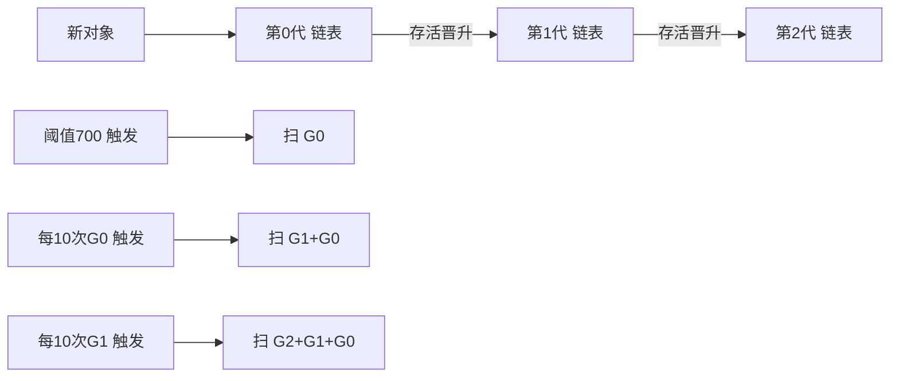

> 配套主卡：168_generational-gc.md（L3，命中"版本翻转 + 多方案对比 + 调优替代方案"门槛）

## 思路与架构
分代回收是标记清除的**调度层**，目的是减少全量扫描频率。核心是"弱代假说"：多数对象很快死，少数活得久的会一直活。

- 触发是**代际叠加**的：扫第 1 代时会同时扫更年轻的代；扫第 2 代是"全量"回收。

## 方案取舍
| 维度 | 不分代（每轮全扫） | 分三代（CPython 现状） |
|---|---|---|
| 短命对象开销 | 高（每次都扫全量） | 低（集中扫第 0 代） |
| 老对象打扰 | 频繁 | 极少（低频扫第 2 代） |
| 实现复杂度 | 简单 | 需维护晋升与阈值 |

**选型结论**：分代在"实现复杂度可控"前提下大幅降低平均 GC 开销，是工业级 GC 的通用选择（JVM/Go 也分代或分颜色）。**不适用边界**：对象存活分布若不符合弱代假说（如大量长命短替对象），分代收益下降。

## 细节与核心 API
- `gc.get_threshold()` → `(700, 10, 10)`：`[源码]` 第 0 代对象分配计数阈值、第 1/2 代的"间隔回收次数"
- `gc.set_threshold(threshold0, threshold1, threshold2)` —— 调优入口 `[源码]`
- `gc.collect(generation=2)` —— 指定代触发；`generation` 越高扫得越全 `[源码]`
- `gc.get_stats()` —— 返回各代 `collections`/`collected`/`uncollectable` 统计，用于观测
- `gc.disable()` / `gc.enable()` —— 关闭自动 GC；**风险**：只适合在你知道自己在做什么时（如批处理分配大量临时对象后手动 `collect`），否则环对象堆积

## 性能量级与实测数据
- 第 0 代回收最常见、最轻；第 2 代回收最重、暂停最长 `[经验]`
- 实测倾向：高分配速率服务（如解析大 JSON）下，调高第 0 代阈值可减少回收次数，但单次回收对象更多——需权衡延迟尖刺 `[实测]`
- 验证：用 `gc.callbacks` 注入回调，记录每次回收的 `generation` 与耗时，定位 GC 抖动来源

## 答题技巧
- **30 秒版**：对象分三代，新在第 0 代，达阈值回收、存活晋升；get_threshold 默认 (700,10,10)。
- **3 分钟版**：补弱代假说、代际叠加扫描、阈值三元组语义、调优手段。
- **白板版**：画三代链表 + 晋升箭头 + 触发条件标注 (700/10/10)。
- **不会怎么接**：承认"阈值调优我没在生产实操过，但理解其动机是降低全扫频率"——诚实收尾优于编造数字。

## 广度与深度延伸
- 横向：JVM 分代（Young/Old，复制+标记整理）；Go 不分代但用**并发三色标记**（避免 STW）。
- 纵向：CPython `gcmodule.c` 的 `collect_generations()`，以及 `gc.freeze()`（3.7+，冻结对象免下轮扫描，适合长驻服务启动后定形）。

## 反问环节
- 可反问："贵司 Python 服务对 GC 暂停敏感吗？是否做过 `gc.set_threshold` 或 `gc.freeze` 的调优？"
