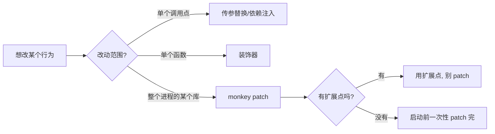

> 本文是 `303-monkey-patch.md` 的深挖附录。命中深挖门槛第 1 条（难度 L3，存在明确权衡与可对比替代方案）+ 第 4 条（原文涉及 gevent 与 mock 多方案，需横向对比）。
> 验证版本：CPython 3.13.12 + gevent 24.x 文档语义。

## 思路与架构

切入路径：**「行为改写的四个时机」**——编译期（改源码）/ 定义期（装饰器）/ 运行期全局（monkey patch）/ 调用期（传参替换）。四者按「改动范围 × 显式程度」排布，monkey patch 的坐标是「范围最大、显式最低」。

**文字版说明**：横轴是改动影响面（小→大），纵轴是显式程度（高→低）。传参替换影响一个调用点且调用方看得见；装饰器包住单个函数定义；monkey patch 动的是模块级属性，进程内所有使用方同时中招。**先用扩展点，没有扩展点才 patch，且要赶在业务启动前**——这是 gevent 的实践，也是一般生产库的共识。

## 方案取舍

| 维度 | monkey patch | mock.patch（测试） | 依赖注入 | 装饰器 |
|---|---|---|---|---|
| 生效范围 | 进程内全局 | 上下文内 | 单个调用链 | 单个函数 |
| 显式程度 | 最低（调用方无感） | 高（with 块可见） | 最高（签名声明） | 中（定义处可见） |
| 还原机制 | 手动，易忘 | 自动 | 不需要 | 不需要 |
| 性能开销 | 替换一次零开销 | with 进出有开销 | 传递成本 | 调用多一跳 |
| 典型场景 | gevent 改标准库、遗留库 | 单元测试替身 | 可测试性设计 | 横切关注点（日志/计时） |
| 主要风险 | 隐式全局污染、并发竞态 | 误用导致测试假绿 | 过度设计 | 掩盖原函数签名 |

**选型结论**：测试替身 → `mock.patch` 上下文；新写代码 → 依赖注入；横切逻辑 → 装饰器；**只在「库没有注入点 + 必须改全局行为」时用 monkey patch**（gevent 是教科书案例）。

**不适用边界**：patch 不能解决「逻辑本身写错」；不能跨进程生效（多进程模型每个 worker 都要 patch）；不能替代接口设计——该抽象的时候抽象，patch 是补丁不是架构。

## 细节与核心 API

- `sys.modules[name]`：模块注册表，patch 的落点就是这里的模块对象；同名 import 全局共享同一对象，这是 patch 全局生效的根因。
- `unittest.mock.patch(target, new)`：字符串 target 延迟解析，进上下文替换、出上下文还原；`patch.object(obj, "attr")` 直接对对象下手。
- `gevent.monkey.patch_all()`：一次性 patch socket/select/threading/os 等；**必须在 import 任何会用到这些模块的业务代码之前调用**，否则部分代码走阻塞路径、部分走协程路径，行为割裂。
- `importlib.reload(module)`：重新执行模块代码——注意它**不会**还原被 patch 的属性，常被误当作还原手段。
- `types.MethodType`：把函数绑成实例方法的正式途径；patch 实例方法时 `obj.m = types.MethodType(f, obj)` 比裸赋值更稳（自带 self 绑定语义）。

## 性能量级与实测数据

- **patch 本身**：属性赋值是 O(1) 字典操作，替换一次后调用方零额外开销 `[实测]`（CPython 3.13.12，`time.time = f` 纳秒级）。
- **`mock.patch` 上下文**：进出各有一次 patch/unpatch + 参数解析，单次约微秒级；对测试用例可忽略，**热路径里用 mock 是设计错误** `[经验]`。
- **gevent patch 的收益**：把阻塞 IO 换成协程调度后，IO 密集场景单机连接数从「千级线程」到「十万级协程」——数量级收益来自调度模型，不是 patch 本身 `[源码]`（gevent 文档的 benchmark 一节）。

## 答题技巧

- **30 秒版**：定义（运行期属性替换）+ 一个场景（gevent/mock）+ 一句代价（全局隐式）——三件套齐全即可收。
- **3 分钟版**：补机制（模块单例 + 运行期查找）、边界（实例 vs 类属性）、替代（mock.patch 上下文自动还原）。
- **白板版**：画四象限（范围 × 显式程度），把 patch 钉在「范围最大、显式最低」的角上，替代方案逐个点名。
- **不会怎么接**：如果被追问到没踩过的坑（如 gevent 与 requests 的兼容性），诚实说「只在 gevent 场景用过 patch_all，业务代码里我用 mock.patch 做测试替身」——**把话题迁到自己真有经验的地带**，别硬编。

## 广度与深度延伸

- **横向**：Ruby 的 `refine` / `prepend` 是有作用域的 monkey patch；Java 的 `Instrumentation` API 是 JVM 层字节码改写；JS 的 `Object.prototype` 污染是同款反模式的经典事故（Prototype Pollution）。
- **纵向**：CPython 的属性查找走 `type->mro` 与实例 `__dict__` 两级，patch 类属性动的是前者；`__slots__` 类没有实例 `__dict__`，patch 实例属性直接 `AttributeError`——这是「实例 patch 失效」的根因。

## 反问环节

- 「咱们团队的测试替身有统一规范吗？还是各写各的？」
- 「如果服务里有用 gevent，patch 的时机有约定在哪个入口做吗？」——面试官若是基础架构方向，这题能探出他们的工程化水位。
