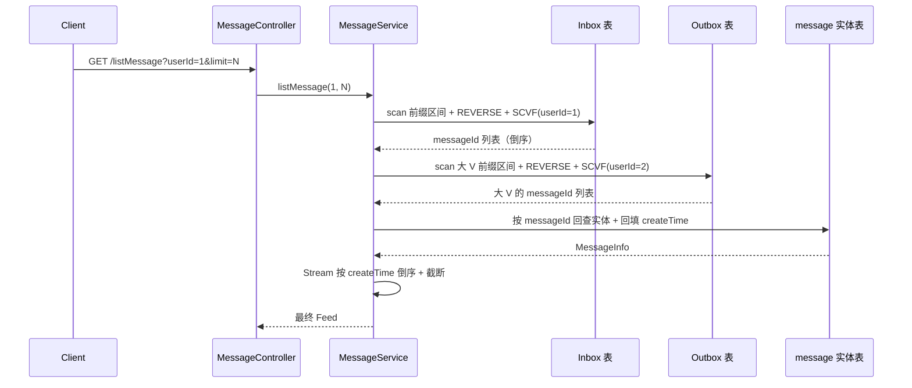

## 纲要

- `listMessage(userId,limit)` 是读取侧的统一入口，内部走"收件箱一路 + 大 V 发件箱一路"
- 收件箱扫描：用散列段前缀构造 `STARTROW`/`STOPROW`，`setReversed(true)` 倒序，`setLimit` 分页
- 安全过滤：`SingleColumnValueFilter` 按 `userId` 精确过滤，兜住 MD5 截断冲突
- 取回的是 messageID，再用消息服务回查 `message` 实体并回填 `createTime`
- 大 V 一路：直接扫描大 V 的 Outbox（本例以 userId=2 为大 V 示例）
- 两路合并后用 Java 8 Stream 按 `createTime` 倒序排序，超过 `limit` 则 `subList` 截断
- Controller 层用 `GET /message/listMessage` 暴露

## 📎 代码说明

本讲代码以**内联片段**形式呈现在正文中。课程课件仅发布第 2/3/4 章（MySQL 核心能力）的完整工程源码，本讲所属章节未随课件发布独立源码文件，故不做外部文件关联，请以正文片段为准。

## 接口定义

先定义服务接口，把"推拉混合读取"收敛成一个方法：

```java
public interface MessageService {
    /**
     * 拉取某用户的 Feed 流（推拉混合）
     *
     * @param userId 拉取者用户 ID
     * @param limit  每页条数
     * @return 合并排序后的消息列表
     */
    List<MessageInfo> listMessage(String userId, Integer limit);
}
```

## 第一路：扫描自己的收件箱

收件箱扫描的核心是：用 `userId` 的 MD5 散列段（前面生成器截取前四位）构造区间，开启反向扫描拿倒序，再用 `SingleColumnValueFilter` 按 `userId` 精确过滤。

```java
@Override
public List<MessageInfo> listMessage(String userId, Integer limit) {
    List<MessageInfo> result = new ArrayList<>();

    // ===== 路一：收件箱 =====
    Table inboxTable = hbaseConnection.getTable(TableName.valueOf("inbox"));
    Scan scanInbox = new Scan();
    // 反向扫描下 STARTROW/STOPROW 角色互换：哨兵放 start（上界）、前缀放 stop（下界）
    scanInbox.withStartRow(Bytes.toBytes(boxService.md5Prefix(userId) + "~"));
    scanInbox.withStopRow(Bytes.toBytes(boxService.md5Prefix(userId)));
    scanInbox.setReversed(true);          // 时间倒序
    scanInbox.setLimit(limit);            // 每路只召回一页

    // 按 userId 精确过滤，防 MD5 截断冲突读到他人数据
    SingleColumnValueFilter inboxFilter = new SingleColumnValueFilter(
            Bytes.toBytes("base"),
            Bytes.toBytes("userId"),
            CompareFilter.CompareOp.EQUAL,
            Bytes.toBytes(userId));
    scanInbox.setFilter(inboxFilter);

    try (ResultScanner scanner = inboxTable.getScanner(scanInbox)) {
        for (Result r : scanner) {
            if (r.getRow() == null) {
                continue; // 防御性编程
            }
            // 取回的是 messageId，再去 message 实体表回查
            String messageId = Bytes.toString(
                    r.getValue(Bytes.toBytes("base"), Bytes.toBytes("messageId")));
            MessageInfo info = messageService.get(messageId);
            // 回填 createTime：来自收件箱行内的 base:createTime（yyyyMMddHHmmss）
            String createTimeStr = Bytes.toString(
                    r.getValue(Bytes.toBytes("base"), Bytes.toBytes("createTime")));
            info.setCreateTime(new SimpleDateFormat("yyyyMMddHHmmss").parse(createTimeStr));
            result.add(info);
        }
    }
    // ... 路二见下文
}
```

几个必须注意的点：

- `result.getRow() == null` 的防御，避免空行进入后续逻辑；
- 收件箱 / 发件箱里**只存 messageID**，所以一定要用 `messageService.get(messageId)` 回查实体；
- `createTime` 必须从行内的 `base:createTime` 回填，且格式与写入时一致（`yyyyMMddHHmmss`），否则排序口径会错。

## 第二路：扫描大 V 的发件箱

大 V 在发布时被短路、没写进收件箱，因此这一路直接去查大 V 的 Outbox。示例中以 userId=2 作为大 V：

```java
    // ===== 路二：大 V 的发件箱（本例大 V 固定为 userId = 2）=====
    Table outboxTable = hbaseConnection.getTable(TableName.valueOf("outbox"));
    Scan scanOutbox = new Scan();
    String bigV = "2";
    scanOutbox.withStartRow(Bytes.toBytes(boxService.md5Prefix(bigV) + "~"));
    scanOutbox.withStopRow(Bytes.toBytes(boxService.md5Prefix(bigV)));
    scanOutbox.setReversed(true);
    scanOutbox.setLimit(limit);

    SingleColumnValueFilter outboxFilter = new SingleColumnValueFilter(
            Bytes.toBytes("base"),
            Bytes.toBytes("userId"),
            CompareFilter.CompareOp.EQUAL,
            Bytes.toBytes(bigV));
    scanOutbox.setFilter(outboxFilter);

    try (ResultScanner scanner = outboxTable.getScanner(scanOutbox)) {
        for (Result r : scanner) {
            if (r.getRow() == null) {
                continue;
            }
            String messageId = Bytes.toString(
                    r.getValue(Bytes.toBytes("base"), Bytes.toBytes("messageId")));
            MessageInfo info = messageService.get(messageId);
            String createTimeStr = Bytes.toString(
                    r.getValue(Bytes.toBytes("base"), Bytes.toBytes("createTime")));
            info.setCreateTime(new SimpleDateFormat("yyyyMMddHHmmss").parse(createTimeStr));
            result.add(info);
        }
    }
```

## 合并、排序与截断

两路结果都已进入同一个 `result` 列表，接下来用 Stream 按 `createTime` 倒序排，再截断到 `limit`：

```java
    // 两路合并后，按 createTime 倒序（乘 -1 实现降序）
    result = result.stream()
            .sorted((o1, o2) -> -o1.getCreateTime().compareTo(o2.getCreateTime()))
            .collect(Collectors.toList());

    // 数据量最多 2 倍 limit，超过则截断
    if (result.size() >= limit) {
        return result.subList(0, limit);
    }
    return result;
}
```

截断是必要的：两路各自最多召回 `limit` 条，合并后最多 `2 * limit` 条，必须裁回 `limit`；若不足则直接返回。

## Controller 暴露

最后用 Spring MVC 把服务包成 HTTP 接口：

```java
@RestController
@RequestMapping("/message")
public class MessageController {

    @Autowired
    private MessageService messageService;

    @RequestMapping(value = "/listMessage", method = RequestMethod.GET)
    @ResponseBody
    public List<MessageInfo> listMessage(
            @RequestParam("userId") String userId,
            @RequestParam(value = "limit", defaultValue = "10") Integer limit) {
        return messageService.listMessage(userId, limit);
    }
}
```

本地验证：访问 `localhost:9090/message/listMessage?userId=1&limit=1`，应当看到大 V（userId=2）最新发出的内容；`limit=2`、`limit=3` 时时间应保持递减；当数据不足四条时，接口永远只返回实际存在的条数。

## 读路径完整链路



## API 速览

| API | 说明 |
| --- | --- |
| `Scan.withStartRow / withStopRow` | 用散列段前缀收窄区间，命中单 Region |
| `Scan.setReversed(true)` | 反向扫描，实现时间倒序 |
| `Scan.setLimit(int)` | 每路只召回一页 |
| `SingleColumnValueFilter(family,qualifier,EQUAL,value)` | 按列值精确过滤，防哈希冲突 |
| `Table.getScanner(Scan)` | 执行扫描，返回 `ResultScanner`（需关闭） |
| `Result.getValue(family,qualifier)` | 取单元格值，通常为 messageId / createTime |
| `Collectors / subList` | 合并排序后截断到 `limit` |
