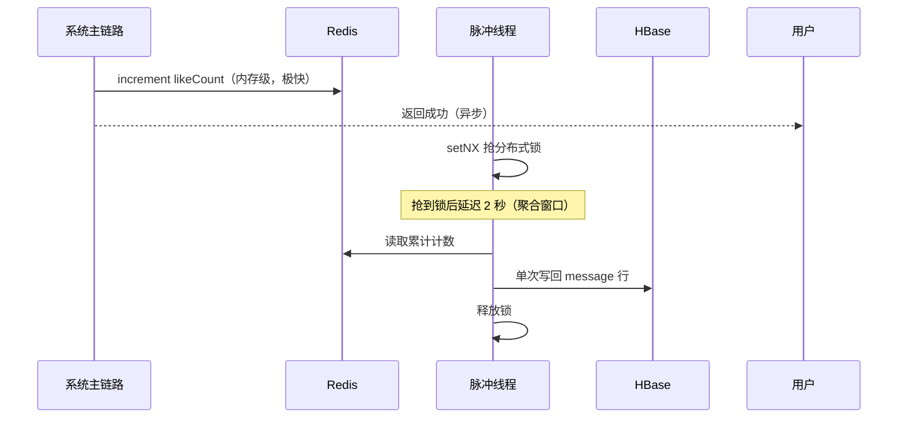

## 纲要

- 传统两步走：MongoDB 写明细 + HBase `increment` 计数，两步性能损耗本质不同
- `insert` 是追加写，互不干扰可并行；HBase `increment` 同一 `messageId` 是行级原子操作，必须串行 → 行锁热点
- 思路转折：计数不必实时写 HBase，先写 Redis（内存级、极快、无行锁竞争），再延迟批量回写
- 脉冲：另起异步线程，靠 setNX 分布式锁串行化回写，且拿到锁后延迟约 2 秒聚合
- 效果：把高频计数写压成低频单线程写，行锁冲突被打散，整体呈"脉冲式"请求

## 📎 代码说明

本讲为**原理 / 架构 / 选型**篇，正文以图示与推演为主，无配套代码片段，课程课件亦未提供本章源码文件。

## 传统两步走的问题

点赞评论的明细落在 MongoDB，但卡片上要回显的总数存在 HBase 的 `message` 行。因此每次点赞，链路分两步：

第一步往 MongoDB `insert` 一条点赞明细；第二步到 HBase 对 `message` 行的 `likeCount` 做 `increment`。

## insert 与 increment 的本质差异

这两步的性能损耗根本不是一回事：

- **`insert` 是追加写**：同一时刻来一百个用户点赞，就产生一百条新数据，彼此之间互不影响，写入完全可以并行，不会竞争锁。
- **`increment` 是行级原子操作**：HBase 的 `increment` 会作用在**同一个 `messageId`** 上。它必须先在该行上串行完成一次相加的原子操作，才能进行下一次相加。热门内容一旦高并发点赞，所有 `increment` 都撞在同一行，形成**行锁热点**，请求排队等待，系统响应被拖慢。

如果 HBase 单点极限是每秒写入约一千次（约 1 毫秒一次），高并发并行下这层就会成为瓶颈。

## 引入 Redis 承接计数

解决热点的关键是把"计数"和"明细"分开处理。明细照常写 MongoDB，计数则先写到 Redis：

Redis 的 `increment` 同样是单线程执行，但它是内存级数据库，性能开销极低，几乎不存在锁等待。系统做完 Redis 自增即可返回"点赞成功"，甚至这一步也能异步化。

但问题来了：Redis 里的计数最终还是要落到 HBase 的 `message` 行，否则卡片读不到总数。能不能直接同步写回 HBase？可以，但那样只是把热点从请求主链路挪到了别处，没有真正削峰。

## 脉冲 延迟聚合 + 分布式锁

更好的做法是"脉冲"：每隔一两秒，由一个异步线程把 Redis 的累计计数同步回 HBase。

所谓"脉冲"，是另起一个异步线程（系统二），它先去抢**分布式锁（setNX）**——只有抢到锁的线程才有资格把 Redis 数据同步回 HBase。由于是分布式锁，同一时刻只有一个线程能在写 HBase，HBase 的写入退化成**单线程**，行锁热点自然消失。

## 为什么要有延迟

抢到锁后**不立即写**，而是先延迟约 2 秒，这是整个方案的核心。

延迟的目的，是开一个"时间窗口"做聚合：在这 2 秒内产生的多次自增，先都在 Redis 里聚成一个最终值，再一次性写回 HBase。于是 HBase 在 2 秒窗口内只收到一次写请求，且由唯一线程执行。

批处理不一定是把所有变更 `select` 出来再 `update`，也可以是一个时间窗口——把窗口内的增量结果同步落库即可。最终在系统 QPS 视角里，对 HBase 的写请求被压成每隔 2 秒才出现一次，看上去就像一串"脉冲式"的响应。

## 效果

这套方案同时解决了两件事：

| 手段 | 解决的问题 |
| --- | --- |
| Redis 内存级自增 | 承接高并发计数，无锁竞争，主链路极快返回 |
| setNX 分布式锁 | 串行化回写，全局只有一个线程写 HBase |
| 延迟时间窗口 | 把多次自增聚成一次 HBase 写，消除行锁热点 |

延迟时长不是固定的——可按实际行锁压力调小到毫秒级，目标始终是平滑掉 HBase 的行锁热点。

## 小结

- 传统 `insert + increment` 链路中，HBase `increment` 的行级原子性制造了行锁热点；
- 把计数先写 Redis（快、无锁竞争），再异步回写，可以解耦主链路；
- 脉冲方案用 setNX 锁串行化回写、用延迟窗口聚合计数，把高频写压成低频单线程写；
- "上篇"讲清了为什么这么做，"下篇"给出 Redis 累加与延迟写回的代码实现。
